# 45 · 셀카 모션으로 진짜 셀카 찍기

브랜치 `step/45-selfie-motion` · 커밋 `[45-A] 셀카 모션 변환`, `[45-B] 손이 폰이 되는 셀카`

## 바뀐 파일

| 파일 | 내용 |
| --- | --- |
| `motions/xstage_take_selfie.json` | (A) 새 모션 변환 결과 244KB(뼈 20개, 30fps, 16.28초, 빠진 뼈 없음) |
| `data/motions.json` | (A) **x25 셀카 자세**(`only: selfie`) 이름·XSTAGE(0.05~14.6초 전체), **m14 셀카 찍기**의 진짜 모션(0.9~3.6초, `motionVer` 2), 설명 |
| `data/collection.json` | (A) `card.momentById.g07` 60, 설명 |
| `data/config.json` | (A) `camera.byMotion.m14` = `waveHigh`(폰을 든 손이 머리 위 앞으로 올라가 3D 칸 위에서 잘려서), 설명 |
| `docs/CREDITS.md` | (A) 셀카 모션 한 줄 |
| `index.html` | (B) `Stage.handPose(side)`(손목·가운뎃손가락 뿌리·두 눈 사이 자리), `Stage.hideBones(names)`(뼈 숨기기·되돌리기) |
| `seoaphoto.js` | (B) 셀카를 찍을 때 셀카 모션(x25)을 받아 그 한 순간으로 자세를 멈추고 카메라를 폰을 든 손에 붙임(`setHandCam`). 종류 고르기 `pickSelfie` 가 손 셀카(`types`)·32-B 셀카(`armTypes`)를 나눔. 모션을 못 받으면 32-B 그대로. 사진을 그리는 동안만 렌즈 화각·가까운 경계(`near`)를 바꾸고 끝나면 되돌림 |
| `data/seoa_photo.json` | (B) `kinds.selfie.hand`(기본값), 새 `types` 3종(높이·가까이·옆에서), 예전 `types` → `armTypes`, `_selfie` 설명 |
| `docs/reports/img/45/` | 캡처 |

`_src/standard_Take_Selfie.fbx` 는 이름 그대로 복사만 함(`.gitignore`, 저장소에 없음).

## A · 셀카 모션 변환과 연결

원본 「[standard] Take Selfie」(16.3초, 배우가 정면, 오른손에 폰):

| 원본 시각 | 동작 |
| --- | --- |
| 1.3~3.3초 | 오른손을 앞 위로 높이 들어 폰을 내려다봄 |
| 3.7~6.1초 | 폰을 든 채 몸을 오른쪽 앞으로 숙여 기울임 |
| 6.9~10.1초 | 폰을 얼굴 앞 가까이(서아의 왼쪽 앞) |
| 10.9~13.3초 | 다시 오른쪽 위로 들고 몸을 기울임, 왼손은 옆으로 내밀어 포즈 |
| 13.7~14.5초 | 내림 |

정면(0.4초 간격) / 옆(70°)
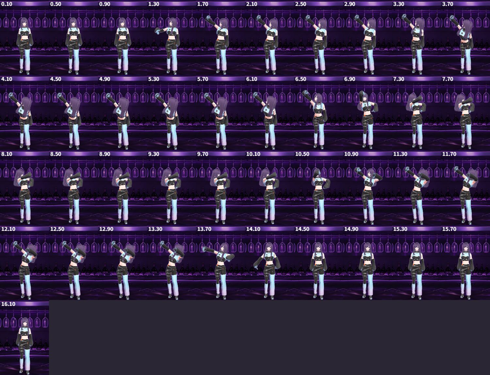
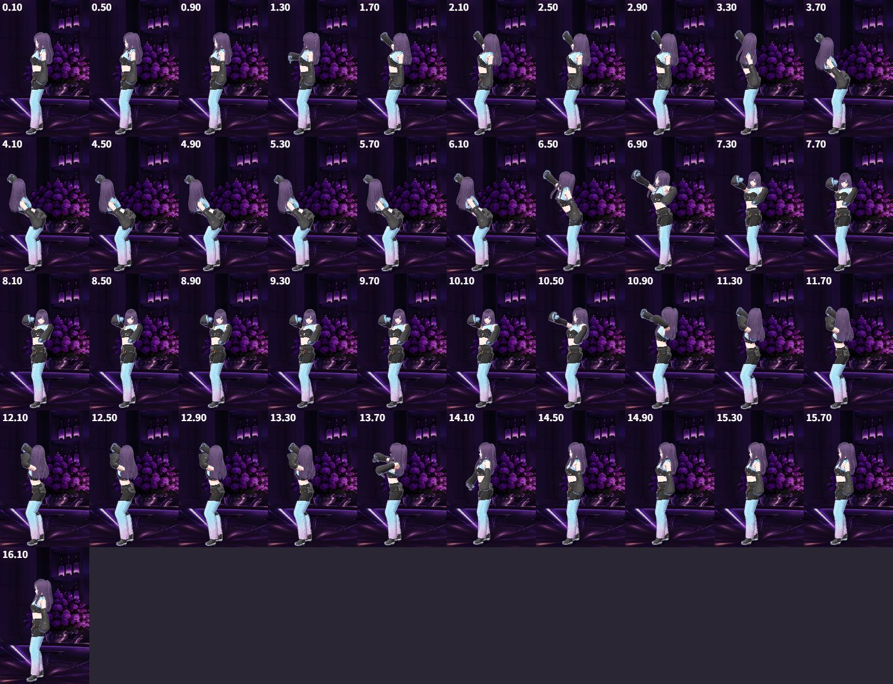

- **x25 셀카 자세**(`only: selfie`): 파일 전체(0.05~14.6초). 재생하지 않고 서아가 보내는 셀카의 자세로만 씀. `only` 라서 대화 몸짓 목록·서버에 보내는 목록·키워드·컬렉션에 안 나옴(`node tools/build_collection.mjs` → 45칸 그대로). 시연 패널 몸짓 목록에는 미리보기로 나옴(XSTAGE 모션 전체가 나오는 기존 규칙).
- **m14 셀카 찍기** = 선물 반응 g07 「같이 셀카 찍기」의 진짜 모션: 0.9~3.6초(2.7초) — 폰을 든 손을 앞 위로 올려 내려다보며 포즈, 끝 섞기 0.7초로 내림. 처음 섞기 0.4초. m14 는 `data/seoa_story.json ban` 그대로(서아 대화 몸짓에 안 나옴).
- **g07 카드 그림:** m14 `motionVer` 2(예전 코드 몸짓 = 1) → 43 방식대로 앱을 열 때 예전 g07 카드 그림만 다시 만듦. 카드 그림 순간 `momentById.g07` 60%(폰을 높이 들고 렌즈를 보는 때).
- **구도:** 대화 무대에서 m14 가 커진 3D 칸으로 재생될 때 손이 칸 위에서 잘려 `camera.byMotion.m14 = waveHigh`(43 의 x23 과 같은 구도).

**선물 g07 시연 패널로 뽑기**(`S.giftNext = {item:"g07"}` → 커피 주기, 390px): 0.7초 뒤 재생 시작 → 폰을 들고 포즈 → 3.7초쯤 내림. 새로 얻은 카드 기록 `mv: 2`, 카드 그림 바로 만들어짐(오른쪽 끝).

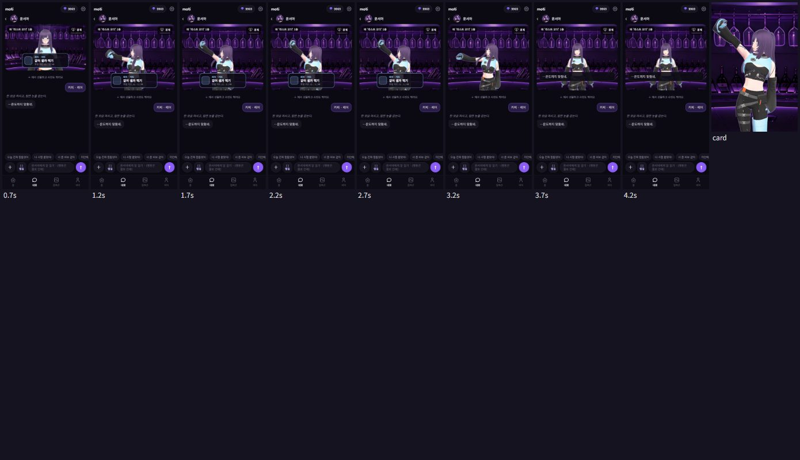

| 재생 중(2.2초) | 새 카드 그림 |
| --- | --- |
| 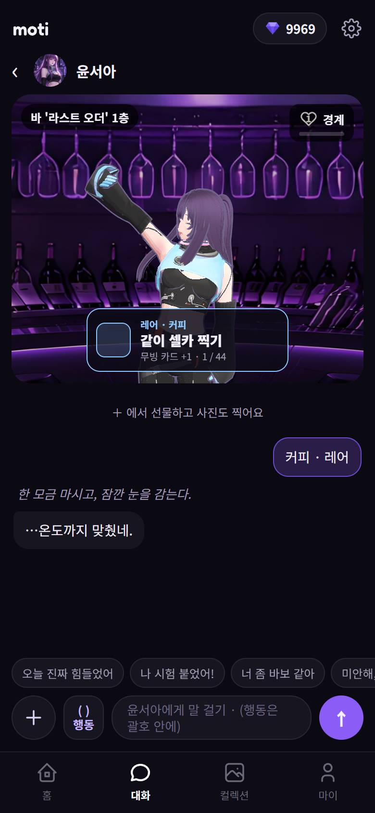 | 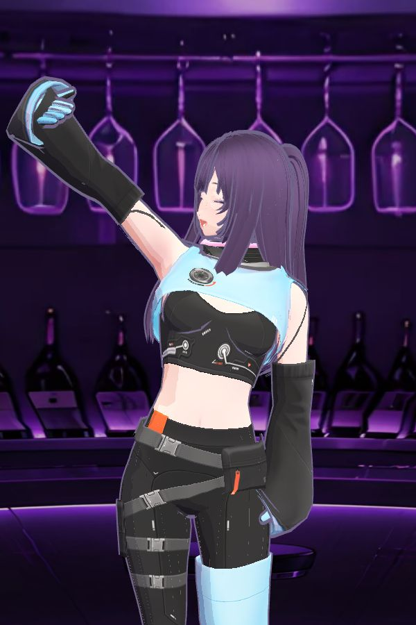 |

## B · 손이 폰이 되는 셀카

서아가 보내는 셀카(단계 사진·대화 중 가끔·부재중·시연 「지금 받기」, 모두 `SeoaPhoto.make` 하나)를 찍을 때:

1. 셀카 모션(x25)을 받아 둠. 못 받으면 아래를 건너뛰고 32-B 셀카(팔 뻗기)로.
2. 셀카 종류(`types`)를 하나 뽑음. 직전 셀카와 같은 종류는 피함(32-B 규칙 그대로, `S.sp.lastSelfie`).
3. 그 종류의 모션 시각(`at`, 범위 안 무작위)으로 서아 자세를 멈춤(`Stage.still`).
4. **카메라 = 폰:** 오른손 손목에서 손끝 쪽(`along`)·얼굴 쪽(`out`)으로 조금 띄운 자리에 두고, 그 자리에서 카메라 기준 팔 반대쪽·위로 조금 옮김(`shift` — 폰 렌즈는 손목보다 폰 윗끝에 있으니, 뻗은 팔이 사진 아래 옆 모서리로 빠지게). 서아 얼굴(두 눈 사이)보다 조금 아래(`look`)를 봄. 사진 기울기 `roll`. 폰 모델은 없음.
5. 시선은 32 의 `lens` 처럼 목·머리·눈을 카메라 쪽으로(종류마다 바꿀 수 있음).
6. 가리는 뼈가 있으면 숨김(`hide`, 지금은 비어 있음).

**셀카 종류**(`data/seoa_photo.json kinds.selfie.types`, 기본값은 `hand`):

| id | 이름(확인용) | 모션 시각 at | 화각 fov | 기울기 roll | 그 밖 |
| --- | --- | --- | --- | --- | --- |
| `high` | 폰을 높이 들어 내려다보기 | 2.2~3.2초 | 72° | 2~5° | 카메라가 얼굴보다 약 25~30° 위 |
| `close` | 얼굴 가까이 | 7.8~9.6초 | 68° | 1~3° | 얼굴 앞 거의 같은 높이, 가장 가까움 |
| `side` | 살짝 옆에서 | 11.8~13.0초 | 64° | 2~5° | `shift` [0.03, 0.04], 머리는 덜 돌림(`lens.head` 0.3, 눈만 렌즈) → 얼굴이 살짝 옆을 봄, 왼손 포즈가 오른쪽 끝에 |

공통(`hand`): `side` R, `along` 0.04, `out` 0.02, `shift` [0.06, 0.03], `look` 0.02(키 비율), `near` 0.01m, `hide` [].

### 셀카 12장 모음 (장소 × 의상, 390px 앱에서 `SeoaPhoto.make`)

전(32-B 팔 뻗기) / 후(45 손이 폰) 를 번갈아 — 같은 칸 번호는 같은 장소·의상:

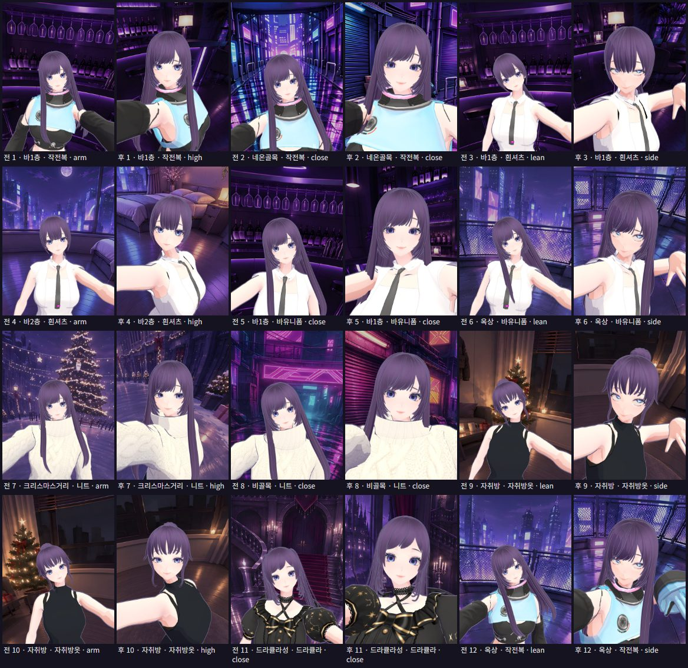

| 전 (32-B, 이번에 같은 장소·의상으로 다시 찍음) | 후 (45) |
| --- | --- |
| 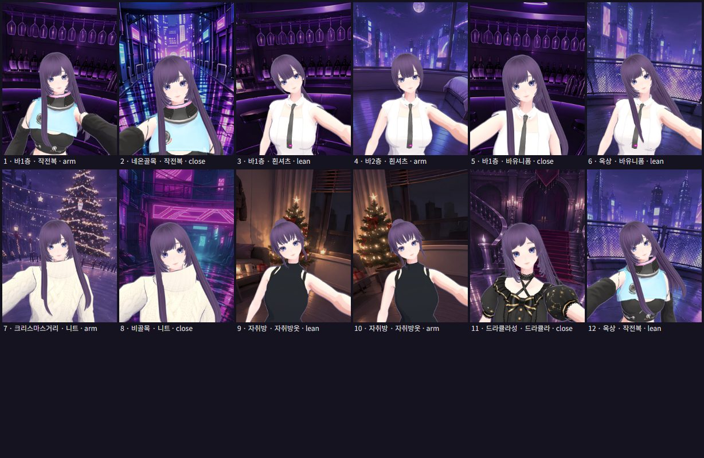 | 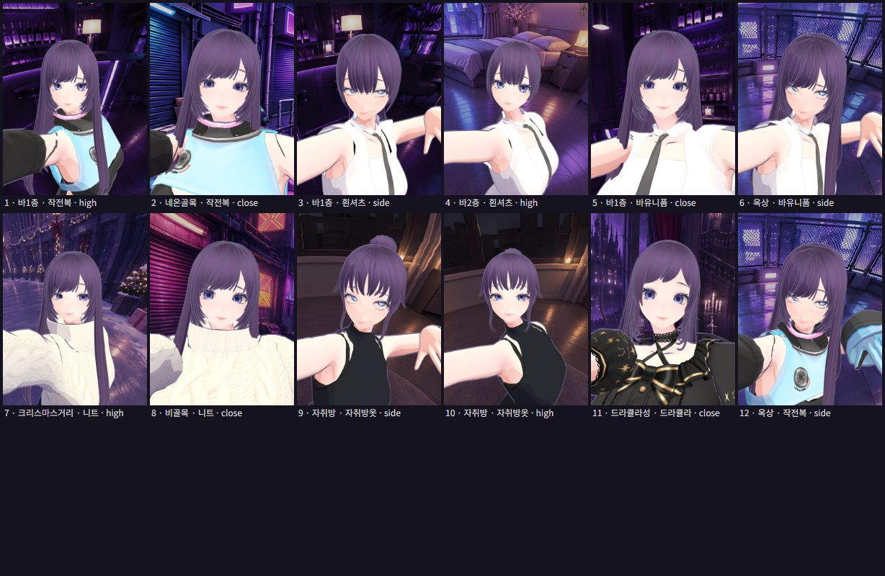 |

32 보고서의 예전 모음: 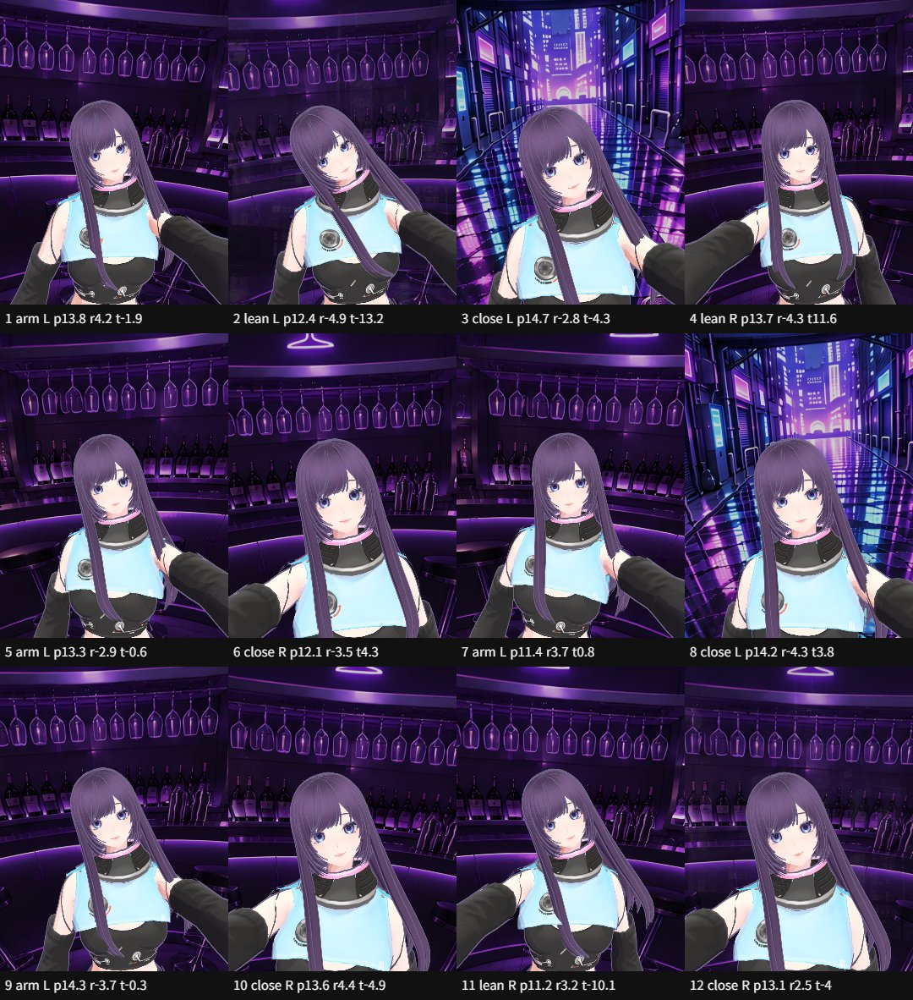

크게(후 2 · 후 4 · 후 12):

| close · 작전복 · 네온 골목 | high · 흰 셔츠 · 바 2층 | side · 작전복 · 옥상 |
| --- | --- | --- |
| 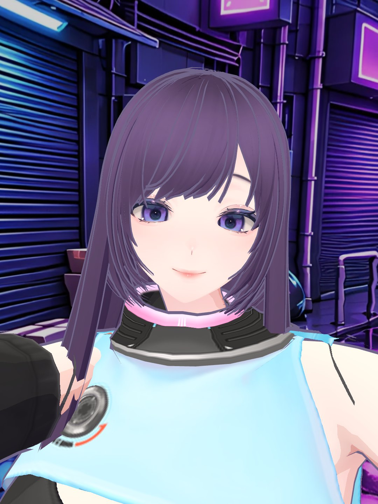 | 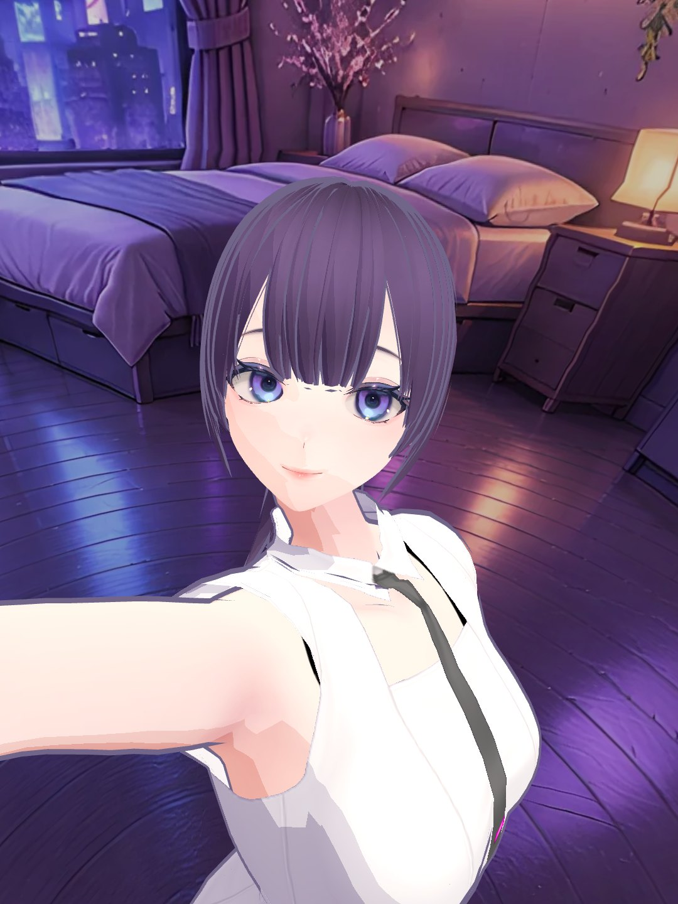 | 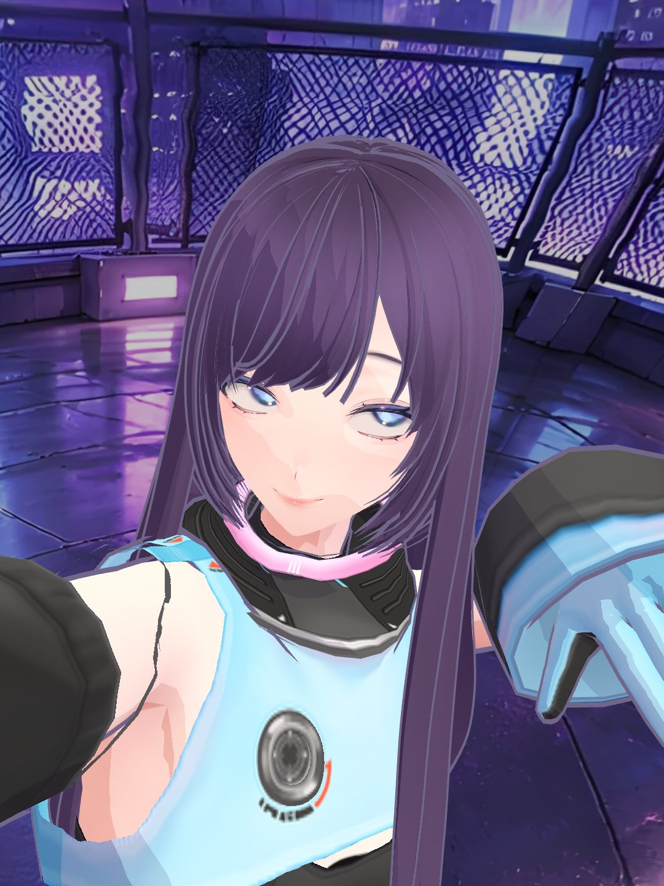 |

**본 것:**
- 얼굴이 잘린 사진 없음(정수리까지 들어옴), 시선은 12장 모두 렌즈.
- 뻗은 팔(소매)은 사진 왼쪽 아래 모서리로 빠짐. 작전복·니트·드라큘라의 넓은 소매가 왼쪽 아래 1/5 쯤을 차지하지만 얼굴·가슴 위는 가리지 않음.
- `side` 는 원본 모션의 왼손 포즈(손을 옆으로 내밂)가 사진 오른쪽 끝에 들어옴. 손가락 뼈는 모션에 없어 손이 편 채로 보임(아래 「제가 정한 것」).

### 고치며 바꾼 값

| 시도 | 본 것 | 바꾼 것 |
| --- | --- | --- |
| 처음(화각 60~64°, 옮김 없음) | 얼굴이 너무 가까워 정수리가 잘리고, 뻗은 팔이 가슴 앞을 가로질러 큰 덩어리로 보임 | 화각 68~72°, `shift` [0.06, 0.03](렌즈를 팔 반대쪽·위로) → 팔이 왼쪽 모서리로 빠짐 |
| `side` 를 몸을 숙인 구간(4.3~5.7초)으로 | 화각 72° 에서 무릎·발까지 보이고, 60° 로 좁히면 왼팔이 렌즈 바로 앞을 덮음 | 10.9~13.3초 구간(다시 높이 들고 기울임)으로 |

몸을 숙인 구간을 60° 로 찍었을 때(버림):
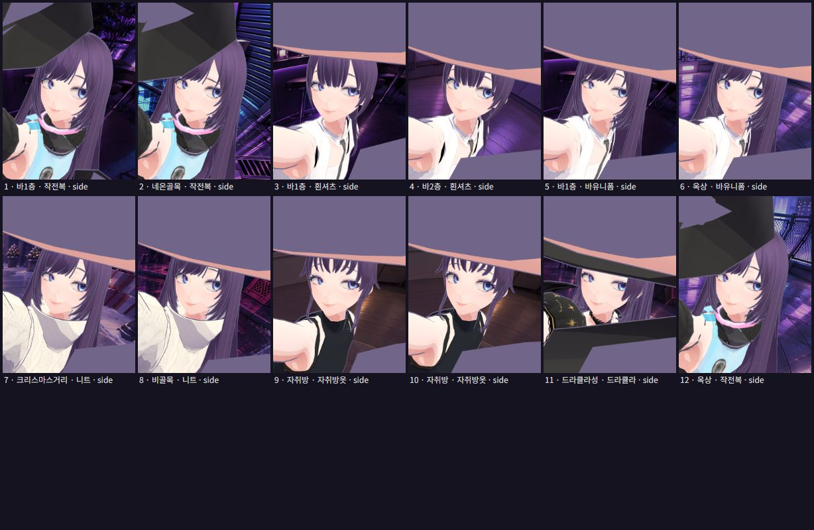

손 카메라를 처음 붙여 본 것(0.4초 간격, 화각 60°, 렌즈를 보게 돌림):
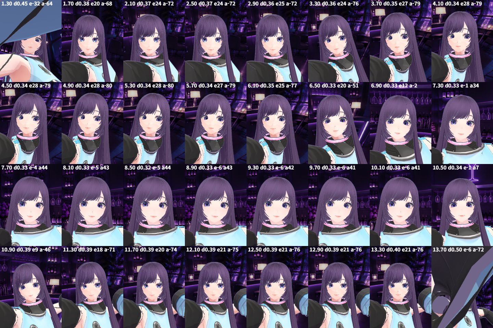

### 그 밖의 확인

| 확인 | 결과 |
| --- | --- |
| **32-A 확대 직후 셀카:** 대화 무대에서 m01 확대 0.25초 뒤 「서아 사진 지금 받기」 → 사진이 옴 | 사진 `high` 손 셀카(x25 2.8초). 매 프레임 감시(빌려 쓰지 않을 때 카메라 비율 ≠ 그림판 비율, 켜진 시야 자르기, near ≠ 0.1, 카메라 위 방향이 틀어짐) **0프레임**. 끝난 뒤 1.743 / 1.743, near 0.1, fov 30 |
| 이어서 한 장 더 | `side`(직전 `high` 와 다른 종류) |
| **모션 파일을 못 받으면:** `xstage_take_selfie.json` 요청을 막고 3장 | 3장 모두 32-B 셀카(`lean`·`close`·`lean`, 몸 m25), 오류 없음 |
| 데이터 JSON | `data/*.json` 모두 읽힘, 콘솔 오류·예외 없음(three.js 의 `morphNormals` 경고는 예전부터) |
| 사진 만드는 시간(헤드리스 소프트웨어 그리기) | 그리기 0.3~0.66초, 32-B 와 같은 정도 |

| 확대 중 「보내는 중」 | 사진이 온 뒤 | 다음 셀카 | 모션을 못 받았을 때(32-B) |
| --- | --- | --- | --- |
| 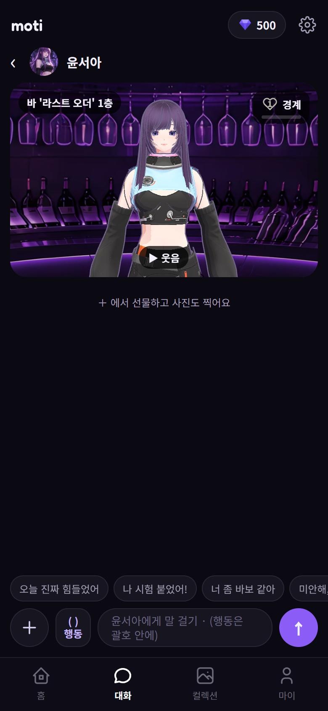 | 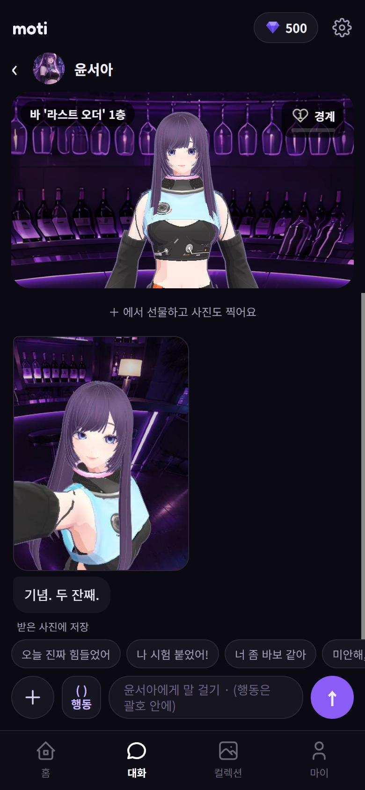 | 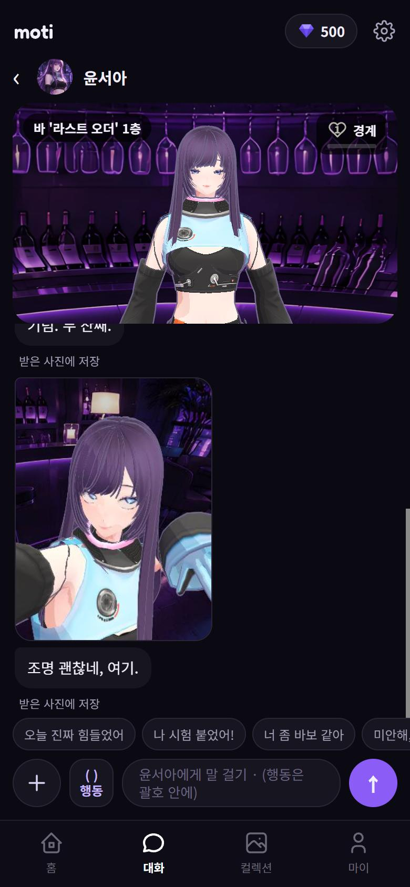 | 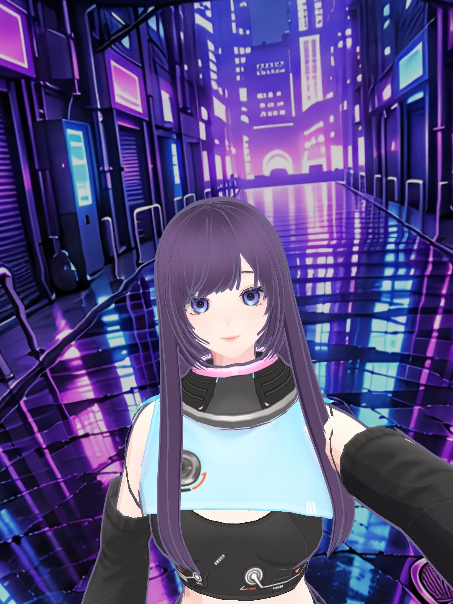 |

## 제가 정한 것

- **새 번호:** 셀카 자세 = **x25**(x24 다음), 감정 「기쁨」(`only` 라 쓰이지 않음).
- **x25 구간:** 파일 전체(0.05~14.6초, 내린 뒤 서 있는 끝은 뺌). 셀카 종류의 `at` 은 **원본 파일 시각(초)** 으로 적고 코드가 재생 시각으로 바꿈(구간을 나중에 바꿔도 `at` 이 그대로 맞게).
- **m14 구간 0.9~3.6초:** 지시문 「폰을 들고 포즈를 잡는 핵심 2~4초」 중 손을 들어 올려 높이 든 채 포즈까지. 그 뒤(3.7초~)는 몸을 숙이는 다음 동작이라 끝 섞기로 내림. m14 3D 칸 구도는 x23 과 같은 `waveHigh`.
- **g07 카드 순간 60%:** 폰을 다 들고 렌즈를 보는 때(후보를 따로 견주지 않고 재생 캡처에서 고름).
- **폰을 든 손:** 원본대로 오른손 하나(`hand.side` R). 32-B 처럼 좌우를 무작위로 바꾸지 않음(모션이 오른손이라).
- **「렌즈 각도」:** 렌즈 화각 `fov`(종류마다)로 읽음. 카메라가 보는 방향은 손 자리 → 얼굴로 정해지고, 렌즈를 보는 시선 몫은 `lens`(종류마다 덮어쓸 수 있음, `side` 만 머리를 덜 돌림).
- **거리 단위:** `along`·`out`·`up`·`shift`·`look`·`minDist` 는 이 파일의 다른 값처럼 **키 비율**(서아 키 약 1.53m 기준 0.04 ≈ 6cm). `near` 만 m.
- **`shift`(렌즈를 팔 반대쪽·위로 옮기기):** 지시문에 없는 값. 손목에 렌즈를 그대로 두면 팔이 렌즈를 향해 곧장 들어와 가슴 앞을 가로질러서, 폰 윗끝에 렌즈가 있다고 보고 옮김. 팔이 사진 왼쪽 아래 모서리로 빠짐.
- **`look` 0.02:** 얼굴 가운데보다 조금 아래를 봐서 얼굴이 사진 위쪽에 오게.
- **`near` 0.01m:** 렌즈가 손 바로 앞이라 기본 0.1m 면 손·소매가 잘린 단면으로 보일 수 있어서, 이 사진을 그리는 동안만. 그린 뒤 원래대로(확인함).
- **뼈 숨기기(`hide`):** 만들어 두었지만 지금 값은 비움. 12장에서 손·소매가 얼굴을 가린 사진이 없었고, 손을 숨기면 손목이 잘린 모양이 돼서.
- **`side` 의 왼손:** 원본 모션의 포즈(왼손을 옆으로 내밂)가 오른쪽 끝에 보임. 숨기면 팔이 잘려 보이고, 다른 구간(몸을 숙인 구간)은 왼팔이 렌즈를 덮거나 다리가 보여서 이 구간으로 둠. 손가락 뼈는 변환 범위(뼈 20개) 밖이라 손이 편 채.
- **셀카 몸 자세:** 32-B 의 `mids`(m25)·`avoid`·`arm` 등은 손 셀카에서 쓰지 않음(32-B 로 찍을 때만). 표정 후보(`faces`)는 그대로.
- **32-B 셀카 종류:** 지우지 않고 `armTypes` 로 이름만 바꿈(모션을 못 받았을 때). 「직전과 같은 종류 피하기」는 두 목록이 같은 저장값을 씀.
- **x25 미리 받기:** 따로 미리 받기 목록에 넣지 않음(쉬는 틈에 받는 기존 순서). 사진을 만들 때 아직 없으면 그때 받고, 받는 동안 「보내는 중」이 조금 길어질 수 있음.
- **캡처:** 31~44 와 같이 저장소를 잠깐 띄워 헤드리스 Chrome 390px(픽셀 비율 2). 「전」 모음은 B 를 넣기 전 같은 브랜치에서 같은 장소·의상으로 다시 찍음. 확인 스크립트는 저장소 밖 임시 폴더.

## 아이폰에서 나중에 볼 것

- **셀카 그리기:** 렌즈 가까운 경계(`near` 0.01m)를 잠깐 바꿔 그릴 때 아이폰 GPU 에서 깊이 깨짐(머리카락·옷이 깜빡이거나 겹쳐 보임)이 없는지. 깨지면 `hand.near` 를 0.03 쯤으로.
- **사진 만드는 동안 멈칫함:** 셀카 모션 파일(244KB)을 처음 받는 때가 겹치면 「보내는 중」이 길어지는지(`SeoaPhoto.perf` 의 `maxGapMs`·`total`).
- **선물 g07:** 커진 3D 칸에서 폰을 든 손이 위로 잘리지 않는지(`waveHigh`), 끝에 손을 내리는 섞기(0.7초)가 끊기지 않는지.
- **g07 카드 다시 만들기:** 예전에 g07 을 받은 저장값이면 앱을 열 때 g07 카드 그림을 다시 만듦(43 과 같은 쉬는 틈 한 장).

## 45-1 · 빠른 답장 칩 없애기 · 입력창 안내 문구 · 손가락 뼈 옮기기와 브이 셀카

브랜치 `step/45-1-chips-fingers` · 커밋 `[45-1A] 빠른 답장 칩 없애기와 입력창 안내 문구`, `[45-1B] 손가락 뼈 옮기기와 브이 셀카`

### 바뀐 파일

| 파일 | 내용 |
| --- | --- |
| `index.html` | (A) 빠른 답장 칩(`QUICK`·`renderQuick`·`#quick`·`.quick` 스타일, 서아 방에서만 보이게 하던 줄) 지움. 안내 문구의 괄호 ( ) 안을 한 덩어리로(띄어쓰기 → 붙는 빈칸 U+00A0, 글자 사이 단어 잇개 U+2060). (B) 손가락 뼈 이름 `XFING`, `xsAlign` 손가락 방향 맞춤, `xsFq`(손가락 값 풀기), `xsFingers`(손가락 적용) |
| `data/config.json` | (A) `inputPlaceholder` 「{name}에게 말 걸기 · (행동·표정은 괄호 안에)」, 설명 |
| `tools/fbx2motion.mjs` | (B) 손가락 뼈 30개(양손 × 다섯 손가락 × 3마디)를 서아 VRoid 이름으로 담음(`fingers`), 크기 줄이기, 크기 비교 출력 |
| `motions/xstage_*.json` 12개 | (B) `_src/` 의 FBX 로 다시 변환. 몸 뼈 값(`tracks`·`hip`·`dir`)은 예전과 똑같음을 비교로 확인, 손가락만 더해짐 |
| `data/seoa_photo.json` | (B) 셀카 `side` → 「살짝 옆에서 브이」 |
| `data/motions.json` | (B) 설명만 |
| `docs/reports/img/45/451*` | 캡처 |

### A · 빠른 답장 칩 없애기, 입력창 안내 문구

- 칩은 서아 방에만 보였음(다른 캐릭터 방은 이미 숨김) → 코드·스타일을 모두 지움. 대화 기록 칸(`.log`, `flex: 1`)이 칩 자리만큼 늘어남: 서아 방 390×844 에서 **375px → 406px**(+31px), 키보드를 올린 상태 **39px → 70px**.
- 안내 문구: 「윤서아에게 말 걸기 ·」 / 「(행동·표정은 괄호 안에)」 두 줄. 처음엔 「(행동·」 뒤에서 끊겨서, 괄호 안을 줄바꿈 없는 한 덩어리로 바꿈 → 넘치면 괄호 앞에서 통째로 다음 줄로. 입력칸 높이 46px 그대로, 문구 높이 44px(두 줄 안).
- 「( ) 행동」·+·보내기 버튼 그대로.

| 칩 없애기 전·후(서아 방·지후 방) | 키보드 올림·입력 중 전·후 |
| --- | --- |
| 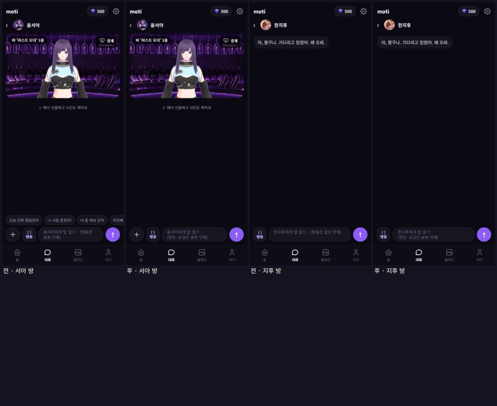 | 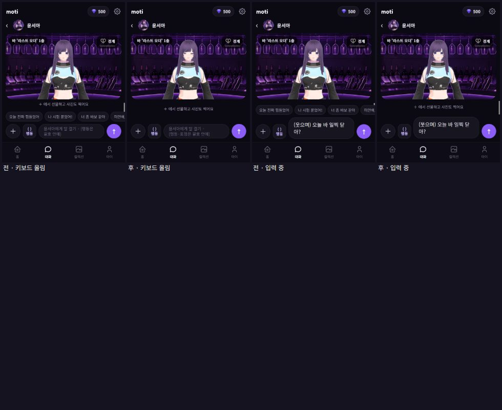 |

후 · 서아 방(390px): 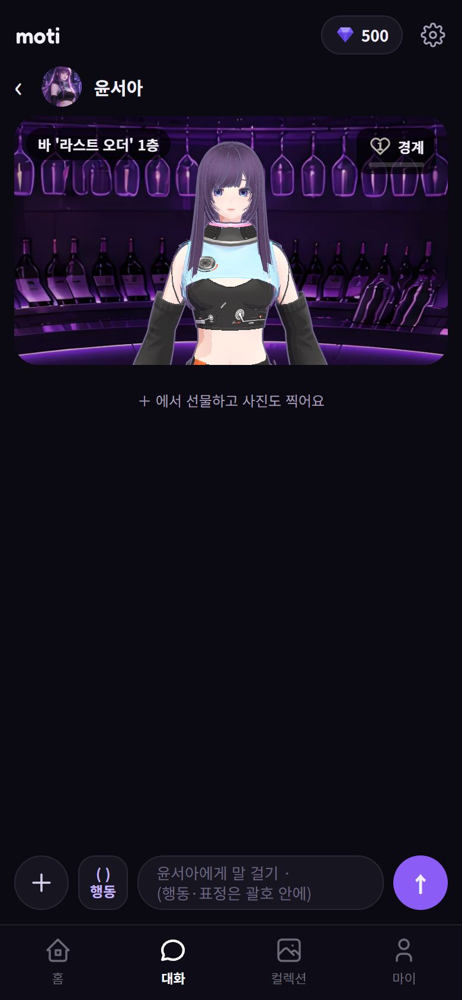

### B · 손가락 뼈 옮기기

**변환(`tools/fbx2motion.mjs`):** 원본 `RightHandIndex1` … `LeftHandPinky3` → 서아 `J_Bip_R_Index1` … `J_Bip_L_Little3`(Pinky = Little). 몸 뼈와 같이 「기준 자세(T자) 대비 세계 회전」을 담고, 1·2마디는 다음 마디 쪽 방향(`fingers.dir`)도 담음. 3마디는 원본·서아 모두 끝 뼈가 없어 앱이 2마디 방향 맞춤을 그대로 씀.

**앱(`index.html xsApply`):** 몸 뼈 다음에 손가락을 몸 뼈와 같은 규칙으로 — 방향 맞춤, `turn`, 처음·끝 섞기, 건너뛰기 이음매 섞기(`skipBlend`). `damp` 는 손가락에 안 씀. 손가락이 없는 모션은 지금처럼 기본 손(매 프레임 기본 자세로 돌아가는 기존 흐름 그대로).

**크기 줄이기** (셀카 모션 기준, 몸만 244KB):

| 방식 | 크기 | 늘어남 |
| --- | --- | --- |
| 손가락을 몸처럼 그대로(30fps, 소수점 3자리, x·y·z·w, 30개) | 601KB | +357KB |
| 15fps, 소수점 2자리 | 394KB | +150KB |
| 30fps, x·y·z 만 ×100 정수(w 는 앱이 되살림) | 384KB | +140KB |
| **15fps + x·y·z ×100 정수 (쓰는 방식)** | **315KB** | **+71KB** (gzip 45 → 60KB) |
| 10fps + x·y·z ×100 정수 | 292KB | +48KB (gzip 57KB) |

- 「변하지 않는 손가락 뼈는 빼기」: 손에 대해 기준 자세에서 2° 넘게 벗어나지 않으면 빼고, 내내 1.5° 안에서만 변하면 한 프레임만 담게 함. 그러나 12개 모션 모두 **30개 손가락이 다 움직임**(배우의 편한 손도 T자 기준 자세보다 굽어 있고 조금씩 움직여서) — 뺀 뼈·한 프레임 뼈 0개.
- 15fps 와 10fps 차이는 gzip 3KB 라 부드러운 15fps 로.

**다시 변환한 12개 (전 → 후):**

| 파일 | 원본 FBX | 크기 | gzip |
| --- | --- | --- | --- |
| `xstage_arms_crossed_female.json` (m07) | standard_Idle_Arms_Crossed_female | 304 → 395KB | 39 → 54KB |
| `xstage_brushing_hair_back.json` (c02) | standard_Shy_Brushing_hair_back | 111 → 147KB | 19 → 28KB |
| `xstage_checking_watch.json` (x18) | standard_Waiting | 202 → 261KB | 34 → 46KB |
| `xstage_glancing_nervously.json` (m06) | standard_Shy _Glancing_around_nervously | 77 → 102KB | 11 → 14KB |
| `xstage_shy_short_laugh.json` (x19) | standard_Shy_Short laugh | 126 → 166KB | 24 → 32KB |
| `xstage_standard_kick.json` (x17) | standard_Kick | 136 → 177KB | 43 → 57KB |
| `xstage_take_selfie.json` (x25·m14) | standard_Take_Selfie | 244 → 315KB | 45 → 60KB |
| `xstage_think_chin.json` (x24) | standard_Standing_Think_Chin | 143 → 188KB | 18 → 27KB |
| `xstage_walk.json` (x22) | standard_Walk | 53 → 69KB | 14 → 19KB |
| `xstage_wave_and_laugh.json` (m13) | standard_Wave_and_Laugh | 174 → 228KB | 33 → 47KB |
| `xstage_wave_hand.json` (x20) | standard_Wave_Hand | 81 → 109KB | 9 → 14KB |
| `xstage_wave_hands_upward.json` (x23) | standard_Wave_Hands_Upward | 179 → 231KB | 28 → 39KB |
| 합 | | 1829 → 2387KB | 315 → 436KB |

**`_src/` 에 FBX 가 없어 그대로 둔 18개** (손가락 없이 기본 손): `xstage_annoyance_1`(x01), `xstage_bent_over`(x02), `xstage_blunt_handing_out_candy_1`(m09), `xstage_embarrassing3`(m24, 원본 이름 기록 없음), `xstage_evade_jog_spin_r`(보류 x04), `xstage_hold_forehead`(m04), `xstage_idle_arms_crossed_male`(안 씀), `xstage_macho_man_taunt5`(보류 x08), `xstage_maid_grab`(x09), `xstage_mov_dive_roll_breakfall`(보류 x07), `xstage_proud_persuasion`(m19), `xstage_raise_hand_to_stop`(x11), `xstage_round_house_kick_1`(보류 x12), `xstage_rub_neck_one_hand`(m05), `xstage_run_look_back`(x21), `xstage_shy_surprise1`(m03), `xstage_shy_walk`(x15), `xstage_stealth_squat_idle_alert`(x16). 원본(`[standard] …fbx`)을 `_src/` 에 넣고 `node tools/fbx2motion.mjs` 를 다시 돌리면 손가락이 들어감.

**첫 로딩 크기 (39 표 기준):** 처음 실행 때 미리 받는 모션(`motionsSoon`, 13개 — 입장권·첫 만남·오프닝·1단계 몸짓·시계 보기·기다리는 몸짓) **1857 → 2181KB(+324KB)**, gzip 318 → 388KB(+70KB). 39 의 (라) 대화 화면까지 받은 크기 11.99MB 의 약 +2.7%. 모션 전체(25개) 3534 → 4092KB, gzip 611 → 732KB.

### 손가락 전·후 (손 가까이, 흰 셔츠 — 작전복은 소매가 손을 가려서. 각 칸 왼쪽 = 오른손, 오른쪽 = 왼손)

셀카 x25(15·58·82·88%) · 손 흔들기 m13(30·50%) · 두 손 흔들기 x23(35·55%):
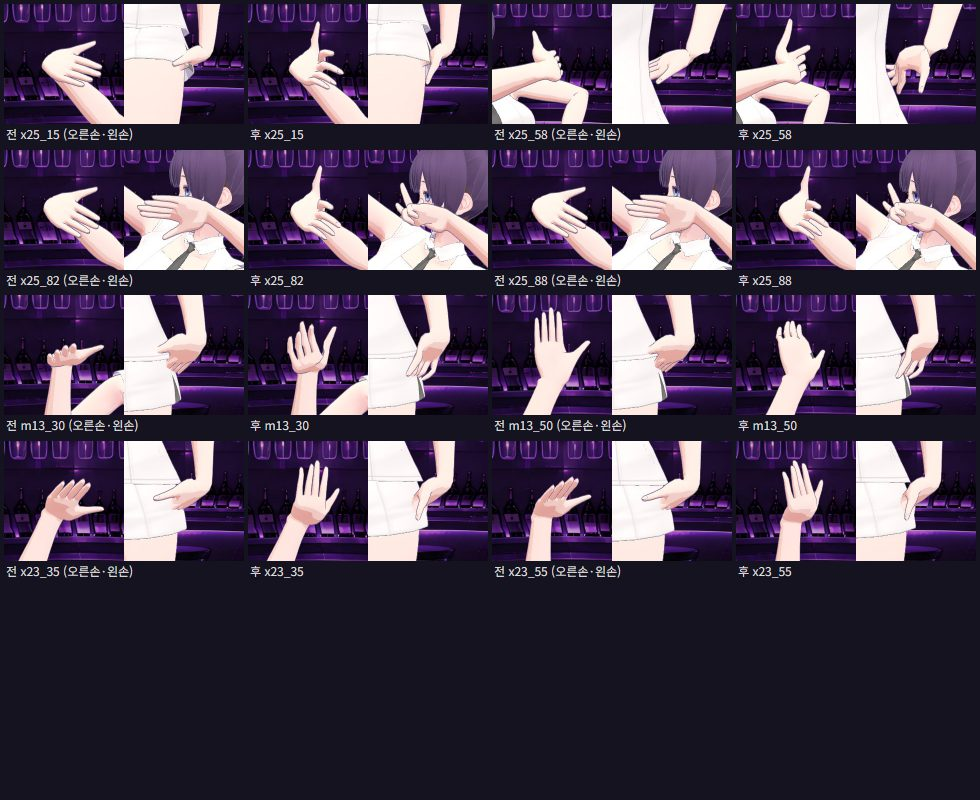

턱 괴기 x24(35·60%) · 머리 쓸어 넘기기 c02(18·40%) · 입 가리고 웃기 x19(35·55%) · 시계 보기 x18(25·45%):
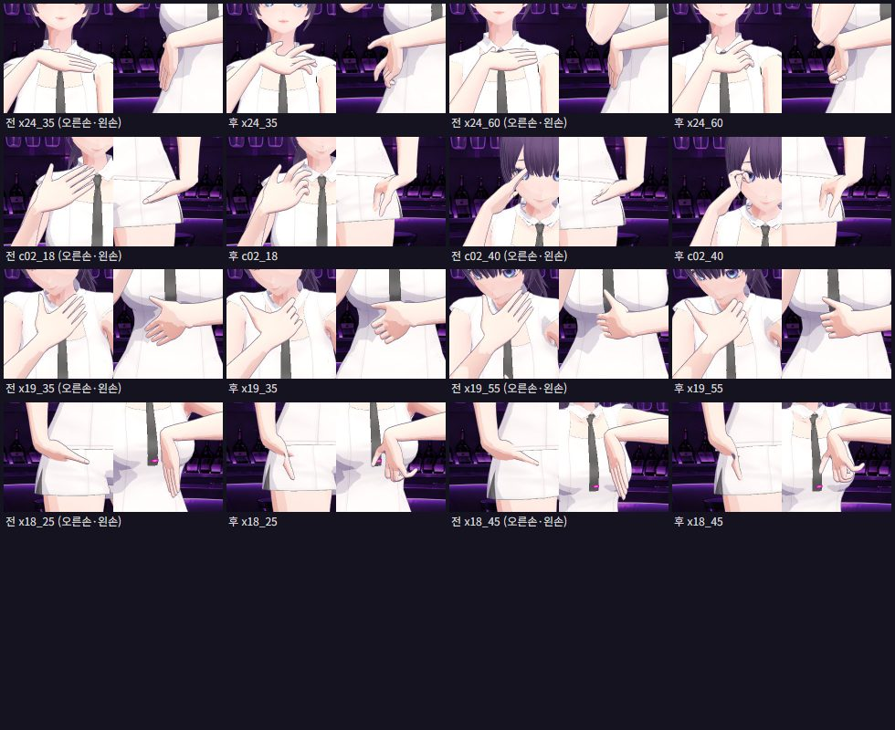

- 셀카: 전에는 두 손 모두 편 손 → 후 오른손은 폰을 쥔 모양(엄지를 세우고 나머지를 감음), 왼손은 **브이**. 손 흔들기는 손가락이 살짝 벌어지고 굽은 자연스러운 손, 턱 괴기·입 가리기·쓸어 넘기기는 손가락이 얼굴·턱 선을 따라 굽음, 시계 보기는 내린 손이 편하게 굽음.
- 손가락이 거꾸로 꺾이거나 비틀린 곳은 못 찾음(위 16 순간 × 양손).
- 몸 전체로 보면(작전복): 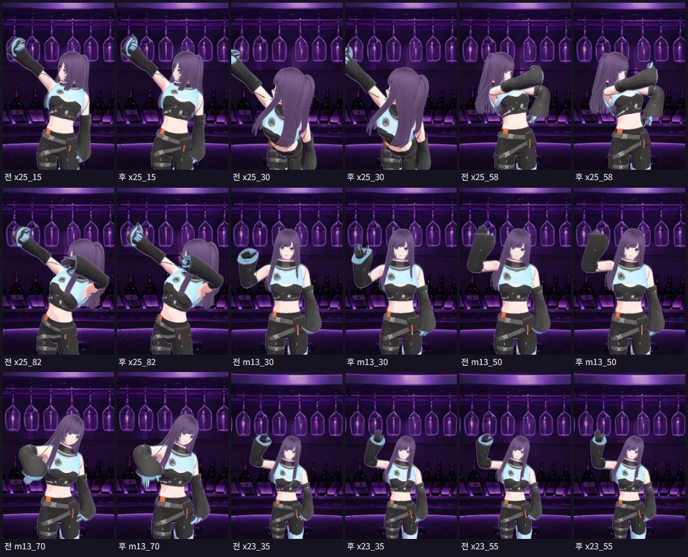

셀카 88% 순간 두 손: 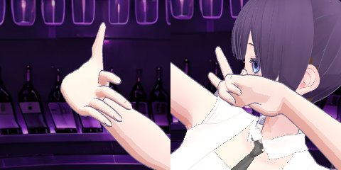

### 셀카 side → 브이 셀카

손가락이 들어가 원본의 왼손 브이가 보이게 됨. 브이가 얼굴 옆에 오도록 순간·렌즈 자리를 다시 고름.

| 시도 | 본 것 |
| --- | --- |
| 45 의 렌즈 자리(`shift` [0.03~0.12, 0.02~0.04]), 11.6~13.1초 | 브이가 어깨 높이, 사진 오른쪽 끝 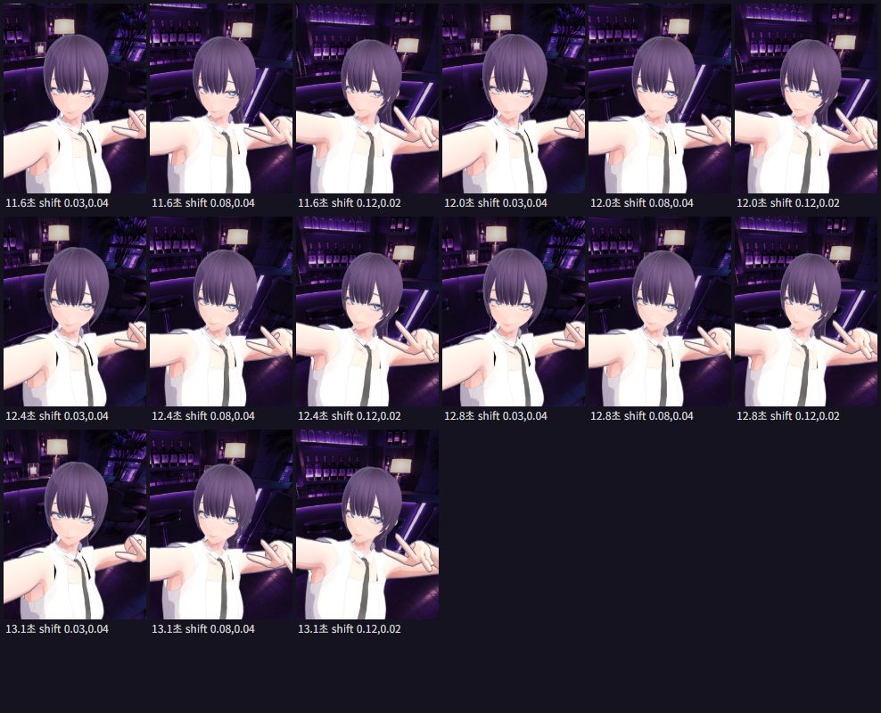 |
| 렌즈를 얼굴 앞쪽·아래로(`shift` x 0.12~0.24, y −0.04~−0.12) | 0.12~0.18 이면 브이가 얼굴 바로 옆, 0.2 넘으면 브이가 눈을 가림 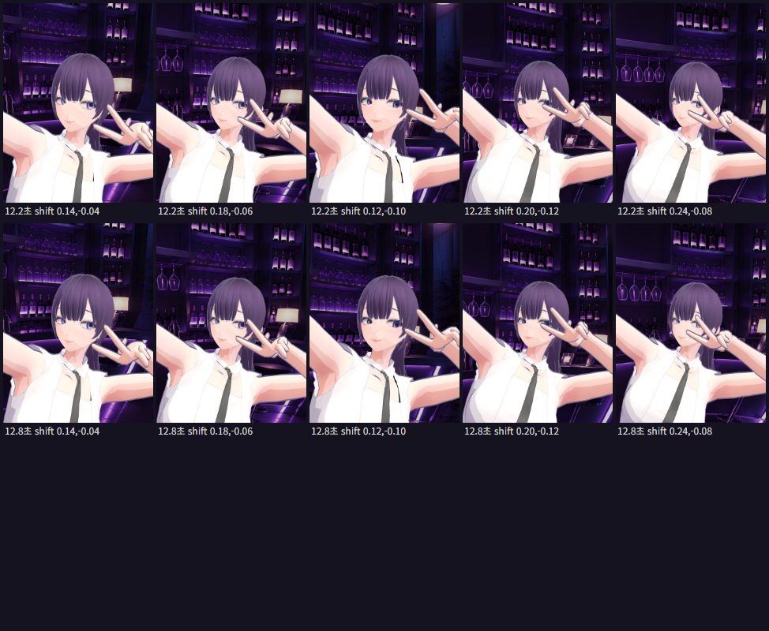 |
| 렌즈 보기를 45 의 `side`(머리 0.3)로 두면 | 눈이 렌즈 옆으로 비낌 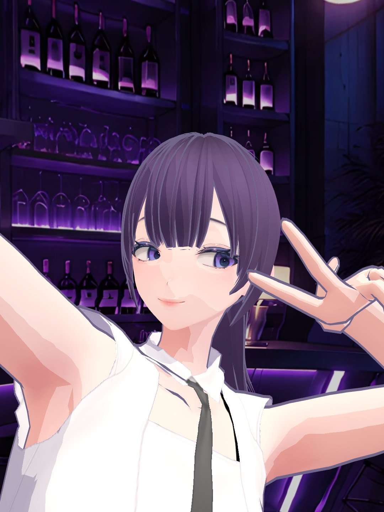 |

**고른 값:** `at` 12.2~12.8초, `fov` 62°, `shift` [0.12, −0.08], `look` 0, 렌즈 보기 목 0.3·머리 0.8·눈 1(최대 20°·40°·20°). 카메라가 얼굴과 거의 같은 높이(위로 4° 쯤)에서 살짝 옆. 이름 「살짝 옆에서 브이」. 브이가 잘 보여서 비중은 그대로(세 종류 같은 비중).

작전복 브이(장갑이라 브이가 크게): 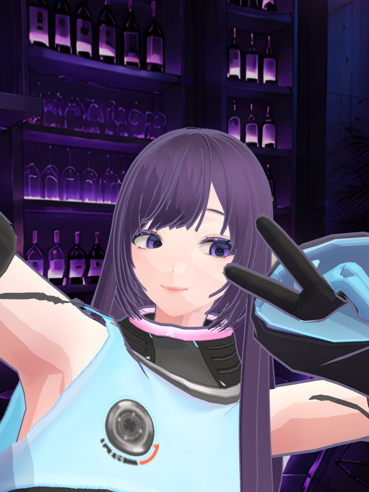

**셀카 12장 다시 (45 와 같은 장소·의상):**
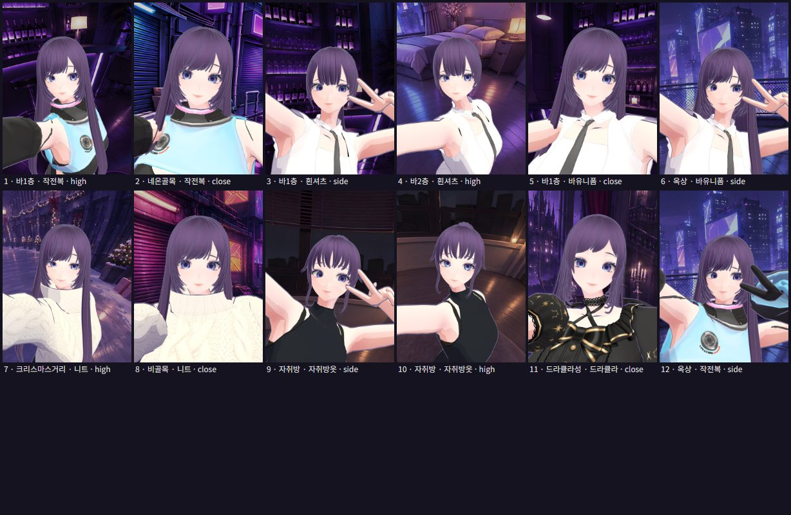

3 · 바 1층 · 흰 셔츠 · 브이: 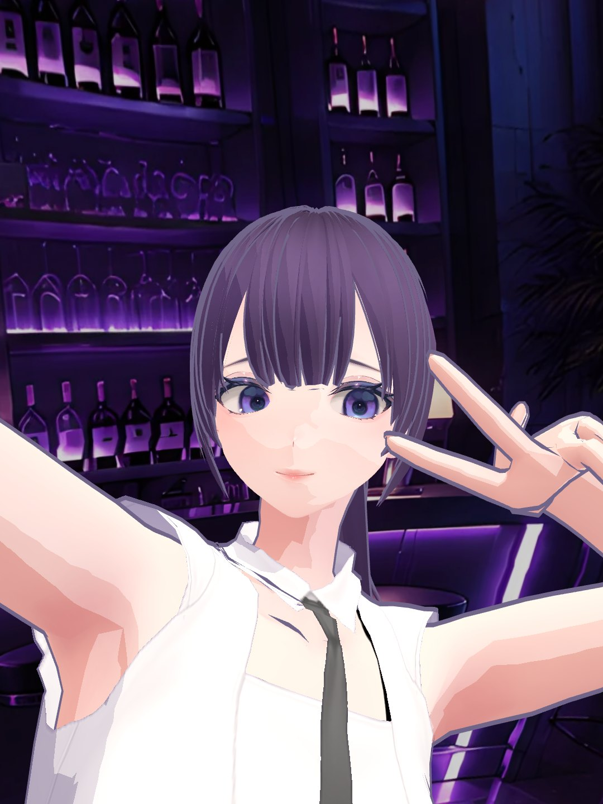

- 얼굴 잘림 없음, 시선 12장 모두 렌즈, 브이는 side 4장 모두 얼굴 옆(12 작전복은 장갑 끝이 사진 오른쪽 끝에 걸림).
- high·close 는 45 와 같은 값. 폰을 든 오른손이 쥔 모양이 되었지만 카메라 바로 옆이라 사진에는 거의 안 들어옴.

### 그 밖의 확인

- 32-A: 확대 0.25초 뒤 셀카 → 매 프레임 비율 어긋남 0, 끝난 뒤 1.743/1.743 · near 0.1. 셀카 모션을 막으면 32-B 셀카(오류 없음). 선물 g07 재생·카드 `mv 2` 그대로.
- `data/*.json`·`motions/*.json` 모두 읽힘(JSON 검사), 확인 실행 모두 콘솔 오류·예외 없음.

### 제가 정한 것

- **칩 문구:** 코드 안 배열(`QUICK`)이라 데이터 파일에서 지울 문구는 없었음. 다른 캐릭터 방은 이미 칩을 숨기던 것이라 따로 고칠 곳 없음. v1(`v1.html`·`app.js`)의 칩은 이전 앱이라 그대로.
- **안내 문구 줄바꿈:** 데이터 문구는 그대로 두고, 코드가 괄호 ( ) 안을 줄바꿈 없는 덩어리로 바꿔 넣음(띄어쓰기 → U+00A0, 글자 사이 U+2060). 「·」 뒤에서도 끊기지 않게 하려고 단어 잇개까지 씀. 지후 방처럼 + 버튼이 없는 넓은 입력칸에서도 괄호 앞에서 줄이 바뀜.
- **키보드 올린 상태 캡처:** 헤드리스에는 화면 키보드가 없어서 화면 높이를 508px(844 − 키보드 약 336px)로 줄이고 입력칸에 포커스.
- **손가락 키 이름:** 모션 JSON 안에서 서아 VRoid 이름을 그대로 씀(몸 뼈가 앱 이름(XORD)을 쓰는 것과 같게).
- **3마디 방향:** 끝 뼈가 없어 2마디 방향 맞춤을 씀.
- **크기 방식:** 손가락만 15fps·×100 정수·w 빼기. 몸 뼈 형식은 바꾸지 않음(예전 파일·앱 흐름 그대로). 「안 움직이면 빼기·한 프레임」 규칙은 넣었지만 지금 12개에서는 걸리는 뼈가 없음.
- **15fps:** 10fps 보다 gzip 3KB 크지만 브이·주먹 쥐는 빠른 손가락 움직임을 덜 뭉갬.
- **카드 그림 다시 만들기 안 함:** 손가락이 바뀐 몸짓(m07·c02·m06·m13·x17·m14 등)의 `motionVer` 는 올리지 않음. 이미 만든 카드는 예전 손 그대로, 새로 만드는 카드부터 손가락이 들어감. 다시 만들려면 그 몸짓의 `motionVer` 를 하나 올리면 됨.
- **브이 셀카 비중:** 0 으로 하지 않고 세 종류 같은 비중.
- **FBX 가 없는 18개:** 다운로드 폴더에도 없어서 그대로. 목록은 위.

### 아이폰에서 나중에 볼 것

- 손가락 뼈 30개를 매 프레임 더 계산함(XSTAGE 모션 재생 중에만). 낮은 기기에서 몸짓 재생 때 프레임이 떨어지지 않는지.
- 첫 실행 때 모션 파일이 +324KB(gzip +70KB) 늘어 입장권·첫 만남 준비가 늦어지지 않는지(39 의 (나′)·(다) 시각).
- 안내 문구 두 줄: 사파리에서 U+2060·U+00A0 가 빈 네모로 보이지 않는지, 괄호 앞에서 줄이 바뀌는지, 키보드가 올라온 뒤 입력칸·대화 기록 높이가 맞는지.
- 브이 셀카: 장갑(작전복)·맨손(흰 셔츠·자취방 옷)에서 브이 손가락 외곽선이 깨지지 않는지.
