# 46 · 대화 목록: 이야기마다 옆으로 넘기기 · 「본 이야기로」 버튼 없애기 · 탭 정리

브랜치 `step/46-story-swipe` · 커밋 `[46-A] 본 이야기로 버튼 없애기, 목록 드나들기, 컬렉션 아이콘, 카드 그림 다시 만들기`, `[46-B] 이야기마다 옆으로 넘기기`, `[46-C] 이야기마다 셀카 프로필`

## 바뀐 파일

| 파일 | 내용 |
| --- | --- |
| `index.html` | (A) 대화방 머리의 「본 이야기로」 단추(`#thrBtn`)·스타일 지움, `Thread.chip` 은 이름 밑 설명 줄만. `setTab("chat")` 은 언제나 대화 목록(`showList`). 아래 탭 컬렉션 아이콘을 `icons.js` 에서 채움. (B) `Swipe`(서아 줄의 이야기 칸: 칸 목록·순서·이야기별 대화 기록·읽음·단계, 넘기기·점·마우스 끌기, 넘기기 안내), `renderList`·`showList` 가 `Swipe` 를 씀, 안 읽은 수는 모든 이야기 합(`unreadOf`), 미리보기 `pvOf` 로 묶음. (C) `Swipe.sceneOf`·`outfitOf`(다른 이야기의 마지막 장소·지금 옷), 프로필 동그라미 셀카 바꾸기(`avatar`)·SPECIAL 표, 시연 초기화 때 셀카도 지움, `storypic.js` 불러오기 |
| `storypic.js` | (C) 새 파일. 이야기마다 셀카 프로필 만들기·저장(IndexedDB `moti_storypic`)·차례 |
| `seoaphoto.js` | (B) 부재중(오랜만) 사진은 본 이야기 대화방에 들어올 때만 |
| `icons.js` | (A) `cards` 아이콘(포토카드 두 장이 겹친 선 아이콘, 선 굵기 1.8) |
| `data/motions.json` | (A) 손가락이 들어간 무빙 카드 몸짓 `motionVer` 올림, 설명 |
| `data/ui.json` | (A) `thread.back`·`backToast` 지움. (B) `chatList` 의 `unread`·`hintMain`·`hintOther`·`dotAria`·`slotAria`·`main`. (C) `chatList.special` |
| `data/config.json` | (B) `storySwipe`(안내 띄우기·보이는 시간, 살짝 움직이는 거리·시간, 마우스 끌기 기준). (C) `storyPic`(셀카 종류·크기·품질·차례 간격·바뀌는 시간) |
| `docs/reports/img/46/` | 캡처 |

## A · 「본 이야기로」 버튼 없애기, 목록으로 드나들기, 컬렉션 아이콘, 카드 그림 다시 만들기

- 특별 에피소드 대화방 위 「본 이야기로」 단추를 없앰. 이름 밑 설명 줄(에피소드 이름)은 그대로. 이야기 바꾸기는 대화 목록에서 넘겨서(B).
- 「대화」 탭은 언제나 목록: 대화방 → 홈 → 대화 탭, 대화방 → 컬렉션 → 대화 탭, 대화 탭을 바로 누름, 대화방 뒤로 가기 — 모두 목록으로 확인. 홈 에피소드 카드·알림·시연 패널은 지금처럼 바로 대화방(`setTab("chat")` 뒤에 `openRoom`).
- 아래 탭 컬렉션 아이콘: 사진 모양 → 포토카드 두 장이 겹친 모양(뒤 카드는 가리지 않는 부분만, 앞 카드 아래 띠 한 줄). 다른 탭과 같은 24px·선 굵기 1.8(고른 탭 2.1).

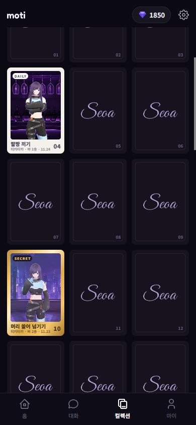

### 카드 그림 다시 만들기 (43 방식, `motionVer` 를 하나씩 올림)

45-1 에서 손가락을 넣어 다시 변환한 12개 모션 중 무빙 카드가 있는 몸짓:

| 카드 | 몸짓(모션) | motionVer |
| --- | --- | --- |
| 04 팔짱 끼기 | m07 | 2 → 3 |
| 10 머리 쓸어 넘기기 | c02 | 2 → 3 |
| 허둥대기 | m06 | 2 → 3 |
| 손 흔들기 | m13 | 1 → 2 |
| 32 첫 만남 | x17 돌려차기 | 1 → 2 |
| g02 입 가리고 웃기 | x19 | 1 → 2 |
| g07 같이 셀카 찍기 | m14 | 2 → 3 |

카드가 없는 나머지(x18 시계 보기·x22 걷기·x23 두 손 흔들기·x24 턱 괴기·x25 셀카 자세·x20 손 인사)는 그대로.

확인: 7장을 예전 버전 기록으로 만들어 둔 뒤 `Cards.refresh()` → 7장 모두 다시 만들어지고 `mv` 가 새 버전, 의상·장소·날짜(`outfit`·`scene`·`at`)는 그대로. 한 장 약 1초.

## B · 서아 줄을 옆으로 넘기기

- 대화 목록 캐릭터마다 한 줄. 서아 줄은 왼쪽 프로필 동그라미가 고정, 오른쪽 내용 칸만 옆으로 넘김(`scroll-snap`, 칸 단위로 멈춤 + `scroll-snap-stop: always`). 칸 하나 = 본 이야기 + 시작한 특별 에피소드(`S.stories` 이고 대화 기록이 있는 것).
- 칸 순서 = 마지막 메시지가 가장 최근인 이야기부터(같으면 본 이야기 먼저). 목록을 열면 첫 칸. 목록이 열려 있는 동안 다시 그려져도(안 읽은 수·다른 캐릭터 알림 등) 보던 칸 그대로.
- 칸 내용: 이름, 그 이야기의 관계 단계 하트(번호·단계 이름, 본 이야기는 `S.story`, 크리스마스처럼 단계가 있는 에피소드는 그 에피소드 단계, 단계가 없는 에피소드는 본 이야기와 같이 씀), 마지막 메시지 시간·한 줄, 안 읽은 수. 에피소드 제목·금박 테두리 없음.
- 칸 아래 점: 몇 번째 이야기인지, 눌러도 넘어감.
- 칸을 누르면 그 이야기로 대화방(본 이야기 = `Thread.go("main")`, 특별 에피소드 = 홈 에피소드 카드와 같은 `startStory`). 프로필 동그라미를 누르면 보이는 칸의 이야기로.
- 넘기기 안내(한 번만, `S.swipeHint`): 이야기가 둘 이상인 목록이 0.45초 넘게 보이면 서아 줄 바로 밑 말풍선 + 내용 칸이 46px 옆으로 살짝 움직였다 돌아옴. 첫 칸이 특별 에피소드면 「옆으로 넘기면 본 이야기를 볼 수 있어요」, 그 밖에는 「옆으로 넘기면 다른 이야기를 볼 수 있어요」. 4초 뒤나 넘기면 사라짐.
- 알림: 부재중(오랜만) 사진은 본 이야기 대화방에 들어올 때만. 다른 캐릭터 먼저 말 걸기는 원래 서아 대화방과 상관없음(그대로).

| 크리스마스를 처음 산 뒤 목록(안내) | 안내가 뜰 때 살짝 움직임 |
| --- | --- |
| 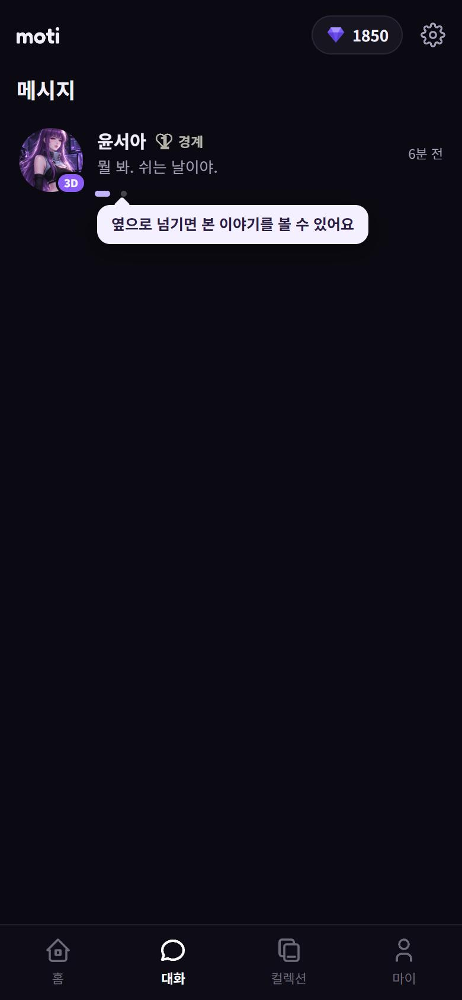 | 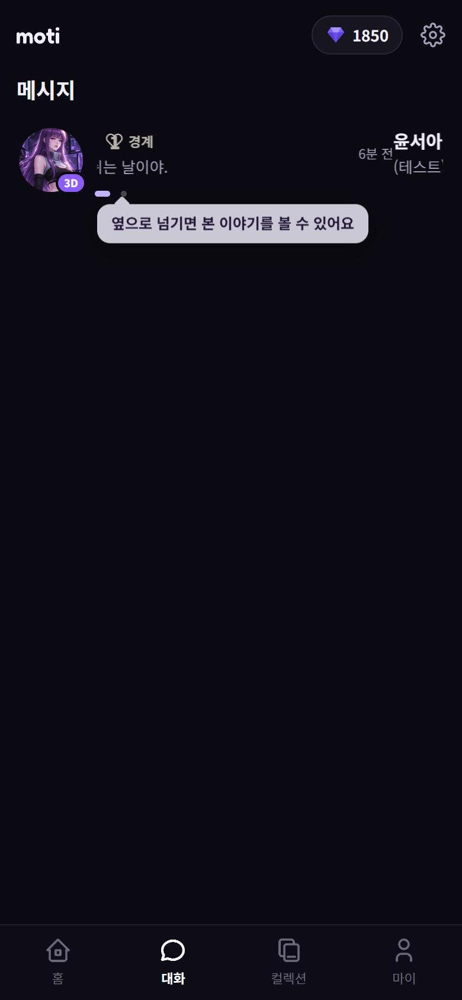 |

확인(390px):
- 크리스마스를 사서 대화방 → 목록: 첫 칸 크리스마스, 안내 「본 이야기」 문구·움직임 한 번. 다시 목록을 열면 안 뜸.
- 본 이야기에 새 메시지 → 본 이야기 칸만 안 읽은 수 1, 크리스마스 0, 아래 탭 1. 크리스마스 대화방에 다녀와도 본 이야기 1 그대로.
- 관계 단계: 본 이야기 2(티키타카), 크리스마스 4(고백 직전), 할로윈 2(본 이야기와 같이 씀) — 칸마다 따로.
- 각 칸 눌러 들어가기(본 이야기·크리스마스·할로윈), 뒤로 가기로 목록, 목록을 다시 그려도 보던 칸 유지.

## C · 이야기마다 셀카 프로필

- 넘긴 칸에 맞춰 왼쪽 프로필이 그 이야기의 셀카로 바뀜(0.15초 흐려졌다 0.15초 나타남, `storyPic.swapMs` 300).
- 셀카 = 45·45-1 손이 폰이 되는 셀카(`high`·`close` 중 하나), 그 이야기의 마지막 장소, 그 이야기에서 지금 입는 옷. 정사각형 192px jpeg(약 9~10KB), IndexedDB `moti_storypic`(카드 저장소 26-2 와 같은 방식, 따로 둠).
- 다시 만드는 때: 그 이야기의 옷이 기록과 달라질 때만. 장소만 바뀌면 그대로. 만드는 동안·실패하면 원래 프로필 그림(`card_seoa.jpg`).
- 만드는 때: 목록이 보일 때 예약 → 서아 대화방 3D 가 보이지 않고, 걷기·확대 움직임·사진 보내기·카드 그리기·촬영·해금 연출·첫 만남 연출 중이 아닐 때 한 장씩(보이는 칸 먼저, 0.6초 간격). 그리기는 `SeoaPhoto.make`(card) 그대로라 화면 밖에서 같은 작업 안에 그리고 되돌림, 확대가 움직이는 중이면 끝날 때까지 미룸(32-A). 한 장 330~410ms(그리기 130~150ms + jpeg 160~180ms).
- 특별 에피소드 칸이면 프로필 동그라미 바로 밑에 SPECIAL 표(진한 바탕 `#1d1730`·금색 글자 `#f5c66b`, 시크릿 카드 표와 같은 색). 본 이야기 칸에서는 안 보임.

| 본 이야기만 | 본 이야기 + 크리스마스 | + 할로윈(첫 칸 할로윈) |
| --- | --- | --- |
| 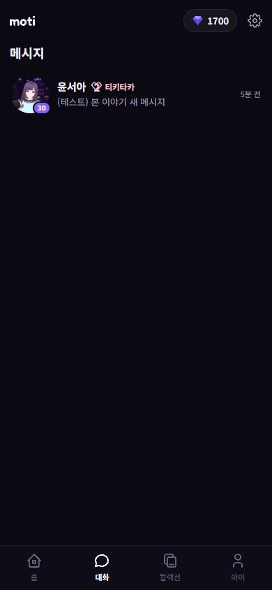 | 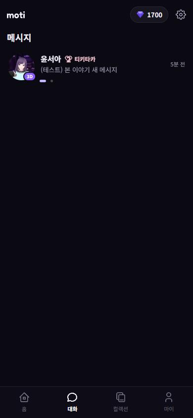 | 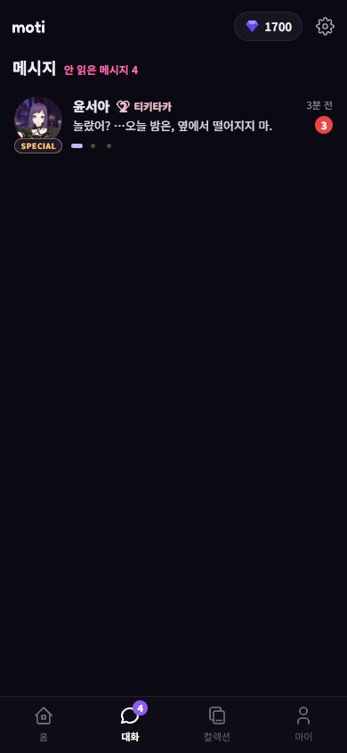 |

| 넘기는 순간(흐려짐) | 크리스마스 칸(자취방 옷, SPECIAL) | 본 이야기 칸 |
| --- | --- | --- |
| 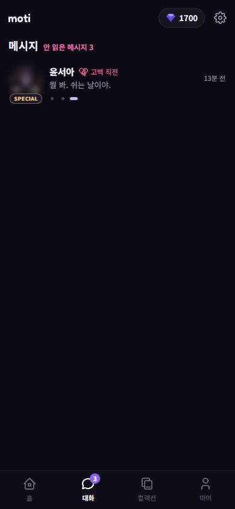 | 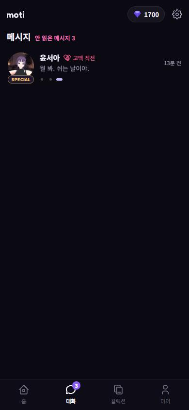 |  |

만들어진 셀카 — 거리(니트) 때 / 자취방으로 옷이 바뀐 뒤:

| 거리 | 자취방 |
| --- | --- |
| 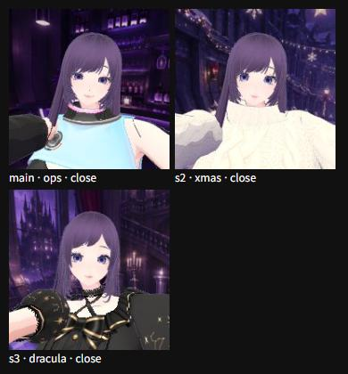 | 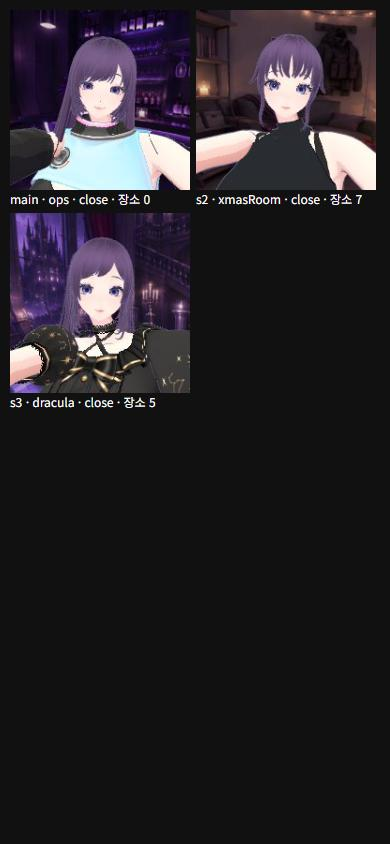 |

크리스마스 칸에서 들어간 대화방(「본 이야기로」 단추 없음, 이름 밑 설명 줄 그대로): 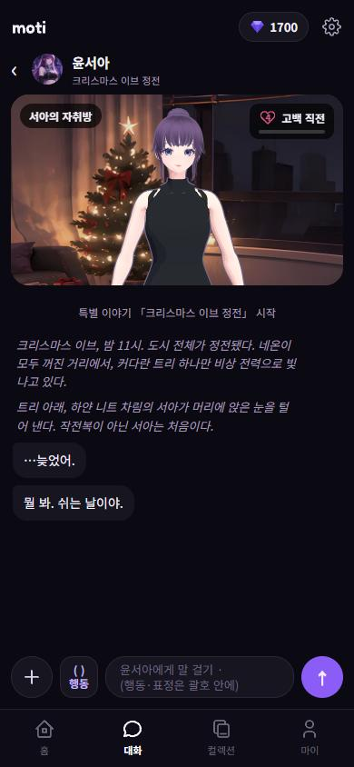

확인:
- 크리스마스 거리 → 자취방(4단계 장면 끝, 옷 `xmas` → `xmasRoom`) 뒤 목록: 크리스마스 셀카만 다시 만들어짐(1장), 그 사이 원래 프로필. 본 이야기·할로윈은 다시 만들지 않음. 다른 칸에 다녀와 목록을 다시 열어도 더 만들지 않음.
- 콘솔 오류 없음(three.js `morphNormals` 경고는 예전부터), 데이터 JSON 모두 읽힘.

## 제가 정한 것

- **넘기기 안내는 모두 합쳐 한 번만**(저장값 하나). 크리스마스를 사서 안내를 본 뒤 할로윈을 사면 다시 안 뜸. 문구는 그때 첫 칸이 특별 에피소드면 「본 이야기」, 아니면 「다른 이야기」.
- 안내는 목록이 0.45초 넘게 실제로 보일 때만(홈 에피소드 카드처럼 목록을 거쳐 바로 대화방으로 가는 때 저장값만 쓰이지 않게). 값 `storySwipe.hintDelayMs`.
- **이야기가 하나뿐이어도 칸 모양(하트·단계 이름)과 셀카 프로필을 씀.** 넘기기·점만 없음. 줄 높이가 이야기 수에 따라 달라지지 않게.
- 칸 순서는 「마지막 메시지 시각」 기준. 칸에 들어갔다 나오기만 하면 순서가 안 바뀜(대화를 해야 바뀜).
- 칸에 넣는 특별 에피소드 = 산 것(`S.stories`) 중 대화 기록이 있는 것. 같은 순간이면 본 이야기 먼저.
- 프로필 동그라미를 눌러도 보이는 칸의 이야기로 들어감.
- 특별 에피소드 칸은 3D 표를 숨기고 SPECIAL 표만(둘이 동그라미 아래에서 겹쳐서).
- 컴퓨터 마우스로도 끌어 넘길 수 있게 함(18% 넘게 끌면 다음 칸). 터치는 브라우저 기본 넘기기.
- 단계가 없는 특별 에피소드(할로윈·오늘의 바텐더) 칸의 하트는 본 이야기 단계(16 에서 같이 쓰는 값).
- 대화방이 아닌 곳에서 다른 이야기의 옷·장소를 셀 때 `Outfit.want()`·`setScene` 과 같은 규칙(에피소드 의상·장소별 의상·갈아입었는지·단계로 열리는 장소, 본 이야기는 흰 옷 규칙)을 보관한 값으로 계산.
- 셀카 종류는 `high`·`close` 중 하나를 뽑음(브이 `side` 는 뺌). 표정은 셀카 종류 기본값.
- 셀카를 못 만들면 이번 실행 동안은 그 옷으로 다시 시도하지 않음(다음에 앱을 열면 다시).
- 목록 위 「안 읽은 메시지 n」 문구를 `ui.json chatList.unread` 로 옮김(코드 안에 있던 문구).
- 시연 패널 「서아 초기화」·「전체 초기화」 때 셀카 프로필도 지움.

## 아이폰에서 나중에 볼 것

- 넘기기: 사파리에서 `scroll-snap` 이 칸 단위로 딱 멈추는지(`scroll-snap-stop`), 세로 스크롤과 헷갈리지 않는지, 칸을 누를 때 넘기기로 오인하지 않는지.
- 안내가 뜰 때 내용 칸이 살짝 움직이는 애니메이션(`transform`)이 스크롤 칸 안에서 끊기지 않는지, 말풍선 그림자.
- 프로필 바뀔 때 `filter: blur(5px)` 흐려졌다 나타남이 깜빡이거나 버벅이지 않는지.
- 셀카 만들기(한 장 0.3~0.4초)가 목록을 넘기는 중에 멈칫함을 만들지 않는지, 다른 옷 모델(니트·자취방·드라큘라)을 받아 그리는 동안 메모리.
- SPECIAL 표 크기(8.5px)와 금색 글자가 잘 보이는지.
- 컬렉션 아이콘 선 굵기가 다른 탭과 같아 보이는지.
- 손가락이 들어간 카드 그림 7장을 처음 열 때 다시 만드는 동안 버벅임.
