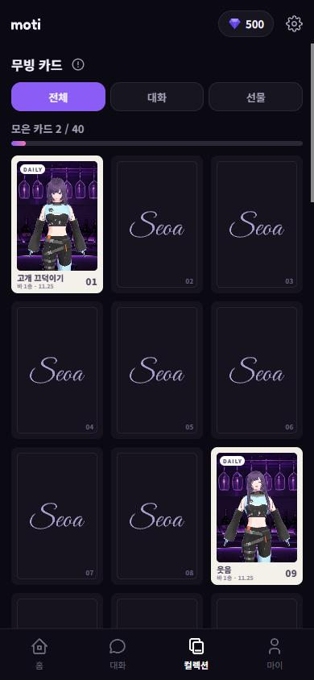
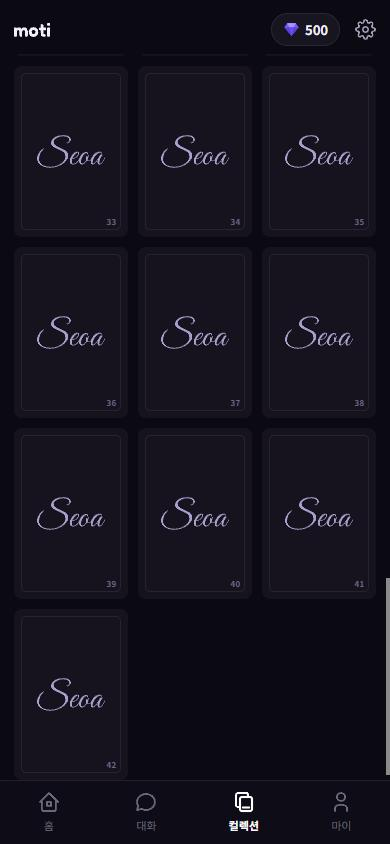
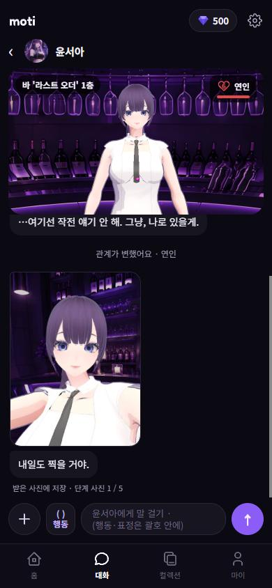
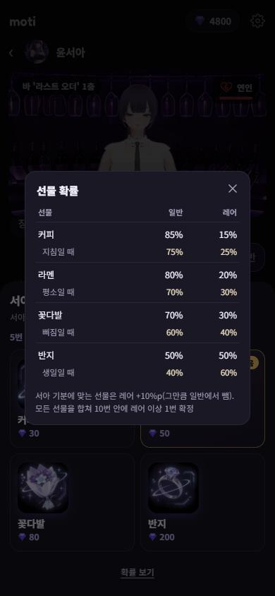
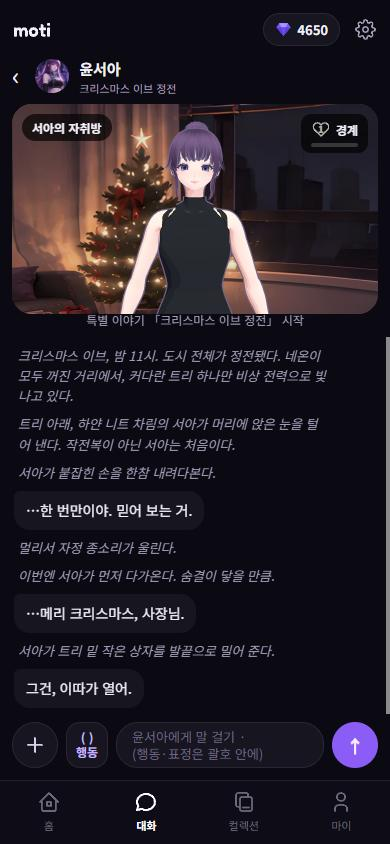

# 47 · 카드 세 장 보류 · 크리스마스 카드 빼기

브랜치 `step/47-card-hold` · 커밋 `[47] 카드 세 장 보류와 크리스마스 카드 빼기`

## 바뀐 파일

| 파일 | 바뀐 것 |
| --- | --- |
| `data/collection.json` | m15(25번)·g11(43번)·g12(44번)에 `hold: true`(번호 그대로). e01 「크리스마스 이브」(45번) 칸 삭제, 45 는 `retiredNo` 로. `_설명` 갱신 |
| `data/seoa_story.json` | `ban` 에 m15 추가(m14·m15·m16·m22·m23). `unlock.stage.6` → `motions: []`, `lead: ""`, `text: ""`, 원래 값(`["m15"]`, lead m15, 「서아가 처음으로 당신을 맞아 줬어요」)은 같은 자리 `_보류` 칸에 |
| `data/config.json` | `greet.motions.6` → `["m13"]`. 원래 값 `["m13","m15"]` 은 `greet._motions보류.6` 에 |
| `data/episodes.json` | 크리스마스(s2) `stageScenes.6.card: "e01"` 삭제, `_설명` 의 card 설명 정리 |
| `index.html` | 선물: 뽑은 등급을 얻을 수 있는 등급으로 맞춤(`Gacha.odds(…, COL.items)`·`Gacha.fit`), 확률 표 열 = 얻을 수 있는 등급만(`Gacha.grades`). 에피소드 장면 뒤 카드 주는 코드(`EpScene` 의 `award`) 삭제 |
| `gacha.js` | `fit(grade, items)` — 그 등급 선물 몸짓(보류 빼고)이 없으면 한 단계씩 내림. `odds(gift, matched, bonus, items)` — items 를 주면 빈 등급의 %를 내린 등급에 더함. `grades(items)`. `pickItem` 이 보류 칸을 고르지 않음 |
| `tools/build_collection.mjs` | 선물 칸의 hold 는 보류 줄로 옮기지 않고 선물 줄에 그대로(안 고치면 g11·g12 가 두 번 들어감) |
| `tools/check_gacha.mjs` | 보류·연출 칸을 unlock 비교에서 뺌(44 부터 실패하던 검사 2개 고침), 시뮬레이션이 앱과 같은 `odds(…, items)` 사용, 보류 몸짓이 나오면 실패, 특별 → 희귀 검사 추가 |
| `docs/drafts/42-크리스마스-에피소드-원고.md` | 6단계의 카드 줄 삭제 |
| `docs/server-sync.md` | 「47 · 다정하게 인사하기 보류」 한 줄(서버 해금 지도에서 6단계 → m15 지우기) |
| `docs/status.md` | 47 절 |

## 할 일 A · 카드·몸짓 보류

- **m15 다정하게 인사하기 · g11 손가락 하트 · g12 품에 안겨 오기:** 44 의 hold 방식 그대로. 앱이 읽을 때 `COL.held` 로 빼서 목록·「모은 카드 n / total」·마이·카드 크게 보기·시연 패널(선물 몸짓 지정 줄 포함)에 안 나오고 세지 않음. 저장값 `S.col.m15/g11/g12` 는 지우지 않음.
- **m15 대화 몸짓에서 뺌:** `ban` 에 넣어 `allowedMotions()`·`unlockedIds()`·키워드(「왔어」「반갑게」)에서 빠짐. 6단계가 되면 단계 메시지(「관계가 변했어요 · 연인」)와 단계 사진은 그대로 나오고, 열리는 몸짓이 없어 해금 연출·토스트는 안 나옴(코드 수정 없음 — 44 와 같은 경로).
- **m22 손가락 하트 동작:** `ban` 에 그대로 있음 → 대화 몸짓에서 빠진 상태 확인. (온보딩 연출 `data/onboarding.json` 의 m22 는 대화 몸짓이 아니라 그대로 둠.)
- **m18 감싸 안기:** `unlock.flag.pursue` 그대로, 컬렉션 30번 그대로.
- **선물 특별 → 레어:** 특별 선물 몸짓(g11·g12)이 모두 보류라 `odds` 가 특별 %를 레어에 더함(커피 85/15, 라멘 80/20, 꽃다발 70/30, 반지 50/50, 기분 맞춤 +10%p 는 그 위에). 확률 표도 같은 함수를 써서 일반·레어 두 열만, 숫자가 실제와 같음. 천장 문구 「10번 안에 레어 확정」·「레어 이상 1번 확정」은 그대로 맞음. 시연 패널 「다음 선물 결과 · 특별」로 지정해도 `fit` 으로 레어가 나옴(대사도 레어 대사).
- 크기: 컬렉션 **44칸 중 보류 4(m15·m23·g11·g12) → 보이는 칸 40**(대화 30 · 선물 10). `node tools/build_collection.mjs` → 「대화 29 + 보류 2 + 연출 1 + 선물 12 = 44칸」.

## 할 일 B · 크리스마스 카드 빼기

- e01(45번) 칸을 지우고 45 는 `retiredNo` 에 넣어 다시 쓰지 않음(마지막 번호라 다른 번호 그대로).
- 크리스마스 6단계 장면이 끝나면 `ep.seen` 기록만 하고 자유 대화로 이어짐. 카드·알림 없음.
- 예전 저장값 `S.col.e01` 은 지우지 않음. `colBy("e01")` 이 없으니 컬렉션·마이·캐릭터 칩 어디에서도 쓰이지 않음(오류 없음 확인).

## 확인 (390×844)

- **예전 저장값으로 열기**(`S.col` = m01·m02·m15·g11·g12·e01, 6단계 전 m15 해금): 오류 없음. 전체 「모은 카드 2 / 40」, 대화 「2 / 30」, 선물 「0 / 10」. 칸 번호 01~24·26~30·32~42, 25·31·43·44·45 없음. `unlockedIds`·`allowedMotions` 에 m15 없음.
   
- **5 → 6단계:** 「관계가 변했어요 · 연인」 + 단계 사진만, 해금 확대·토스트·새 카드 없음(대기열 0, 새 컬렉션 기록 0). 어색한 빈 알림 없음.
  
- **다시 들어올 때 인사(6단계):** 48시간 전으로 돌려 세 번 들어옴 → 세 번 모두 m13 손 흔들기(예전엔 m13·m15 번갈아), 첫 대사는 6단계 줄에서 바뀌며 나옴.
- **선물:** 시연 「다음 선물 결과 · 특별」로 커피·라멘·꽃다발·반지 4번 → 모두 「· 레어」, 몸짓 g07·g08, 레어 대사. 반지 무작위 30번 → 레어 12 · 일반 18, 특별 0, g11·g12 안 나옴. 확률 표 일반·레어 두 열.
  
- `node tools/check_gacha.mjs` → 「✓ 모두 통과」(선물마다 5,000번 시뮬레이션, 특별 결과 0%, 보류 몸짓 안 나옴, 천장 그대로).
- **크리스마스 6단계 장면:** 에피소드 6단계로 맞추고 장면 실행 → 다섯 문단 뒤 자유 대화, 카드 알림·카드 창 없음, `S.col.e01` 안 생김.
  
- `data/*.json` 17개 모두 읽힘, 모든 실행에서 콘솔 오류 없음.

## 제가 정한 것

- **6단계 `text` 도 비움:** 「당신을 맞아 줬어요」는 m15 인사를 가리키는 문구라 44 처럼 `_보류` 로 옮김. `lead` 는 키를 남기고 `""`(구조 그대로, 비어 있으면 연출 없음).
- **greet 원래 값 자리:** `greet.motions` 안에 두면 단계 키로 읽힐 수 있어 바깥 `greet._motions보류` 에 둠. 대사 `lines.6` 은 m15 와 상관없는 줄이라 그대로.
- **특별 → 레어를 「확률을 옮기는」 방식으로:** 뽑은 뒤 바꾸기만 하면 표와 결과가 어긋나므로, 표와 뽑기가 함께 쓰는 `odds` 에서 특별 %를 레어로 더함. 등급 이름이 아니라 「그 등급에 얻을 수 있는 선물 몸짓이 있는지」로 판단해서, 나중에 특별 선물 몸짓이 다시 생기면 코드 수정 없이 특별 열·결과가 돌아옴.
- **확률 표 특별 열은 숨김:** 0% 열을 남기는 것보다 「뜨지 않는 등급」을 안 보이는 게 덜 헷갈려서. 데이터(`data/gifts.json odds`)·특별 대사는 그대로 둠(선물 구조를 따로 바꿀 예정이라).
- **시연 패널 「특별」 버튼은 남김:** 누르면 레어가 나오는 것을 확인하는 용도. 선물 몸짓 지정 줄에서는 g11·g12 가 빠짐(보류 칸은 `COL.items` 에 없음).
- **e01 은 hold 가 아니라 삭제:** 지시문대로 「빼기」. 번호 45 는 `retiredNo` 로.
- **`tools/build_collection.mjs` 수정:** 선물 칸의 hold 가 보류 줄로 한 번 더 들어가는 문제가 있어 선물 칸은 제외.
- **`tools/check_gacha.mjs`:** 44 이후 「대화 몸짓이 unlock 과 다름」「ban 몸짓이 들어 있음」으로 실패하던 검사를 보류·연출 칸을 빼고 비교하도록 고침.
- **m15 키워드·모션·사진 가중치(`seoa_photo.json`)·힌트**는 그대로(ban 이라 안 나옴).
- `docs/server-sync.md` 에 서버 해금 지도 6단계 m15 를 지워 달라는 한 줄을 넣음(44 와 같은 방식).

## 아이폰에서 나중에 볼 것

- 시각 효과는 바꾸지 않음(블러·그림자·애니메이션·3D 변경 없음) → 별도 확인 항목 없음. 함께 볼 때: 컬렉션 40칸·마이 카드 수, 선물 확률 표 두 열 배치, 6단계 오를 때 알림.
