# 49 · 뽑기를 컬렉션 카드 팩으로 · 대화 속 선물은 뽑기 없이

브랜치 `step/49-card-pack` · 커밋 `[49-A] 대화 속 선물에서 뽑기 빼기` · `[49-B] 컬렉션 카드 팩` · `[49-C] server-sync 선물 줄` · `[49] 보고서와 진행 현황`

## 바뀐 파일

| 파일 | 바뀐 것 |
| --- | --- |
| `index.html` | **A** `give()` 를 새로: 다이아 빼기 → `send("(커피를 건넨다)", {srv:"[유저가 선물함: 커피]", gift})`. `send(text, o)` 가 `o.srv` 를 서버(`/chat` message·history)와 판정(`queueJudge`)에 보냄, 화면에는 `text`. 서버 답이 아니면 `gift.fallback` 지문 한 줄(몸짓 없음). `turnText` 가 `m.srv` 를 씀. 선물 시트의 천장 줄·「확률 보기」·확률 표(`giftOdds`)·선물 몸짓 재생(`playGift`)·`pityLeft` 삭제. **B** `data/pack.json` 불러오기, 저장값 v4(`S.pity`·`S.giftNext` 버리고 `S.packPity`·`S.packNext`), 컬렉션 묶음 `all·chat·pack`, 카드 팩 탭 맨 위 배너(`Pack.banner`), 마이 충전 칸 `id="chargeCard"`, 시연 패널 「다음 카드 팩 결과(첫 장)」·천장 초기화·카드 팩 카드 모두 열기·비우기, 스크립트 버전 `?v=49` |
| `pack.js` (새) | 배너·확률 보기·뽑기(`pull`)·연출(`#packFx`) |
| `pack.css` (새) | 배너·확률 보기·연출(팩 열림, 3D 뒤집기, 레어 홀로그램 빛, 10장 5열, NEW·이미 있어요) |
| `gacha.js` | 선물 뽑기 → 카드 팩 뽑기. `pool`(source pack, 보류 빼고)·`odds(base, items)`·`fit`·`grades`·`cardPct`(카드 한 장 %)·`rollGrade`·`nextPity`·`pickItem`·`draw(n, …)`(1장·10장, 시연 지정은 첫 장만). 선물 대사 고르기(`line`) 삭제 |
| `cards.js` | `motionOf` 가 `source pack` 도 재생 설정(play)으로, `vars`·`cell`·`backCell`(번호 없는 「Seoa」 뒷면) 내보내기 |
| `data/pack.json` (새) | 가격 1장 50·10장 450, 확률 85/14/1, 천장 10장·레어, 중복 환급 5, 연출 시간 |
| `data/gifts.json` | 선물마다 `odds`·`lines` 를 `_보류` 로, 맨 위 `moodBonus`·`pity` 도 `_보류` 로. 이름·가격·아이콘·기분(rec)은 그대로 |
| `data/collection.json` | g01~g10 `source gift → pack`(번호 33~42·등급·play 그대로). 보류 g11·g12 는 `gift` 그대로 |
| `data/ui.json` | `gift`(제목 「서아에게 건넬 것」, sub, act, srv, fallback, busy, 예전 확률 문구는 `gift._보류`), `album.seg.pack` 「카드 팩」, 소개 창 문구 「카드 팩」으로, 새 `pack.*` |
| `data/demo.json` | 시연 패널 카드 팩 문구(예전 선물 문구는 `_보류49`) |
| `tools/check_gacha.mjs` | 카드 팩 검사로 다시 씀(아래) |
| `tools/build_collection.mjs` | `pack` 칸을 선물 칸처럼 그대로 둠(다시 만들어도 지금 파일과 똑같이 나옴 확인) |
| `docs/server-sync.md` | 「49 · 선물 줄」 |
| `docs/status.md` | 49 절, 아이폰 확인·서버 팀원 줄 |

## 할 일 A · 대화 속 선물

| 선물 시트 | 서버 없음(예비 지문) | 서버 v2 |
| --- | --- | --- |
| 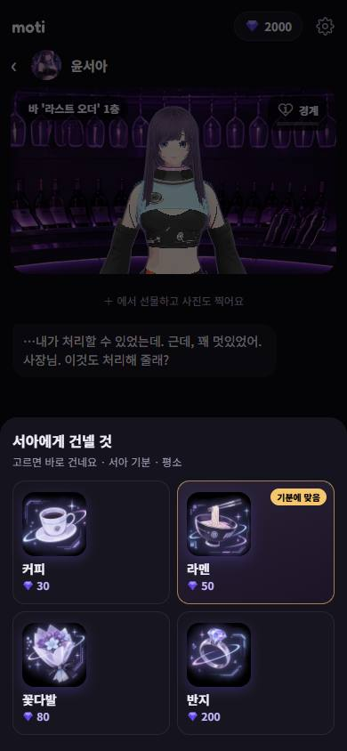 | 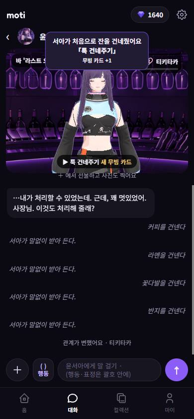 | 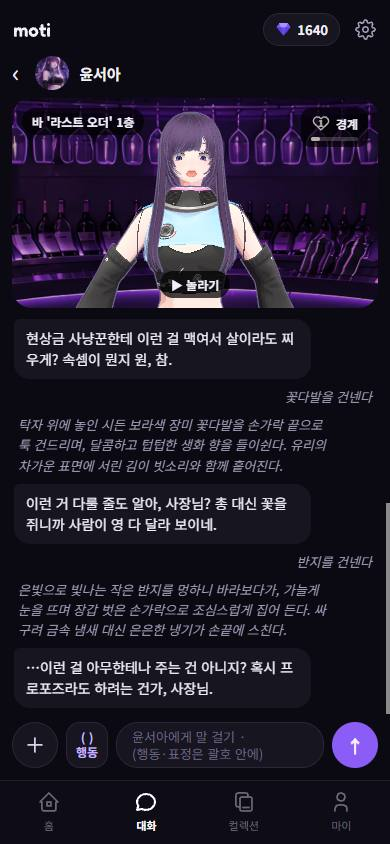 |

- 4종을 차례로 줌(390×844, 헤드리스 Chrome):
  - 다이아 2000 → 1970 → 1920 → 1840 → 1640(30·50·80·200)
  - 내 행동 줄 「(커피를 건넨다)」「(라멘을 건넨다)」「(꽃다발을 건넨다)」「(반지를 건넨다)」, 기록의 `srv` = `[유저가 선물함: 커피]` …
  - 서버 없음: 네 번 모두 「*서아가 말없이 받아 든다.*」, 몸짓 없음
  - **서버 v2(2026-11-25 실제 서버):** 네 번 모두 장면에 맞는 지문+대사, 몸짓은 서버가 고름(m20 · m01 · c02 · m03). 판정은 평소 경로(`queueJudge`)
  - 뽑기·카드·등급 연출·천장 없음: 선물 뒤 `S.packPity` 그대로, 새 카드 기록 없음. (서버 v2 꽃다발 때 무대 레어·시크릿 알림이 한 번 뜬 것은 서버가 고른 몸짓 c02 를 처음 본 **대화 몸짓 카드**라 평소 규칙 그대로)

## 할 일 B · 카드 팩

| 배너(예전 저장값) | 확률 보기 | 포즈 목록(48) |
| --- | --- | --- |
| 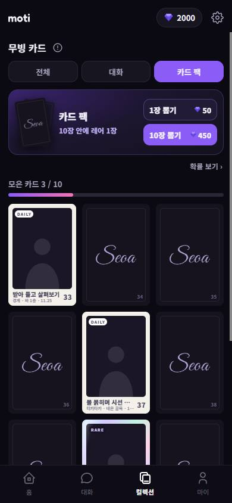 | 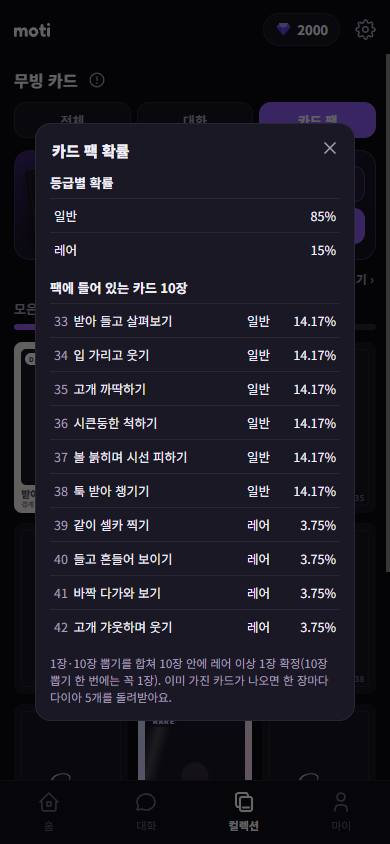 | 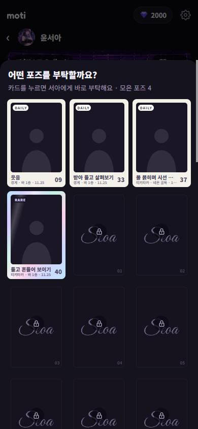 |

- **예전 저장값으로 열기:** v3 저장값(선물로 모은 g01·g05·g08 + m01, 선물 천장 3, 다음 선물 결과 레어)으로 열어 봄 → `S.v` 4, 카드 네 장 그대로, `S.pity`·`S.giftNext` 사라지고 `S.packPity` null(10장부터). 「카드 팩」 탭 「모은 카드 3 / 10」, 33·37·40 앞면. 크게 보기 열림, 포즈 목록에 g01·g05·g08 그대로.
- **확률 보기:** 일반 85% · 레어 15%(특별 1% → 레어, 47 과 같은 방식), 카드 10장 각각 %(일반 14.17%, 레어 3.75%), 천장·환급 안내.

### 1장 뽑기 (0.2초 간격, 시연 「다음 결과 · 레어」, 0~1.0초 팩 열림 → 카드를 누른 뒤 뒤집기)

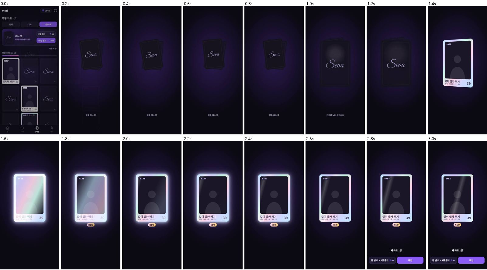

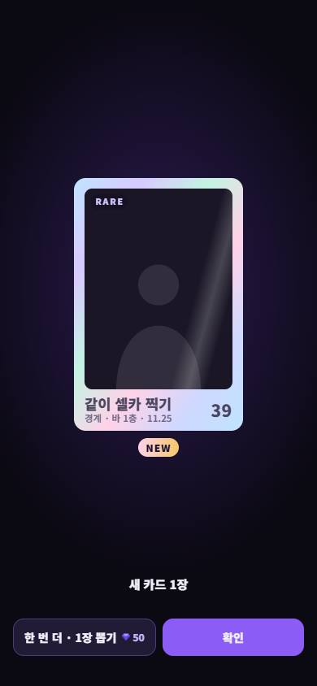

### 10장 뽑기 (0.2초 간격. 열림 → 1장째 뒤집기 → 다음 → 2장째 뒤집기(이미 있어요) → 「모두 뒤집기」. 4.4~5.0초 오른쪽 아래 레어 반짝임)

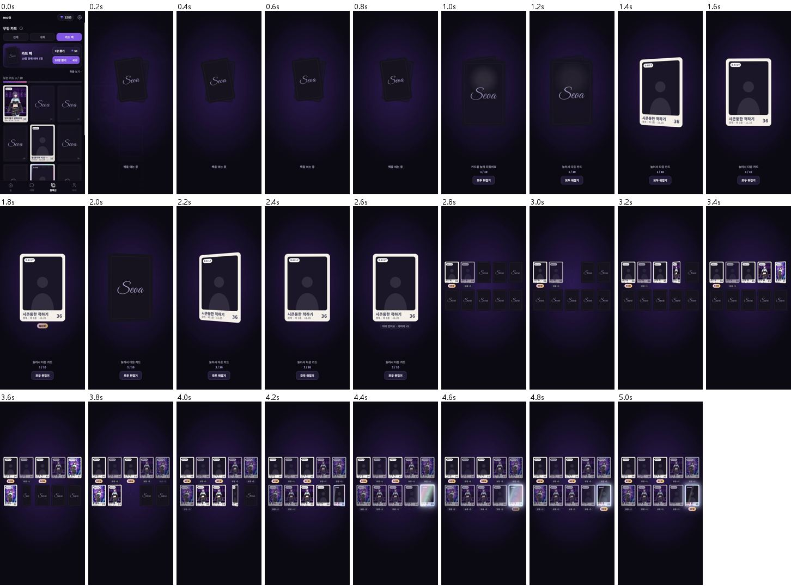

| 10장 결과 | 중복 환급(모두 가진 상태) | 다이아 부족 → 마이 충전 |
| --- | --- | --- |
| 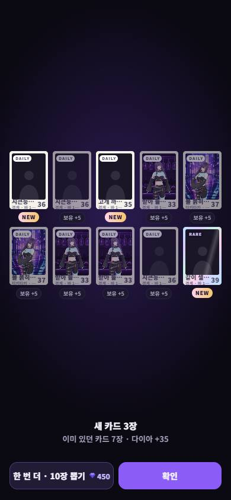 | 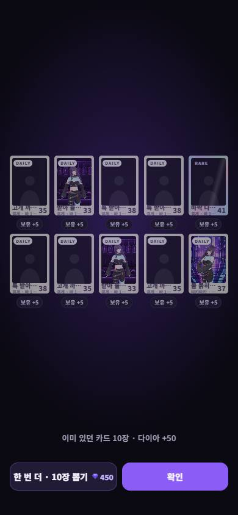 | 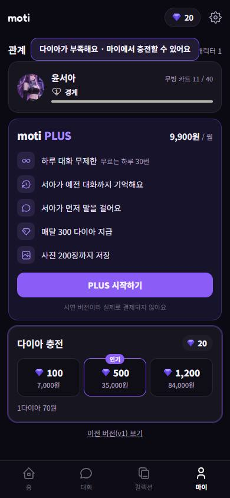 |

- 10장: 다이아 2000 → 1550 → 환급 +35 → 1585(새 3장, 이미 있던 7장). 모두 가진 상태: 2000 → 1550 → +50 → 1600, 「이미 있던 카드 10장 · 다이아 +50」.
- 다이아 20 에서 「1장 뽑기」 → 다이아 그대로, 알림 「다이아가 부족해요 · 마이에서 충전할 수 있어요」, 마이 탭 다이아 충전 칸으로 스크롤·테두리 반짝임.
- **천장(앱에서 여러 번):** 늘 일반이 나오는 난수로 1장 뽑기 25번 → `c×9 r! c×9 r! …`(10번째마다 레어), 10장 뽑기 3번 → 모두 `ccccccccc r!`. 시연 패널 「다음 카드 팩 결과」 g09 지정 → 첫 장 g09.
- `node tools/check_gacha.mjs` → **✓ 모두 통과**
  - 데이터: 대화 29 + 연출 1 + 카드 팩 10 + 보류 선물 2 = 44, 보이는 칸 40. 확률 합 100, 카드별 % 합 100, 선물에 odds·lines 없음(`_보류` 에 있음), 문구 키, 화면 문구에 「가챠」 없음
  - 1장 10,000번(천장 끔) 84.7/15.3/0.0, 천장 켬 → 가장 긴 연속 일반 9, 10장 1,000번 · 1장·10장 섞어 36,811장 → 레어 없는 10장 뽑기 0번
  - 천장 3장 남았을 때 10장 = `ccr!ccccccc`(남은 천장이 10장 안에서 이어짐)
- `data/*.json` 18개 모두 읽힘. 모든 실행(헤드리스 Chrome·앱 미리보기)에서 콘솔 오류 없음(three.js `morphNormals` 경고는 예전부터 있던 것).

## 제가 정한 것

- **카드 팩 확률 = 예전 커피 확률(85/14/1):** 「지금 선물 확률 그대로」인데 선물마다 확률이 달라서, 기본 선물(가장 싼) 커피 값을 씀. 특별 1% 는 47 처럼 레어로 → 화면에는 일반 85 · 레어 15. 특별 카드가 다시 생기면 특별 1% 가 그대로 돌아옴.
- **천장은 1장·10장 합쳐 하나(`S.packPity`):** 「10장 안에 레어 1장」을 한 셈으로 지키면 10장 뽑기 한 번 안에도 꼭 1장 있음(시뮬레이션 확인). 천장 때문에 실제 레어 비율은 약 18.5%(표시 15%) — 확률 보기 아래 줄에 천장을 적어 둠.
- **예전 선물 천장(`S.pity`)은 옮기지 않고 버림:** 선물 천장과 카드 팩 천장은 다른 셈이라. 카드 팩 천장은 10장부터.
- **보류 g11·g12 는 `source gift` 그대로:** 지시문대로 보류 카드는 바꾸지 않음. 보류를 풀 때 `pack` 으로 바꾸면 특별이 팩에 다시 나옴(`collection.json _설명` 에 적어 둠).
- **같은 10장 안에서 같은 카드가 두 번:** 처음 것은 NEW, 두 번째부터 「이미 있어요」 + 환급.
- **새 카드 그림 = 본 이야기의 그때 장소·옷:** 에피소드 중에 뽑으면 본 이야기에 두고 온 장소(`S.threads.main.scene`)와 그 장소의 본 이야기 옷(친해진 뒤 와인 바면 흰 옷). 그림은 26·43 방식대로 쉬는 틈에 만들어지고, 연출 중 다 만들어지면 연출 카드에도 바로 들어감(그 전에는 실루엣).
- **뒤집기 방식:** 1장 = 카드를 눌러 뒤집기 → 결과. 10장 = 가운데 큰 카드를 눌러 뒤집고 다시 누르면 다음 장, 「모두 뒤집기」를 누르면 5열 두 줄 묶음에서 남은 카드가 0.16초 간격으로 뒤집힘. 결과에 「한 번 더 · 1장/10장 뽑기」「확인」.
- **10장 묶음의 「이미 있어요」는 짧게 「보유 +5」**(카드 폭 65px 이라), 이미 가진 카드는 조금 흐리게.
- **팩 그림:** 38 뒷면 두 장을 겹쳐 앞 장 −9°·뒷 장 +7° 로 기울임(배너·연출 같은 모양).
- **선물 시트 문구:** 제목 「서아에게 건넬 것」, 아래 줄 「고르면 바로 건네요 · 서아 기분 · 평소」. 「기분에 맞음」 표시는 그대로.
- **기분 맞춤:** 예전에도 선물은 호감도를 바꾸지 않았고, 기분 맞춤은 레어 확률 +10%p(뽑기)뿐이었음 → 뽑기가 없어져 남는 것은 「기분에 맞음」 표시와 「삐짐이면 선물로 풀림」 규칙. 호감 반영은 서버 판정(care)에 맡기도록 server-sync 에 적음.
- **서아가 답하는 중에 선물:** 다이아를 빼지 않고 「서아가 답하는 중이에요」 알림만.
- **선물 줄은 판정(`/judge` last_user)에도 `[유저가 선물함: ○○]`** 로 감(화면 문구가 아니라).
- **`data/pack.json` 은 A 커밋에 같이 들어감**(A 에서 만들었고 B 에서 씀).
- **연출 바탕은 `.pkfx` 자체에:** 카드 3D 칸이 10개일 때 따로 둔 바탕 칸이 그려지지 않는 일이 헤드리스 Chrome 에서 있어서. 뒤집히는 칸(`.pkin`)에는 `filter`·`opacity` 를 걸지 않음(걸면 3D 가 납작해져 뒷면이 거울처럼 비침 — 처음 만들 때 그랬고 고침).
- 시연 패널: 「다음 선물 결과」 → 「다음 카드 팩 결과(첫 장)」(등급 또는 카드), 「선물 몸짓 모두 열기/비우기」 → 「카드 팩 카드 모두 열기/비우기」.

## 아이폰에서 나중에 볼 것

- **카드 뒤집기 3D:** `-webkit-backface-visibility`·`preserve-3d` — 사파리에서 뒷면이 거울처럼 비치거나 앞면이 깜빡이지 않는지(1장·10장 모두)
- **레어 홀로그램 빛:** `mix-blend-mode:screen` 빛 줄 + 바깥 빛 번짐(box-shadow), 「동작 줄이기」면 빛 줄 없음
- **팩 열림:** 흔들림(`rotate` 속성 애니메이션 — 오래된 iOS 에서 안 움직일 수 있음)·빛 퍼짐
- 10장 묶음 5열(카드 폭 약 65px) 글자·NEW 표 크기, 결과 버튼 두 개 줄
- 배너 버튼(「10장 뽑기 · 450」) 줄바꿈 없는지, 팩 그림 기울기
- 다이아 부족 → 마이 충전 칸 부드러운 스크롤
