# 5. 발표용 시연 설정·디버그 패널

브랜치: `step/5-demo-panel` (main 병합 안 함)

| 단계 | 커밋 | 한 일 |
| --- | --- | --- |
| 5-A | `3817b9b` | 시연 설정을 패널로 확장, 디버그 기능(`?debug=1`), 서버 깨우기 상태 점, 늦을 때 대체 답장 |
| 5-B | 이 커밋 | 장면 바로가기 6개, 다음 답장 뒤 예약, 키보드 단축키 |

## 바뀐 파일

| 파일 | 내용 |
| --- | --- |
| `index.html` | 헤더의 「시연 설정」 버튼과 시트를 없애고, 오른쪽 가장자리 손잡이 + 패널(`Demo`)로 바꿈. 장면 바로가기·예약·단축키(`Scenes`). 서버 모드(v1·v2·없음), 서버 깨우기 상태, 답장 시간 초과, 마지막 답장 기록. 초기화·장면 이동 때 진행 중인 답장·판정·인트로를 버리는 장치(`GEN`) |
| `data/demo.json` | 패널의 모든 문구, 플래그 목록 (새 파일) |
| `data/demo_scenes.json` | 장면 6개 정의 (새 파일) |
| `data/config.json` | `replyTimeoutMs` 8000, `wakeTimeoutMs` 60000 추가 |
| `docs/reports/img/5/*.jpg` | 캡처 14장 |

## 화면 구성

- **손잡이:** 화면 오른쪽 가장자리 가운데에 반투명 막대(12×52px). 누르면 패널이 오른쪽에서 나온다. 키보드 `D`(debug 일 때)로도.
- **항상 보이는 항목:** 지금 장면·다음 장면·예약, 장면 바로가기, 서버 상태 점과 「서버 깨우기」, 오프닝 다시 보기, 전체 초기화(두 번 누르기), 💎 500 충전, 기분(평소·피곤함·삐침·생일).
- **`?debug=1` 일 때만:** 서버 v1/v2/없음 전환, 마지막 답장(응답 시간·받은 JSON), 부분 초기화 4개, 관계 단계 1~6, 호감도 막대(0~100), 플래그 8개, 장소 5곳, 몸짓 목록(재생·해금 연출 미리보기·전부 열기·전부 잠그기), 단축키 안내.
- 열림/닫힘, 서버 모드, 지금 장면은 `localStorage` `moti_demo` 에 따로 저장 → 새로고침·전체 초기화해도 유지.

## 서버 안전장치 (5-A)

- **상태 점:** 회색(아직)·노랑(깨우는 중)·초록(깨어 있음, 걸린 ms 표시)·빨강(60초 안에 응답 없음 또는 연결 실패). 앱을 열 때 자동으로 한 번 깨우는 동작은 그대로이고, 그 결과도 같은 점에 나온다. 답장이 서버에서 오면 초록으로 바뀐다.
- **늦을 때 대체 답장:** 서버가 깨어난 것이 확인된 뒤에는 `/chat` 을 8초(`replyTimeoutMs`)까지만 기다리고, 넘기면 기존 예시 대사. 깨어나기 전 첫 답장은 45초 그대로.
  - 시험: 12초 늦게 답하는 가짜 서버(`?api=` 로 연결) → **8,003ms** 에 예시 대사로 넘어감, 패널에 「예시 대사 (서버 8000ms 초과)」.
  - 실제 배포 서버(v1): 3,410ms 에 답장, 패널에 「서버 · v1」과 받은 JSON.
- **서버 없음:** 서버에도 Claude 미리보기에도 묻지 않고 바로 예시 대사.

## 장면 바로가기 (5-B)

| 장면 | 들어가면 | 다음 답장 뒤 |
| --- | --- | --- |
| ① 첫 만남 | 서아 전체 초기화 → 대화방 → 오프닝 재생 | — |
| ② 단골 | 1단계, 바 1층, 평소 | 2단계 상승 → 「툭 건네주기」 해금 연출 |
| ③ 끌림 | 2단계(2단계 몸짓 해금), 바 1층, 평소 | 3단계 상승 → 「칼라 만지작거리기」 해금 연출 |
| ④ 고백 직전 | 3단계, 바 1층, 평소 | 4단계 상승 → 「이마 맞대기」 해금 연출 |
| ⑤ 옥상 | 4단계, 바 옥상, 평소 | 옥상 사건 → 「바디웨이브 댄스」 해금 연출(전신) |
| ⑥ 추억 앨범 | 앨범 탭 「처음 본 모습」 (상태 그대로) | — |

- 들어가면 서아 대화를 비우고 장 제목을 가운데 2초(「3장 · 끌림」). 장 제목은 대화 목록 맨 위에도 작은 시스템 줄로 남는다.
- 예약은 서버 v1·v2·없음 모두 같은 자리(답장을 보여 준 직후)에서 실행하고 지운다. 그 턴은 대화 횟수 단계 계산을 건너뛰고, v2 판정이 단계를 바꿔도 예약 단계로 되돌린다.

## 단축키 (`?debug=1` 일 때만, 입력창에 치는 중에는 동작 안 함)

| 키 | 동작 |
| --- | --- |
| `1` ~ `6` | 해당 장면으로 |
| `→` | 다음 장면 |
| `←` | 이전 장면 |
| `R` | 지금 장면 처음부터 다시 |
| `D` | 패널 접기·펴기 |
| `W` | 서버 깨우기 |

한글 자판 상태에서도 동작하도록 글자가 아니라 키 위치(`KeyR` 등)로 받는다. 숫자 패드 1~6도 된다.

## 확인

**서버 없음, 단축키로 한 바퀴 (390px):** 각 장면에서 메시지 하나씩.

| 장면 | 결과 | 캡처 |
| --- | --- | --- |
| ① | 장 제목 → 오프닝 11문단 → 메시지에 예시 대사 답장 | 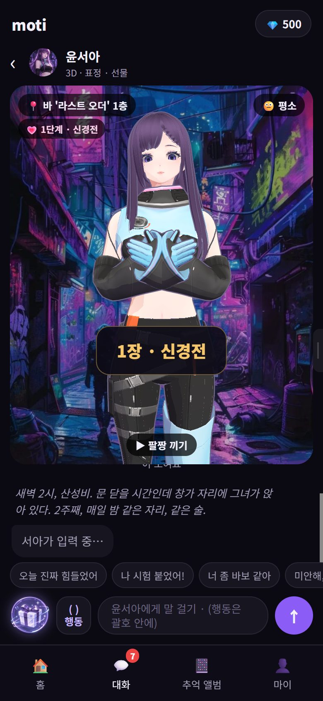 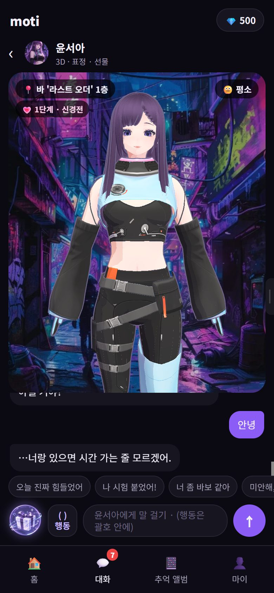 |
| ② | 1→2단계, `m09` 해금 연출·토스트·앨범 기록 | 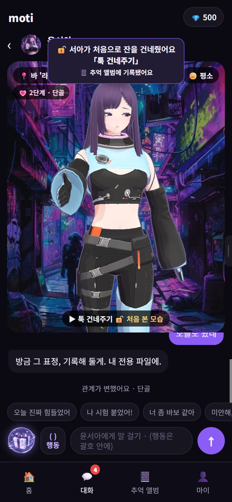 |
| ③ | 2→3단계, `c01` 해금 연출 | 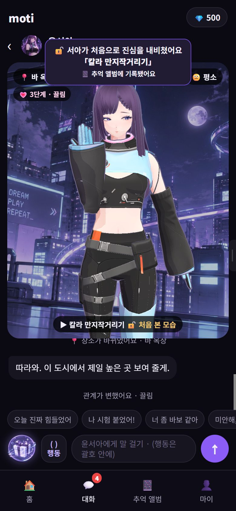 |
| ④ | 3→4단계, `c05` 해금 연출 | 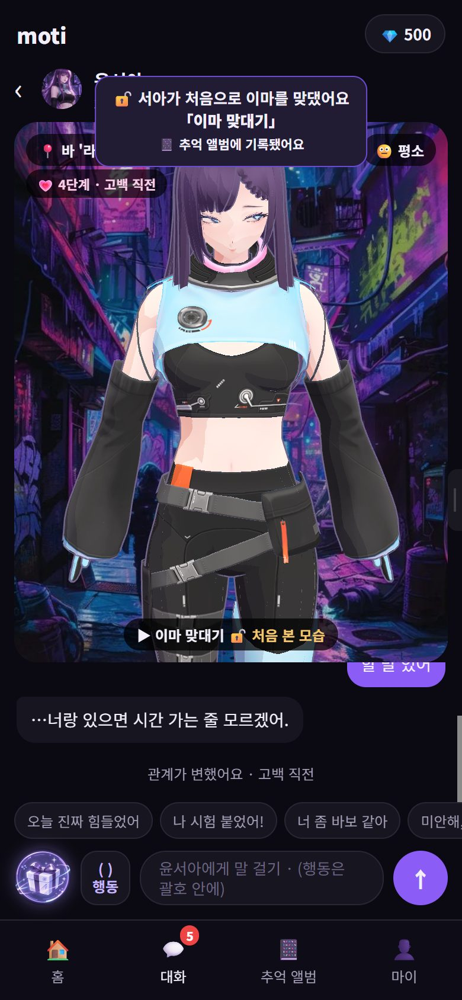 |
| ⑤ | 4단계 유지, `m23` 해금 연출(전신 구도) | 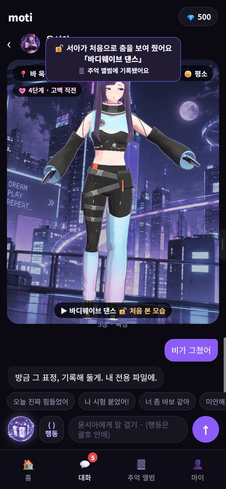 |
| ⑥ | 앨범 「처음 본 모습」 4칸(m09·c01·c05·m23) | 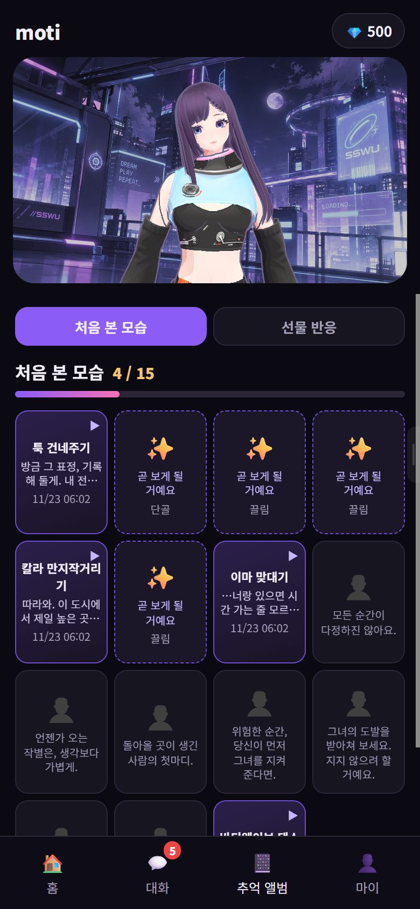 |

- `R`(⑥ 다시), `←`(⑤로, 예약 다시 걸림), `D`(패널 열림), 입력창에 포커스가 있을 때 `2` → 장면 안 바뀜. 콘솔 오류 0.
- **서버 v1(배포 서버):** ② 4.7초 → 2단계·`m09` 연출 ✔, ③ 6.2초 → 3단계·`c01` 연출 ✔.
- **서버 v2:** 배포 서버에 `/judge` 가 없어 실제로는 못 돌렸다. 예약 실행 위치는 v1·없음과 같은 코드.

**5-A 패널 (390px · 1280px):**

| | 390px | 1280px |
| --- | --- | --- |
| 접힘 | 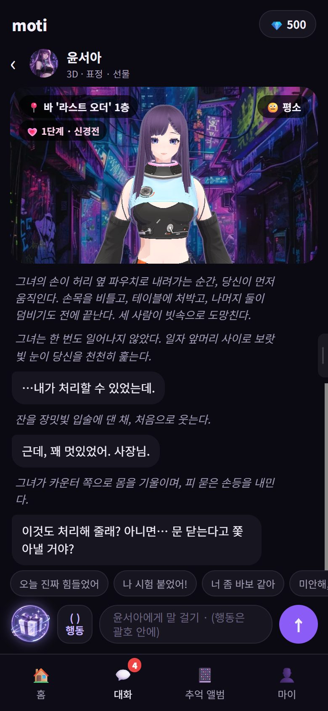 | 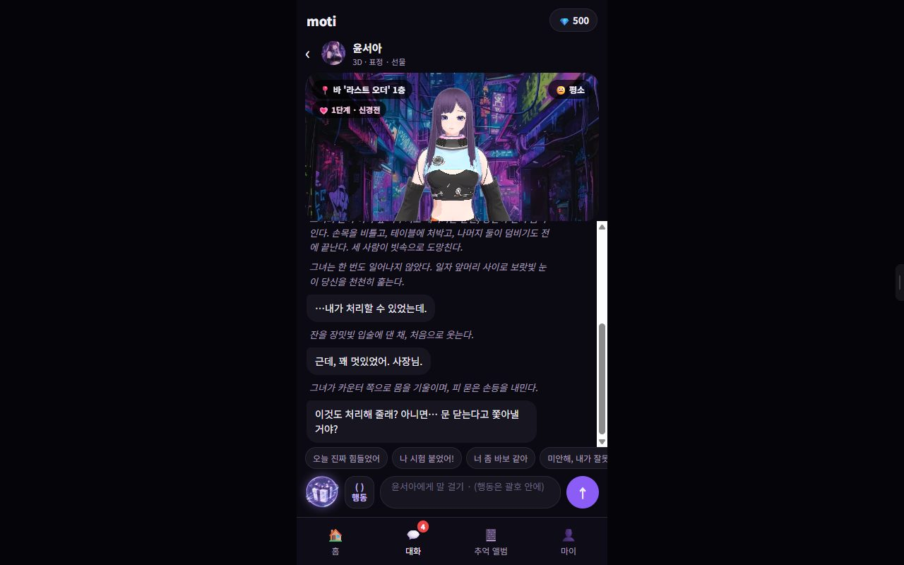 |
| 펼침 | 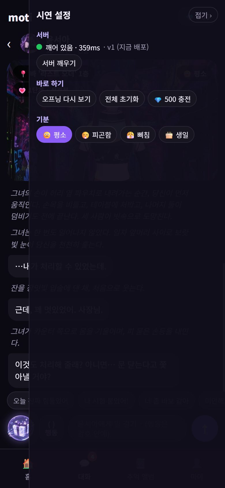 | 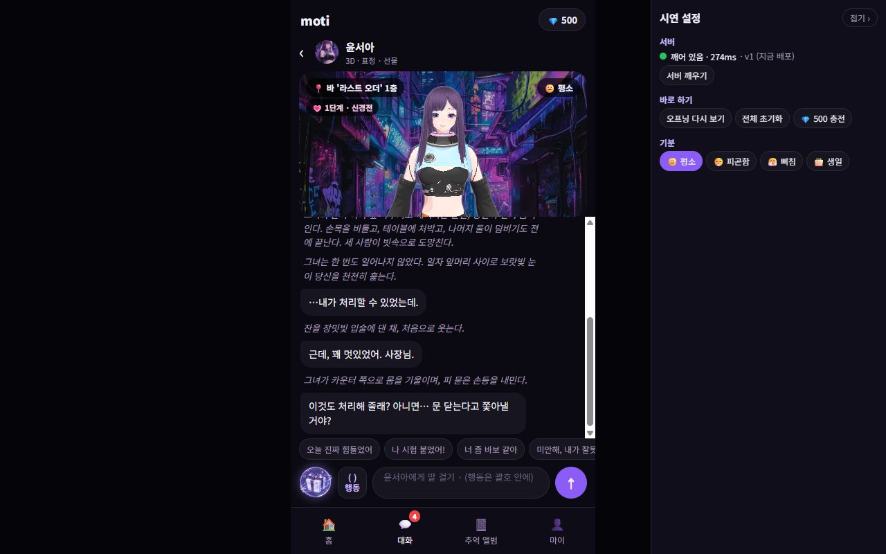 |
| 펼침 `?debug=1` | 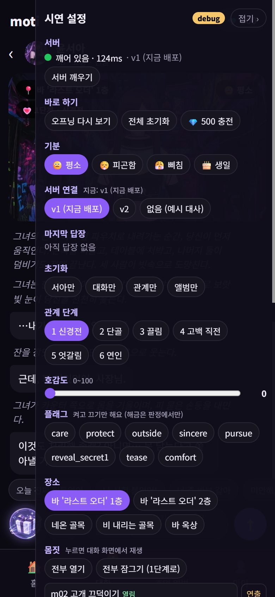 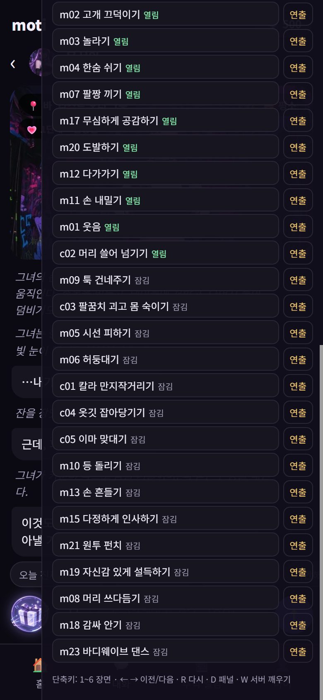 | 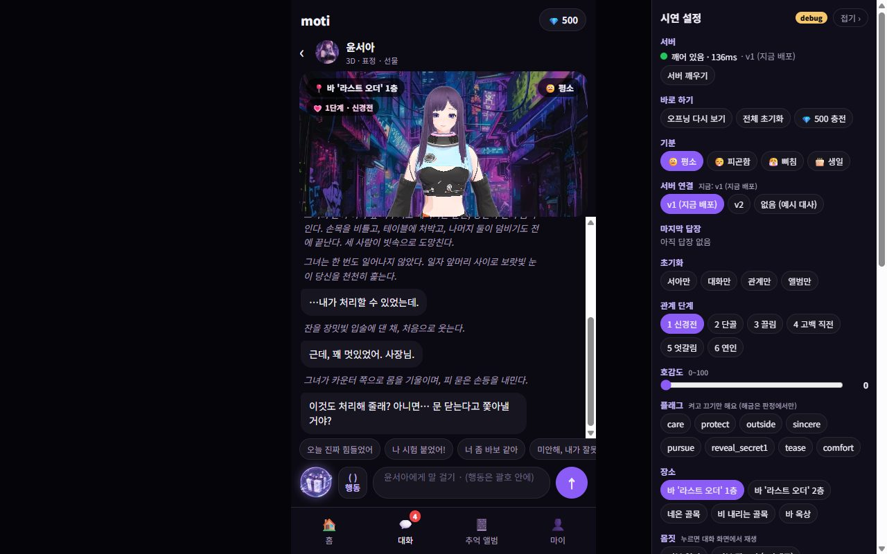 |
| 장면·예약 표시 | | 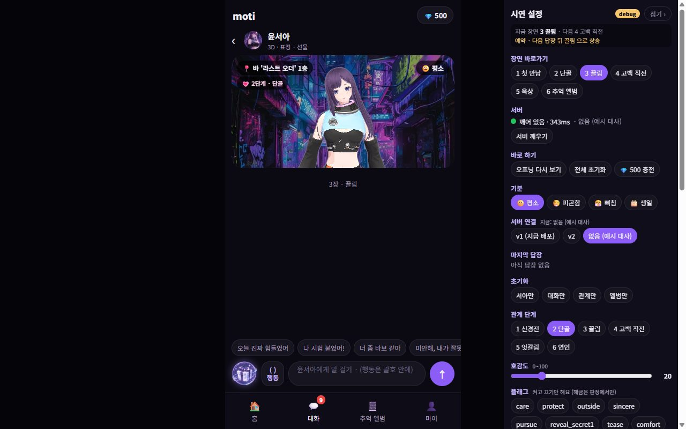 |

노트북(1280px)에서는 앱(440px)과 패널이 겹치지 않는다. 휴대폰 폭에서는 패널이 화면 대부분을 덮으므로, 장면·몸짓 재생·오프닝을 누르면 패널이 저절로 접힌다(폭 800px 미만일 때).

## 아이폰 사파리 확인 (별도 확인 항목)

새 시각 효과: 패널 미끄러지기(transform 전환), 장 제목(투명도·크기 전환). 블러·그림자는 쓰지 않았다. 헤드리스 Chrome에서만 봤다.

- [ ] 오른쪽 손잡이가 보이고 눌리는지 (사파리 가장자리 뒤로 가기 제스처와 겹치지 않는지)
- [ ] 패널이 부드럽게 나오고 안에서 스크롤되는지, 뒤 화면이 같이 스크롤되지 않는지
- [ ] 장 제목이 가운데에 2초 보였다가 사라지는지
- [ ] 호감도 막대를 손가락으로 끌 수 있는지

## 발표 전 체크리스트

1. 노트북 브라우저로 `https://bii0411.github.io/Moti/?debug=1` 열기 (발표 5분 전)
2. 손잡이(또는 `D`)로 패널 열기 → **서버 깨우기**(`W`) → 점이 **초록**이 될 때까지 대기 (Render는 처음 30~50초 걸림)
   - 빨강이면 다시 누르기. 계속 빨강이면 서버 연결을 **없음**으로 → 예시 대사로 시연
3. **전체 초기화**를 두 번 눌러 비우기 (서버 모드·패널 설정은 남음)
4. `1` 을 눌러 **① 첫 만남** 장면에서 대기, `D` 로 패널 접기
5. 시연 중: 장면마다 메시지 하나 보내기 → 연출 확인 → `→`
6. 끝난 뒤 문제가 있으면 `R` 로 지금 장면 다시

## 제가 정한 것

1. **헤더의 「시연 설정」 버튼을 없앴다.** 접었을 때 관객에게 거의 안 보여야 해서 오른쪽 가장자리의 흐린 손잡이 하나로만 연다.
2. **손잡이 위치는 오른쪽 가장자리 가운데.** 위쪽 구석은 💎 표시와 겹치고, 아래쪽은 탭 막대와 겹친다.
3. 좁은 화면(800px 미만)에서는 장면·몸짓·오프닝을 누르면 **패널이 저절로 접힌다.** 노트북에서는 그대로 둔다.
4. **기분 버튼은 「지금 기분」을 바꾼다**(고정하지 않음). 이후 대화로 다시 바뀔 수 있다. 예전 시트의 「자동/강제」 구분은 없앴다. 패널 문구는 지시대로 「피곤함·삐침」이고, 3D 위 기분 표시는 기존 문구(「지침·삐짐」) 그대로다.
5. **관계 단계 바꾸기:** 그 단계까지 몸짓을 열고 위 단계 몸짓은 닫는다. 대화 횟수와 호감도도 그 단계 시작값(`countAt`·`affectionAt`)으로 맞춰 이후 진행이 자연스럽게 했다. 앨범 기록은 건드리지 않는다.
6. **플래그 켜고 끄기는 상태(`stage_flags`)만 바꾼다.** 해금은 판정에서 플래그가 나올 때만 일어나는 규칙이라 패널이 해금을 일으키지 않는다.
7. **「전부 잠그기」는 1단계로 되돌린다.** 단계로 열린 몸짓은 단계에서 계산되므로, 단계를 두면 잠기지 않기 때문이다.
8. **부분 초기화의 범위:** 「대화만」= 모든 캐릭터 대화(서아 오프닝은 다시 안 나옴), 「관계만」= 단계·호감도·플래그·사건·대화 횟수·판정으로 열린 몸짓, 「앨범만」= 처음 본 모습 + 선물 반응(선물로 배운 몸짓은 남김), 「서아만」= 서아 대화·관계·앨범·기분·장소(💎·PLUS·다른 캐릭터는 남김).
9. **장 제목 이름:** ①~④는 단계 이름(신경전·단골·끌림·고백 직전 — 예약으로 올라갈 단계), ⑤ 「옥상」·⑥ 「추억 앨범」은 맞는 단계 이름이 없어 장면 이름을 썼다. ①은 지시 예시대로 「1장 · 신경전」.
10. ②~⑤의 기분은 모두 **평소**로 맞췄다(지시는 ②만). 삐침 토스트 같은 것이 끼지 않게.
11. 장면에 들어갈 때 **예약된 몸짓의 앨범 기록과 해금을 지운다.** 그래야 같은 장면을 다시 해도 해금 연출이 또 나온다. 그 장면 단계 이하의 기록은 남긴다(⑥ 앨범에 앞 장면 기록이 쌓이게).
12. 대화를 비운 자리에는 **장 제목 시스템 줄 하나만** 둔다(앞 대화를 만들지 않음). 비워 두면 새로고침 때 예전 한 줄 인트로가 다시 들어가는 기존 동작이 있어서다.
13. 예약을 실행한 턴에서는 v2 판정이 준 **플래그 해금 연출도 건너뛴다.** 예약 연출과 겹치지 않게.
14. 서버 v2에서 ⑤ 옥상은 서버의 `pending_event` 를 쓰지 않고 앱이 직접 해금한다. 서버에 사건을 넣으면 서버 답장이 사건 장면으로 바뀌는데, 그건 이번 범위(상태 도구)를 넘는다고 봤다.
15. 서버 깨우기 「응답 없음」 기준은 60초(`wakeTimeoutMs`).
16. 장면 이동·초기화 때 기다리던 답장·판정·인트로·해금 연출은 **버린다.** 안 그러면 늦게 온 답장이 새 장면 대화에 끼어든다.
17. 예시 대사 규칙상 「달」이 들어간 말(예: 「달라 보여」)은 장소를 옥상으로 바꾼다(기존 동작). 시연 때 ②~④에서 「달」이 든 말을 쓰면 배경이 옥상으로 바뀌니 피하는 게 좋다.
18. 캡처는 헤드리스 Chrome(소프트웨어 렌더링)으로 했다. 3D가 많이 그려지는 순간 캡처가 가끔 멈춰 다시 찍었다.
