# 50 · 선물 다시 짜기 — 언제든 주는 선물 · 순간 선물 · 반응 포토카드

브랜치 `step/50-gift-moment` · 커밋 `[50-A] 선물 목록 다시 짜기` · `[50-B] 순간 선물이 열리는 흐름` · `[50-C] 순간 선물 반응 포토카드` · `[50-C] 시연 패널 서아 초기화 때 순간 선물도 비움` · `[50-D] server-sync 순간 선물` · `[50] 보고서와 진행 현황`

> **먼저 알려 드릴 것:** 다운로드 폴더에 `standard_Gift_Cocktail_1~3` FBX 가 **없었습니다**(같은 폴더의 다른 `standard_*.fbx` 12개만 있음). 지시대로 칵테일은 세 묶음 모두 순간 목록에 들어가지 않으므로, **지금 앱에서는 순간 선물이 열리지 않고 컬렉션 「선물」 탭도 비어 있습니다.** 연결은 다 해 두었고, FBX 가 오면 변환 → `data/motions.json` 에 넣기만 하면 열립니다(아래 「FBX 가 오면」). 흐름 확인은 확인용 주소 `?giftPreview=1`(반응 몸짓을 이미 있는 몸짓으로 잠시 대신함)로 했습니다.

## 바뀐 파일

| 파일 | 바뀐 것 |
| --- | --- |
| `data/gifts.json` | **A** 선물을 `kind` always 5 · moment 5 로. 가격(임시), 언제든 선물 받는 몸짓 `motion`, 순간 선물 `when`·`reactions`(묶음 → 반응 몸짓 id). 커피·라멘은 `_보류.list`. `repeat`(직전 3번 · m04/m07 · 호감 ×0.5). **B** `moment`(3턴, 임시 규칙 재열림 간격 10턴), `momentFallback`(켜 둠, 칵테일). **C** `bonds`(차가움 1·2 / 흔들림 3·4 / 솔직함 5·6), `preview`(확인용) |
| `data/collection.json` | **C** 카드 3장 `gm01` 46 「칵테일 · 차가움」, `gm02` 47 「칵테일 · 흔들림」, `gm03` 48 「칵테일 · 솔직함」 — `source moment`, 레어, `play.m` = 반응 몸짓 x26·x27·x28 |
| `data/ui.json` | `gift` 서버 줄 붙는 말(srvMoment·srvMood·srvAgain), 시트 두 줄 제목·설명·??? ·「지금 건네기 좋아요」·「반응 포토카드」·첫 안내(guide). `album.seg.gift` 「선물」, `album.giftEmpty` |
| `index.html` | **A** `give()`: 언제든 선물 몸짓 고정, 「또」(직전 3번), 서버 줄 붙는 말, `send()` 가 `o.giftMid` 를 서버 몸짓보다 우선 재생(선물 몸짓은 「처음 본 카드」 기록 안 함), 판정 버퍼 `h`(또) → 그 판정의 호감 상승 ×0.5. 선물 그림이 없으면 그림 문자(`giftPic`). **B** 선물 시트 다시 그림(순간 칸 · 언제든 · 특별한 순간에), 첫 「선물」 안내 시트(`#giftGuide`, `S.giftGuide`), `Moment`(열기·닫기·3턴 셈·임시 규칙·서버 `gift_moment`·+ 금빛), `/chat` `state.gift_moments`, 답장 `gift_moment` 읽기. **C** 순간 선물 = 지금 묶음의 반응 몸짓 + 처음이면 카드(새 카드 알림), 컬렉션 「전체·대화·선물·카드 팩」, 반응 몸짓 없는 카드는 숨김, `?giftPreview=1`. 시연 패널 서아 초기화 때 순간 선물·「또」 기록도 비움 |
| `tools/check_gacha.mjs` | 선물 목록 검사(언제든 5·순간 5·커피 라멘 빠짐·예전 확률 대사 `_보류` 보존·문구 키), 순간 카드 ↔ gifts.json reactions 일치, 카드 번호 겹침·은퇴 번호 |
| `tools/build_collection.mjs` | `moment` 칸을 그대로 둠(다시 만들어도 지금 파일과 같음 확인) |
| `docs/server-sync.md` | 「50 · 순간 선물」 |
| `docs/status.md` | 50 절, 남은 일 |

## 할 일 A · 선물 목록

| 사탕 → m09 | 초콜릿 → x19 | 물 한 잔 → m04 |
| --- | --- | --- |
| 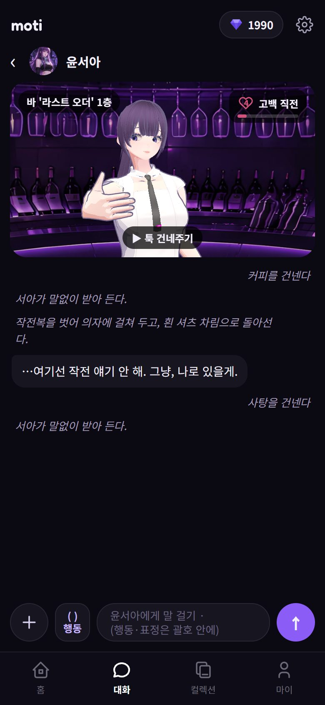 | 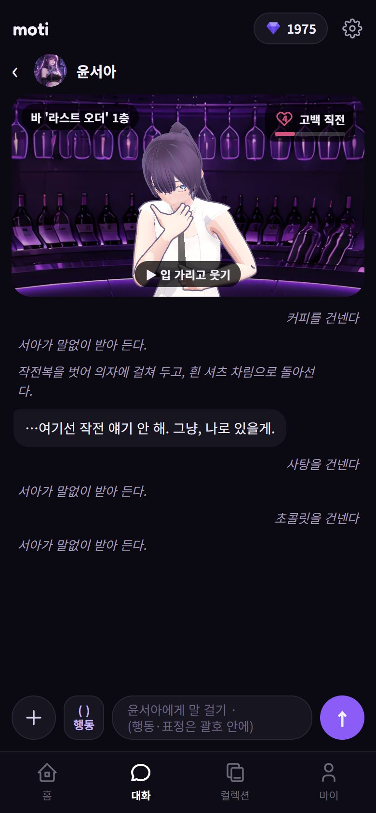 |  |

| 반창고 → m05 | 손난로 → m24 | 손난로 또 → m04 |
| --- | --- | --- |
|  | 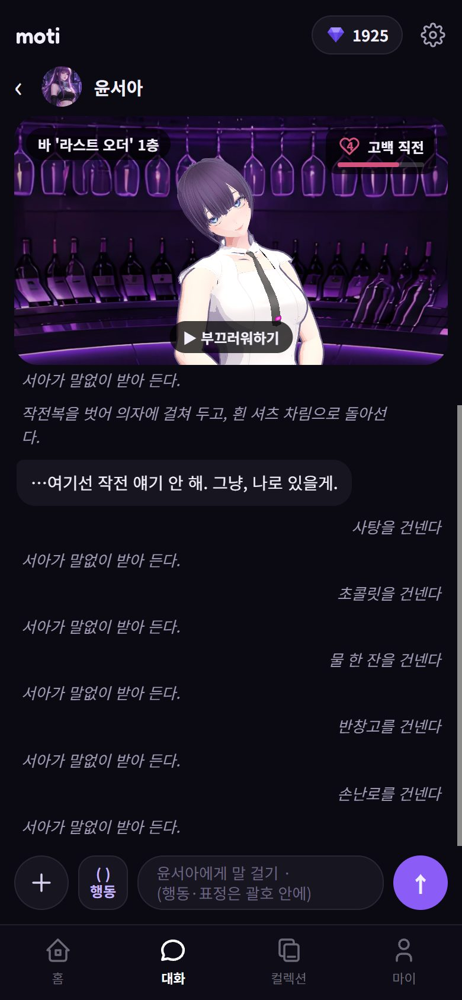 |  |

- 다섯 개를 차례로 줌(서버 없음, 390×844 헤드리스 Chrome): 재생 몸짓 m09 · x19 · m04 · m05 · m24, 다이아 10·15·10·20·20 씩 빠짐, 새 카드 없음.
- **또:** 반창고 → 반창고 = m04 + `[유저가 선물함: 반창고] · 또`, 물 한 잔 → 물 한 잔 = m07(물 한 잔 몸짓이 m04 라 다른 쪽) + `· 또`, 손난로 → 손난로 = m04 + `· 또`. 사이에 다른 선물 3개를 끼우면 또가 아님(사탕 … 손난로 → 사탕 = 평소).
- **49 그대로인 것:** 「기분에 맞음」 표(물 한 잔·지침 그림 아래 B 캡처), 기분 맞으면 서버 줄 `[유저가 선물함: 사탕] · 서아 기분에 맞는 선물`, 화면 줄 「(사탕을 건넨다)」, 서버 답이 없을 때 지문 「*서아가 말없이 받아 든다.*」, 삐짐이면 선물로 풀림.

## 할 일 B · 순간 선물이 열리는 흐름

| 처음 「선물」 안내 | 시트 · 순간 없음 | 시트 · 순간 열림 |
| --- | --- | --- |
|  |  |  |

| + 버튼 금빛 | 기능판 「선물하기」도 금빛 | 내 메시지 3번 뒤 닫힘 |
| --- | --- | --- |
| 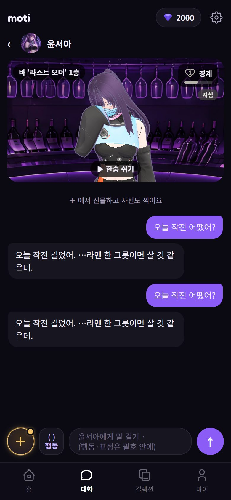 |  | 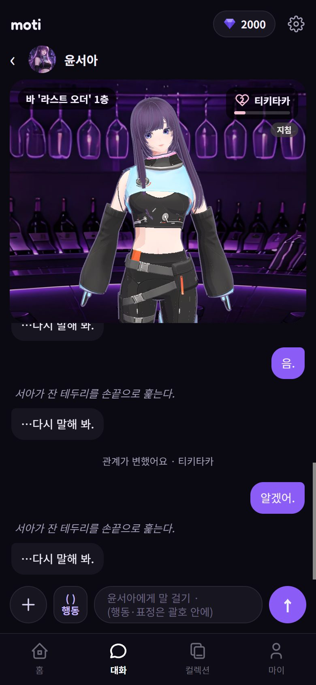 |

확인(`?giftPreview=1`, 서버 없음 → 서버 v2 흉내):

- **반응 모션 없음(그냥 주소):** 「오늘 작전 어땠어?」 → 서아 「오늘 작전 길었어. …」 → **안 열림**, `gift_moments` `[]`, + 금빛 없음.
- **임시 규칙:** 같은 말 → 칵테일 열림(`reason` 「서아가 지쳐 보여요」, 남은 3) → 「그래?」 2 · 「음.」 1 · 「알겠어.」 → 닫힘, 금빛 꺼짐.
- **서버 흉내(`/chat` 을 가로채 「…오늘은 좀 길었어.」 + `gift_moment` 를 돌려줌):** 보낸 `state.gift_moments` = `[{"id":"cocktail","name":"칵테일","when":"서아가 지쳐 보일 때"}]`(열려 있는 동안은 `[]`). `gift_moment {"id":"cocktail","reason":"서아가 지쳐 보여요"}` → 열림(`src server`), `S.momentSrv` true. 3턴 뒤 닫고, `gift_moment` 없이 「오늘 작전 길었지?」(서아 답 「…오늘은 좀 길었어.」) → **임시 규칙 꺼져서 안 열림.**
- 서버 `gift_moment` 를 받기 전에는 같은 답 「…오늘은 좀 길었어.」 에 임시 규칙이 칵테일을 엶(서버 v2 경로에서도 동작).

## 할 일 C · 순간 선물 반응 포토카드

| 칵테일 · 흔들림 (썸) | 컬렉션 「선물」 탭 | 반응 모션 없을 때 「선물」 탭 |
| --- | --- | --- |
| 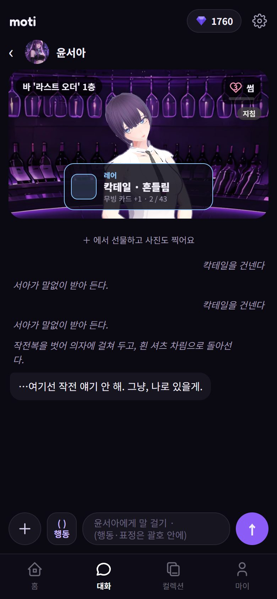 | 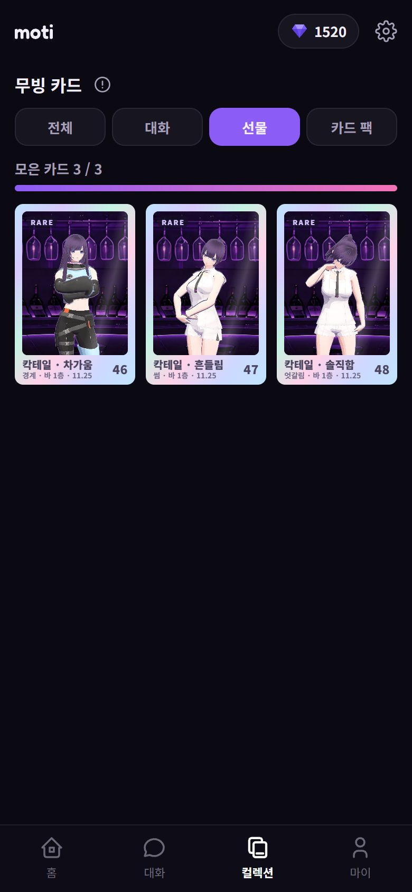 |  |

카드 크게 보기(미리보기 몸짓이라 진짜 반응 모션과 다름):

- `?giftPreview=1` 에서 단계 1 · 3 · 5 로 칵테일을 줌 → 묶음 cold · sway · honest, 재생 x26 · x27 · x28(미리보기에선 m07 · m24 · m05 를 빌림), 카드 gm01 · gm02 · gm03 이 하나씩 생김(레어 알림 「칵테일 · 흔들림」). 단계 5 에서 한 번 더 → 반응만, 카드 그대로 3장. 서버 줄 `[유저가 선물함: 칵테일] · 순간 선물`, 주면 순간 닫힘.
- 카드 번호 46 · 47 · 48(44 다음, 45 는 은퇴 번호), 아래 띠는 그때 관계 단계 · 장소 · 날짜.
- **FBX 가 없는 지금:** 카드 3장은 `data/collection.json` 에 있지만 반응 몸짓이 없어서 앱에서 숨김(목록·「모은 카드 n / total」·마이 개수에 안 셈). 「선물」 탭은 「특별한 순간에 선물을 건네면 서아의 반응이 카드로 모여요」.
- 따뜻한 수건 · 구급상자 · 꽃다발 · 반지: `reactions` 가 비어 있어 시트에서 ??? + 자물쇠, 순간 목록에 안 들어감.

### FBX 가 오면 (칵테일 한 묶음씩)

1. `standard_Gift_Cocktail_1.fbx` 를 `_src/` 에 이름 그대로 복사(저장소에는 안 들어감).
2. `node tools/fbx2motion.mjs _src/standard_Gift_Cocktail_1.fbx motions/xstage_gift_cocktail_1.json` (45-1 방식, 손가락 포함).
3. `data/motions.json` — `motions` 에 `"x26": {"name": "칵테일 · 차가움", "emo": "…", "only": "gift"}`, `xstage` 에 `"x26": {"file": "motions/xstage_gift_cocktail_1.json", …}`. (_2 → x27 흔들림, _3 → x28 솔직함)
4. 그러면 그 묶음에서 칵테일이 순간 목록·컬렉션에 나타남. `?giftPreview=1` 로 만든 카드 그림은 모션 버전(0.5)이 달라서 진짜 모션으로 다시 그려짐.

## 할 일 D · server-sync

[server-sync.md](../server-sync.md) 「50 · 순간 선물」: `state.gift_moments`, 답장 `gift_moment {id, reason}`(맞는 장면에만, 같은 선물은 10턴 안에 다시 안 넣음), 붙는 말 「순간 선물」「서아 기분에 맞는 선물」 = care 크게 · 「또」 = 작게, 반응 대사는 관계 단계에 맞게 짧게, 몸짓은 앱이 정함.

## 그 밖의 확인

- **예전 저장값(49, v4: 카드 팩 g01 + m01, 팩 천장 3, 49 선물 기록 「(커피를 건넨다)」)으로 열기:** 오류 없음, `S.v` 4 그대로, 카드 그대로, 대화 기록의 커피 줄 그대로 보임, 선물 시트 10칸.
- `node tools/check_gacha.mjs` → **✓ 모두 통과**(도감 47칸 = 대화 29 + 연출 1 + 카드 팩 10 + 보류 선물 2 + 순간 선물 3). `node tools/build_collection.mjs` → 지금 파일과 똑같이 나옴.
- `data/*.json` 18개 모두 읽힘(「불러오지 못함」 경고 없음). 모든 실행에서 콘솔 오류 없음(three.js `morphNormals` 경고는 예전부터 있던 것).

## 제가 정한 것

- **FBX 없음 → 순간 선물은 지금 열리지 않음.** 지시문 그대로 「없는 묶음은 순간 목록에서 뺌」을 따름. 흐름을 미리 보려고 확인용 `?giftPreview=1` 을 넣음(저장값을 바꾸지 않고, 주소에 있을 때만). 반응 몸짓 id 는 다음 빈 번호 x26 · x27 · x28.
- **반응 몸짓이 없는 카드는 숨김**(보류 칸처럼): 얻을 수 없는 카드가 「모은 카드 n / total」에 들어가지 않게. 모션이 오면 저절로 나타남.
- **순간 카드 source = `moment`**(49 의 보류 g11·g12 가 `gift` 를 쓰고 있어서 겹치지 않게). 탭 이름은 「선물」. 등급은 셋 다 **레어**, 카드 표정은 차가움 neutral · 흔들림 shy · 솔직함 soft(모션이 오면 바꿀 수 있게 `play.f`).
- **선물 그림:** 새 선물 8개는 그림이 없어 그림 문자(🍬 🍫 🥛 🩹 🧤 🍸 ♨️ 🧰)로 임시. 꽃다발·반지는 예전 그림 그대로. 그림이 오면 `icon` 만 넣으면 됨.
- **기분에 맞는 선물(rec):** 사탕 = 평소, 초콜릿 = 삐짐, 물 한 잔 = 지침. 반창고·손난로는 없음. 꽃다발(삐짐)·반지(생일)는 예전 값 그대로 두되, 기분 바뀜 알림의 「○○라면 반응이 다를 거예요」는 지금 줄 수 있는 선물에서만 고름(잠긴 순간 선물을 권하지 않게).
- **「또」:** 직전 3번 = 선물을 준 기록(대화 턴이 아니라) 기준. 몸짓은 m04 · m07 중 **그 선물 몸짓과 다른 것**을 번갈아(물 한 잔은 늘 m07). 순간 선물에는 「또」가 없음(주면 닫힘).
- **호감 절반:** 앱은 호감을 직접 바꾸지 않고 판정(3턴에 한 번)이 바꾸므로, 「또」 턴이 들어 있는 판정의 **호감 상승분만** ×0.5(내려가는 값은 그대로). 서버 v1·서버 없음(대화 횟수 단계)에서는 호감이 없어 해당 없음.
- **순간 3턴:** 열린 뒤 내 메시지 3번째를 보낼 때 닫힘(그 메시지 답장에 서버가 새로 열 수는 있음). 순간 선물을 건넨 턴은 그 자리에서 닫힘. 다른 캐릭터 방 메시지는 안 셈.
- **임시 규칙 단어:** 「지쳤 · 지친 · 피곤 · 길었어 · 녹초」(지시문의 예에 「지친」 하나 더함), 서아 답장의 감정 · 지문 · 대사를 봄. 한 번 닫힌 칵테일은 내 메시지 10번 동안 임시 규칙으로 다시 안 열림(서버 규칙과 같은 간격). 서버 `gift_moment` 는 앱이 거르지 않고 따름(지금 보낸 목록 안의 id 일 때만).
- **열려 있을 때 `gift_moments` 는 `[]`**(한 번에 하나).
- **처음 안내:** + → 「선물하기」를 처음 누를 때 시트 대신 안내(자물쇠 그림 · 제목 · 본문 · 「확인」) → 확인하면 선물 시트. 한 번 보면 `S.giftGuide`.
- **시트:** 한 줄 3칸으로 작게(언제든 5개가 한 화면에). 「특별한 순간에」 줄에서 잠긴 칸을 누르면 「특별한 순간에 열려요」, 한 번이라도 준 선물이면 아래 줄에 `when`. 열린 순간 선물은 맨 위 금색 칸과 줄 안 칸(금색 테두리) 모두에서 줄 수 있음. 「반응 포토카드」 옆에 이미 가진 카드면 「· 모았어요」.
- **+ 금빛:** 서아 방에서만. + 버튼 금색 테두리·바탕 + 오른쪽 위 금색 점, 1.8초 숨쉬듯 빛남(「동작 줄이기」면 멈춘 빛). 기능판을 열면 「선물하기」 칸도 금색 + 점.
- **선물 몸짓은 「처음 본 카드」로 기록하지 않음:** 언제든 선물의 m09 · m05 등은 대화 카드이기도 해서, 선물로 재생됐다고 카드가 생기지 않게 함(「새 카드는 생기지 않는다」).
- 시연 패널 「서아 초기화」는 열린 순간·「또」 기록·턴 수를 비움(준 적 있는 선물 기록·서버 신호는 유지). 전체 초기화는 모두 비움.

## 아이폰에서 나중에 볼 것

- **+ 버튼 금빛:** `box-shadow` 애니메이션(숨쉬듯 빛남)이 사파리에서 버벅이지 않는지, 금색 점(`::after`)이 버튼 밖으로 잘리지 않는지, 「동작 줄이기」 때 멈춘 빛
- 기능판 「선물하기」 칸 금색 테두리·점
- 선물 시트 맨 위 금색 칸의 그라데이션·빛 번짐, 한 줄 3칸 글자(「물 한 잔」·「따뜻한 수건」 말줄임), 시트 스크롤(80% 높이)
- 그림 문자 선물 그림이 iOS 그림 문자로 바뀌어 보이는 모양(🧤·♨️ 등 크기·세로 위치)
- 첫 안내 시트의 아래 안전 영역(홈 막대와 「확인」 버튼 간격)
- 컬렉션 탭 버튼 4개(전체·대화·선물·카드 팩) 한 줄

## 50-1 · 순간 선물을 단계별 하나씩으로

커밋 `[50-1] 순간 선물 단계별 하나씩`

> **붙인 FBX: 없음.** 다운로드 폴더에 `standard_Gift_FirstAid · Cocktail · Towel · Flowers · Umbrella · Ring` 이 하나도 없었습니다(하위 폴더까지 「Gift」로 찾아봄). 여섯 개 모두 반응 몸짓이 없어 **지금 앱에서는 순간 선물이 하나도 열리지 않고**, 시트 「특별한 순간에」 줄은 단계와 상관없이 ??? + 자물쇠, 「선물」 탭은 빈 안내입니다. 아래 확인은 `?giftPreview=1` 로 했습니다.

### 바뀐 것

| 파일 | 바뀐 것 |
| --- | --- |
| `data/gifts.json` | `bonds` 없앰. 순간 선물 여섯 개를 단계 순서로: 구급상자 1 · 60 · x26 / 칵테일 2 · 120 · x27 / 따뜻한 수건 3 · 80 · x28 / 꽃다발 4 · 150 · x29 / 우산 5 · 100 · x30(새로, ☂️) / 반지 6 · 300 · x31. 선물마다 `stage`·`reaction`(하나)·`when`(지시문 표 그대로). `momentFallback.rules` 선물별(구급상자·칵테일·따뜻한 수건). `preview` x26~x31 |
| `data/collection.json` | 옛 gm01~03(칵테일 · 묶음) 지우고 gm01~gm06 = 구급상자 46 · 칵테일 47 · 따뜻한 수건 48 · 꽃다발 49 · 우산 50 · 반지 51(레어, 이름 = 선물 이름, `stage`, `play.m` = reaction) |
| `index.html` | `Moment`: 묶음 대신 `reaction` 하나, 카드도 선물마다 하나, 열 수 있는 조건 = 본 이야기 단계 ≥ stage · 반응 몸짓 있음 · 특별 에피소드 아님(`gift_moments`·임시 규칙·서버 `gift_moment` 모두 이 조건). 시트 「특별한 순간에」 세 가지 칸(???·흐린 그림·그림 + when). 저장값 v5: 옛 gm01~03 기록과 그 카드 그림을 지움 |
| `tools/check_gacha.mjs` | 순간 6개 · stage 1~6 하나씩 단계 순서 · 카드 ↔ reaction 일치 · 선물마다 카드 한 장 · 이름·번호 46~ · bonds·reactions·bond 없음 · 임시 규칙 선물 확인 |
| `docs/server-sync.md` | 「50 · 순간 선물」 다시 씀(단계 표, 앱이 거른 목록만 감, 반응 몸짓은 선물마다 하나, 반응 대사는 단계마다 다르게) |

### 캡처 (`?giftPreview=1`, 390×844)

| 1단계 | 3단계(구급상자·칵테일 준 뒤) | 6단계 |
| --- | --- | --- |
| 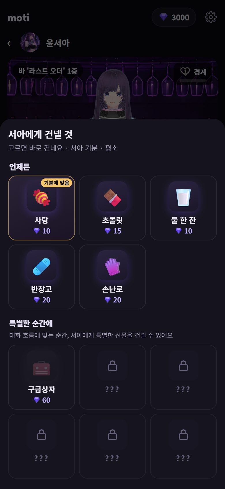 | 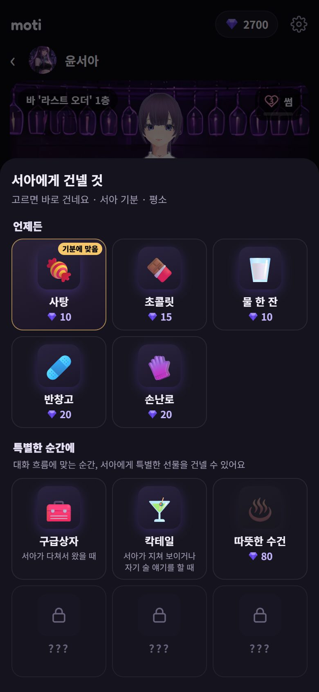 | 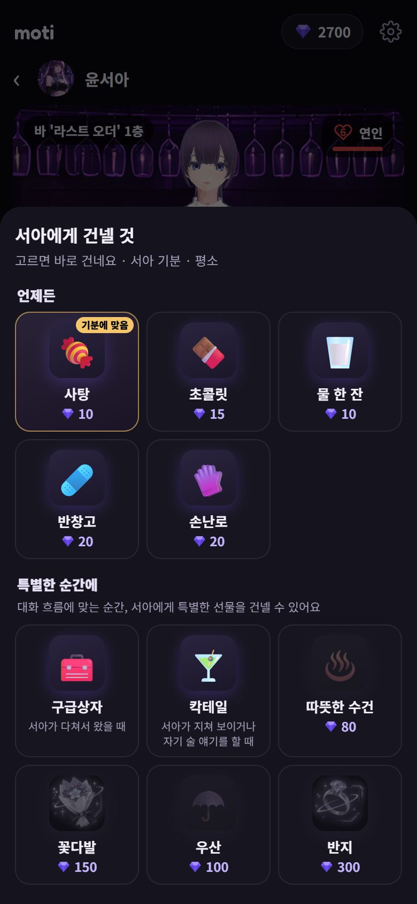 |

| 6단계 · 그냥 주소(반응 모션 없음) | 「선물」 탭(미리보기) |
| --- | --- |
| 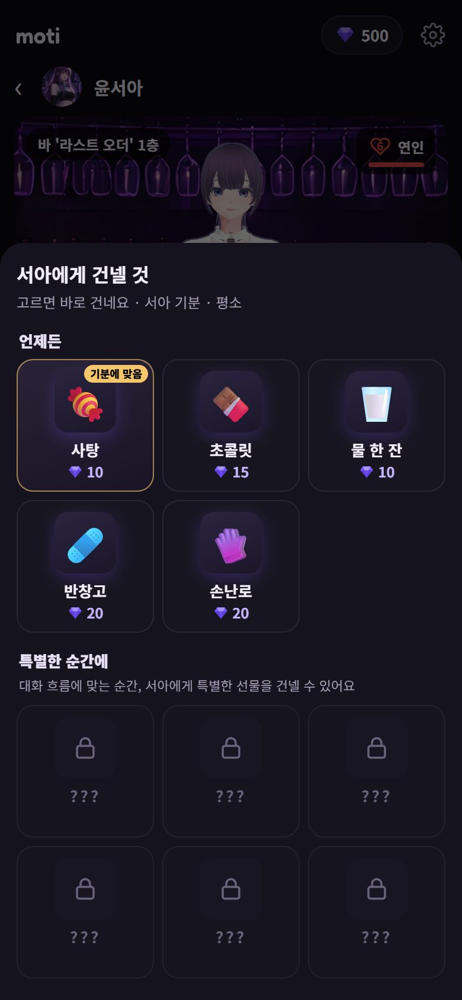 | 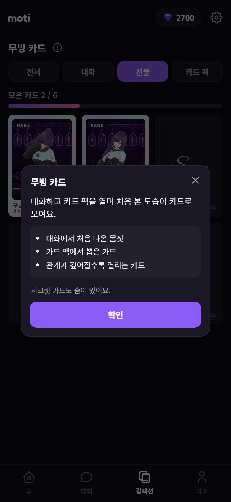 |

### 확인

- **1단계:** 서아 답 「…좀 지쳤어.」 → 안 열림(`gift_moments` = `["firstaid"]` 뿐). 「…다쳤어. 별거 아니야.」 → 구급상자 열림(「서아가 다친 것 같아요」). 건네면 x26 + 카드 「구급상자」(46).
- **2단계:** 「…지쳤어. 오늘은 그냥 쉬고 싶어.」 → 칵테일 열림. 건네면 x27 + 카드 「칵테일」(47). **5단계에서 칵테일을 또 주면 같은 x27, 카드 그대로 한 장.**
- **그냥 주소 6단계:** `Moment.list()` = `[]`, 여섯 칸 모두 ???.
- **예전 저장값(v4, g01 + 옛 gm01·gm02·gm03):** 열면 `S.v` 5, 남은 카드 `g01` 만, 오류 없음(옛 카드 그림도 지움).
- `node tools/check_gacha.mjs` → **✓ 모두 통과**(도감 50칸, 순간 선물 6). 콘솔 오류 없음.
- 그대로 둔 것(언제든 다섯·「또」·+ 금빛·3턴 닫힘·첫 안내·`gift_moment` 읽기·임시 규칙 꺼짐·`?giftPreview=1`)은 코드를 건드리지 않음. 위 실행에서 서버 흉내 경로로 임시 규칙 → 열림 → 3턴 흐름이 그대로 돎.
- 특별 에피소드에서 `[]` 는 코드로만 확인(`Thread.ep()` 이면 `ready` 가 거짓 → 목록·임시 규칙·서버 `gift_moment` 모두 안 열림), 실행 확인은 못 함.

### FBX 가 오면 (50-1 기준, 위 50 의 「FBX 가 오면」 대신)

1. `standard_Gift_FirstAid.fbx` 등을 `_src/` 에 이름 그대로 복사.
2. `node tools/fbx2motion.mjs _src/standard_Gift_FirstAid.fbx motions/xstage_gift_firstaid.json` (45-1 방식, 손가락 포함).
3. `data/motions.json` — `motions` 에 `"x26": {"name": "구급상자", "emo": "…", "only": "gift"}`, `xstage` 에 `"x26": {"file": "motions/xstage_gift_firstaid.json", …}`. (Cocktail → x27, Towel → x28, Flowers → x29, Umbrella → x30, Ring → x31)
4. 그 선물이 단계 조건에 맞으면 순간 목록·시트·컬렉션에 나타남.

### 제가 정한 것

- **카드 표정(`play.f`):** 구급상자 neutral(경계 — 무덤덤하게), 칵테일 soft, 따뜻한 수건 shy, 꽃다발 shy, 우산 sorrow(엇갈림), 반지 joy. 반응 모션이 오면 바꿀 수 있음.
- **카드 번호는 선물 순서대로 새로 매김:** 옛 46~48(칵테일 묶음)은 정식으로 얻을 수 없던 카드라 번호를 은퇴시키지 않고 46~51 을 그대로 다시 씀(지시문대로). 같은 id(gm01~03)를 새 카드가 쓰므로, 저장값 v5 로 올릴 때 옛 기록과 **카드 그림까지** 지움(안 지우면 새 「구급상자」 칸에 옛 칵테일 그림이 남음).
- **「단계는 됐지만 안 줌」 칸은 가격 표시**, 「한 번이라도 줌」 칸은 가격 대신 when(두 줄까지). 열린 순간 선물 칸은 가격. 잠긴 칸이든 흐린 칸이든 누르면 「특별한 순간에 열려요」 한 줄(50 에서 붙던 when 둘째 줄은 칸 안으로 옮겨서 뺌).
- **단계 조건은 본 이야기 단계(`curStage`)만** 봄. 지금 열린 순간은 단계가 내려가도 열린 채 둠(관계 단계는 내려가지 않음).
- **임시 규칙 「피」 → 「피(?!곤)」:** 「피」 한 글자가 「피곤」 에도 걸려서, 규칙 순서(= 단계 순서)상 「피곤해」 에 칵테일 대신 구급상자가 열렸음. 「피곤」 만 빼게 좁힘(「피가 나」 는 그대로 걸림). 나머지 단어는 지시문 그대로.
- 미리보기 대신 몸짓: x26 m05 · x27 m24 · x28 m04 · x29 x19 · x30 m11 · x31 m06.

### 아이폰에서 나중에 볼 것

- 「특별한 순간에」 흐린 그림(`opacity`+`grayscale` 필터)이 사파리에서 그림 문자에도 먹는지
- 칸 안 when 두 줄 말줄임(`-webkit-line-clamp`)
- ☂️ 그림 문자 모양

## 50-2 · 순간 선물 반응 모션 · 우산 모션 만들기 · 허둥대기 교체 · 카드 손보기

브랜치 `step/50-2-gift-motion` · 커밋 `[50-2A] 순간 선물 반응 모션` · `[50-2B] 허둥대기 교체와 카드 손보기` · `[50-2] 보고서`

> **이제 그냥 주소(`?giftPreview=1` 없이)에서 순간 선물 다섯 개(구급상자·칵테일·따뜻한 수건·꽃다발·우산)가 열리고, 카드 gm01~gm05 가 보입니다.** 반지(x31)는 모션이 없어 잠긴 채입니다.

### 붙인 FBX (다운로드 폴더 → `_src/` 이름 그대로)

| 몸짓 | 쓴 파일 | 지시문 이름과 다른 점 |
| --- | --- | --- |
| x26 구급상자 | `standard_Shy _Glancing_around_nervously.fbx` (이미 `_src/` 에 있던 것. 43 에서 변환한 `xstage_glancing_nervously.json` 을 그대로 씀) | 같음 |
| x27 칵테일 | `[standard]_Shake_Head_Up_and_Down.fbx` | 같음 |
| x28 따뜻한 수건 | `[standard]_Shy_Touching_handsnervously.fbx` | 같음 |
| x29 꽃다발 | `[standard]_Shy_Avoiding_eye_contact.fbx` | 같음 |
| m06 허둥대기 | `[standard]_Flustered_Hand_Gesture.fbx` | 같음 |

### 바뀐 파일

| 파일 | 바뀐 것 |
| --- | --- |
| `motions/xstage_shake_head_up_down.json` · `xstage_shy_touching_hands.json` · `xstage_shy_avoiding_eye_contact.json` · `xstage_flustered_hand_gesture.json` | **A·B** 새 FBX 네 개를 45-1 방식(손가락 30개 포함)으로 변환 |
| `motions/xstage_gift_umbrella.json` · `tools/make_umbrella.mjs` | **A** x30 우산 모션(3초)과 그것을 만드는 도구(아래) |
| `data/motions.json` | **A** `motions` x26~x30(이름 = 선물 이름, `only: "gift"`), `xstage` x26~x30. x30 `face`·`faceEmo`·`faceAt`(몸짓 중 표정 바꾸기)·`frame`(이 몸짓 동안만 카메라 구도). **B** m06 → Flustered 1.0~3.6초(damp 뺌, motionVer 3→4), x33 4.7~19.8 → 4.7~12.0초(motionVer 2). 설명 |
| `data/gifts.json` | **A** `momentFallback.rules` 에 꽃다발·우산·반지 |
| `data/config.json` | **A** `giftPicMs` 1000, `camera.umbrella`·`xsFrameMs`·`xsFrameBackMs` |
| `index.html` | **A** 선물 그림(`#burst`)을 3D 칸 가운데 아래에서 1초 떠올랐다 사라지게(「동작 줄이기」면 움직임 없이 나타났다 사라짐), 그림 1초가 지난 뒤 답장·반응 몸짓(`send` 의 `o.picAt`), xstage `face`·`frame` 읽기 |
| `cards.js` · `pack.js` | **B** `fitName(e, min)` — 10장 뽑기 결과는 8px 까지만 줄이고 넘치면 「…」 |
| `data/collection.json` | **B** `photocard.packNameMinPx` 8, `momentById.m06` 65 → 55 |
| `tools/check_gacha.mjs` | **B** 50-2 검사(반응 모션 다섯 개 준비·반지 잠금·구간과 원본·x26 damp 없음·x30 표정·구도, 임시 규칙 여섯 개, m06 Flustered 2~4초·motionVer 4, x33 4.7~12초, packNameMinPx 8) → **✓ 모두 통과** |
| `docs/CREDITS.md` | 새 모션 다섯 개 출처, glancing 파일 쓰는 곳 바뀜 |

### A · 순간 선물 반응 모션

| 몸짓 | 구간 | turn | 섞기(처음·끝) | 원본 배우 방향 |
| --- | --- | --- | --- | --- |
| x26 구급상자 | 1~4초 | 90 | 0.25 · 0.3 | −90°, damp 없음(지시대로) |
| x27 칵테일 | 3~8초 | 7 | 0.25 · 0.3 | −7°(거의 정면). 5.5~7.5초 끄덕임 |
| x28 따뜻한 수건 | 0.1~3초 | 78 | 0.25 · 0.3 | −69°~−87°, 골반이 옆으로 70cm 비켜 있어 inPlace |
| x29 꽃다발 | 2~6초 | 93 | 0.25 · 0.3 | −93°, 3.5초쯤 고개를 크게 돌려 눈을 피함 |

넷 다 `inPlace`, 선물 전용(`only: "gift"`).

**확인(그냥 주소, 390×844 헤드리스 Chrome, 서버 `/chat` 을 가로채 서아 답장만 흉내):** 단계를 시연 패널 함수로 맞추고 서아 답장에 단어가 든 대사를 보냄 → 임시 규칙으로 열림 → 선물 시트 → 건네기 → 그림 1초 → 반응 몸짓 → 카드.

| 단계 · 서아 답장 | 열림(reason) | 재생 · 카드 |
| --- | --- | --- |
| 1 「…피 좀 났어. 별거 아니야.」 | 구급상자 「서아가 다친 것 같아요」 | x26 · gm01 |
| 2 「…지쳤어. 오늘은 그냥 쉬고 싶어.」 | 칵테일 「서아가 지쳐 보여요」 | x27 · gm02 |
| 3 「…비에 흠뻑 젖었어. 보지 마.」 | 따뜻한 수건 「서아가 비에 젖었어요」 | x28 · gm03 |
| 4 「…내 이름, 불러 보고 싶었어?」 | 꽃다발 「서아가 처음으로 이름을 물었어요」 | x29 · gm04 |
| 5 「…빗속에 그냥 서 있고 싶었어.」 | 우산 「서아가 빗속에 서 있어요」 | x30 · gm05 |
| 6 「…남을게. 여기가 돌아올 곳이니까.」 | **안 열림**(반지 모션 없음), `gift_moments` 에 반지 없음 | — |

서버로 보낸 `state.gift_moments` 도 단계마다 하나씩 늘어남(1단계 구급상자 → 5단계 다섯 개, 반지는 안 감). 위 대사들은 확인용으로 흉내 낸 서버 답이고 앱 데이터에는 들어가지 않음.

| 구급상자 시트 | 그림 1초 | x26 | 카드 |
| --- | --- | --- | --- |
| 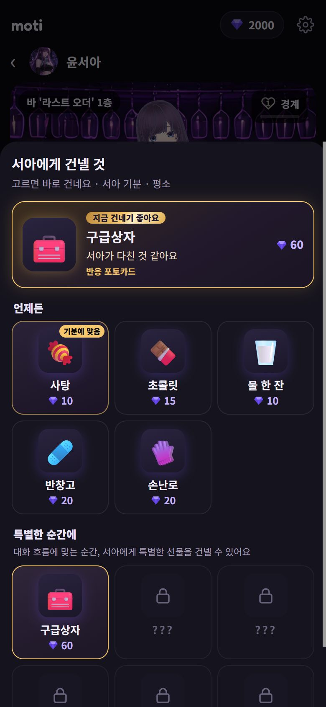 | 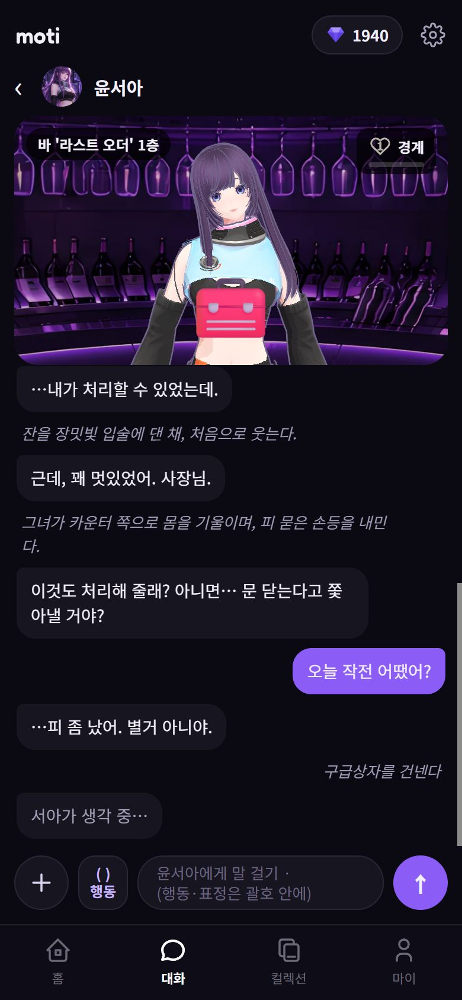 | 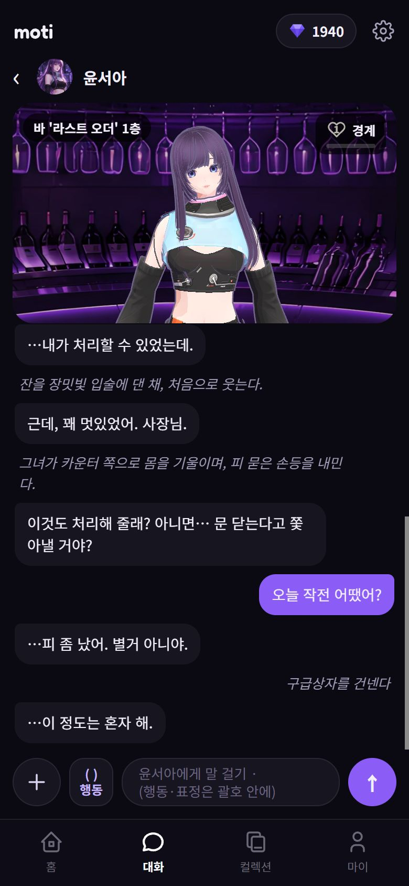 | 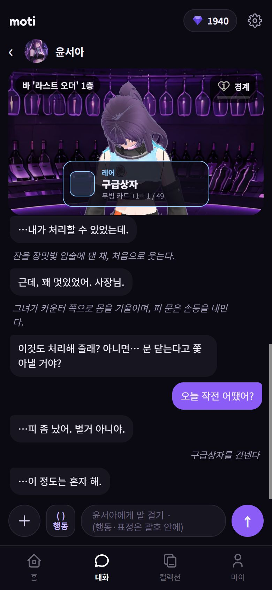 |

| 칵테일 x27 | 따뜻한 수건 x28 | 꽃다발 x29 | 「선물」 탭 |
| --- | --- | --- | --- |
| 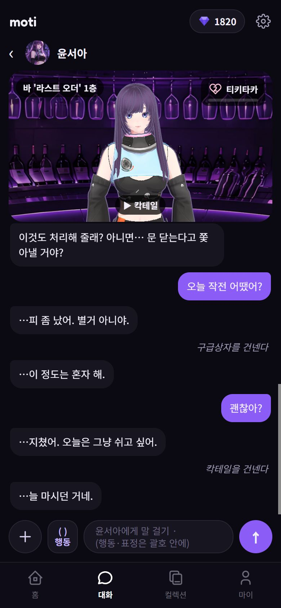 | 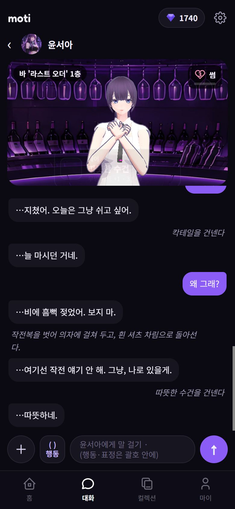 | 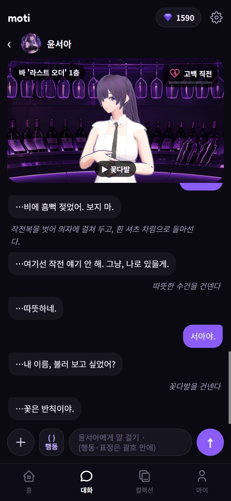 | 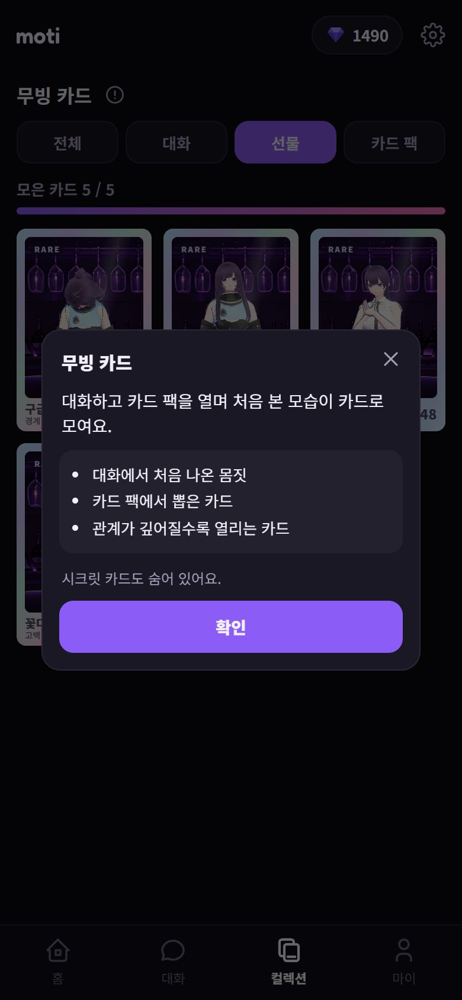 |

반지 잠금: 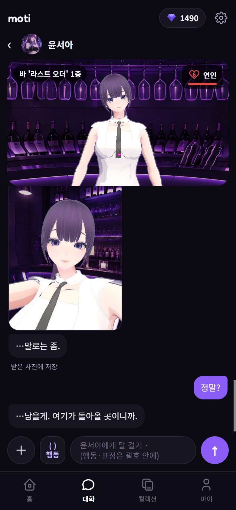

### A · x30 우산 모션 — 파일 하나로 만듦

`tools/make_umbrella.mjs` → `motions/xstage_gift_umbrella.json`(3초, 61KB). 원본 FBX 없이 이미 변환된 두 JSON 에서 만듦:

1. **한 걸음(0~0.73초):** 걷기 x22 파일 0.567~1.30초 — 오른발을 디딘 채 왼발이 나가 디디고, 오른발이 왼발 옆을 지나는 때까지. 원본 배우가 +z(화면 쪽)로 걸어서 turn 없이 다가옴. 다리 각도는 서기 자세 쪽으로 0.5배 줄여 걸음을 좁힘(그대로면 약 0.75m 다가와 너무 큼).
2. **멈춤(0.73~1.33초):** 0.6초 동안 서기 자세로 섞음. 그동안 걷기 시간도 섞는 몫만큼 느려지며 흐름(갑자기 얼지 않게, 지나가던 발이 앞으로 너무 나갔다 끌려오지 않게). 서기 자세는 칵테일 파일(Shake Head) 2.0초~(끄덕이기 전 가만히 선 구간)을 +7° 돌려 씀.
3. **올려다보며 씩(1.18초~끝):** 고개 9°·목 5°·등 2° 를 0.5초 동안 들어 끝까지. 표정은 1.2초부터 `fun`(감정 「장난」 → `data/emotion_face.json` 에서 fun, 지금 있는 표정 중 가장 가까움), 끝까지.

**발 고정:** 매 프레임 다리 길이(골반 높이 대비 허벅지·정강이 0.47)로 두 발 위치를 셈하고, 디딘 발이 제자리에 있도록 골반 앞뒤·좌우를 정함. 두 배우의 뼈 기준 방향이 달라서 서기 쪽 회전은 걷기 쪽 기준 방향에 맞게 바꿔 담음.

**앱에서 잰 발 위치(서아 발목 뼈, 그릴 때마다 기록, m):**

| 시각 | 왼발 z | 오른발 z | |
| --- | --- | --- | --- |
| 0.58초 | 0.393 | 0.134 | 왼발 디딤 |
| 0.85초 | 0.401 | 0.352 | 오른발 지나감 |
| 1.10초 | 0.397 | 0.460 | 오른발 디딤 |
| 1.4~2.1초 | 0.45±0.01 | 0.47±0.01 | 멈춘 채 고개 듦 |

→ 걸음·멈춤·씩 동안 **디딘 발은 1~4cm 안**(멈출 때 오른발이 4cm 나갔다 돌아옴). 처음 섞기(0.3초) 동안 디딘 오른발이 약 10cm 끌림(x22 걷기와 같은 까닭: 앱이 골반 이동에 섞는 몫을 곱함). 끝 섞기는 아래 「제가 정한 것」.

| 그림 | 0.2초 | 0.6초 | 1.0초 | 1.5초(씩) | 2.1초 | 2.7초(돌아감) |
| --- | --- | --- | --- | --- | --- | --- |
| 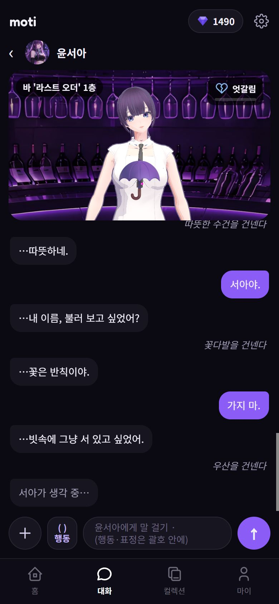 | 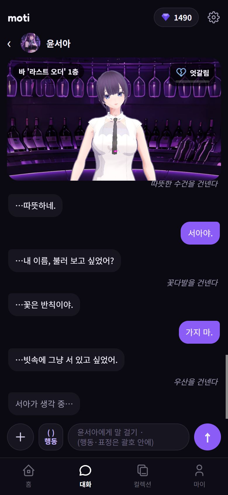 | 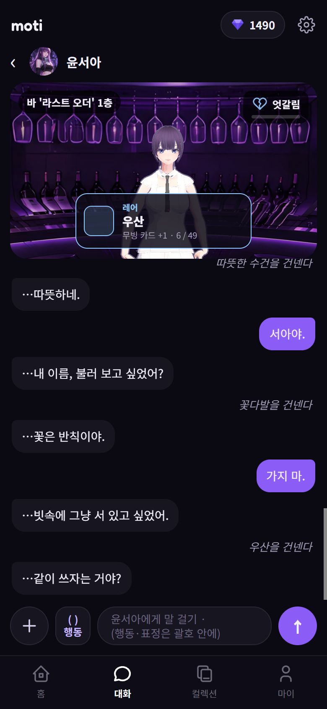 | 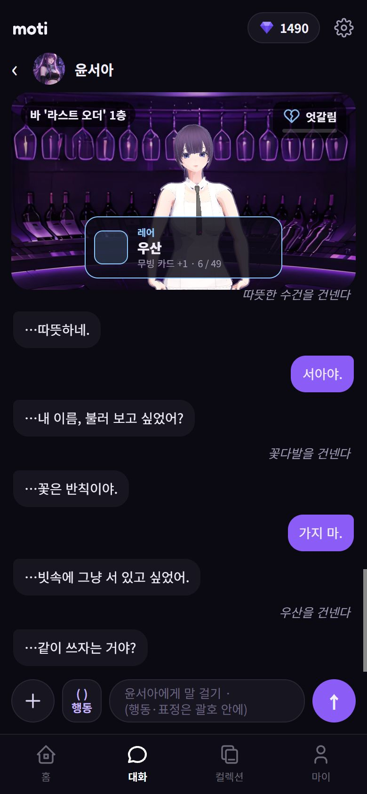 |  | 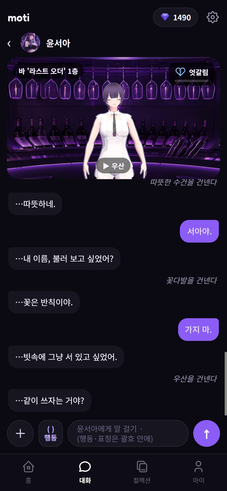 | 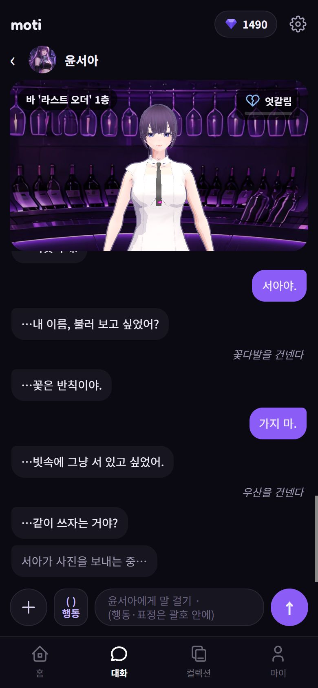 |

(0.6~1.5초 캡처에 처음 얻는 카드 알림 「레어 · 우산」이 몸 위에 겹쳐 있음. 몸짓은 그 아래에서 그대로 나옴.)

**걷기를 정면으로 돌렸을 때 발 모양:** 걷기 원본이 처음부터 화면 쪽으로 걸어서 돌리지 않음. 순간 선물 구도에서는 발이 화면 밖이라 보이지 않음. 전신·옆 구도로 따로 돌려 봤을 때 어색한 발 모양은 못 봤지만 발이 작게 찍혀 캡처는 싣지 않고 위 숫자로 대신함.

### A · 선물 그림 띄우기

- 언제든·순간 선물 모두: 건네면 3D 칸 가운데 아래(`bottom: 12%`)에서 그림(없으면 그림 문자)이 떠올라 1초 뒤 사라짐 → 그 뒤 답장 줄·반응 몸짓. 서버 답이 1초보다 빨리 와도 기다림(`data/config.json giftPicMs`).
- 「동작 줄이기」: 움직임 없이 나타났다(0.2초) 사라짐(0.75~1초). 잰 투명도 0.27초 1 · 0.82초 0.9 · 1.04초 0.

| 그림 1초(구급상자) | 동작 줄이기(우산) |
| --- | --- |
|  | 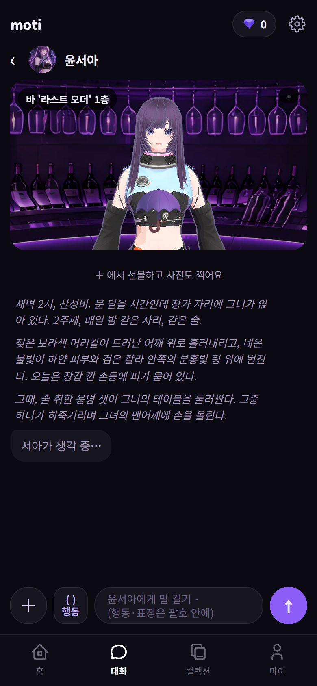 |

### B · 허둥대기 교체 · 카드 손보기

**m06 후보 구간**(Flustered Hand Gesture, 원본 11초, 정면):

| A 1.0~3.6초 (고름) | B 3.4~6.4초 | C 6.2~9.4초 |
| --- | --- | --- |
|  |  |  |

- A: 내린 손을 가슴 앞으로 휙 올려 두 손을 허둥지둥 흔들며 정면을 봄 — 손 움직임이 가장 크고 빠름(손목 회전 합이 다른 구간의 2배쯤). B 는 손을 올린 채 어깨 앞에서 만지작, C 는 고개를 숙이며 손을 내림.
- 고개를 거의 숙이지 않아(−4°) 예전 damp 는 **뺌**, turn 없음. motionVer 3 → 4.
- 대화에서 `Stage.play('m06')` → 새 파일 재생. 카드 17 은 기록 `mv` 3 으로 두고 다시 열면 그림을 새로 그려 `mv` 4 가 됨. 카드 멈춘 순간 65% → 55%(두 손을 가슴 앞으로 올린 때).

| 대화 m06 | 카드 17 새 그림 | 카드 17 크게 |
| --- | --- | --- |
| 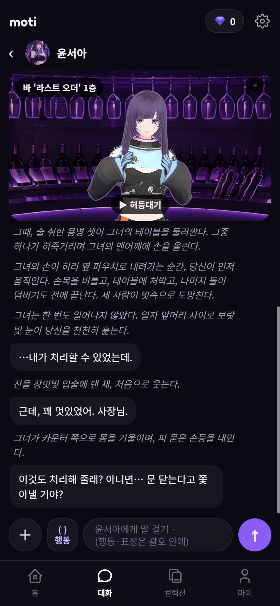 | 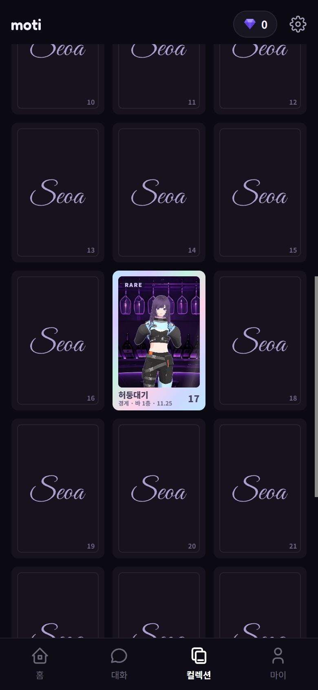 | 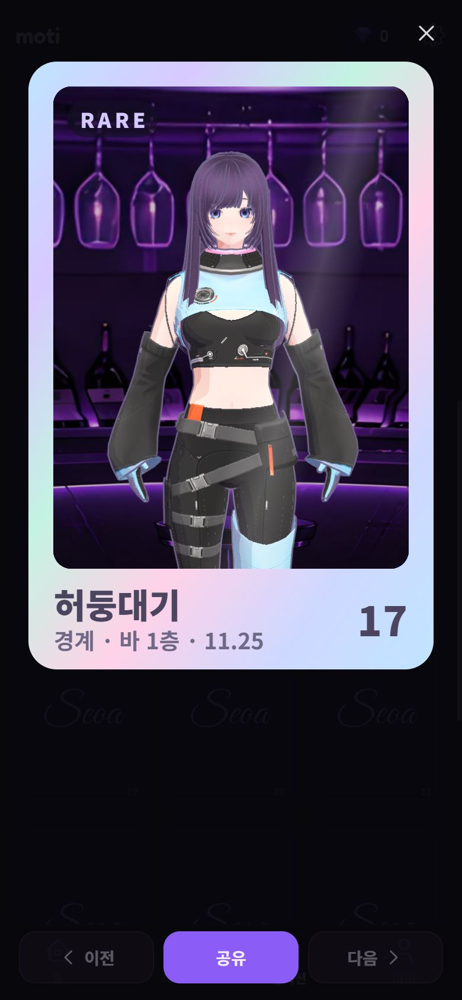 |

**춤 카드(x33):** 4.7~12.0초 = **7.3초** 되풀이(`Stage.dur('x33')` 7.3). 12초는 몸이 정면(4°)이고 팔을 내리는 때라 끝 섞기가 자연스러움. motionVer 2 → 카드 그림 다시 그림.

| 크게 보기 | 3.6초 뒤 | 7.3초 뒤(한 바퀴) |
| --- | --- | --- |
| 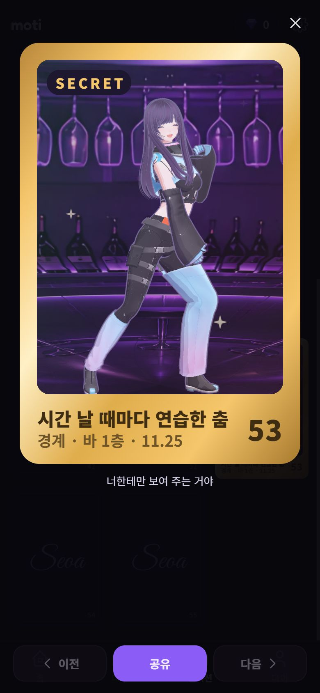 | 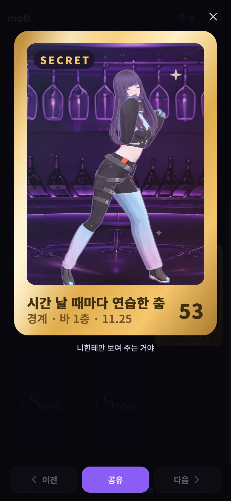 | 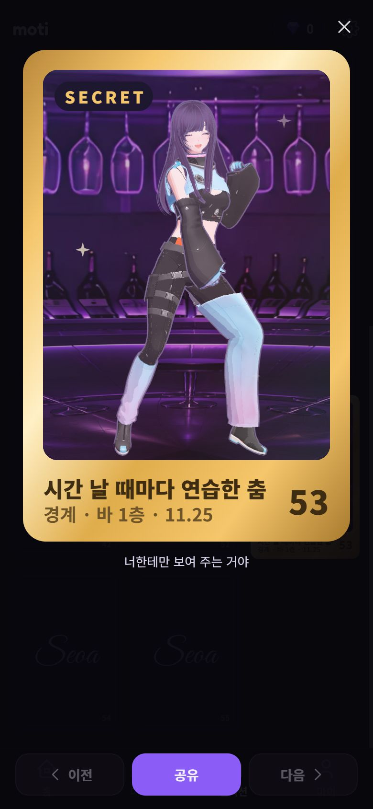 |

**10장 뽑기 결과 이름:** 8px 까지만 줄이고 넘치면 끝을 「…」. 크게 보기는 전체 이름(22.6px, 안 잘림).

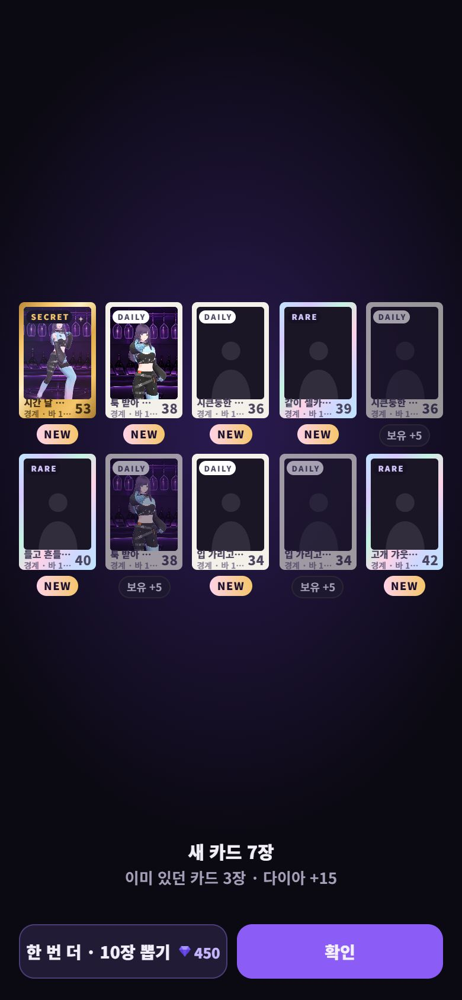

- 390px 에서 5열 칸이 좁아서 8px 로도 **열 장 모두** 「…」 가 붙음(「툭 받아 …」 같은 짧은 이름도). 예전(52)엔 6px 대까지 줄여 다 보였음.

### 그 밖의 확인

- 예전 저장값(v4, 카드 g01 + m06 `mv` 3 + 옛 gm01, 선물 기록 있음)으로 열기: 오류 없음, `S.v` 5, 옛 gm01 지워짐, 선물 시트 정상. 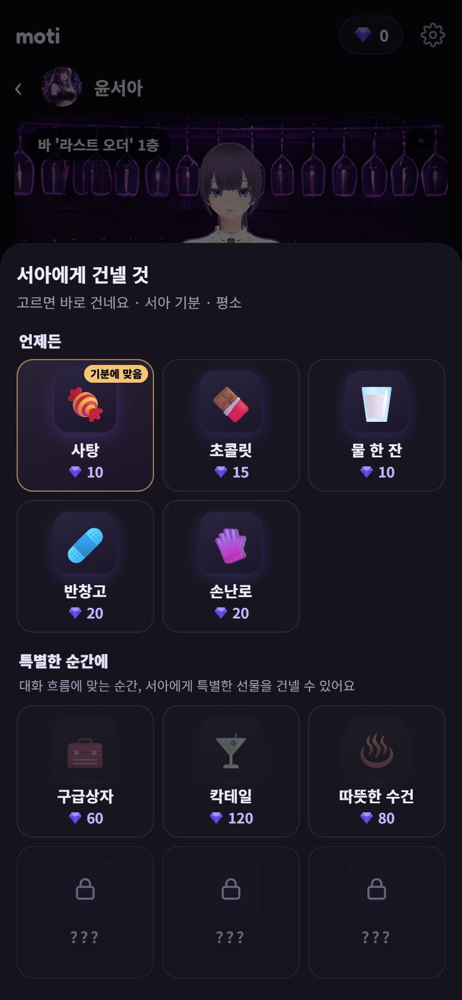
- `data/*.json` 모두 읽힘. 모든 실행에서 콘솔 오류 없음(three.js `morphNormals` 경고·favicon 404 는 예전부터 있던 것).
- `node tools/check_gacha.mjs` → ✓ 모두 통과.

### 제가 정한 것

- **x30 은 파일 하나로**(`tools/make_umbrella.mjs`). 이어 붙이기 설정으로는 디딘 발을 고정할 수 없어서. 도구 안 `C` 의 숫자(구간·멈추는 시간·다리 몫·고개 각도)로 다시 만들 수 있음.
- **x30 이 다가오는 거리 약 0.4m**(다리 각도 0.5배). 끝 섞기(0.8초) 동안 **제자리로 미끄러지듯 돌아감** — 앱의 기본 자세가 늘 원래 자리라서. 순간 선물 구도에서는 발이 화면 밖이라 서아가 뒤로 물러나는 것처럼 보임. 돌아오는 걸음까지 넣으려면 모션이 길어져서 이번엔 안 함.
- **x30 동안만 카메라를 조금 뒤로**(`camera.umbrella`, 위·아래를 넓힘): 평소 구도 그대로면 다가왔을 때 머리가 위로 잘렸음. 처음엔 서아가 조금 작게 보이다가 다가오면 평소 크기쯤. 이를 위해 xstage `frame`(평소 구도일 때 이 몸짓 동안만 쓰는 구도)을 새로 만듦. 다른 몸짓이 오면 평소 구도로.
- **x30 표정** `fun`(감정 「장난」)·1.2초부터, 그 뒤는 예전처럼 7초 뒤 기본 얼굴. 서아 답장이 다른 표정을 줘도 1.2초에 바뀜.
- **x30 서기 자세 재료 = 칵테일 파일(Shake Head) 2.0초~**: 받은 모션 중 팔을 내리고 가만히 선 구간이 가장 긴 것.
- **섞기 0.25 · 0.3초**(지시 0.2~0.3 안). x30 은 처음 0.3 · 끝 0.8초.
- **turn 값**은 각 구간에서 잰 골반 방향의 평균(x27 7 · x28 78 · x29 93). x29 는 3.5초쯤 고개를 60° 돌리는데(눈 피하기) 그대로 둠.
- **x26 은 지시대로 damp 없음** → 1~1.5초·2.5~4초에 고개를 깊이 숙여 정수리가 보임(43 에서 damp 를 넣었던 까닭). 캡처 52a 1300 참고. 필요하면 damp 만 다시 넣으면 됨.
- **반응 몸짓 이름 = 선물 이름**, 감정: 구급상자 당황 · 칵테일 기쁨 · 수건 수줍음 · 꽃다발 수줍음 · 우산 장난.
- **임시 규칙 순서**: 지금처럼 단계 순서(위에서부터 먼저 맞는 것). 「빗속에 젖어」처럼 두 규칙에 다 맞으면 따뜻한 수건이 먼저.
- **그림 1초 기다림**: 답장 줄과 몸짓을 함께 1초 뒤로(그림 → 답장·몸짓 순서). 시간은 `giftPicMs`.
- **m06 구간 A**(1.0~3.6초, 2.6초), 카드 멈춘 순간 55%.
- **10장 결과 최소 글자 8px** 은 `data/collection.json photocard.packNameMinPx`. 목록·크게 보기(6px)는 그대로.
- `xstage_glancing_nervously.json` 은 이제 x26 만 씀(m06 은 새 파일).
- 「단계 맞춤」은 시연 패널 버튼 대신 같은 함수(`Demo.setStage`)를 불러서 함.

### 아이폰에서 나중에 볼 것

- 선물 그림이 3D 칸 아래에서 떠오르는 움직임(`transform`·`opacity` 애니메이션 1초), 그림 문자 크기·세로 자리, 「동작 줄이기」 때 멈춘 채 나타났다 사라짐
- x30 우산: 카메라가 뒤로 갔다 돌아오는 움직임(0.5초·0.9초), 다가올 때 머리가 잘리지 않는지
- 반응 모션 손가락(새 파일 네 개)
- 10장 결과 「…」 글자(8px)가 읽히는지, 크게 보기 전체 이름
- 춤 카드 7.3초 되풀이, m06 카드 다시 그릴 때 버벅임
