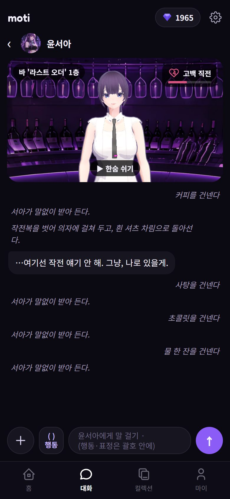
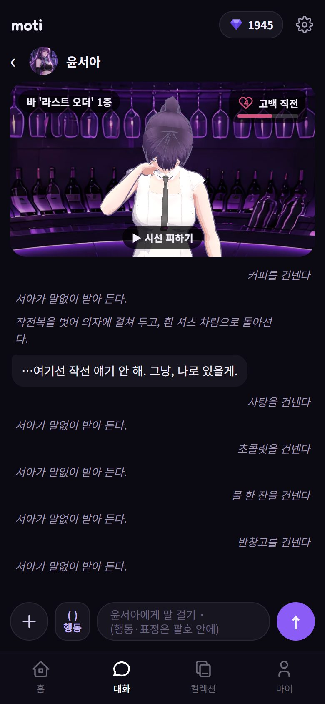
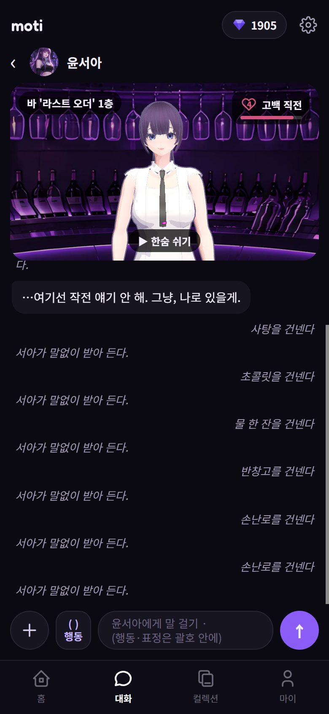
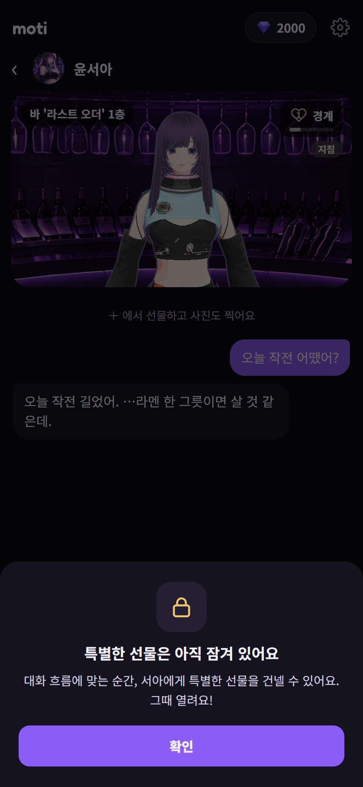
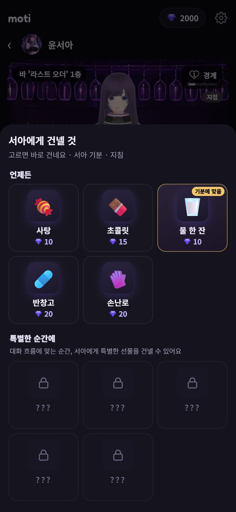
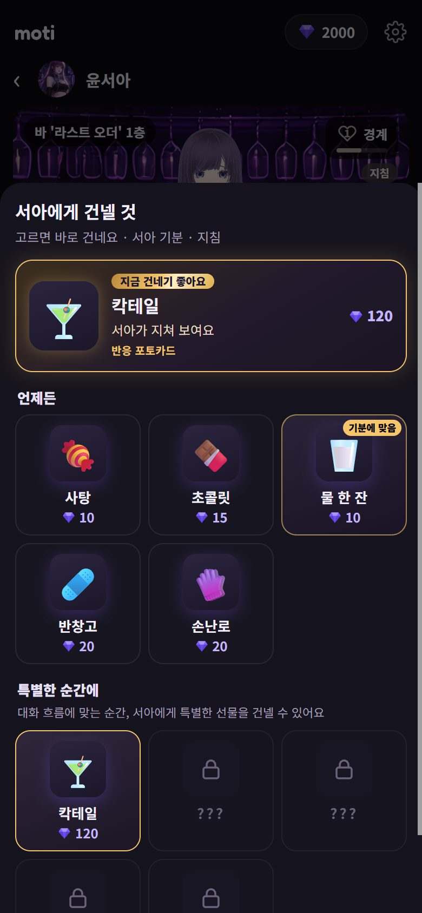
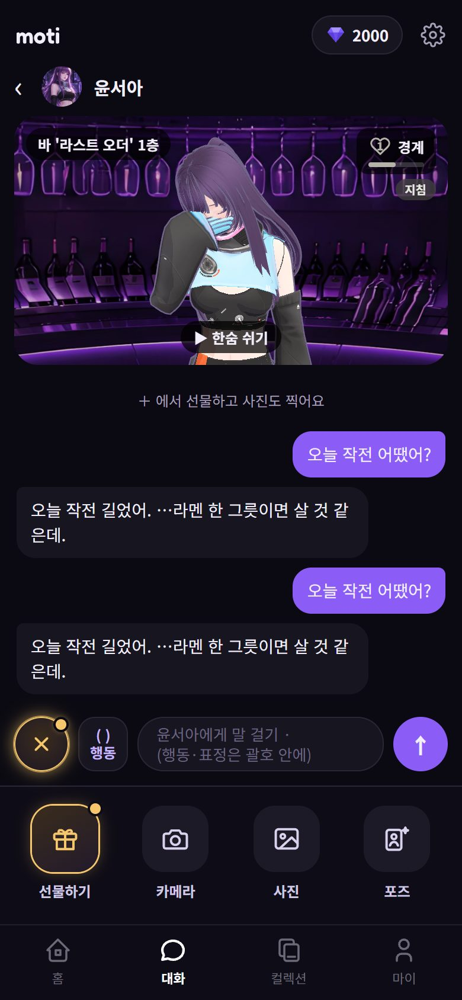
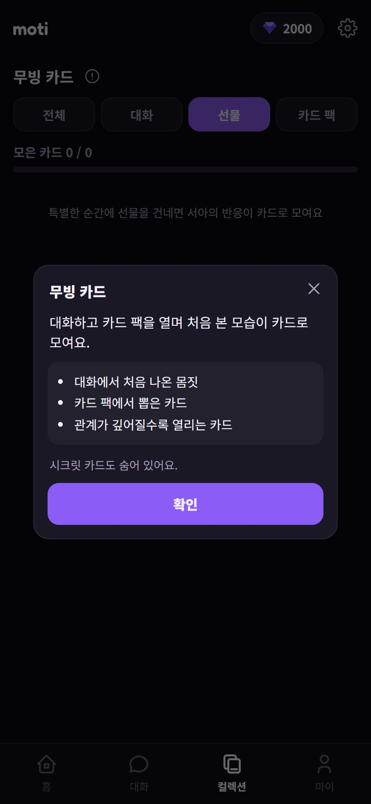
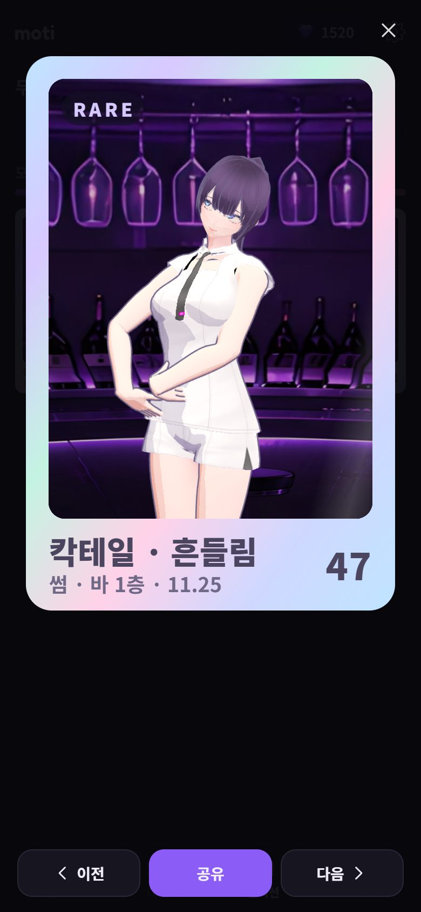

# 50 · 선물 다시 짜기 — 언제든 주는 선물 · 순간 선물 · 반응 포토카드

브랜치 `step/50-gift-moment` · 커밋 `[50-A] 선물 목록 다시 짜기` · `[50-B] 순간 선물이 열리는 흐름` · `[50-C] 순간 선물 반응 포토카드` · `[50-C] 시연 패널 서아 초기화 때 순간 선물도 비움` · `[50-D] server-sync 순간 선물` · `[50] 보고서와 진행 현황`

> **먼저 알려 드릴 것:** 다운로드 폴더에 `standard_Gift_Cocktail_1~3` FBX 가 **없었습니다**(같은 폴더의 다른 `standard_*.fbx` 12개만 있음). 지시대로 칵테일은 세 묶음 모두 순간 목록에 들어가지 않으므로, **지금 앱에서는 순간 선물이 열리지 않고 컬렉션 「선물」 탭도 비어 있습니다.** 연결은 다 해 두었고, FBX 가 오면 변환 → `data/motions.json` 에 넣기만 하면 열립니다(아래 「FBX 가 오면」). 흐름 확인은 확인용 주소 `?giftPreview=1`(반응 몸짓을 이미 있는 몸짓으로 잠시 대신함)로 했습니다.

## 바뀐 파일

| 파일 | 바뀐 것 |
| --- | --- |
| `data/gifts.json` | **A** 선물을 `kind` always 5 · moment 5 로. 가격(임시), 언제든 선물 받는 몸짓 `motion`, 순간 선물 `when`·`reactions`(묶음 → 반응 몸짓 id). 커피·라멘은 `_보류.list`. `repeat`(직전 3번 · m04/m07 · 호감 ×0.5). **B** `moment`(3턴, 임시 규칙 재열림 간격 10턴), `momentFallback`(켜 둠, 칵테일). **C** `bonds`(차가움 1·2 / 흔들림 3·4 / 솔직함 5·6), `preview`(확인용) |
| `data/collection.json` | **C** 카드 3장 `gm01` 46 「칵테일 · 차가움」, `gm02` 47 「칵테일 · 흔들림」, `gm03` 48 「칵테일 · 솔직함」 — `source moment`, 레어, `play.m` = 반응 몸짓 x26·x27·x28 |
| `data/ui.json` | `gift` 서버 줄 붙는 말(srvMoment·srvMood·srvAgain), 시트 두 줄 제목·설명·??? ·「지금 건네기 좋아요」·「반응 포토카드」·첫 안내(guide). `album.seg.gift` 「선물」, `album.giftEmpty` |
| `index.html` | **A** `give()`: 언제든 선물 몸짓 고정, 「또」(직전 3번), 서버 줄 붙는 말, `send()` 가 `o.giftMid` 를 서버 몸짓보다 우선 재생(선물 몸짓은 「처음 본 카드」 기록 안 함), 판정 버퍼 `h`(또) → 그 판정의 호감 상승 ×0.5. 선물 그림이 없으면 그림 문자(`giftPic`). **B** 선물 시트 다시 그림(순간 칸 · 언제든 · 특별한 순간에), 첫 「선물」 안내 시트(`#giftGuide`, `S.giftGuide`), `Moment`(열기·닫기·3턴 셈·임시 규칙·서버 `gift_moment`·+ 금빛), `/chat` `state.gift_moments`, 답장 `gift_moment` 읽기. **C** 순간 선물 = 지금 묶음의 반응 몸짓 + 처음이면 카드(새 카드 알림), 컬렉션 「전체·대화·선물·카드 팩」, 반응 몸짓 없는 카드는 숨김, `?giftPreview=1`. 시연 패널 서아 초기화 때 순간 선물·「또」 기록도 비움 |
| `tools/check_gacha.mjs` | 선물 목록 검사(언제든 5·순간 5·커피 라멘 빠짐·예전 확률 대사 `_보류` 보존·문구 키), 순간 카드 ↔ gifts.json reactions 일치, 카드 번호 겹침·은퇴 번호 |
| `tools/build_collection.mjs` | `moment` 칸을 그대로 둠(다시 만들어도 지금 파일과 같음 확인) |
| `docs/server-sync.md` | 「50 · 순간 선물」 |
| `docs/status.md` | 50 절, 남은 일 |

## 할 일 A · 선물 목록

| 사탕 → m09 | 초콜릿 → x19 | 물 한 잔 → m04 |
| --- | --- | --- |
|  |  |  |

| 반창고 → m05 | 손난로 → m24 | 손난로 또 → m04 |
| --- | --- | --- |
|  |  |  |

- 다섯 개를 차례로 줌(서버 없음, 390×844 헤드리스 Chrome): 재생 몸짓 m09 · x19 · m04 · m05 · m24, 다이아 10·15·10·20·20 씩 빠짐, 새 카드 없음.
- **또:** 반창고 → 반창고 = m04 + `[유저가 선물함: 반창고] · 또`, 물 한 잔 → 물 한 잔 = m07(물 한 잔 몸짓이 m04 라 다른 쪽) + `· 또`, 손난로 → 손난로 = m04 + `· 또`. 사이에 다른 선물 3개를 끼우면 또가 아님(사탕 … 손난로 → 사탕 = 평소).
- **49 그대로인 것:** 「기분에 맞음」 표(물 한 잔·지침 그림 아래 B 캡처), 기분 맞으면 서버 줄 `[유저가 선물함: 사탕] · 서아 기분에 맞는 선물`, 화면 줄 「(사탕을 건넨다)」, 서버 답이 없을 때 지문 「*서아가 말없이 받아 든다.*」, 삐짐이면 선물로 풀림.

## 할 일 B · 순간 선물이 열리는 흐름

| 처음 「선물」 안내 | 시트 · 순간 없음 | 시트 · 순간 열림 |
| --- | --- | --- |
|  |  |  |

| + 버튼 금빛 | 기능판 「선물하기」도 금빛 | 내 메시지 3번 뒤 닫힘 |
| --- | --- | --- |
|  |  |  |

확인(`?giftPreview=1`, 서버 없음 → 서버 v2 흉내):

- **반응 모션 없음(그냥 주소):** 「오늘 작전 어땠어?」 → 서아 「오늘 작전 길었어. …」 → **안 열림**, `gift_moments` `[]`, + 금빛 없음.
- **임시 규칙:** 같은 말 → 칵테일 열림(`reason` 「서아가 지쳐 보여요」, 남은 3) → 「그래?」 2 · 「음.」 1 · 「알겠어.」 → 닫힘, 금빛 꺼짐.
- **서버 흉내(`/chat` 을 가로채 「…오늘은 좀 길었어.」 + `gift_moment` 를 돌려줌):** 보낸 `state.gift_moments` = `[{"id":"cocktail","name":"칵테일","when":"서아가 지쳐 보일 때"}]`(열려 있는 동안은 `[]`). `gift_moment {"id":"cocktail","reason":"서아가 지쳐 보여요"}` → 열림(`src server`), `S.momentSrv` true. 3턴 뒤 닫고, `gift_moment` 없이 「오늘 작전 길었지?」(서아 답 「…오늘은 좀 길었어.」) → **임시 규칙 꺼져서 안 열림.**
- 서버 `gift_moment` 를 받기 전에는 같은 답 「…오늘은 좀 길었어.」 에 임시 규칙이 칵테일을 엶(서버 v2 경로에서도 동작).

## 할 일 C · 순간 선물 반응 포토카드

| 칵테일 · 흔들림 (썸) | 컬렉션 「선물」 탭 | 반응 모션 없을 때 「선물」 탭 |
| --- | --- | --- |
|  |  |  |

카드 크게 보기(미리보기 몸짓이라 진짜 반응 모션과 다름):

- `?giftPreview=1` 에서 단계 1 · 3 · 5 로 칵테일을 줌 → 묶음 cold · sway · honest, 재생 x26 · x27 · x28(미리보기에선 m07 · m24 · m05 를 빌림), 카드 gm01 · gm02 · gm03 이 하나씩 생김(레어 알림 「칵테일 · 흔들림」). 단계 5 에서 한 번 더 → 반응만, 카드 그대로 3장. 서버 줄 `[유저가 선물함: 칵테일] · 순간 선물`, 주면 순간 닫힘.
- 카드 번호 46 · 47 · 48(44 다음, 45 는 은퇴 번호), 아래 띠는 그때 관계 단계 · 장소 · 날짜.
- **FBX 가 없는 지금:** 카드 3장은 `data/collection.json` 에 있지만 반응 몸짓이 없어서 앱에서 숨김(목록·「모은 카드 n / total」·마이 개수에 안 셈). 「선물」 탭은 「특별한 순간에 선물을 건네면 서아의 반응이 카드로 모여요」.
- 따뜻한 수건 · 구급상자 · 꽃다발 · 반지: `reactions` 가 비어 있어 시트에서 ??? + 자물쇠, 순간 목록에 안 들어감.

### FBX 가 오면 (칵테일 한 묶음씩)

1. `standard_Gift_Cocktail_1.fbx` 를 `_src/` 에 이름 그대로 복사(저장소에는 안 들어감).
2. `node tools/fbx2motion.mjs _src/standard_Gift_Cocktail_1.fbx motions/xstage_gift_cocktail_1.json` (45-1 방식, 손가락 포함).
3. `data/motions.json` — `motions` 에 `"x26": {"name": "칵테일 · 차가움", "emo": "…", "only": "gift"}`, `xstage` 에 `"x26": {"file": "motions/xstage_gift_cocktail_1.json", …}`. (_2 → x27 흔들림, _3 → x28 솔직함)
4. 그러면 그 묶음에서 칵테일이 순간 목록·컬렉션에 나타남. `?giftPreview=1` 로 만든 카드 그림은 모션 버전(0.5)이 달라서 진짜 모션으로 다시 그려짐.

## 할 일 D · server-sync

[server-sync.md](../server-sync.md) 「50 · 순간 선물」: `state.gift_moments`, 답장 `gift_moment {id, reason}`(맞는 장면에만, 같은 선물은 10턴 안에 다시 안 넣음), 붙는 말 「순간 선물」「서아 기분에 맞는 선물」 = care 크게 · 「또」 = 작게, 반응 대사는 관계 단계에 맞게 짧게, 몸짓은 앱이 정함.

## 그 밖의 확인

- **예전 저장값(49, v4: 카드 팩 g01 + m01, 팩 천장 3, 49 선물 기록 「(커피를 건넨다)」)으로 열기:** 오류 없음, `S.v` 4 그대로, 카드 그대로, 대화 기록의 커피 줄 그대로 보임, 선물 시트 10칸.
- `node tools/check_gacha.mjs` → **✓ 모두 통과**(도감 47칸 = 대화 29 + 연출 1 + 카드 팩 10 + 보류 선물 2 + 순간 선물 3). `node tools/build_collection.mjs` → 지금 파일과 똑같이 나옴.
- `data/*.json` 18개 모두 읽힘(「불러오지 못함」 경고 없음). 모든 실행에서 콘솔 오류 없음(three.js `morphNormals` 경고는 예전부터 있던 것).

## 제가 정한 것

- **FBX 없음 → 순간 선물은 지금 열리지 않음.** 지시문 그대로 「없는 묶음은 순간 목록에서 뺌」을 따름. 흐름을 미리 보려고 확인용 `?giftPreview=1` 을 넣음(저장값을 바꾸지 않고, 주소에 있을 때만). 반응 몸짓 id 는 다음 빈 번호 x26 · x27 · x28.
- **반응 몸짓이 없는 카드는 숨김**(보류 칸처럼): 얻을 수 없는 카드가 「모은 카드 n / total」에 들어가지 않게. 모션이 오면 저절로 나타남.
- **순간 카드 source = `moment`**(49 의 보류 g11·g12 가 `gift` 를 쓰고 있어서 겹치지 않게). 탭 이름은 「선물」. 등급은 셋 다 **레어**, 카드 표정은 차가움 neutral · 흔들림 shy · 솔직함 soft(모션이 오면 바꿀 수 있게 `play.f`).
- **선물 그림:** 새 선물 8개는 그림이 없어 그림 문자(🍬 🍫 🥛 🩹 🧤 🍸 ♨️ 🧰)로 임시. 꽃다발·반지는 예전 그림 그대로. 그림이 오면 `icon` 만 넣으면 됨.
- **기분에 맞는 선물(rec):** 사탕 = 평소, 초콜릿 = 삐짐, 물 한 잔 = 지침. 반창고·손난로는 없음. 꽃다발(삐짐)·반지(생일)는 예전 값 그대로 두되, 기분 바뀜 알림의 「○○라면 반응이 다를 거예요」는 지금 줄 수 있는 선물에서만 고름(잠긴 순간 선물을 권하지 않게).
- **「또」:** 직전 3번 = 선물을 준 기록(대화 턴이 아니라) 기준. 몸짓은 m04 · m07 중 **그 선물 몸짓과 다른 것**을 번갈아(물 한 잔은 늘 m07). 순간 선물에는 「또」가 없음(주면 닫힘).
- **호감 절반:** 앱은 호감을 직접 바꾸지 않고 판정(3턴에 한 번)이 바꾸므로, 「또」 턴이 들어 있는 판정의 **호감 상승분만** ×0.5(내려가는 값은 그대로). 서버 v1·서버 없음(대화 횟수 단계)에서는 호감이 없어 해당 없음.
- **순간 3턴:** 열린 뒤 내 메시지 3번째를 보낼 때 닫힘(그 메시지 답장에 서버가 새로 열 수는 있음). 순간 선물을 건넨 턴은 그 자리에서 닫힘. 다른 캐릭터 방 메시지는 안 셈.
- **임시 규칙 단어:** 「지쳤 · 지친 · 피곤 · 길었어 · 녹초」(지시문의 예에 「지친」 하나 더함), 서아 답장의 감정 · 지문 · 대사를 봄. 한 번 닫힌 칵테일은 내 메시지 10번 동안 임시 규칙으로 다시 안 열림(서버 규칙과 같은 간격). 서버 `gift_moment` 는 앱이 거르지 않고 따름(지금 보낸 목록 안의 id 일 때만).
- **열려 있을 때 `gift_moments` 는 `[]`**(한 번에 하나).
- **처음 안내:** + → 「선물하기」를 처음 누를 때 시트 대신 안내(자물쇠 그림 · 제목 · 본문 · 「확인」) → 확인하면 선물 시트. 한 번 보면 `S.giftGuide`.
- **시트:** 한 줄 3칸으로 작게(언제든 5개가 한 화면에). 「특별한 순간에」 줄에서 잠긴 칸을 누르면 「특별한 순간에 열려요」, 한 번이라도 준 선물이면 아래 줄에 `when`. 열린 순간 선물은 맨 위 금색 칸과 줄 안 칸(금색 테두리) 모두에서 줄 수 있음. 「반응 포토카드」 옆에 이미 가진 카드면 「· 모았어요」.
- **+ 금빛:** 서아 방에서만. + 버튼 금색 테두리·바탕 + 오른쪽 위 금색 점, 1.8초 숨쉬듯 빛남(「동작 줄이기」면 멈춘 빛). 기능판을 열면 「선물하기」 칸도 금색 + 점.
- **선물 몸짓은 「처음 본 카드」로 기록하지 않음:** 언제든 선물의 m09 · m05 등은 대화 카드이기도 해서, 선물로 재생됐다고 카드가 생기지 않게 함(「새 카드는 생기지 않는다」).
- 시연 패널 「서아 초기화」는 열린 순간·「또」 기록·턴 수를 비움(준 적 있는 선물 기록·서버 신호는 유지). 전체 초기화는 모두 비움.

## 아이폰에서 나중에 볼 것

- **+ 버튼 금빛:** `box-shadow` 애니메이션(숨쉬듯 빛남)이 사파리에서 버벅이지 않는지, 금색 점(`::after`)이 버튼 밖으로 잘리지 않는지, 「동작 줄이기」 때 멈춘 빛
- 기능판 「선물하기」 칸 금색 테두리·점
- 선물 시트 맨 위 금색 칸의 그라데이션·빛 번짐, 한 줄 3칸 글자(「물 한 잔」·「따뜻한 수건」 말줄임), 시트 스크롤(80% 높이)
- 그림 문자 선물 그림이 iOS 그림 문자로 바뀌어 보이는 모양(🧤·♨️ 등 크기·세로 위치)
- 첫 안내 시트의 아래 안전 영역(홈 막대와 「확인」 버튼 간격)
- 컬렉션 탭 버튼 4개(전체·대화·선물·카드 팩) 한 줄
