# 51 · 본편 갈래 · 실패 엔딩 · 되감기 · 사장님 집 모션 · 캐시

브랜치 `step/51-route-rewind` · 커밋 `[51-A] 갈래` · `[51-B] 실패 엔딩과 되감기` · `[51-C] 사장님 집 모션과 캐시` · `[51-D] server-sync 갈래와 실패 엔딩` · `[51] 보고서와 진행 현황`

> **원고가 없음:** 지시문의 `다운로드/51-갈래-되감기-원고.md` 가 다운로드 폴더(와 사용자 폴더 전체)에 없어 `docs/drafts/` 에 복사하지 못했다. 원고 4번(에필로그)·5번(끝 화면·확인창) 자리는 `data/rewind.json` 에 **「[원고 대기 · …]」 임시 표시**로 두었다. 원고가 오면 `data/rewind.json` 의 문구만 바꾸면 된다(코드는 그대로). 지시문에 적힌 문구(「되감기」, 「*…다시, 그 밤.*」, 「첫 되감기는 선물이에요」, 「처음부터」, 「자정」)는 그대로 넣었다.

## 바뀐 파일

| 파일 | 내용 |
| --- | --- |
| `index.html` | **A** `Route`(갈래 세기·정하기·시연 패널), 본 이야기 판정 뒤 `Route.judged`, 단계가 오를 때 `Route.check`, `chatState()` 에 `route`. **B** `End`(되감기 지점·실패·에필로그·끝 화면·되감기·처음부터·시연), 서버 `state.ending == "departed"` → 본편 실패, 에피소드 내 메시지 수 `ep.u` → 크리스마스 「자정」 실패, 실패한 줄기는 `send()`·인사·사진이 멈춤, 끝 화면 `#endBox`(입력창 자리)·확인창 `#rwConfirm`, 시연 패널 「갈래」·「실패 엔딩」. **C** `placeOkMotion`(장소별 ban, `pickable()`·v1 `allowedMotions()`), `<meta name="moti-version">`·`APP_V`·`checkVersion()`(버전이 다르면 한 번 새로고침), data/*.json 을 `?v=` 로, js/css `?v=` 꼬리표 |
| `seoaphoto.js` | 실패해 잠긴 줄기에는 서아 사진을 보내지 않음(단계 사진은 되감은 뒤로 미룸) |
| `data/rewind.json` | **새 파일.** 되감기 아이템(이름·임시 가격 200·첫 무료 1장), 되감은 뒤 지문, 본편 실패 신호·지점 단계, 크리스마스 「자정」 40·실패 단계 4 미만·지점 3단계·남길 턴 15, 에필로그·끝 화면·확인창 문구(원고 대기) |
| `data/seoa_story.json` | `route`(갈래 규칙), `placeBan`(바 2층 ban · c05·m18 은 6단계부터) |
| `data/demo.json` | 시연 패널 「갈래」·「실패 엔딩」 문구 |
| `data/ui.json` | 선물 첫 안내 본문 「그때 열려요!」 사이를 붙는 빈칸(U+00A0)으로 |
| `data/version.json` | **새 파일.** 배포 버전 `v` |
| `tools/version.mjs` | **새 파일.** 버전 꼬리표를 한 번에 바꿈(`node tools/version.mjs` → 지금 시각, 또는 값을 줌) |
| `docs/server-sync.md` | 처리함 표시, 51 절 |
| `docs/status.md` | 51 절 |
| `docs/reports/img/51/` | 캡처 |

## A · 갈래

- 본 이야기 판정(`/judge`)이 돌아올 때마다, 판정 전 단계가 1·2 이면 플래그를 셈: 장난 = `tease`, 다정 = `care`·`comfort`·`protect`(플래그 하나마다 +1). 저장 `S.routeCount`.
- 판정 전 단계가 2 이고 (판정 뒤 호감 ≥ 40 또는 판정에 `outside`) 이면 그때 정함: 장난 > 다정 → `"tease"`, 아니면 `"care"`. 저장 `S.story.route`(한 번 정하면 그대로). `/chat`·`/judge` state 에 `route`(없으면 `null`).
- 시연 패널(`?debug=1`) 「갈래」: 지금 갈래·센 수·정한 때, 「판정 tease / care / comfort / protect / outside」(판정 한 번이 그 플래그로 온 것처럼 갈래만), 「갈래 지우기」.

확인(서버 흉내: `/judge` 를 가로채 정한 플래그·호감을 돌려줌, 서버 v2 경로 그대로)

| 쪽 | 판정 순서(2단계) | 결과 |
| --- | --- | --- |
| tease | tease(호감 25) → tease·care(30) → **outside**(35) → care·comfort·protect | 장난 2 · 다정 1 에서 outside 때 `tease`. 첫 `/chat` route `null`, 그 뒤 `"tease"` |
| care | tease(33) → comfort(**43**) | 장난 1 · 다정 1(같음) 에서 호감 40 에 닿을 때 `care` |

| 시연 패널 tease | 시연 패널 care |
| --- | --- |
| 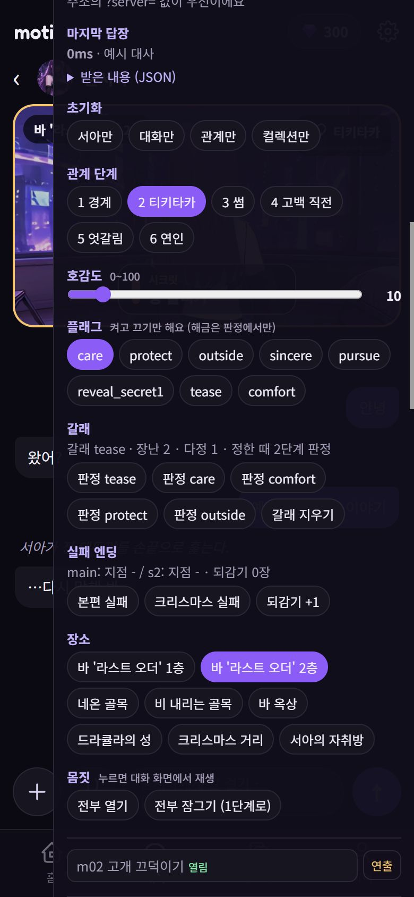 | 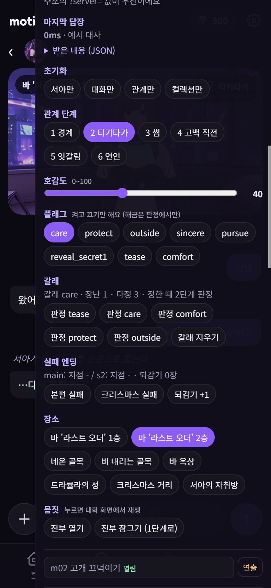 |

## B · 실패 엔딩 · 끝 화면 · 되감기

### 지금 서버가 돌려주는 것 (서버 저장소 `engine.py` `1905866`, 읽기만)
- 5단계로 오르면 `departure_days_left = 7`, `pending_event = "DEPARTURE"`(다음 턴에 떠난다는 소식).
- 판정의 `time_advance` 로 하루가 지나면 5단계에서 남은 날 −1. `_next_stage` 5→6 은 `pursue` + 남은 날 > 0.
- 남은 날 0 이고 엔딩이 없으면 `_apply` 끝에서 **`state.ending = "departed"`** → `/judge` 응답 `state` 에 실려 옴. `/chat`(상태 없는 방식)은 엔딩을 안 줌. → 앱은 `/judge` 의 `ending == "departed"` 를 본편 실패로 봄. server-sync 51 절에 적음.

### 흐름
- **본편 실패:** 위 신호 → 에필로그(원고 4번, 장면 문단처럼 1.9초 간격) → 입력창 자리가 끝 화면(원고 5번)으로. 그 줄기는 잠김(보내기·다시 들어올 때 인사·서아 사진 없음).
- **크리스마스 실패:** 에피소드 안 내 메시지 수(`ep.u`, 선물 포함)가 40(「자정」)이 되었을 때 에피소드 단계가 4 미만이면. 그 턴의 판정이 끝난 뒤(단계가 오를 수 있어서), 장면이 돌고 있으면 장면이 끝난 뒤 봄.
- **되감기 지점:** 본편 = 5단계에 오른 뒤 첫 서아 답장(떠난다는 장면) 다음. 크리스마스 = 3단계 장면(「…오늘은 빼 달라고 했어.」)이 끝난 직후. 그 줄기의 대화 기록·장소·판정 묶음·최근 대사·요약, 본편은 이야기 상태 전체(단계·호감·플래그·남은 날·route)와 대화 횟수·갈래 센 수, 크리스마스는 에피소드 단계·호감·플래그·내 메시지 수.
- **되감기:** 되감기 장이 있으면 한 장, 없으면 💎 200(모자라면 49 카드 팩과 같은 「다이아가 부족해요 · 마이에서 충전할 수 있어요」 + 마이 충전 카드로). 지점으로 돌리고 맨 아래 첫 줄에 지문 「*…다시, 그 밤.*」. 카드·다이아(쓴 것 말고)·준 선물 기록·사진은 그대로. 크리스마스는 내 메시지 수를 지점으로, 단 자정까지 15 미만이면 15 남김(40 − 15 = 25 이하로).
- **첫 실패 때 1장 무료:** 처음 실패한 순간 한 장. 끝 화면 단추 「되감기 1장」 + 아래 「첫 되감기는 선물이에요」.
- **처음부터:** 확인창(원고 5번) → 그 줄기만 처음으로. 본편은 이야기 상태·대화·대화 횟수·갈래를 비우고 오프닝부터(첫 만남 연출은 이미 봤으면 다시 안 함). 크리스마스는 그 에피소드 줄기를 지우고 1단계 장면부터, 이미 산 것이라 다이아를 다시 받지 않음. 카드는 그대로.
- **시연 패널(`?debug=1`) 「실패 엔딩」:** 지점·실패 상태·되감기 장 수·자정까지 남은 수, 「본편 실패」(본 이야기로 → 5단계 아래면 5단계 → 지점이 없으면 지금을 지점으로 → 서버 「떠남」이 온 것처럼), 「크리스마스 실패」(크리스마스 이브로 → 4단계 이상이거나 지점이 없으면 3단계로 → 내 메시지 수를 40 으로), 「되감기 +1」.

### 캡처 (390×844, 픽셀 2배, 헤드리스 Chrome · 서버 흉내)

본 이야기: 4단계 → 판정으로 5단계 → 「가지 마」 → 떠난다는 장면(지점 저장) → 판정 두 번(남은 날 3 → 0 · `ending: "departed"`)

| 에필로그 | 끝 화면(첫 무료) | 되감은 뒤 | 두 번째 실패(💎 200) |
| --- | --- | --- | --- |
| 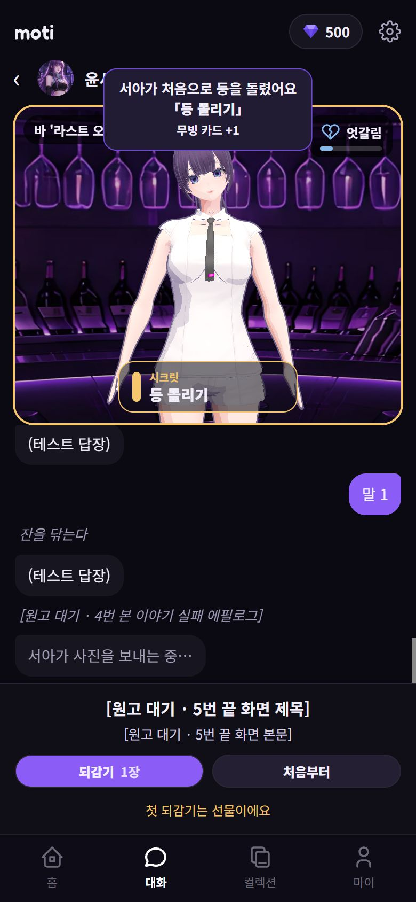 |  | 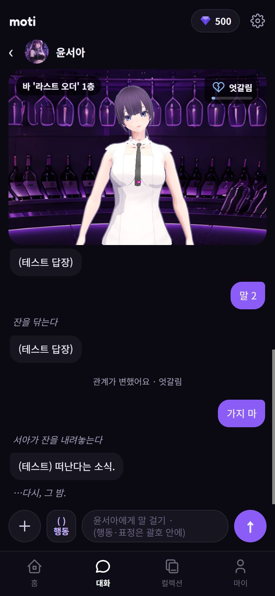 | 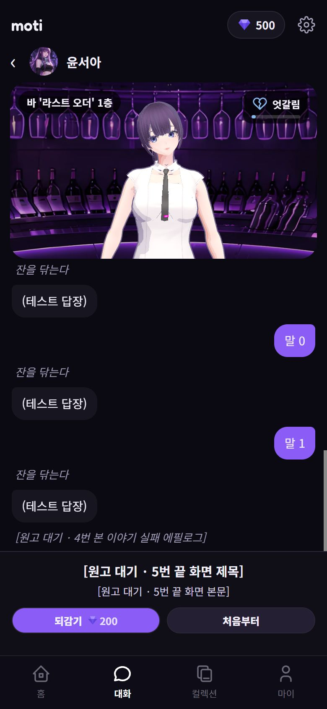 |

| 다이아 모자람 → 마이 충전 | 처음부터 확인창 | 처음부터 뒤(오프닝) |
| --- | --- | --- |
| 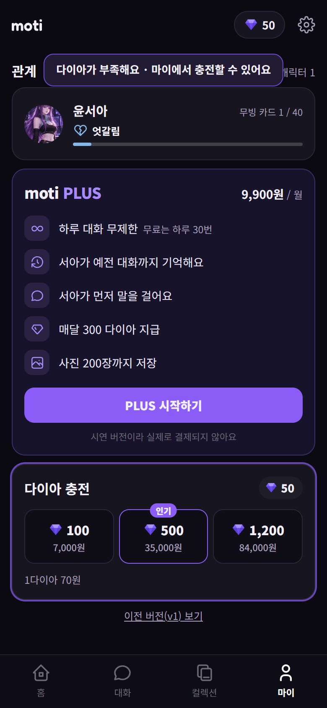 | 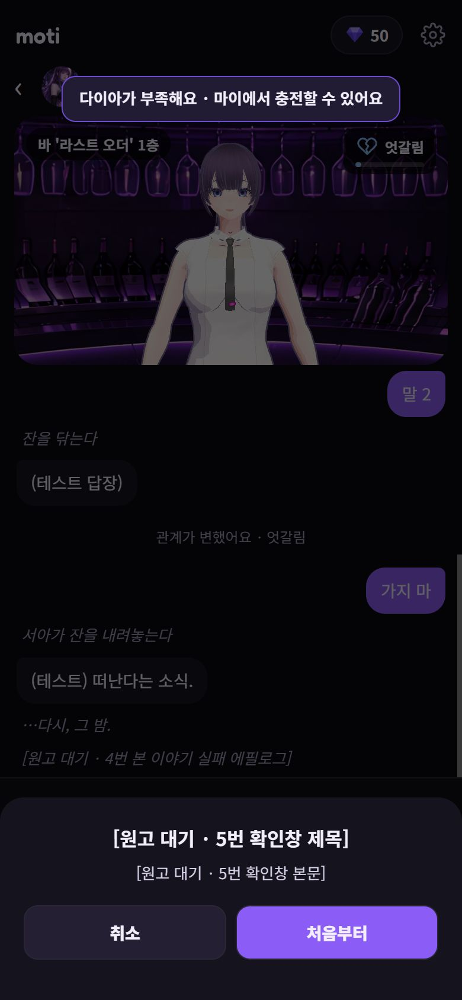 | 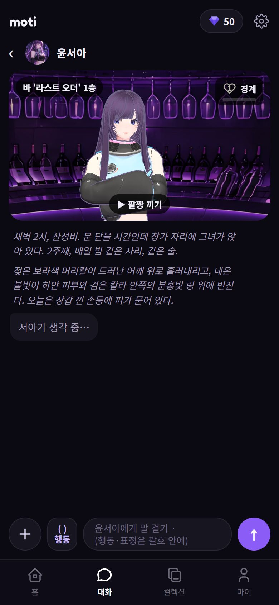 |

- 되감은 뒤 상태: 5단계 · 호감 77 · 남은 날 7 · `ending` null · route `tease` · 대화 11줄(지점 10줄 + 지문). 다음 `/chat` state 도 같은 값, history 끝에 떠난다는 장면.
- 두 번째 되감기: 💎 500 → 300. 세 번째(시연 버튼)에서 💎 50 으로 되감기 → 안내 + 마이 탭. 처음부터 → 1단계 · route null · 되감기 기록 비움 · 카드 수 그대로.

크리스마스 이브: 내 메시지 26번 → 판정으로 1 → 2 → 3단계 → 3단계 장면 끝(지점, 메시지 26) → 40번까지 3단계 → 실패

| 3단계 장면 뒤 | 에필로그 | 끝 화면(첫 무료) | 되감은 뒤 |
| --- | --- | --- | --- |
| 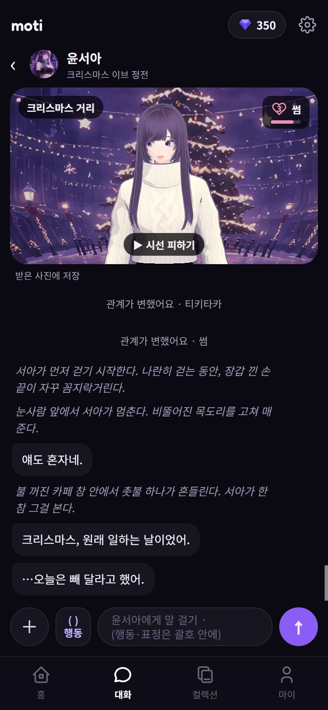 | 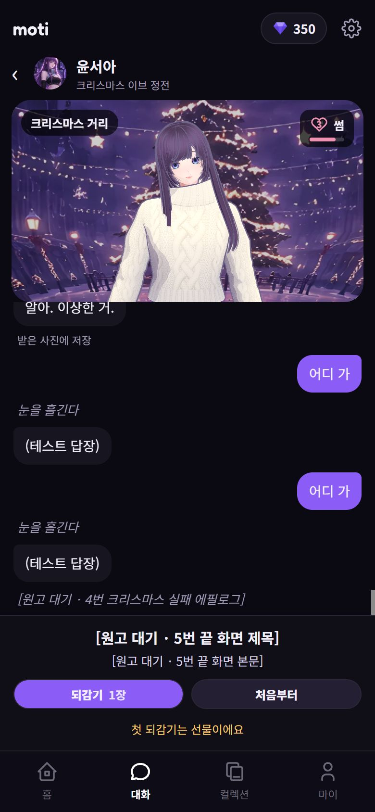 | 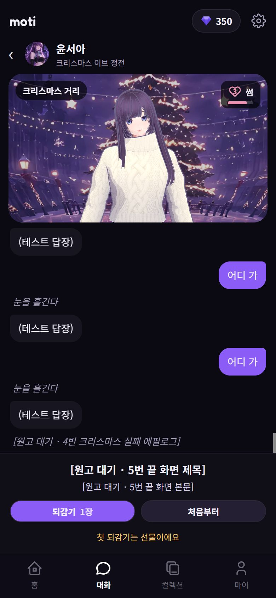 | 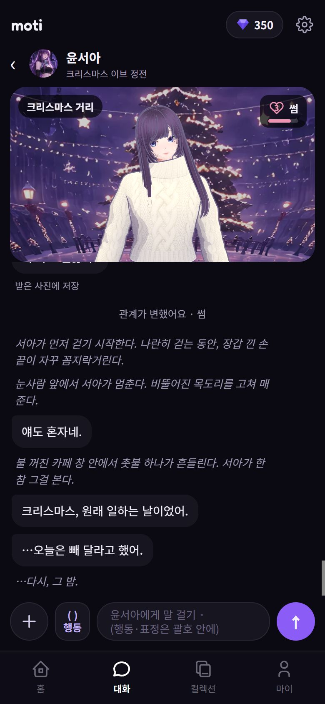 |

| 두 번째 실패(💎 200) | 처음부터 확인창 | 처음부터 뒤(1단계 장면) | 시연 패널 「실패 엔딩」 |
| --- | --- | --- | --- |
| 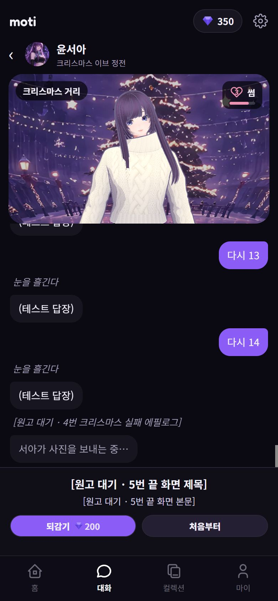 | 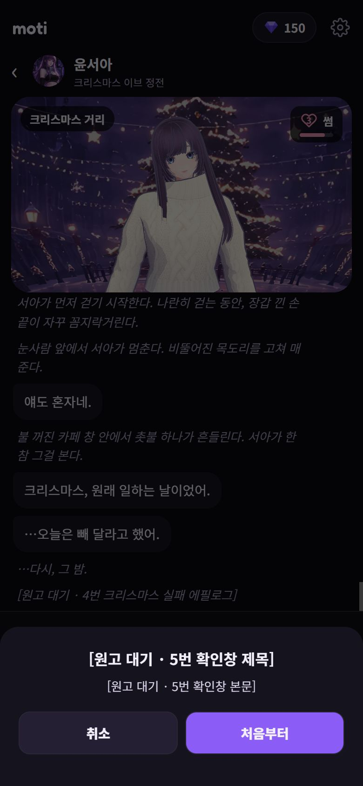 | 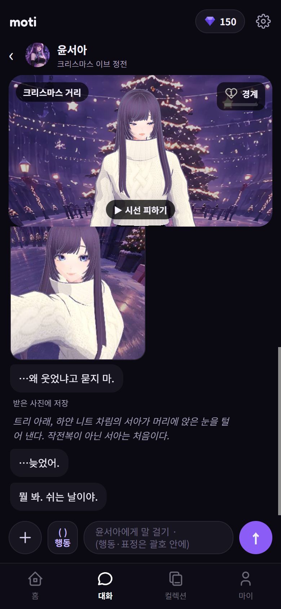 | 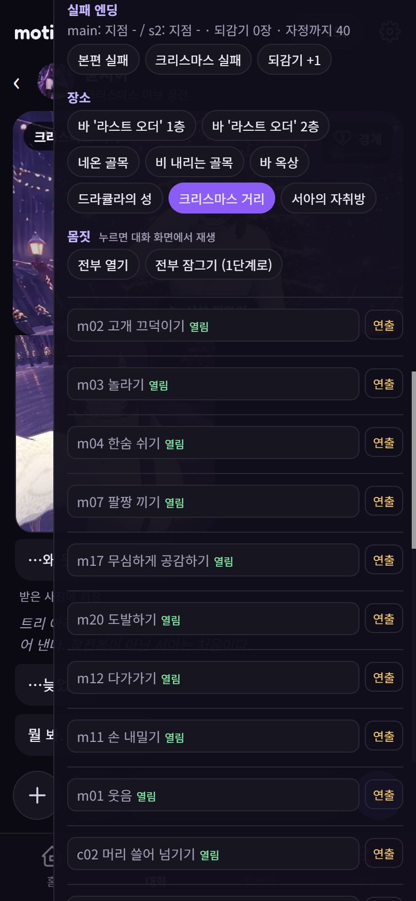 |

- 되감은 뒤 내 메시지 수 26 → **25**(자정까지 15 남김), 3단계 · 호감 27 그대로. 15번 더 보내면 다시 실패 → 💎 350 → 150. 처음부터 → 1단계 · 자정까지 40 · 💎 150 그대로(다시 안 삼). 본 이야기 단계(3)는 내내 그대로.

## C · 사장님 집 모션 · 캐시 · 선물 안내 줄바꿈

### 바 2층 몸짓
`data/seoa_story.json placeBan["1"]`: m20 · c04 · c03 · m12 · m22 · m23 · m21 · x17 · m16 · m19 를 빼고, c05 · m18 은 관계 6단계부터. 서버로 보내는 `motion_list` 와 앱이 고르는 몸짓(서버가 준 몸짓 받기·지문 단어) 모두.

모든 몸짓을 연 뒤 실제로 보낸 `motion_list`:

| 장소 · 단계 | 보낸 수 | ban 목록 중 들어간 것 | 열렸는데 빠진 것 |
| --- | --- | --- | --- |
| 바 1층 · 5 | 32 | m20 m12 c03 c04 c05 m21 m19 m18 x17 | 없음 |
| 바 2층 · 5 | 23 | 없음 | m20 m12 c03 c04 c05 m21 m19 m18 x17 |
| 바 2층 · 6 | 25 | **c05 m18** | m20 m12 c03 c04 m21 m19 x17 |

(m22 · m23 · m16 은 원래 서아 목록에서 빠져 있음)

### 캐시
- `index.html` 의 `<meta name="moti-version">`, 이 저장소 js · css 의 `?v=`, `data/version.json` 의 `v` 가 같은 값. 앱은 data/*.json 을 `?v=그 값` 으로 부름(캐시 다시 확인 `no-cache` 는 그대로).
- 열 때 `data/version.json` 을 캐시 없이(`no-store`) 받아 화면 버전과 다르면 주소에 `?v=새 값` 을 붙여 **한 번만** 새로고침(주소가 달라져 새 index 를 받음). 같은 탭에서 그 값으로 이미 한 번 했거나(`sessionStorage`) 주소에 이미 `?v=그 값` 이 있으면 다시 안 함(무한 새로고침 방지).
- 한 곳: `node tools/version.mjs`(배포 = main 병합 전에 한 번). 이번 병합 때 실행함.
- 확인: 화면 51 · 데이터 `52-test` 로 열기 → `?v=52-test` 로 한 번 이동, 그 뒤 더 이동 없음. 버전 같으면 이동 없음. 불린 파일이 모두 `?v=51`(js 14 · css 5 · data 19).

### 선물 첫 안내
「…건넬 수 있어요. 그때 열려요!」 의 「그때」와 「열려요!」 사이를 붙는 빈칸(U+00A0)으로. 390px 에서 둘째 줄 「그때 열려요!」.

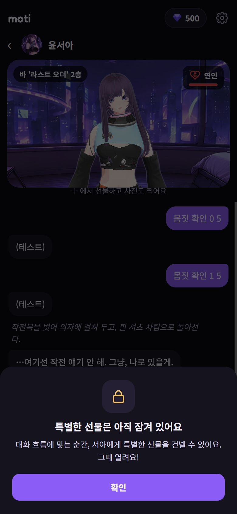

## D · server-sync

- 처리함: 42 · 42-1(표), 44 · 47 · 49(절 제목), 50 선물 줄 붙는 말(절 제목), 「서버에 물어볼 것」 4줄. 50 `gift_moment` 는 「아직」. 표에 44 · 47 · 49 · 50 · 51 줄을 더함(50 은 「일부」).
- 서버 저장소에서 대조(읽기만): EPISODE_XMAS 블록과 이어서 연기 줄, 단계 이름 앱과 같음, m15 · 춤 빠짐, 선물 붙는 말 판정 줄이 있음. `gift_moment` 는 없음.
- 새 절 「51 · 갈래 · 실패 엔딩 · 되감기」: `state.route`(서버 `new_state` 에 `route` 를 더해야 버려지지 않음), 갈래별 사건 표, 단계가 오를 때 한 번 나오는 장면, 엔딩 신호(지금 서버 그대로), 크리스마스 자정은 앱이 셈, 되감기 뒤 서아는 기억 못 함, 앱은 유저 이름을 안 보냄(3→4 에서 이름을 물음), 바 2층 몸짓은 앱이 거름. 대사는 원고 파일을 가리킴.

## 그 밖의 확인
- 예전 저장값(50 때 모양: 본 이야기 5단계·남은 날 4, 크리스마스 3단계, `rw`·`routeCount`·`ep.u` 없음)으로 열기 → 본 이야기·크리스마스 메시지 보내기 오류 없음. 크리스마스 내 메시지 수는 0 부터 셈.
- 콘솔 오류 없음(모든 실행, `favicon.ico` 404 만), `data/*.json` 19개 모두 읽힘, 스크립트 문법 검사 통과.

## 제가 정한 것
- **원고 없음:** 에필로그 · 끝 화면 · 확인창 문구는 「[원고 대기 · …]」. 원고가 몇 문단이든 `data/rewind.json` 배열만 바꾸면 됨. 본편과 크리스마스 문구를 따로 둠(`epilogue.main`·`epilogue.s2`, `end.main`·`end.s2`).
- **새 데이터 파일 `data/rewind.json`:** 실패 · 되감기 묶음을 한 파일로. 갈래 규칙과 장소 ban 은 서아 이야기 규칙이라 `data/seoa_story.json` 에.
- **갈래 세기:** 판정 한 번에 다정 플래그가 여러 개면 각각 +1(care · comfort 둘 = 다정 2). 「판정 전 단계」가 1·2 일 때 셈(2→3 으로 오르는 판정도 셈). 같으면 care.
- **2단계를 건너뛴 경우:** 갈래 없이 3단계 이상이 되면(서버 v1 · 서버 없음의 대화 횟수 단계, 시연 패널 단계) 그때 같은 규칙으로 정함. 이미 3단계 이상인 **예전 저장값은 다음 단계가 오를 때까지 `null`**(서버가 지금 규칙대로 하게).
- **본편 지점 = 5단계에 오른 뒤 첫 서아 답장 다음.** 서버에서는 그 답장이 `DEPARTURE` 사건 답장. 서버 없음에서도 같은 자리. 그 턴은 판정 묶음에 넣기 전에 저장(되감은 뒤 그 턴은 다음 판정에 안 들어감).
- **예전 저장값에서 이미 5단계인 사람**은 지점이 없어 실패하면 되감기 단추가 흐리고 「돌아갈 지점이 없어요」(처음부터만). 문구는 `data/rewind.json end.noPoint`(원고에 없어 정함).
- **크리스마스 자정 셈:** 에피소드 안 내 메시지(선물 · 포즈 부탁 포함). 40번째 답장 뒤 판정이 돌고 있으면 끝난 뒤 판정. 지점은 3단계 장면이 끝날 때마다 새로 저장(처음부터 다시 하면 새 지점).
- **되감기 때 그대로 두는 것:** 판정 · 사건으로 열린 몸짓(`S.unlocked`), 받은 사진, 순간 선물 기록. 처음부터 때도 열린 몸짓은 그대로(카드처럼 「모은 것」으로 봄).
- **되감기 장 저장** `S.rwTickets`, 첫 무료는 첫 실패 때 한 번(`S.rwFirst`). 「첫 되감기는 선물이에요」는 되감기를 한 번도 안 썼고 장이 있을 때만.
- **구매 확인창 없음:** 되감기 💎 200 은 다른 구매(선물 · 에피소드)처럼 누르면 바로. 모자라면 카드 팩(49)의 안내 + 마이 충전 흐름.
- **확인창 단추** 「취소」·「처음부터」(원고 5번 확인창 문구는 원고 대기, 단추 이름은 지시문 · 기존 말).
- **끝 화면 모양:** 입력창 자리에 제목 · 본문 · 단추 둘(되감기 보라 · 처음부터 어둡게), 새 시각 효과 없음. 에필로그가 다 나온 뒤에 나타남(그동안 입력창은 숨김).
- **잠긴 줄기:** 보내기, 다시 들어올 때 인사, 서아 사진(단계 사진은 되감은 뒤로 미룸)을 멈춤. 다른 줄기(본 이야기 ↔ 크리스마스)는 그대로 쓸 수 있음.
- **되감은 뒤 무대:** 장소가 다를 때만 어두워졌다 밝아지는 전환(같은 장소면 바로).
- **바 2층 ban 을 앱이 고르는 몸짓에도:** 지시문은 `motion_list` 였지만, 서버가 목록 밖 몸짓을 주거나 지문 단어로 고를 때도 같은 몸짓이 안 나오게 `pickable()` 에 걸고, 서버 v1 의 몸짓 이름 목록에도 같게.
- **버전 값:** 이번은 `51`. 다음부터 `node tools/version.mjs`(값을 안 주면 `YYYYMMDD-HHmm`). git 훅이나 Actions 로 자동화하지 않음(GitHub Pages 가 main 을 그대로 내보내는 방식이라 병합 전에 한 번 실행). 그림 · 3D 모델 · 모션 파일은 꼬리표 대상이 아님(지시문 범위 밖).
- **새로고침 주소:** `?v=새 값` 이 주소에 남음(앱은 `v` 를 따로 쓰지 않음).
- **선물 안내:** 원고 문구는 그대로 두고 띄어쓰기만 붙는 빈칸으로(JSON 안에 보이지 않는 글자라 `ui.json` 에서 지우지 않게 주의).

## 아이폰에서 나중에 볼 것
- 끝 화면이 입력창 자리에서 아래 탭 · 안전 영역과 겹치지 않는지, 단추 두 개 폭(「되감기 1장」·「되감기 💎200」).
- 처음부터 확인창(시트)이 열리고 닫히는 것, 되감은 직후 3D · 장소 전환.
- 캐시: 배포 뒤 홈 화면에 추가한 앱 · 사파리 탭에서 옛 화면이 남았을 때 한 번 새로고침되는지. 저장소(`sessionStorage`)가 막힌 브라우저도 주소의 `?v=` 가 같으면 다시 안 함(코드로 막음, 아이폰에서는 확인 전).
- 선물 첫 안내의 「그때 열려요!」 줄바꿈(아이폰 글꼴 폭).
- 시각 효과(블러 · 그림자 · 애니메이션 · 3D)는 바꾸지 않음.

---

# 51-1 · 원고 넣기 · 되감기 확인창 · 예전 저장값 · 버전 규칙

브랜치 `step/51-route-rewind`(이어서) · 커밋 `[51-1] 원고 넣기와 되감기 확인창` · `[51-1] 버전 꼬리표`

원고: 다운로드 폴더 `51-갈래-되감기-원고.md`(이름 꼬리 없음) → [docs/drafts/51-갈래-되감기-원고.md](../drafts/51-갈래-되감기-원고.md)

## 바뀐 것

| 파일 | 내용 |
| --- | --- |
| `data/rewind.json` | 「[원고 대기]」를 모두 원고로: 에필로그 둘(4번 「떠난 밤」 5문단 · 「혼자 돌아간 밤」 4문단), 끝 화면 제목·설명·버튼 1(본편 「되감기 · 그 밤으로」 / 크리스마스 「되감기 · 카페 창가로」), 첫 실패 안내, 처음부터 확인창. 새 `confirm`(다이아 되감기 확인창 문구, `{price}`) |
| `index.html` | 끝 화면 버튼 1 을 줄기별 문구·금색으로. 다이아로 되감을 때만 확인창(`#rwConfirm` 재사용) → 「되감기」면 차감 후 되감기, 「취소」면 그대로. 무료 장은 바로. `End.migrate()`(예전 5단계·지점 없음 → 지금을 지점으로, 시작할 때와 본 이야기로 돌아올 때), 시작할 때 `Route.check("old")`(3단계 이상·route null → 센 수로, 없으면 care) |
| `data/demo.json` | 갈래 「정한 때」에 「예전 저장값」 |
| `CLAUDE.md` | 브랜치·커밋 규칙에 「main 에 병합하기 전에 `node tools/version.mjs`」 |
| `docs/status.md` | 51-1 줄, 버전 규칙 한 줄, 남은 일에서 원고 받기 지움 |
| `docs/drafts/51-갈래-되감기-원고.md` | 원고 |

## 캡처 (390×844, 픽셀 2배, 헤드리스 Chrome · 서버 흉내)

| 본편 에필로그 + 끝 화면 | 💎200 되감기 확인창 | 처음부터 확인창 | 크리스마스 에필로그 + 끝 화면 | 예전 저장값 5단계 · 실패 |
| --- | --- | --- | --- | --- |
| 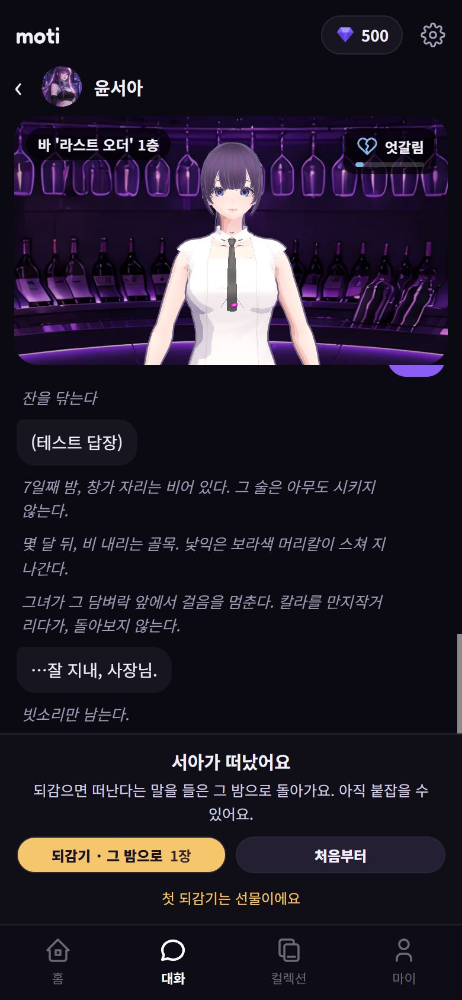 | 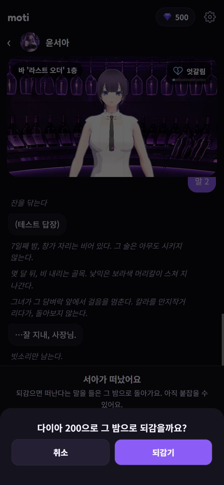 | 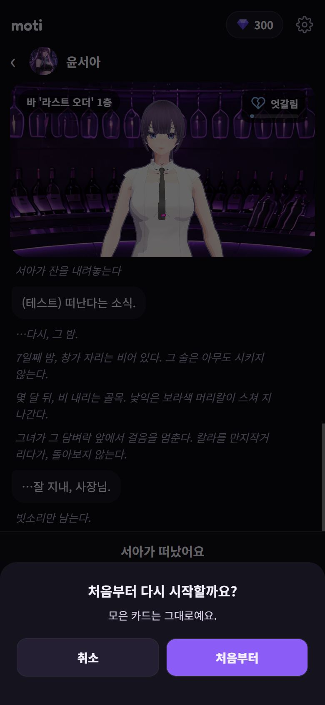 | 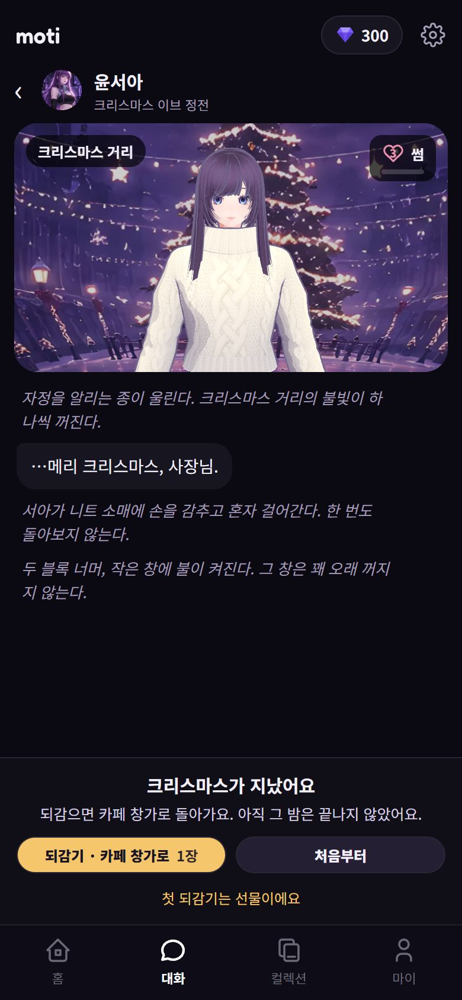 | 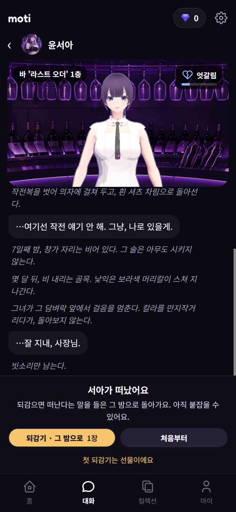 |

## 확인
- 본편: 5단계 → 떠난다는 장면 → `ending: "departed"` → 원고 에필로그 5문단 → 「서아가 떠났어요」 끝 화면 · 「되감기 · 그 밤으로 1장」 · 「첫 되감기는 선물이에요」.
- 무료 되감기: 확인창 없이 바로(잠김 풀림, 마지막 줄 「*…다시, 그 밤.*」).
- 두 번째 실패 → 되감기: 확인창 「다이아 200으로 그 밤으로 되감을까요?」 · 취소 · 되감기. **취소 → 💎 500 그대로, 끝 화면 그대로.** 되감기 → 💎 300, 5단계 · 남은 날 7.
- 크리스마스(시연 버튼): 원고 에필로그 4문단 → 「크리스마스가 지났어요」 · 「되감기 · 카페 창가로」.
- 예전 저장값 ① 본편 5단계 · 남은 날 4 · 지점 없음 → 열자마자 지점 저장(남은 날 4, 대화 3줄). 실패하면 되감기 단추가 켜짐. ② 3단계 · route null · 센 수 장난 3 · 다정 1 → `tease`(정한 때 「예전 저장값」). ③ 4단계 · route null · 센 기록 없음 → `care`. 메시지 보내기 오류 없음.
- 콘솔 오류 없음(`favicon.ico` 404 만), `data/*.json` 모두 읽힘.

## 제가 정한 것
- **대사 따옴표:** 원고의 「…」 대사는 다른 장면 원고(42 등)처럼 `"…"` 로 넣음(앱이 큰따옴표를 대사 말풍선으로 나눔). 글자는 그대로.
- **처음부터 확인창:** 원고 한 줄 「처음부터 다시 시작할까요? 모은 카드는 그대로예요.」를 제목(첫 문장) · 설명(둘째 문장)으로 나눔. 단추는 51 그대로 「취소」·「처음부터」.
- **버튼 1 금색:** 원고 「버튼 1 (금색)」대로 금색 바탕 · 어두운 글자. 장 수 · 💎 가격 작은 표시는 그 옆에 그대로.
- **확인창 문구 「그 밤으로」:** 지시문 문구 하나를 본편 · 크리스마스 같이 씀. 가격은 `item.price` 를 따라 바뀜. 다이아가 모자라면 확인창 없이 바로 부족 안내(확인 뒤에 모자라다고 하지 않게).
- **예전 5단계 지점:** 지시문대로 「지금 상태」(남은 날이 줄었으면 줄어든 채). 5단계에 막 올라 떠난다는 장면을 기다리는 중(51 새 흐름)이면 건드리지 않음. 지금 줄기가 크리스마스면 본 이야기로 돌아올 때 저장.
- **예전 route:** 시작할 때 3단계 이상이면 센 수로 바로(51 에서는 다음 단계에 오를 때까지 null 이었음). 정한 때 표시 `old`.
- 원고 0~3절(갈래 사건 · 단계 장면 · 3단계 호감 55 · 4단계 호감 65 등)은 서버 몫이라 앱은 바꾸지 않음. server-sync 51 절이 원고를 가리킴.

## 아이폰에서 나중에 볼 것
- 끝 화면 금색 버튼 글자(「되감기 · 카페 창가로 1장」이 한 줄에 들어가는지), 설명 두 줄 줄바꿈.
- 다이아 되감기 확인창(시트) 열고 닫기.
