# 52 · 카드 팩 SECRET 세 장 · 시작화면 인사 카드 · 등급 손보기

브랜치 `step/52-pack-secret` · 커밋 `[52] 카드 팩 SECRET 세 장과 등급 손보기`, `[52] 버전 꼬리표`

## 바뀐 파일

| 파일 | 바뀐 것 |
| --- | --- |
| `motions/xstage_cute_fluffy_tilt.json` (새) | x32 귀여운 척 갸웃 ← `_src/[standard]_Cute_Fluffy_Tilt.fbx` (7.07초, 손가락 30개) |
| `motions/xstage_catch_catch.json` (새) | x33 시간 날 때마다 연습한 춤 ← `_src/[standard]_Catch_Catch.fbx` (21.92초, 손가락 30개) |
| `motions/xstage_cute_thinking.json` (새) | x34 고민하는 척 ← `_src/[standard]Cute_Thinking.fbx` (7.13초, 손가락 30개) |
| `data/motions.json` | `motions` 에 x32·x33·x34(`only: "pack"`), `xstage` 에 재생 구간·섞기·`inPlace`, 설명 |
| `data/collection.json` | 카드 g13~g16(52~55번, `line` 한 줄), `gradeRule.byId` {m13: common} → 24번 등급 common, `card.frameById` x33(전신)·x23(위를 조금 더), `momentById` g13~g16, `photocard.nameFitMinPx`, 설명 |
| `data/seoa_story.json` | `_ban` 설명에 m16 이유만 더함(값은 그대로) |
| `cards.js` | 크게 보기 아래 줄 = 칸의 `line` 먼저. 아래 띠 이름이 넘치면 글자만 줄이기(`fitName`·`fitNames`, 목록·크게 보기·카드 팩 연출), 공유 그림도 같은 방식 |
| `pack.js` | 1장씩 뒤집는 큰 카드 아래에 `line`, 10장 묶음이 보인 뒤 이름 맞추기 |
| `pack.css` | `.pkln`(뒤집힌 뒤 나타나는 한 줄) |
| `tools/build_collection.mjs` | `gradeRule.byId` 를 규칙보다 먼저(다시 돌려도 지금 파일과 똑같이 나옴 확인) |
| `tools/check_gacha.mjs` | 52 검사(아래) |
| `docs/CREDITS.md` | 모션 세 줄 |
| `docs/status.md` | 52 절, 남은 일 |
| `docs/reports/img/52/*` | 캡처 |

## 1 · FBX 세 개 변환

다운로드 폴더 이름 그대로 `_src/` 에 복사(지시문 이름과 똑같은 파일이 있었음, 비슷한 이름 고를 일 없음) → `node tools/fbx2motion.mjs` (45-1 방식, 몸 뼈 20 + 손가락 30, 손가락 15fps).

| 몸짓 | 원본 | 크기 | 쓰는 구간 | 방향 |
| --- | --- | --- | --- | --- |
| x32 귀여운 척 갸웃 | `[standard]_Cute_Fluffy_Tilt.fbx` 7.07초 | 134KB | 0.8~6.2초(앞뒤 서 있는 부분 뺌) | 정면(골반 0~−8°) → turn 없음 |
| x33 시간 날 때마다 연습한 춤 | `[standard]_Catch_Catch.fbx` 21.92초 | 429KB (gzip 119KB) | **4.7~19.8초**(15.1초) | 춤 중간 평균 +17°(안무로 좌우로 돎) → turn 없음 |
| x34 고민하는 척 | `[standard]Cute_Thinking.fbx` 7.13초 | 140KB | 0.1~7.0초 | 정면(0~−7°) → turn 없음 |

- 셋 다 `inPlace`(골반이 앞뒤·좌우로 조금씩 움직임 → 제자리). 처음·끝 섞기 0.3~0.4 / 0.6초.
- 춤 원본 0.7~4.6초는 **등을 보이고 서 있다가 한 바퀴 돌아 정면이 되는 시작**. 기본 자세(정면)와 섞으면 180° 를 넘게 돌아 한 프레임에 튀어서(31 의 x17 과 같은 문제) 빼고, 돌아서 정면이 된 4.7초부터. 끝은 마지막 포즈(몸 −53°, 안무)에서 0.6초 머문 뒤 끝 섞기.

춤 크게 보기(약 1.1초 간격, 전신 구도 · 정면):

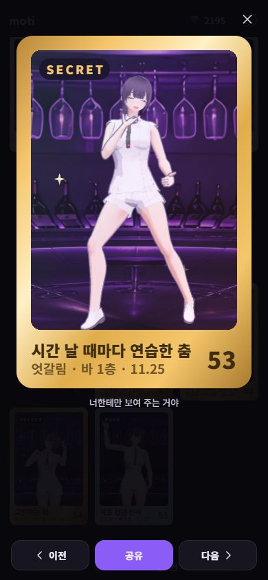

## 2 · 카드 팩 전용

`data/motions.json` x32~x34 `only: "pack"`. 앱의 대화 몸짓 목록(`unlockedIds`)이 `only` 를 빼므로 `motion_list` 에 안 들어감.
- 확인: 6단계 + 모든 몸짓을 열린 것으로 둔 상태에서 `motionList()` 33개, **x32·x33·x34·m16 없음**.

## 3·4 · 카드 네 장

| 번호 | id | 이름 | 등급 | 몸짓 | 한 줄 | 카드 그림 순간 |
| --- | --- | --- | --- | --- | --- | --- |
| 52 | g13 | 귀여운 척 갸웃 | special(SECRET) | x32 | 웅? | 22%(두 손을 볼에 대고 갸웃) |
| 53 | g14 | 시간 날 때마다 연습한 춤 | special(SECRET) | x33 | 너한테만 보여 주는 거야 | 65%(손을 얼굴 옆에 댄 춤 동작), **전신** |
| 54 | g15 | 고민하는 척 | special(SECRET) | x34 | 뭐~ 마실까! 아, 너무 신났나 | 50%(손가락을 머리에) |
| 55 | g16 | 처음 건넨 인사 | rare | x23 | 안녕? 잘 부탁해. | 40%(손을 높이 들어 흔듦) |

번호는 지금 가장 큰 51(gm06) 다음부터. x23 은 `only: "onboarding"` 그대로라 시작화면 인사는 바뀌지 않음.

### 시연 패널로 강제로 뽑기 (390×844, 헤드리스 Chrome)

시연 패널 「다음 카드 팩 결과(첫 장)」에 g13~g16 이 생김. 실제 클릭으로 g14 → g15 → g13 → g16 지정 → 배너 「1장 뽑기」 → 팩 열기 → 카드 누르기: 네 번 모두 지정한 카드, SECRET 3장 `special`, 인사 `rare`.

| 시연 패널 | 뒤집는 중(금빛) | 뒤집는 중(레어) |
| --- | --- | --- |
| 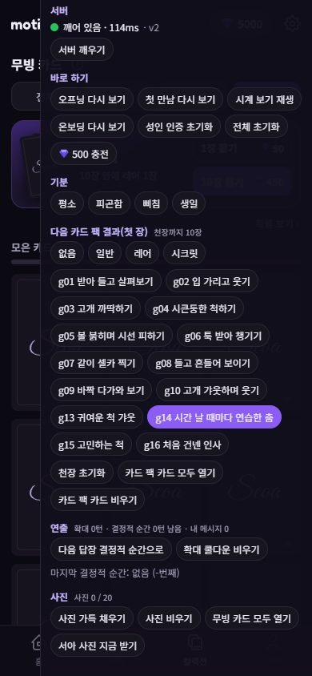 | 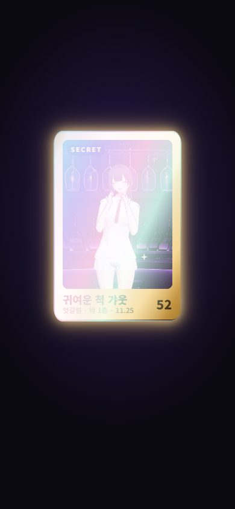 | 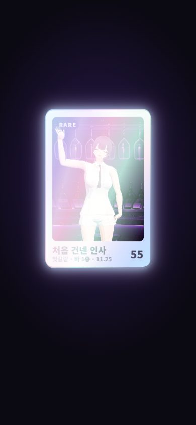 |

처음 뽑을 때는 카드 그림이 아직 없어 실루엣(49 그대로) → 그림이 만들어진 뒤 다시 뽑은 연출(「이미 있어요」):

| 귀여운 척 갸웃 | 시간 날 때마다 연습한 춤 | 고민하는 척 | 처음 건넨 인사 |
| --- | --- | --- | --- |
| 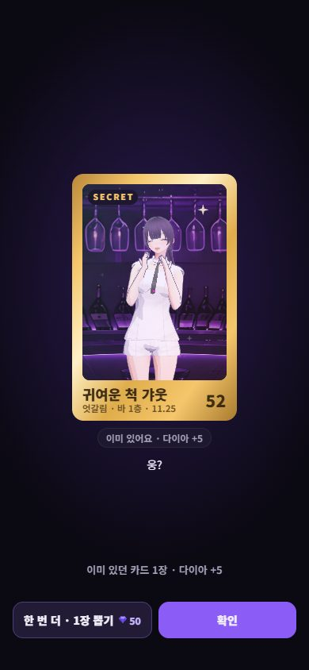 | 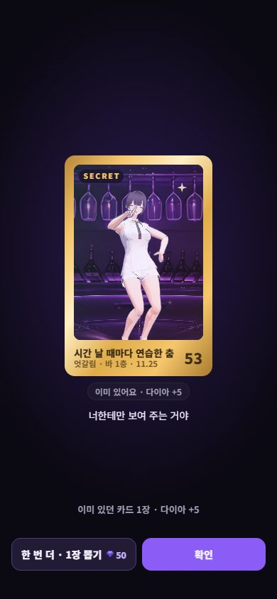 | 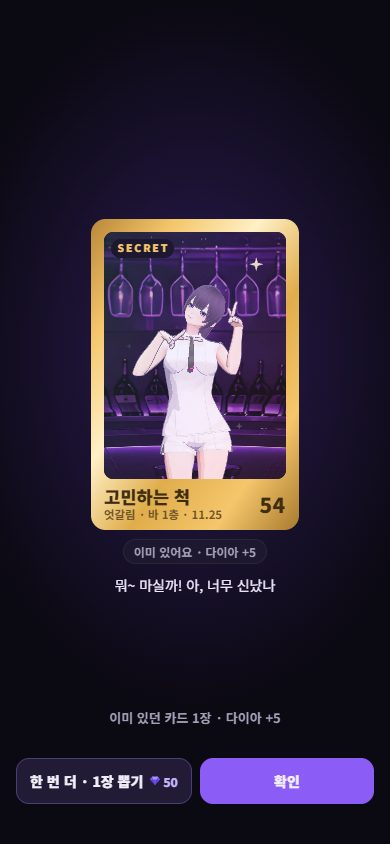 | 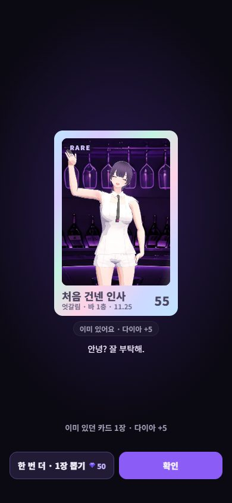 |

10장 뽑기(첫 장 춤 지정) → 「모두 뒤집기」:

| 첫 장 | 결과 |
| --- | --- |
| 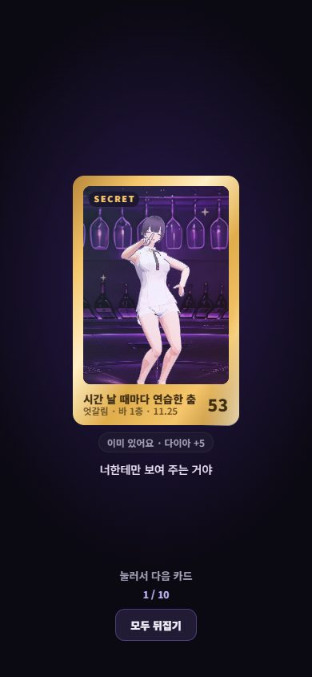 | 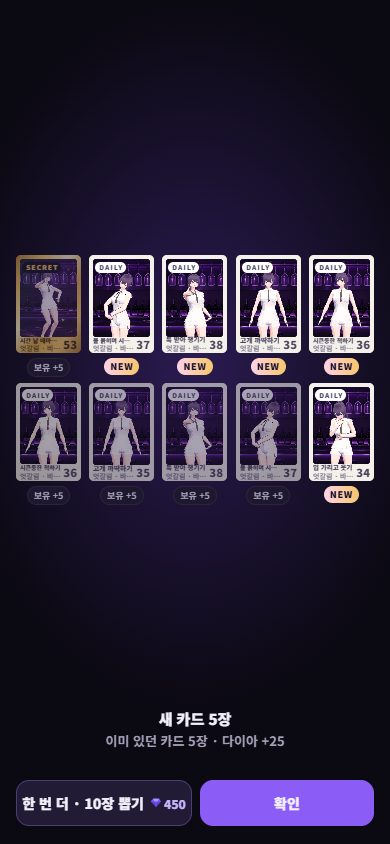 |

### 크게 보기

| 귀여운 척 갸웃 | 고민하는 척 | 처음 건넨 인사 |
| --- | --- | --- |
| 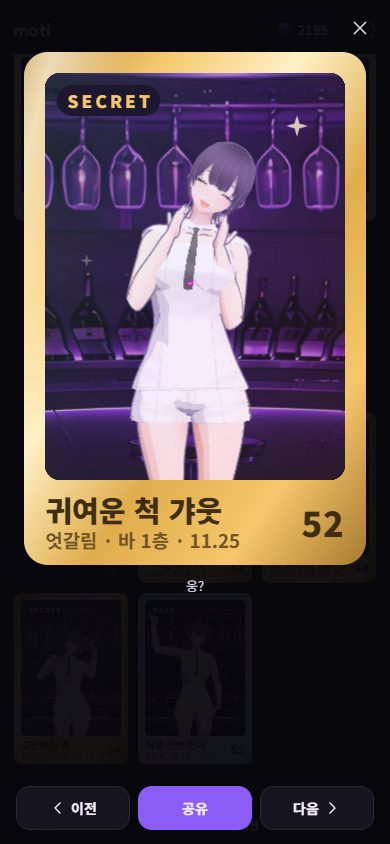 | 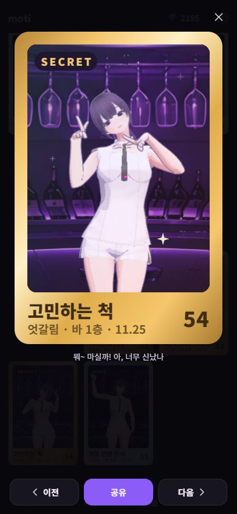 | 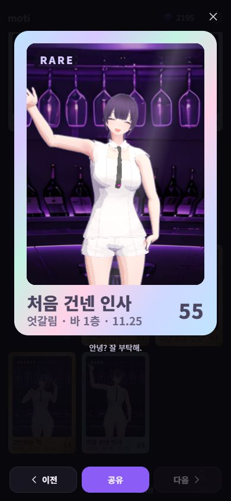 |

손가락(크게 보기에서 잘라 확대 — 볼에 댄 손 · 머리를 가리키는 검지 · 춤 손 · 인사):

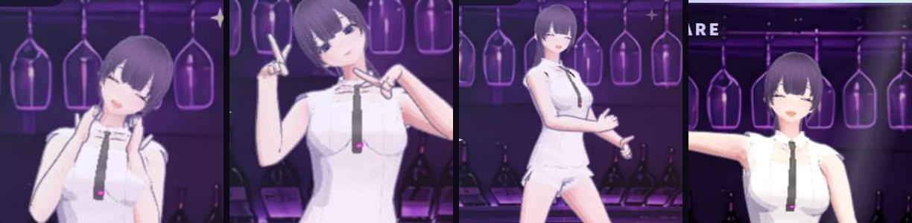

- 갸웃: 손바닥을 볼에 대고 손가락이 얼굴 선을 따라 굽음. 고민: 검지만 펴고 나머지는 접음. 춤·인사: 편하게 벌린 손. 거꾸로 꺾이거나 비틀린 손가락은 못 찾음.

### 컬렉션 · 긴 이름

| 카드 팩 탭 | 새 카드 |
| --- | --- |
| 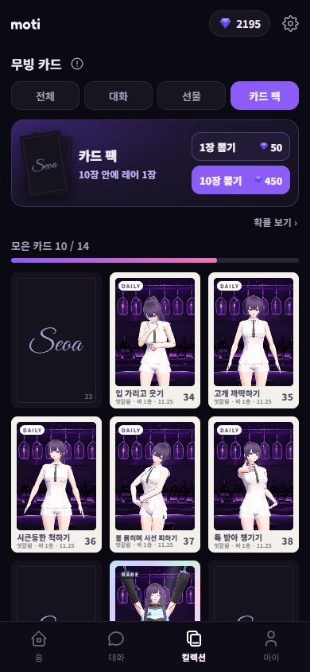 | 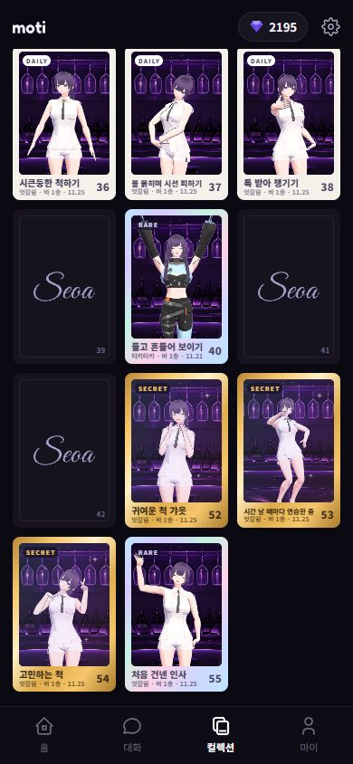 |

- 「시간 날 때마다 연습한 춤」은 처음엔 목록·크게 보기 모두 「시간 날 때마다 연…」으로 잘렸음 → **글자만 줄여서 다 보이게**: 크게 보기 약 25 → 22.6px, 목록 칸(카드 폭 114px) 10 → 7.5px, 1장 뽑기 큰 카드는 그대로 들어감.
- 예전부터 목록에서 잘리던 「볼 붉히며 시선 피하기」(8.5px로)·「팔꿈치 괴고 몸 숙이기」·「자신감 있게 설득하기」도 같이 다 보이게 됨(대화 탭).
- 확인: 카드 팩 탭 모두 연 상태에서 넘치는 이름 0개.

## 5 · 특별이 실제로 나옴

| 확률 보기 | 
| --- |
| 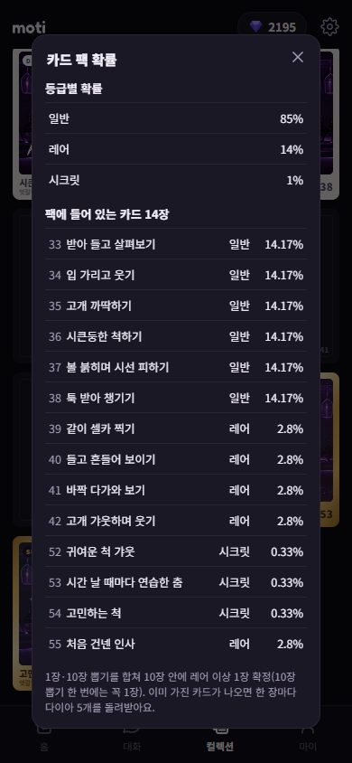 |

- 팩에 특별 카드가 생겨 `gacha.fit("special")` = special(47 의 레어로 내리기가 저절로 풀림). 확률 데이터는 그대로 85/14/1.
- 화면: 일반 85% · 레어 14% · **시크릿 1%**, 카드 14장 — 일반 14.17% ×6, 레어 2.8% ×5, 시크릿 0.33% ×3 (합 100).
- 시뮬레이션(천장 끔 10,000장): 84.7 / 14.2 / **1.1**.

## 6 · 24 손 흔들기 DAILY

`data/collection.json gradeRule.byId: { "m13": "common" }` → `tools/build_collection.mjs` 가 규칙보다 먼저 씀 → 24번 `grade: common`. 저장값에는 등급이 없고 칸의 grade 로 보여서, 이미 가진 사람 카드도 바로 DAILY.

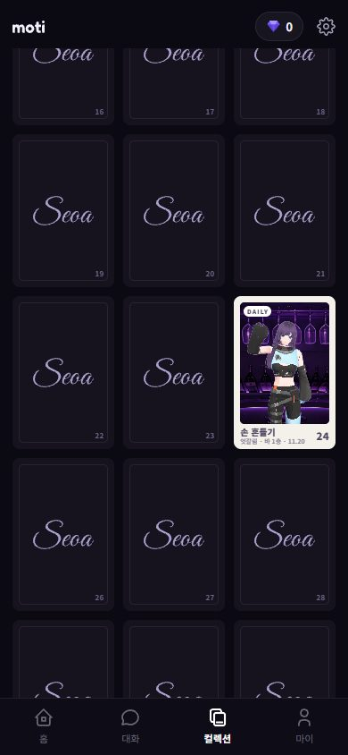

(예전 저장값에 m13 을 가진 상태로 연 화면)

## 7 · m16 응원하기

`data/seoa_story.json ban` 에 이미 m16 이 있었음(44 전부터) → 대화 몸짓 목록·`motion_list` 에 원래 안 나옴. 값은 그대로 두고 설명에 이유만 적음. 카드 팩 g08 「들고 흔들어 보이기」는 m16 그대로(목록 40번, 그림·재생 그대로).

## 8 · `node tools/check_gacha.mjs` → ✓ 모두 통과

- 더한 검사: g13~g16 이름·등급·몸짓·한 줄·번호(이어서), 몸짓이 `only pack`·xstage 연결·손가락 30개·inPlace, x23 은 onboarding 그대로, 카드 팩 전용 몸짓이 대화 해금에 없음, 춤 x33 전신 구도 = m23, m13 일반, m16 ban, g08 = m16, 특별 카드가 있으면 특별 % 가 레어에 안 더해짐·확률 보기 줄에 특별
- 예전 「카드 팩 + 보류 선물 = 12장」 검사는 「예전 선물 카드(g01~g10 + g11·g12) = 12장」으로
- 도감: 대화 29 + 연출 1 + 카드 팩 14 + 보류 선물 2 + 순간 선물 6 = 54(보이는 칸 50)

## 그 밖의 확인

- **예전 저장값:** v4(49 직후 형식, m13·m01·g08 가짐, 천장 3)로 열기 → `S.v` 5, 카드 세 장 그대로, 천장 3 그대로, 오류 없음.
- **데이터 JSON:** `data/*.json` 16개 fetch·파싱 모두 됨.
- **콘솔:** 모든 실행에서 오류·예외 없음(three.js `morphNormals` 경고는 예전부터).
- `node tools/build_collection.mjs` 다시 돌려도 `data/collection.json` 이 바이트까지 같음.

## 제가 정한 것

- **몸짓·카드 id:** 몸짓 x32·x33·x34(x26~x31 은 50 의 순간 선물 반응이 쓰려고 비워 둔 번호라 그다음), 카드 g13~g16(g11·g12 보류 다음).
- **`only` 값:** `"pack"`.
- **표정:** 갸웃·춤·인사 `joy`, 고민하는 척 `fun`(장난스러운 「~척」).
- **감정(emo):** 갸웃·고민 「장난」, 춤 「기쁨」(대화 목록엔 안 나오지만 칸을 채움).
- **춤 구간 4.7~19.8초:** 등 돌린 시작(0.7~4.6초)은 정면 기본 자세와 섞을 때 180° 튐이 생겨 뺌. 마지막 포즈(−53°)는 안무라 돌리지 않고 남김. 춤 중간 몸 방향이 평균 +17° 쯤이지만 좌우로 계속 도는 안무라 turn 없음.
- **세 몸짓 모두 `inPlace`:** 지시문 「제자리에서」대로. 갸웃·고민은 골반이 몇 cm 움직이는 정도라 큰 차이 없음.
- **카드 그림 순간:** 위 표. x23 은 카드 구도에서 높이 든 손끝이 위 가장자리에 닿아서 **카드 구도만** 위를 조금 더(`frameById.x23 top 1.16, width 0.6`). 시작화면 입장권 구도는 그대로.
- **「카드 아래 한 줄」 자리:** 크게 보기 카드 아래 글줄(예전엔 처음 봤을 때 대사가 나오던 곳)에 칸의 `line` 이 먼저, 그리고 카드 팩 1장씩 뒤집는 큰 카드 아래(뒤집힌 뒤 나타남). 10장 묶음 5열에는 칸이 작아 넣지 않음. 목록 칸에도 넣지 않음(아래 띠의 작은 줄은 단계·장소·날짜 그대로).
- **긴 이름 줄이기를 모든 카드에:** 넘칠 때만 줄이는 공통 규칙이라 예전에 잘리던 이름 3개도 다 보이게 됨. 가장 작은 글자 6px(`nameFitMinPx`). 10장 묶음(카드 폭 65px)에서는 6px 로도 「시간 날 때마다…」·「볼 붉히며 시…」가 남아 잘림 — 거기서 다 넣으려면 약 4px 라 못 읽어서 6px 에서 멈춤. 글자 폭 반올림으로 1px 넘치지 않게 계산한 크기의 96%.
- **공유 그림:** 같은 방식으로 이름 글자만 줄임(최대 55%까지, 그래도 넘치면 예전처럼 …).
- **m16:** 이미 빠져 있어 바꿀 값 없음(설명만).
- **카드 팩 확률 숫자는 그대로**(85/14/1). 천장 때문에 레어 이상 실제 비율은 약 19%(49 와 같음), 천장으로 확정될 때 특별이 나올 확률은 1/15.

## 아이폰에서 나중에 볼 것

- **춤 카드 크게 보기:** 15초 XSTAGE 모션 + 손가락 30개를 매 프레임 계산(크게 보기·카드 그림 만들 때만). 낮은 기기에서 프레임이 떨어지지 않는지. 춤 모션 파일은 처음 볼 때 429KB(gzip 119KB)를 받음.
- **카드 아래 한 줄(`.pkln`):** 「이미 있어요」 표 아래 자리, 뒤집힌 뒤 나타나는 opacity 전환.
- **줄인 이름:** 사파리에서 글자 폭이 달라 다시 잘리거나 너무 작지 않은지(목록 7.5px).
- **금빛·레어 연출:** 49 와 같은 방식(뒤집기 3D·홀로그램 빛) — 새로 바꾼 시각 효과는 없음.
