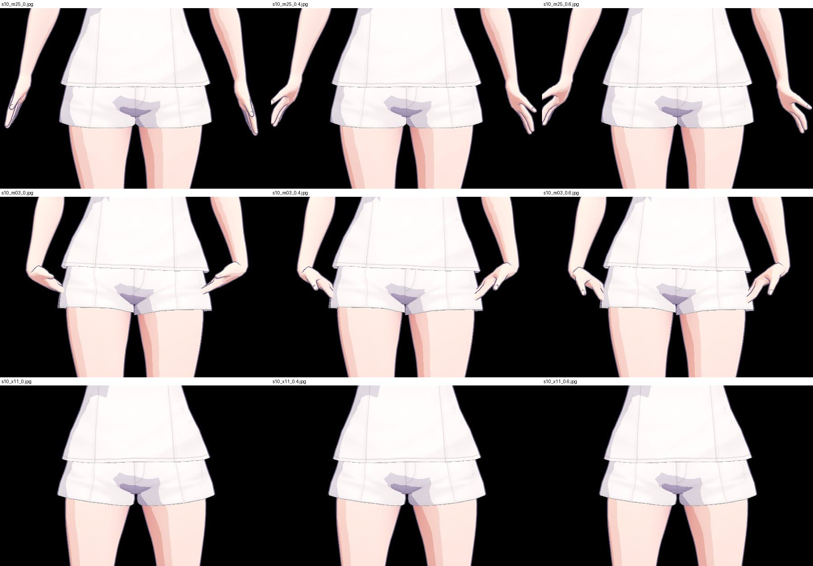
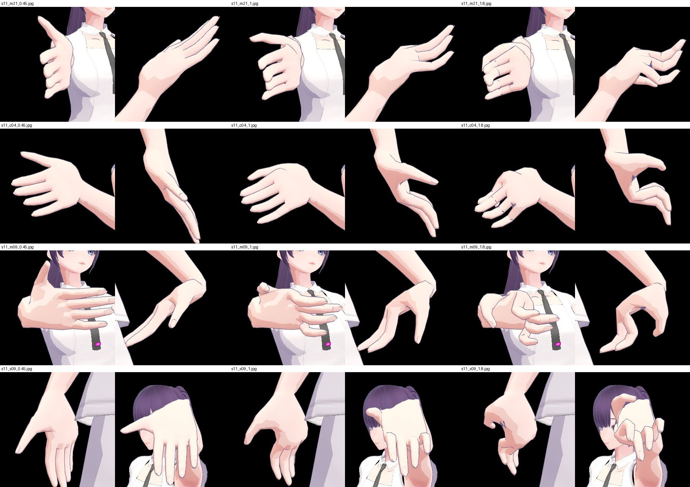
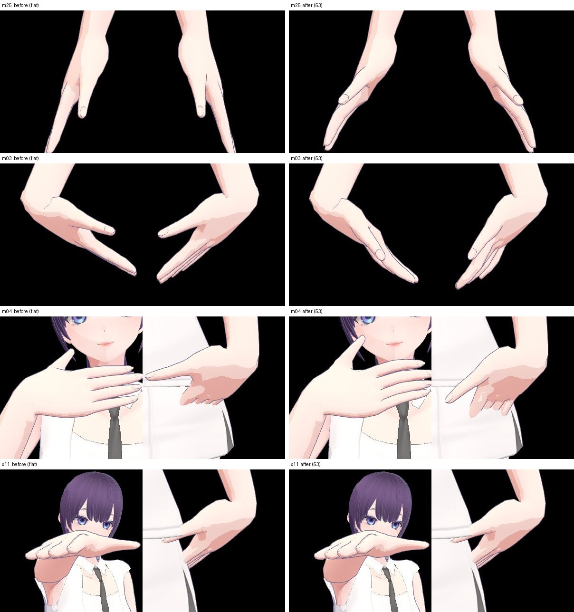
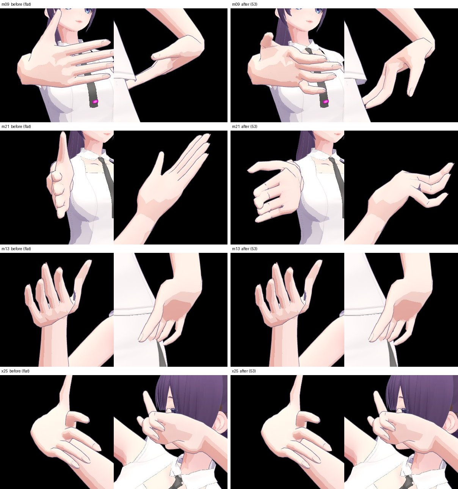
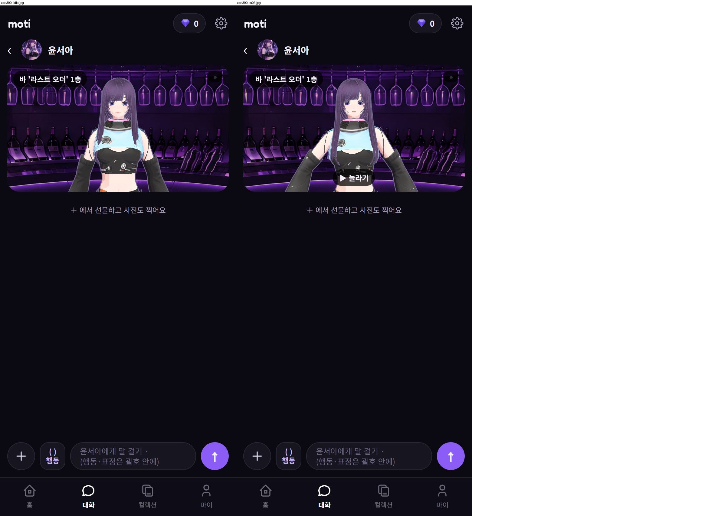

# 53 · 기본 손을 편한 손으로 · 손가락 넣어 다시 변환

브랜치 `step/53-fingers` · 커밋 `[53-B] 기본 손을 편한 손으로`, `[53] 보고서와 출처` (A 는 바뀐 파일이 없어 커밋 없음)

## 바뀐 파일

| 파일 | 내용 |
| --- | --- |
| `index.html` | `Stage` 안 기본 손: `handGoal`(몸짓별 목표) · `handSet`(손가락 30개에 편한 손 회전을 amount 배로) · `handTick`(대화 무대, 몸짓이 바뀔 때 `blendSec` 동안 따라감). `frame()` 은 코드 자세(RIG.pose) 바로 뒤, `still()`(사진·카드 그림)도 같은 자리. 손가락 데이터가 있는 모션은 그 뒤 `xsApply` 가 덮어씀(처음·끝 섞기 동안 편한 손과 섞임) |
| `data/motions.json` | 새 `hands`(`amount` 0.45 · `thumb` 0.4 · `blendSec` 0.2 · `byMotion` 7개 · `relaxed` 손가락 30개 회전), `_hands` 설명. 손가락 없는 XSTAGE 13개 `motionVer` +1(→ 2), 코드 몸짓 19개에 `motionVer` 2 |
| `cards.js` | `verOf`: XSTAGE 가 아닌 몸짓은 `data/motions.json motions` 의 `motionVer` 를 읽음(전에는 늘 1이라 코드 몸짓 카드는 다시 그릴 방법이 없었음) |
| `docs/CREDITS.md` | 손가락이 들어 있는 모션 12줄 「뼈 20개」 → 「뼈 20개 + 손가락 30개」(45-1 에서 바뀌었는데 안 고쳐져 있던 것), 걷기 줄에 「기본 손도 이 모션에서 뽑음」 |
| `docs/status.md` | 53 절, 남은 일 2줄 |
| `docs/reports/img/53/` | 캡처 |

## B · 기본 손을 편한 손으로

**모양:** 지어낸 각도 대신 XSTAGE 걷기(x22, 2.6초)의 원본 손가락을 썼다. 그 순간 서아 손가락 뼈 30개의 지역 회전 − 기본 자세(쫙 편 손) = `hands.relaxed`. 앱은 기본 자세 뒤에 이 회전을 축은 그대로, 각만 `amount` 배로 더 돌린다(0 = 예전 편 손, 1 = 걷기 손 그대로, 1 넘으면 더 쥔 손). 엄지는 `thumb` 배.

- 걷기 손 그대로(1)는 1마디가 35~53° 굽어 정면에서 갈퀴처럼 보여서 **0.45**(1마디 약 20°, 2·3마디 약 10°), 엄지는 앞으로 튀어나오지 않게 **0.4**.

시도(대기 동작 m25·놀라기 m03, 0 / 0.4 / 0.6, 흰 셔츠):

**몸짓별 손(`hands.byMotion`):**

| 몸짓 | amount / 엄지 | 이유 |
| --- | --- | --- |
| x11 손 들어 막기 | 0 / 0 | 「멈춰」 손바닥 (지시문) |
| m09 툭 건네주기 | 1.0 / 0.8 | 조금 더 쥔 손 (지시문) |
| m21 원투 펀치 | 1.8 / 1.2 | 주먹 |
| c04 옷깃 잡아당기기 | 1.2 / 1.0 | 옷깃을 쥠 |
| x09 붙잡기 | 1.1 / 0.9 | 잡는 손 |
| m11 손 내밀기 | 0.2 / 0.2 | 내미는 손바닥 |
| m08 머리 쓰다듬기 | 0.2 / 0.2 | 쓰다듬는 손바닥 |

쥔 손 시도(m21·c04·m09·x09, 0.45 / 1.0 / 1.8):

**카드 그림:** 손가락 데이터가 없는 XSTAGE 13개(m24 x01 x02 m09 m04 x09 m19 x11 m05 m03 x15 x16 x21) `motionVer` 1 → 2, 코드 몸짓 19개(m01 m02 m08 m10 m11 m12 m15 m16 m17 m18 m20 m21 m22 m23 m25 c01 c03 c04 c05) `motionVer` 2. 앱을 열 때 43 의 `Cards.refresh` 가 그 카드만 다시 그린다.

### 확인

예전(편 손) / 새(53) — 대기 m25 · 놀라기 m03(1.5초) · 한숨 m04(6초) · 손 들어 막기 x11(6초). 각 칸 왼쪽 = 오른손, 오른쪽 = 왼손:

건네주기 m09(2.5초) · 원투 펀치 m21 · **손가락이 이미 있는 모션** 손 흔들기 m13 · 셀카 x25(브이):

| 확인 | 결과 |
| --- | --- |
| x11 손바닥 | 편 손 그대로 (검지 1마디 1.1°) |
| 손가락 있는 모션(m13·x25) | 예전과 같은 그림 |
| 대화 무대 재생(`frame` 경로) | 대기 24° → m03 24° → x11 1° → m09 53° → m21 95° → m13 원본 손가락 → 끝나고 24° |
| 예전 저장값 | m03·m01·x11 카드(mv 1)와 m13 카드(mv 2)를 만든 저장값으로 다시 열기 → m03·m01·x11 만 그림을 지우고 다시 만들어 mv 2, m13 그림 그대로. 오류 없음 |
| 데이터 JSON | `data/*.json` 모두 읽힘 |
| 콘솔 | 오류·예외 없음(three.js `morphNormals` 경고는 예전부터) |

390px 대화방(대기 · 놀라기 재생 중). 평소 구도에서는 손이 3D 칸 아래로 잘려 크게 보이지 않음:

## A · 손가락 넣어 다시 변환

다운로드 폴더(하위 폴더 포함), 다운로드 폴더의 zip 전부(`XSTAGE-Motion-0.zip`·`XSTAGE-Motion-0 (1).zip`·`XSTAGE-Motion-1.zip` 과 한글 이름 zip 들), `_src/` 를 찾았지만 13개 모두 없었다. 있는 FBX 는 45-1·49·50 에서 이미 변환한 것뿐(Take Selfie, Walk, Waiting, Wave…, Cute Thinking, Catch Catch, Shy - Avoiding eye contact 등).

| 몸짓 | 원본 | 결과 |
| --- | --- | --- |
| m03 놀라기 | Shy - Surprise1 | 원본 없음 → 편한 손 |
| m04 한숨 쉬기 | Hold Forehead | 원본 없음 → 편한 손 |
| m05 시선 피하기 | Rub Neck_One Hand | 원본 없음 → 편한 손 |
| m09 툭 건네주기 | Blunt - Handing out candy 1 | 원본 없음 → 쥔 손(예외) |
| m24 부끄러워하기 | Lovely – Embarrassing 3 | 원본 없음 → 편한 손 |
| x01 짜증 내기 | Annoyance_1 | 원본 없음 → 편한 손 |
| x11 손 들어 막기 | Raise Hand to Stop | 원본 없음 → 편 손(예외) |
| m19 자신감 있게 설득하기 | Proud - Persuasion | 원본 없음 → 편한 손 |
| x02 허리 숙이기 | Bent Over | 원본 없음 → 편한 손 |
| x09 붙잡기 | Maid_Grab | 원본 없음 → 쥔 손(예외) |
| x15 수줍게 걷기 | Shy Walk | 원본 없음 → 편한 손 |
| x16 몸 낮춰 경계하기 | Stealth_Squat_Idle_Alert | 원본 없음 → 편한 손 |
| x21 뒤돌아보며 달리기 | run_look back | 원본 없음 → 편한 손 |

다시 변환한 것 0개, 못 끝낸 것 13개(전부 원본 없음). 모션 파일·구간·turn·damp·tiltMax·inPlace·섞기는 하나도 안 바꿈.

**원본이 오면:** `_src/` 에 이름 그대로 복사 → `node tools/fbx2motion.mjs _src/<이름>.fbx motions/<같은 파일>.json` → 예전 파일과 몸 뼈(`tracks`·`hip`·`dir`) 비교(45-1 은 똑같았음, 다르면 예전 몸 데이터에 `fingers` 만 얹기) → 그 몸짓이 `hands.byMotion` 에 있으면 지우기 → `motionVer` +1.

## 제가 정한 것

- **편한 손의 출처:** 각도를 손으로 정하지 않고 XSTAGE 걷기(x22)의 원본 손가락을 씀(배우의 실제 편한 손이라 엄지 「살짝 안쪽」도 같이 들어옴). 걷기는 양손이 거의 같아 좌우가 맞음. 원본 출처는 CREDITS 걷기 줄에 적음.
- **세기 0.45 · 엄지 0.4:** 걷기 손 그대로는 정면에서 손끝이 앞으로 말린 갈퀴처럼 보여서 줄임. 서아 기본 자세는 손바닥이 살짝 앞을 보고 있어 굽힘이 정면에서 보이는 편.
- **주먹·쥔 손은 같은 모양을 더 굽힌 것:** 따로 주먹 모양 데이터를 만들지 않고 amount 를 1 넘게(지시문 「값은 data 에」 한 덩어리). m21 1.8 은 완전한 주먹은 아니고 느슨하게 쥔 주먹.
- **예외를 더 둔 몸짓:** 지시문의 x11·m09 외에 m21(주먹)·c04·x09(쥔 손)·m11·m08(거의 편 손). m22 하트 챌린지·m16 응원하기는 손 모양이 따로 필요하지만(하트·주먹) 이 방식으로는 하트를 못 만들어 기본 손으로 둠.
- **손 모양 바뀌기:** 대화 무대에서 몸짓이 바뀌면 손은 0.2초(`blendSec`)로 따라감. 몸의 처음 섞기(0.3~0.8초)와 따로라 x11 처럼 편 손으로 가는 몸짓은 몸보다 손이 먼저 펴짐.
- **코드 몸짓 카드 버전:** 지금까지 카드 버전은 XSTAGE 모션에만 있어서, `data/motions.json motions` 의 `motionVer` 를 새로 읽게 함(`cards.js verOf`). 코드 몸짓 19개 모두 2. 다른 캐릭터·선물 카드도 그 몸짓을 쓰면 다시 그려짐.
- **A 커밋:** 바뀐 파일이 없어 `[53-A]` 커밋은 만들지 않음. 보고서·출처는 `[53] …` 커밋으로.
- **CREDITS 「뼈 20개」:** 이번에 다시 변환한 것은 없지만, 45-1 에서 손가락이 들어간 12개 줄이 여전히 「뼈 20개」라 「뼈 20개 + 손가락 30개」로 고침.
- **캡처:** 저장소를 잠깐 띄워 헤드리스 Chrome 390px(픽셀 비율 2). 손 클로즈업은 `Stage.still` 안에서 손 앞 30cm 카메라로 그림(흰 셔츠, 작전복은 소매가 손을 가려서). 「예전」은 같은 코드에서 amount 0 (기본 자세 그대로 = 53 전과 같은 손). 확인 스크립트는 저장소 밖 임시 폴더.

## 아이폰에서 나중에 볼 것

- 기본 손: 모든 몸짓·대기 중에 손가락 뼈 30개를 매 프레임 돌림(사원수 곱 30번). 낮은 기기에서 프레임이 떨어지지 않는지.
- 앱을 처음 열 때 카드 그림 다시 만들기: 이번에 버전이 오른 몸짓이 32개라, 카드를 많이 모은 저장값이면 다시 만들 그림이 한꺼번에 많음(43 의 쉬는 틈 한 장씩 그대로). 컬렉션을 열었을 때 빈 칸이 오래 남거나 버벅이는지.
- 손가락 외곽선(4-B 뒤집힌 껍데기): 굽은 마디에서 외곽선이 갈라져 보이지 않는지(주먹 m21 처럼 많이 굽는 몸짓).
