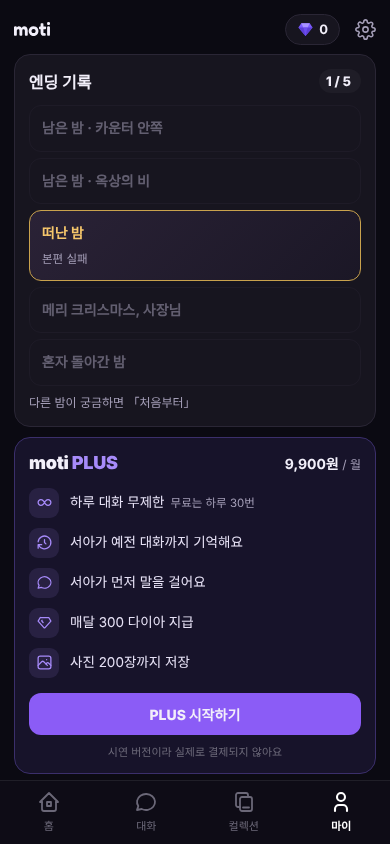
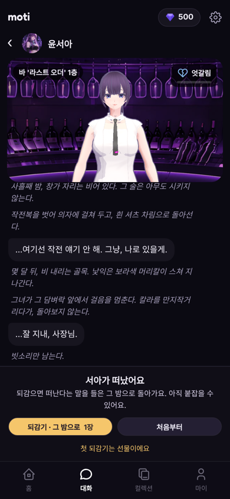
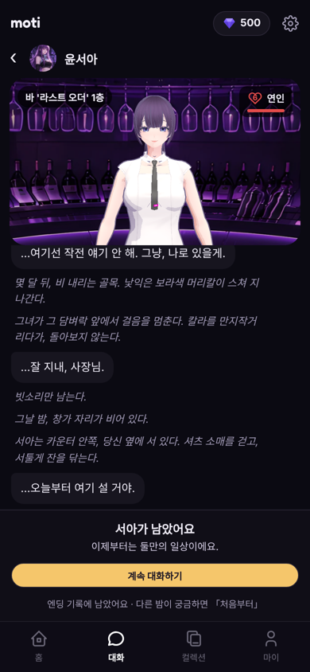
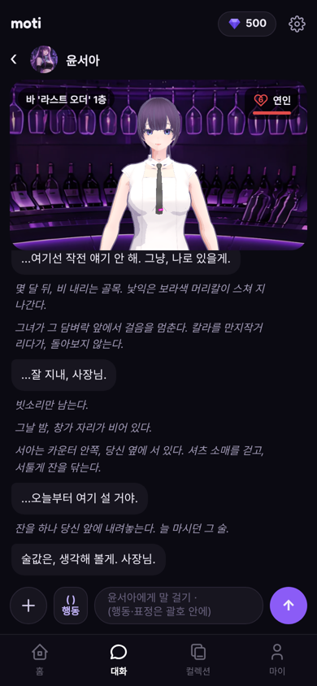
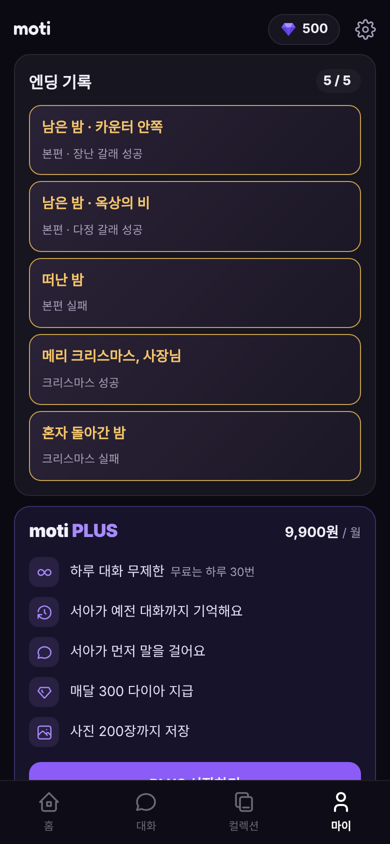
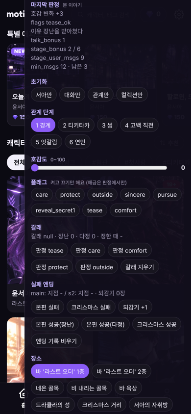
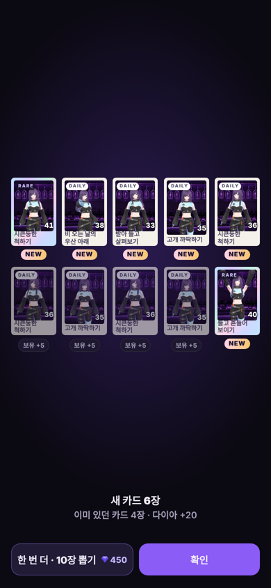

# 54 · 원고 갱신(사흘) · 엔딩 기록 · 성공 엔딩 화면 · 시연 패널 판정 표시

브랜치 `step/54-endings` (origin/main 53 병합 뒤에서 시작). 커밋 `[54-A]` `[54-B]` `[54-C]`.

## 바뀐 파일

| 파일 | 한 일 |
|---|---|
| `docs/drafts/51-갈래-되감기-원고.md` | 새 판(사흘)으로 바꿈 |
| `docs/drafts/조연-성공엔딩-원고.md` | 새로 넣음 |
| `data/rewind.json` | 본편 실패 에필로그 첫 줄 「*사흘째 밤, 창가 자리는 비어 있다. …*」, `main.departDays` 3 |
| `data/endings.json` | **새 파일.** 엔딩 다섯 개(원고 5번 이름·설명), 언제 기록하는지(`when`), 마이 칸 문구(`ui`), 성공 엔딩 신호·갈래별 에필로그(원고 4번 그대로)·끝 화면 문구(`success`) |
| `data/demo.json` | 시연 패널 버튼(본편 성공(장난)·(다정)·크리스마스 성공·엔딩 기록 비우기), 판정 표시 문구(`judge`) |
| `index.html` | `Ending` 모듈(기록·성공 에필로그·끝 화면·마이 칸·예전 저장값 옮기기), 실패 끝 화면/크리스마스 6단계 장면에서 기록, 본편 `/judge` 의 `state.ending == "stayed"` 처리, 시연 패널 버튼·마지막 판정 표시, 본편 실패 시연 `departure_days_left` 7 → 3 |
| `pack.css` | 10장 결과 이름 `word-break:keep-all` — 띄어쓰기에서만 줄바꿈 |
| `docs/server-sync.md` | 「54 · 조연 · 성공 엔딩」 절 새로, 51 절 「`departure_days_left` 7」 → 3 |

선물(50)·카드 팩(49·52)·갈래 세기(51-A)·손(53)·서버 저장소는 건드리지 않았다.

## 캡처 (390px)

| | |
|---|---|
|  엔딩 기록: 본 것(떠난 밤)만 밝게, 안 본 건 제목만 흐리게 1 / 5 (처음엔 다섯 개 모두 흐림, 0 / 5) |  본편 실패 에필로그 「사흘째 밤…」 → 끝 화면, 이때 「떠난 밤」 기록 + 알림 |
|  본편 성공(장난): 「카운터 안쪽」 에필로그 → 끝 화면 |  「계속 대화하기」 → 끝 화면만 닫히고 입력창·대화 그대로 |
|  시연으로 다섯 개 모두 켬, 5 / 5 |  시연 패널 「마지막 판정」(예시 값) |
|  10장 결과 「시큰둥한 / 척하기」 「받아 들고 / 살펴보기」 | |

(2·3번 캡처의 위쪽 지문은 시연 버튼을 이어 눌러서 앞 시연 대화가 남은 것.)

## 확인한 것

- 본편 실패 → 에필로그 첫 줄 「사흘째 밤」, 끝 화면이 나오면 「떠난 밤」 기록 + 「엔딩 기록에 남았어요」 알림.
- 시연 순서 본편 실패 → 크리스마스 실패 → 크리스마스 성공 → 본편 성공(장난) → 본편 성공(다정)으로 하나씩 켜짐(0 → 5).
- 되감기(`End.rewind`) 뒤에도 기록 다섯 개 그대로.
- 성공 끝 화면 → 「계속 대화하기」 → 입력창 돌아옴, 대화 기록 그대로 → 새로고침·대화방 다시 열어도 끝 화면 안 나옴.
- 판정 표시: 값 있는 줄만 나옴(`LASTJ` 없으면 절 자체가 없음).
- 예전 저장값(엔딩 기록 없음, `rw.main.end` 있음, 크리스마스 6단계 본 적 있음, `departure_days_left` 7) → 오류 없이 「떠난 밤」「메리 크리스마스, 사장님」이 알림 없이 기록됨. `data/*.json` 모두 200, 콘솔 오류 없음(막아 둔 서버 주소 제외).

## 제가 정한 것

- **실패 엔딩 기록 시점:** `state.ending` 을 받은 순간이 아니라 **에필로그가 끝나 끝 화면이 나올 때**. 에필로그 도중 앱을 닫았다가 다시 열면 이어서 끝까지 본 뒤 기록된다.
- **크리스마스 성공 기록:** 6단계 장면이 다 끝났을 때(`EpScene` 마무리).
- **성공 엔딩 갈래:** `/judge` 의 `state.route` 를 쓴다. 없거나 정해지지 않았으면 `success.tie` = **다정(care)**. 51 갈래 「정한 때」 규칙이 다정을 앞세운 것에 맞춤.
- **성공 신호는 본 이야기 줄기에서만**, 실패 엔딩이 난 줄기와 겹치면 실패가 먼저. 한 번 본 뒤(`S.stay`)에는 다시 띄우지 않음. 「엔딩 기록 비우기」(시연)만 이 값을 지움.
- **성공 에필로그 장소:** 장난 = 바 1층(장소 0), 다정 = 바 옥상(장소 4). 원고 장면에 맞춰 고름. 몸짓·표정 큐(c01·m09·m20 / m12·m01)도 제가 골랐다(`data/endings.json` 에서 바꿀 수 있음).
- **끝 화면 문구:** 원고 4번 「끝 화면」의 제목·본문·버튼·작은 줄 그대로. 작은 줄은 끝 화면 아래 회색 한 줄.
- **마이 화면 위치:** 관계 칸 바로 아래. 본 엔딩은 제목 + 짧은 설명(「본편 · 장난 갈래 성공」 등), 안 본 엔딩은 제목만 흐리게. 맨 위 오른쪽에 「본 수 / 5」.
- **「처음부터」 안내 줄:** 다섯 개를 다 보면 숨김.
- **시연 「본편 성공」:** 본 이야기로 가서 6단계·갈래·`ending="stayed"` 를 넣고 남아 있던 본편 실패 표시는 지운 뒤 에필로그를 바로 튼다. 「크리스마스 성공」은 크리스마스 줄기로 가서 6단계 장면을 튼다.
- **커밋 나눔:** 판정 기록(`LASTJ`)과 표시 코드는 `index.html` 을 한 번에 고친 탓에 `[54-B]` 커밋에 같이 들어갔다. `[54-C]` 는 `pack.css`·`server-sync.md`.
- **남은 날 지문 세 줄(이틀/하루/마지막 밤)**은 서버가 하루를 넘길 때 넣는 것이라 앱에는 넣지 않고 server-sync 에 적었다.

## 아이폰 사파리에서 나중에 볼 것

- 새 시각 효과는 마이 화면 엔딩 칸의 금색 테두리·그라데이션 배경, 흐림(opacity)뿐. 블러·3D·애니메이션은 새로 넣지 않았다.
- 10장 결과 이름 `keep-all`: 사파리에서 긴 한 단어가 칸을 넘지 않는지(`overflow-wrap:break-word` 로 넘칠 땐 끊기게 해 둠).
- 성공 끝 화면이 입력창 자리에 나올 때 홈 표시줄(아래 안전 영역)과 겹치지 않는지 — 실패 끝 화면과 같은 칸(`#endBox`)을 써서 같을 것으로 봄.

## 서버에 넘긴 것

`docs/server-sync.md` 「54 · 조연 · 성공 엔딩」: 사흘·남은 날 지문, 마리(장난)·태오(다정) 처음 → 두 번째 → 마무리, 2:1, 태오가 5단계 의뢰를 가져온 사람, 성공 신호 `state.ending = "stayed"`(6단계 첫 아침 + 조연 마무리, 또는 6단계 유저 메시지 15번), 앱은 대화를 잠그지 않음, 시연 패널이 보는 `/judge` 값.
