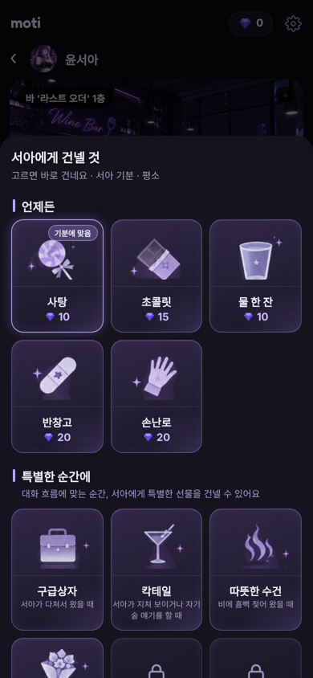
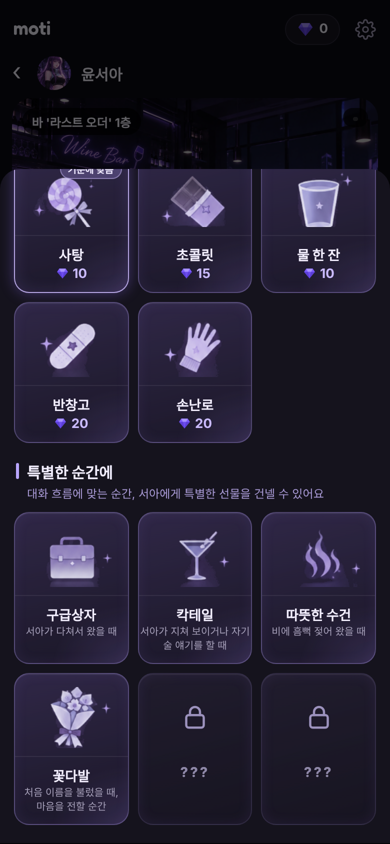

# 56 · 선물 창 아이콘·카드 디자인 바꿈

브랜치 `step/56-gift-icons`.

## 바뀐 파일

| 파일 | 한 일 |
|---|---|
| `icons/gift2_*.png` 9개 | 받은 시안 화면에서 그림만 잘라 배경을 투명하게 |
| `data/gifts.json` | 9개 선물 `icon` 을 새 그림으로(꽃다발도 새 그림) |
| `index.html` | 선물 창 카드: 보라 유리 카드, 그림 아래 가는 줄, 이름·다이아 가격 가운데, 「기분에 맞음」 보라 알약, 맞는 카드는 밝은 테두리·빛, 칸 제목 왼쪽 보라 막대, 잠긴 칸 자물쇠·??? . 선물 그림이 3D 칸에서 떠오를 때도 새 그림은 네모 틀 없이 |
| `docs/CREDITS.md` | 새 그림 출처 |

## 캡처 (390px)

 

## 제가 정한 것

- 그림은 시안 캡처(가로 782px)에서 잘라 쓴 것이라 해상도가 낮다(한 장 124×93). 원본 그림 파일이 있으면 같은 이름(`icons/gift2_*.png`)으로 바꿔 넣으면 된다.
- 우산·반지는 시안에 그림이 없어(??? 칸) 예전 그림 그대로.
- 준 적 있는 「특별한 순간에」 선물은 원래대로 가격 대신 언제 주는지 한 줄을 보여 준다.

## 아이폰에서 볼 것

- 카드의 반투명 그라데이션·빛(box-shadow), 선물 그림이 떠오를 때 drop-shadow.
