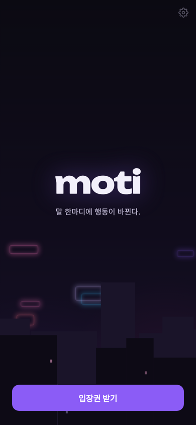
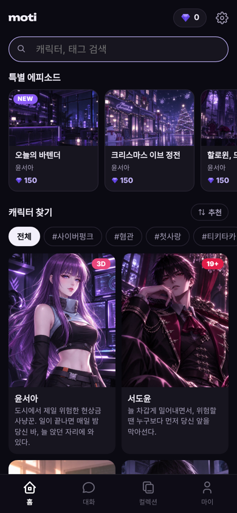

# 59 · 로고 글꼴과 시작 화면 문구

브랜치 `step/59-logo`.

## 바뀐 파일

| 파일 | 한 일 |
|---|---|
| `assets/logo_moti.svg` | 기획자 시안 로고(굵은 「moti」)를 따라 그린 SVG로 바꿈. 시작 화면·홈 왼쪽 위·카드 뒷면·카드 공유 그림이 모두 이 그림을 씀 |
| `index.html` | 로고 가로 비율 2.5864 → 3.2732 |
| `data/onboarding.json` | 시작 화면 문구 「글로만 만나던 캐릭터의 처음 보는 모습」 → 「말 한마디에 행동이 바뀐다.」 |
| `docs/CREDITS.md` | Fredoka 안 씀, 시안 로고 출처 |

## 캡처 (390px)

 

## 제가 정한 것

- 글꼴 파일이 없어 시안 그림(가로 588px)의 윤곽을 따라 그렸다. 가장자리가 아주 살짝 고르지 않을 수 있음 — 원본 글꼴 이름이나 로고 SVG 가 있으면 그걸로 바꾸면 됨.
- 시작 화면 문구 글꼴은 앱 기본 글꼴 그대로(시안과 같은 고딕). 가운데 정렬도 그대로.
- 로고 크기(시작 화면 높이 52px, 헤더 14px)는 그대로 — 새 로고가 가로로 길어 조금 넓어 보임.
