# 6. 서아 다듬기와 화면 규칙

브랜치: `step/6-seoa-polish` (main 병합 안 함)

| 단계 | 커밋 | 한 일 |
| --- | --- | --- |
| 6-A | `75175a3` | 서아 머리카락 중력·몸 충돌 |
| 6-B | `fb3726d` | 몸짓 3D 정사각형·카메라 허벅지 중간, 장면 중 장소 고정, 톱니바퀴 설정 버튼 |
| 6-C | `76e30a6` | 명장면 문구, 대화 목록은 홈에서 들어간 캐릭터만, 알림 규칙·헤더 위치 |

## 바뀐 파일

| 파일 | 내용 |
| --- | --- |
| `alive.js` | 머리카락에 중력(스프링이 돌아가는 제자리를 기운 만큼 옮김)과 몸 충돌 구 5개. `?colliders=1` 이면 구를 반투명하게 그림. 확인용 함수 `probeCol`·`probeHair`·`bonePos`·`hairInfo` |
| `index.html` | 몸짓 중 3D 높이 계산(정사각형·상한·대화 최소 높이), 장면 중 장소 고정(`S.placeLock`), 헤더 톱니바퀴 버튼(오른쪽 가장자리 손잡이 없앰), 명장면 문구를 JSON에서 읽기, 대화 목록(`S.rooms`)·빈 목록 안내, 알림 규칙과 헤더 알림 |
| `data/look.json` | `seoa.alive.hair` 에 `gravity`·`collide`·`colliders` 추가, 설명(`_alive`) 보강 |
| `data/config.json` | `camera.motion.bottom` 0.31 → 0.40, `stage` 를 `bigAspect`·`bigMaxRatio`·`minLogPx` 로, `notify` 추가 |
| `data/ui.json` | **새 파일.** 앨범 탭 이름·진행도·해금 표시, 빈 대화 목록 안내, 알림 문구 |
| `data/seoa_story.json` | `firstSeenText` → 「✨ 새 명장면 · {name}」, `soonText` → 「수집 대기 중」 |
| `data/demo.json` | 패널 여는 방법 설명, 톱니바퀴 버튼 이름 |
| `docs/reports/img/6/*.jpg` | 캡처 20장 |

## 최종 값

| 항목 | 값 | 위치 |
| --- | --- | --- |
| 중력 세기 | 0.6 (기운 각도의 60%만큼 가닥 끝이 월드 아래로) | `look.json seoa.alive.hair.gravity.strength` |
| 중력 무시 각도 | 3° (숨쉬기·시선으로 생기는 작은 기울기는 무시) | `gravity.deadDeg` |
| 중력 최대 | 40° | `gravity.maxDeg` |
| 흔들림 최대 각도 | 8° (그대로) | `hair.maxDeg` |
| 충돌 구 · 가슴 | `Spine02`→`Spine01` 30% 지점 + 앞 2cm, 반지름 8.8cm | `hair.colliders` |
| 충돌 구 · 양 어깨 | `LeftArm`/`RightArm` + 안쪽 1cm·위 1cm, 반지름 5.5cm | 〃 |
| 충돌 구 · 양 위팔 | `LeftArm`→`LeftForeArm` 가운데, 반지름 4.5cm | 〃 |
| 충돌 여유 · 닿음 판정 | 0.8cm · 0.4cm | `hair.collide.margin`·`touch` |
| 충돌 풀림 · 최대 · 반복 | 0.4초 · 60° · 3번 | `collide.relaxSec`·`maxDeg`·`iter` |
| 몸짓 3D 높이 | 3D 칸 가로 폭 × 1 (정사각형) | `config.json stage.bigAspect` |
| 몸짓 3D 상한 | 화면 높이의 58% | `stage.bigMaxRatio` |
| 대화 최소 높이 | 80px (말풍선 두 줄) | `stage.minLogPx` |
| 몸짓 카메라 아래쪽 | 0.40 (허벅지 중간, 예전 0.31 무릎 위) | `camera.motion.bottom` |
| 알림 간격 | 최소 3분 + 0~30초 무작위 (예전 45~75초) | `notify.minGapMs`·`jitterMs` |
| 알림 보이는 시간 | 3초 | `notify.showMs` |

## 6-A 머리카락 중력·몸 충돌

- **중력:** 머리가 기본 자세에서 기운 만큼, 월드 아래 방향을 머리 기준으로 옮겨 그 회전의 60%를 가닥 스프링의 「제자리」로 삼는다. 똑바로 서 있으면 0이라 예전과 같고, 숙일수록 가닥 끝이 월드 아래(몸에서 떨어지는 쪽)로 늘어진다.
- **충돌:** 가닥의 각 점(뼈 시작점과 끝점)이 구 안이면, 가장 깊은 점이 구 표면 + 0.8cm 로 나오도록 **뿌리를 축으로 가닥 전체를 돌린다.** 민 양은 몸에서 떨어진 뒤에만 0.4초 동안 풀리고, 닿아 있는 동안은 그대로 둔다(밀고 당기기를 매 프레임 반복하며 떨리지 않게).
- **측정 (헤드리스 Chrome, 가닥 점이 구 안으로 들어간 가장 깊은 거리):**

| 몸짓 | 예전 | 6-A |
| --- | --- | --- |
| m24 부끄러워하기 | 60~67mm | 0.8~1.4mm |
| m07 팔짱 끼기 | 0~7mm | 0 |
| m05 시선 피하기 | 34~36mm | 0 |
| m23 춤 | 6~12mm | 0 |
| c01 칼라 만지작거리기 | 17~24mm | 0 |
| m11 손 내밀기 | 5~13mm | 0 |

- **가만히 있을 때:** 몸짓이 없을 때 가닥 회전 변화는 예전과 같은 수준(가닥마다 1.5초 동안 0.07° 안팎). 가슴에 얹힌 앞머리 두 가닥만 숨쉬기 때문에 0.2° 안팎으로 천천히 밀린다. 충돌 보정이 앞뒤로 뒤집히는 떨림은 0번.
- 캡처(390px, 몸짓 중간):

| 부끄러워하기 m24 | 팔짱 m07 | 시선 피하기 m05 | 춤 m23 |
| --- | --- | --- | --- |
| 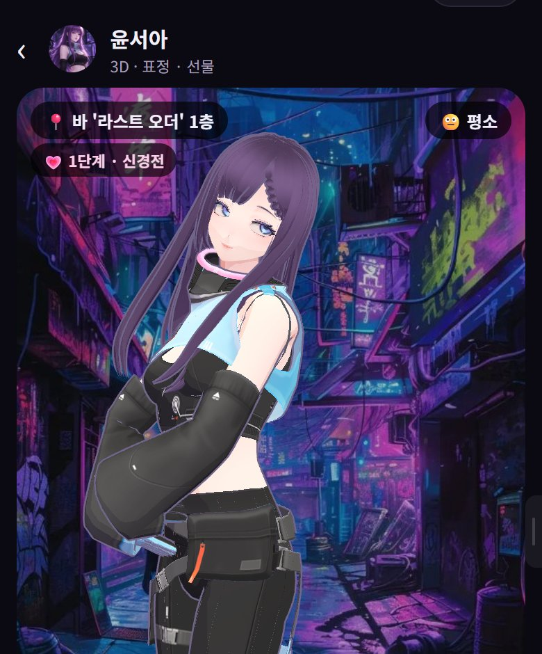 | 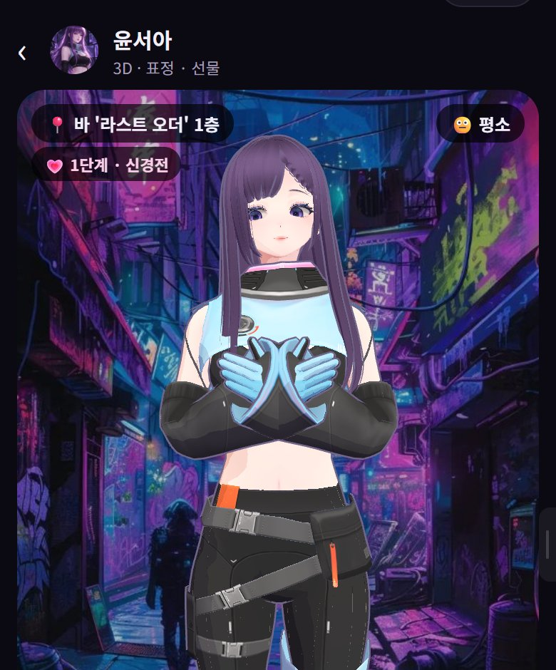 | 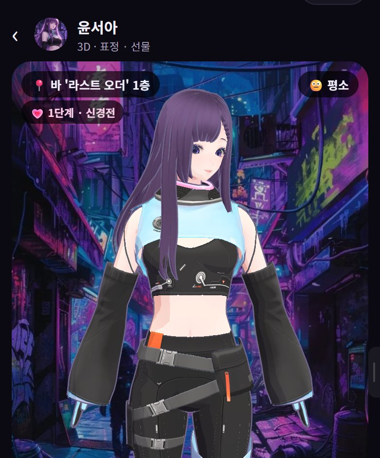 | 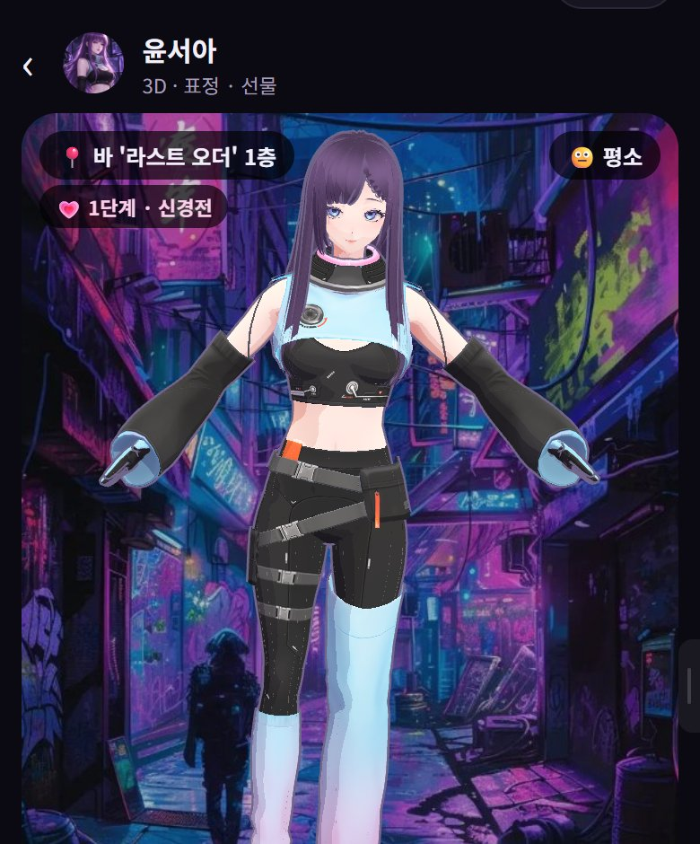 |

| m24 예전(충돌·중력 없음) | m05 예전 | `?colliders=1` (m24) |
| --- | --- | --- |
| .jpg) | .jpg) | 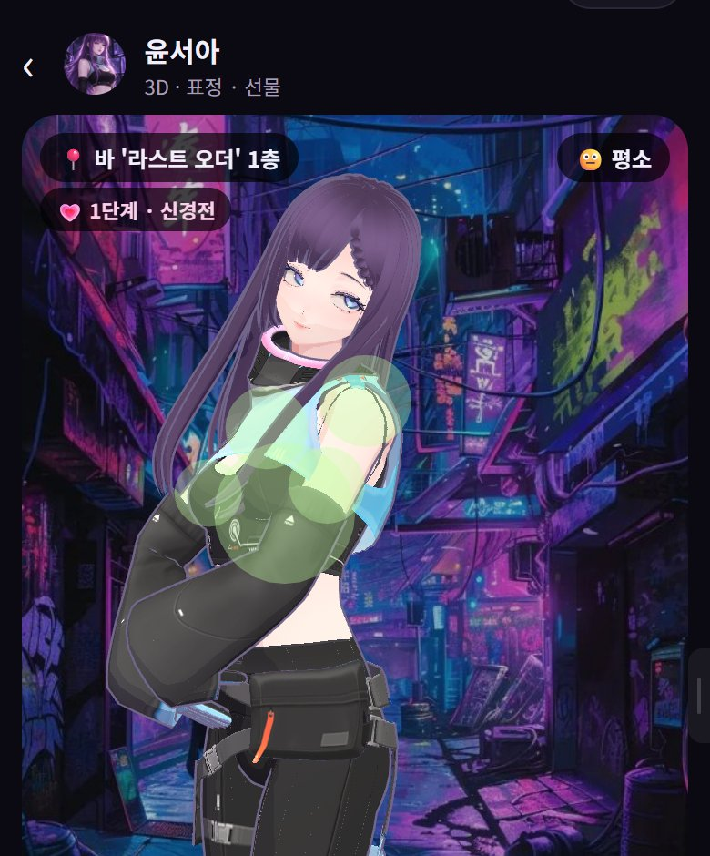 |

## 6-B 정사각형 3D, 몸짓 카메라, 장소 고정, 톱니바퀴

- **정사각형:** 몸짓 중 3D 높이 = 3D 칸 가로 폭, 화면 높이 58% 가 상한. 390×844 → 366×366, 430×932 → 406×406.
- **375×667:** 정사각형(351)으로 키우면 대화 칸이 45px 로 줄어 두 줄 말풍선(60px)이 잘렸다 → 대화 칸을 80px 남기는 만큼만 키워 **351×316** (아래 「제가 정한 것」 3).
- **카메라:** `motion.bottom` 0.40 에서 팔짱(m07)·손 내밀기(m11)·칼라 만지작거리기(c01)·부끄러워하기(m24)·시선 피하기(m05) 모두 손이 3D 칸 안에 들어와 0.38 로 내리지 않았다. 춤(m23)은 전신 그대로. 해금 연출(`unlockFx`)과 앨범 다시 보기는 둘 다 `Stage.play` → `View.motion` 을 거쳐 같은 구도를 쓴다.
- **장소 고정:** 장면 ②~⑤ 로 들어가면 `S.placeLock` 이 켜져, 예시 대사·Claude 미리보기의 단어 규칙(「달」 등)으로는 장소가 안 바뀐다. 서버 답장의 `location` 은 그대로 따른다. ①·⑥ 장면, 전체 초기화, 서아 초기화에서 풀린다.
  - 확인(서버 없음): ② 에서 「달 보러 옥상 가자」 → 바 1층 그대로 / ① 뒤 같은 말 → 바 옥상으로 바뀜 / ③ 에서 다시 잠김 / 전체 초기화로 풀림.
- **톱니바퀴:** 모든 화면 헤더 오른쪽 끝. 색 `--sub`(#a59fb8), 누르거나 올리거나 패널이 열려 있으면 `--text`. 누르면 패널 열고 닫기, 오른쪽 가장자리 손잡이는 없앴다. `D` 키 그대로.

| 390×844 | 375×667 | 430×932 |
| --- | --- | --- |
| 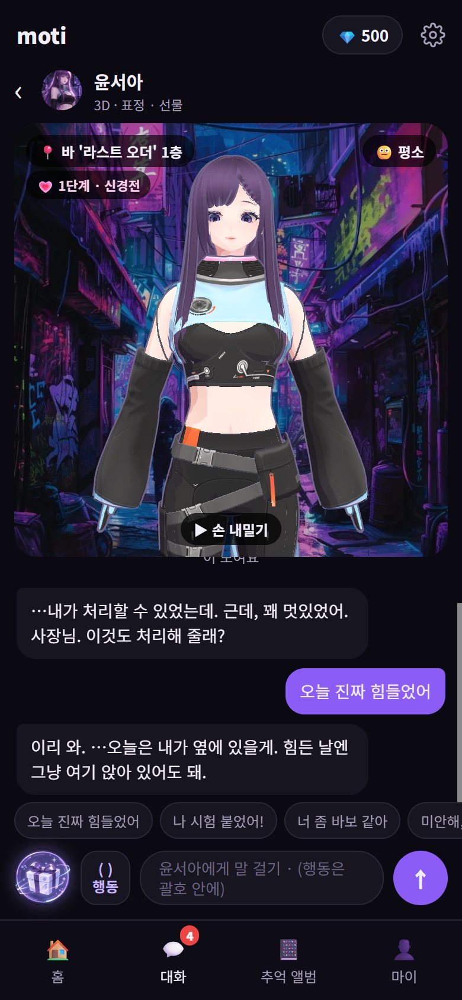 | 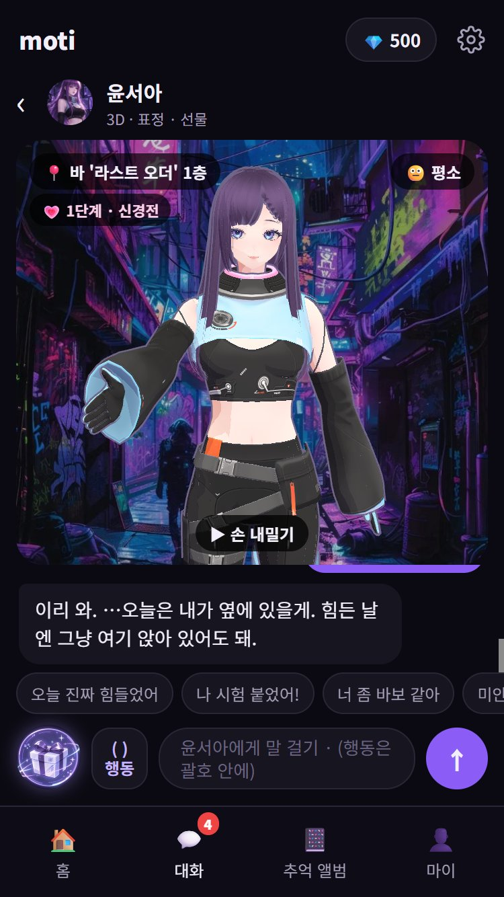 | 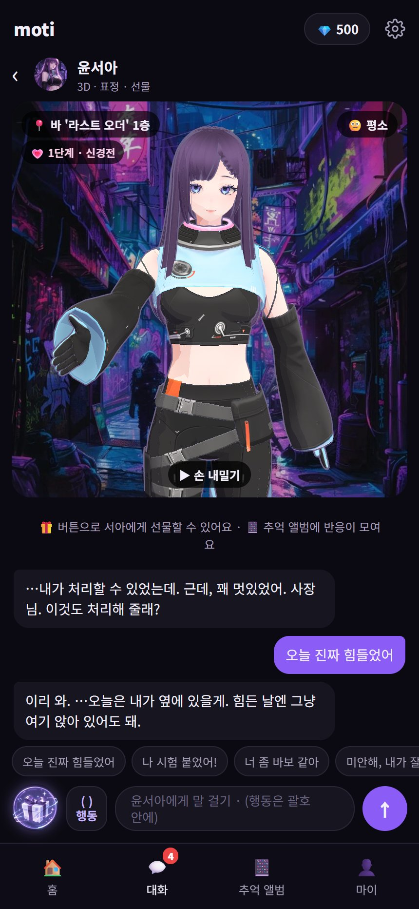 |

| 헤더 390px | 헤더 1280px | 톱니바퀴로 연 패널 |
| --- | --- | --- |
| 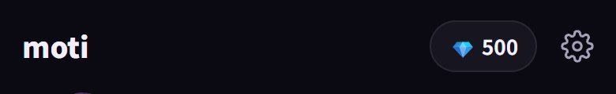 | 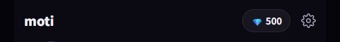 | 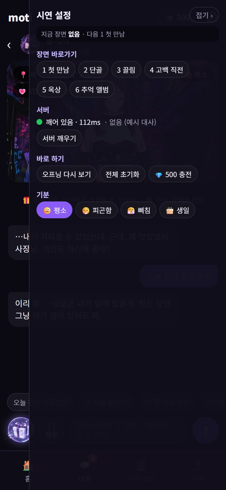 |

## 6-C 명장면 문구, 대화 목록·알림

- **문구** (`data/ui.json`, `data/seoa_story.json`): 탭 「명장면」·「선물 리액션」, 진행도 「명장면 수집 2 / 15」, 빈 칸 「수집 대기 중」, 작은 표시 「✨ 새 명장면 · 이름」, 토스트 셋째 줄 「📔 명장면에 기록됐어요」, 3D 위 「🔓 새 명장면」. 토스트 첫 줄은 그대로.
- **대화 목록:** 처음엔 비어 있고 「홈에서 캐릭터를 골라 대화를 시작해 보세요」 + 「홈으로 가기」. 대화방에 들어가면 목록에 생긴다. 예전 저장값은 사용자가 한마디라도 보낸 대화방만 남긴다(확인: 서도윤에게만 말 건 저장값 → 목록에 서도윤만).
- **알림:** 사용자가 한마디라도 보낸 캐릭터만, 지금 대화 중인 캐릭터는 빼고, 최소 3분 간격, 장면 ①~⑥ 진행 중에는 보내지 않는다.
  - 확인: 서도윤에게 말 걸고 한지후는 들어가기만 → 서아 방에서 알림은 서도윤만 / 서도윤 방에서는 0번 / 장면 ② 중 0번.
- **알림 위치:** 헤더 안 로고와 💎 사이에 한 줄, 길면 말줄임, 3초 뒤 사라짐, 누르면 그 대화방. 3D·대화 위 토스트로는 더 이상 안 뜬다. 390px 에서 로고·알림·💎·톱니바퀴가 한 줄(헤더 넘침 없음).

| 첫 실행 | 홈 → 서아 진입 후 목록 | 헤더 알림 390px |
| --- | --- | --- |
| 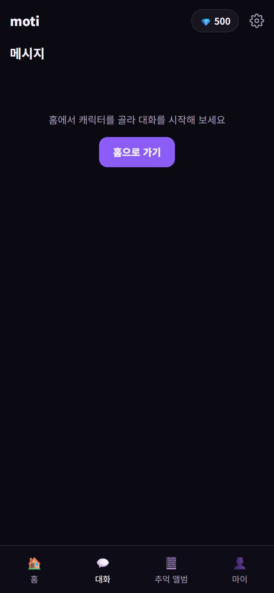 | 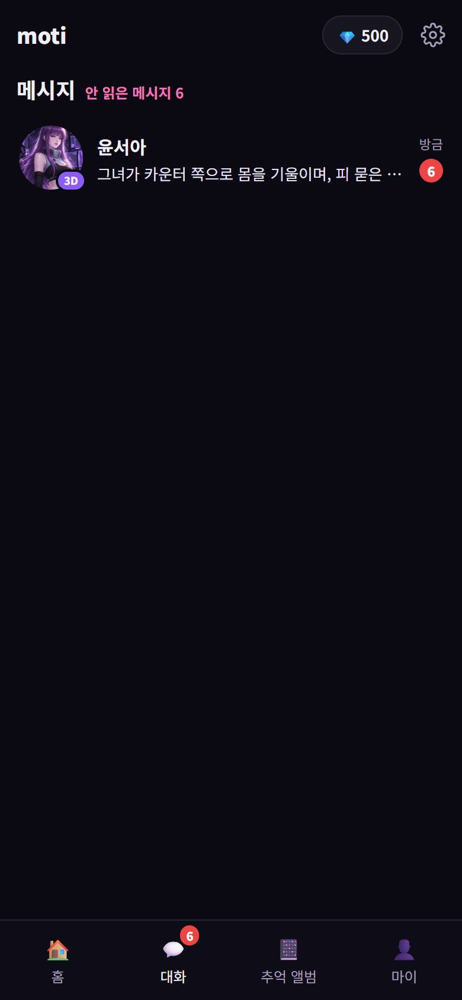 | 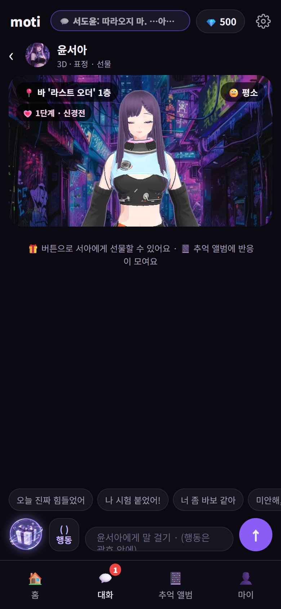 |

| 명장면 탭 | 해금 연출 |
| --- | --- |
| 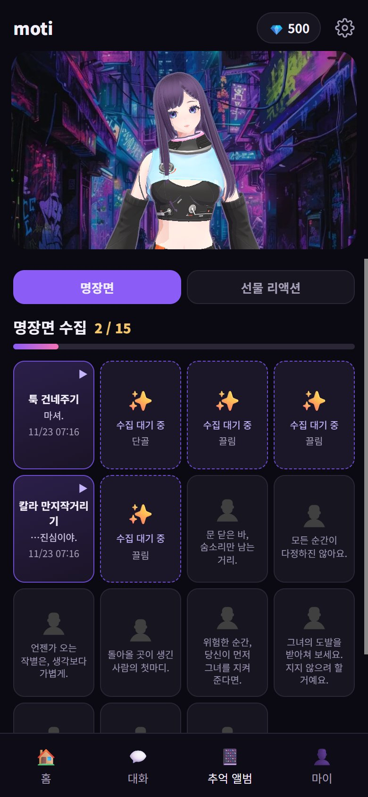 | 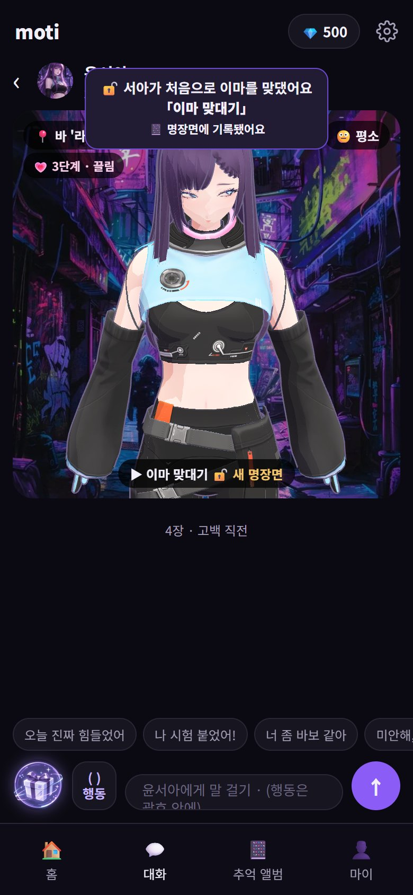 |

헤더 알림 확대: 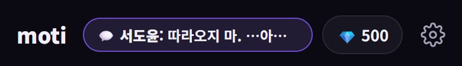 · 1280px: 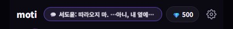

## 아이폰 사파리 확인 (별도 확인 항목)

헤드리스 Chrome(소프트웨어 렌더링)에서만 봤다. 새 시각 효과: 충돌 구 표시(`?colliders=1`, 반투명), 3D 높이 전환(그대로 height 전환), 톱니바퀴 색 전환, 헤더 알림(투명도·위치 전환). 블러·그림자는 새로 쓰지 않았다.

- [ ] **머리카락 충돌:** 부끄러워하기(m24)·팔짱(m07)·시선 피하기(m05)·춤(m23)에서 머리카락이 가슴·팔을 뚫지 않는지, 가만히 있을 때 머리카락이 떨리지 않는지
- [ ] **머리카락 중력:** 상체를 숙이는 몸짓에서 가닥 끝이 자연스럽게 아래로 늘어지는지(너무 뻣뻣하거나 너무 흐느적거리지 않는지)
- [ ] **정사각형:** 몸짓 중 3D 칸이 정사각형으로 커지고, 말풍선 두 줄과 입력창이 보이는지(특히 작은 아이폰). 주소창이 접히고 펴질 때 높이가 튀지 않는지
- [ ] **카메라:** 허벅지 중간 구도에서 손짓이 잘리지 않는지, 해금 연출·앨범 다시 보기도 같은 구도인지
- [ ] **헤더 알림:** 로고와 💎 사이에 한 줄로 보이고 말줄임이 되는지, 누르면 그 대화방으로 가는지
- [ ] **톱니바퀴:** 손가락으로 누르기 쉬운지(34px), 누른 뒤 색이 계속 밝게 남지 않는지(사파리는 누른 뒤 `:hover` 가 남을 수 있음)

## 제가 정한 것

1. **중력은 「기운 만큼 × 0.6」, 3° 아래는 무시.** 1이면 머리카락이 완전히 월드 기준으로 늘어져 머리와 따로 노는 느낌이 나서 0.6. 숨쉬기·무게중심·시선이 머리를 1~2° 움직이는데, 이것까지 따라가면 가만히 있을 때도 머리카락이 계속 움직여서 3° 이하는 무시했다.
2. **충돌은 가닥을 휘지 않고 뿌리에서 통째로 돌린다.** 처음에는 흔들림처럼 끝으로 갈수록 휘게 했는데, 뿌리 가까운 점이 닿으면 끝이 크게 튀어 옆으로 뻗쳤다(m05).
3. **375×667 에서는 정사각형보다 조금 낮게(351×316).** 지시의 「정사각형」과 「말풍선 두 줄과 입력창이 보일 것」이 이 크기에서는 같이 안 돼서, 대화 칸을 최소 80px 남기는 규칙(`stage.minLogPx`)을 더했다. 390·430 에서는 정사각형 그대로다.
4. **흔들림 최대 각도는 8° 그대로.** 중력·충돌만으로 뚫림이 거의 없어져서 늘리지 않았다.
5. **충돌 구는 5개만**(가슴 1, 어깨 2, 위팔 2). 가슴 구는 반지름 9.5cm 로 시작했는데, 가만히 있을 때 앞머리가 가슴에 닿아 숨쉴 때마다 밀려서 8.8cm 로 줄였다.
6. **`?colliders=1` 의 구는 몸에 가려지지 않게 위에 그린다**(초록 반투명). 구가 몸 안에 있어서 깊이 검사를 하면 거의 안 보였다.
7. **장소 고정은 서버 답장이 아닌 것만 막는다.** 예시 대사의 단어 규칙과 Claude 미리보기의 `scene` 은 둘 다 단어로 고르는 것이라 같이 막았다. 서버의 `location` 은 따른다.
8. **장소 고정이 풀리는 때:** ① 첫 만남, ⑥ 추억 앨범, 전체 초기화, 서아 초기화. ②~⑤ 사이로 옮기면 그 장면 장소로 다시 잠긴다.
9. **전체 초기화하면 「지금 장면」도 없음으로 바꿨다.** 5단계에서는 유지했는데, 이번 지시의 「전체 초기화하면 원래 규칙으로」와 「장면 진행 중엔 알림 없음」에 맞추려면 장면이 끝나야 해서. 발표 순서(초기화 → `1`)는 그대로 된다.
10. **알림을 멈추는 「장면 진행 중」은 장면 바로가기를 한 번이라도 누른 뒤 전체 초기화 전까지.** 장면이 「끝나는」 동작이 따로 없어서다.
11. **대화 목록에 생기는 때는 「대화방에 들어갈 때」 전부.** 홈 카드뿐 아니라 특별 에피소드, 선물, 시연 장면으로 서아 방에 들어가도 생긴다. 들어가 있는 방이 목록에 없으면 뒤로 갔을 때 이상해서다. 알림이나 앱 시작으로는 생기지 않는다.
12. **예전 저장값에서 지금 열려 있던 방이 목록에서 빠지면** 앱을 열 때 그 방 대신 대화 목록(빈 목록이면 안내)으로 연다.
13. **알림 간격은 3분 + 0~30초 무작위.** 예전(45~75초)이 더 잦아서 3분으로 줄였고, 무작위 폭은 예전처럼 30초로 뒀다.
14. **서아는 예전처럼 알림을 보내지 않는다.** 서아는 예시 대사(`lines`)가 없어서 원래도 빠져 있었다.
15. **헤더 알림 모양:** 💎 표시와 같은 높이의 둥근 칸, 보라 테두리. 이름은 굵게. 문구 틀(「💬 {name}: {line}」)은 `data/ui.json`.
16. **앨범 문구는 새 파일 `data/ui.json` 에 모았다.** 단, 이미 `data/seoa_story.json` 에 있던 「처음 본 모습 · 이름」(`firstSeenText`)과 「곧 보게 될 거예요」(`soonText`)는 그 자리에서 값만 바꿨다.
17. 선물 탭 안의 제목(「서아의 모습 n / 16」)과 아래 탭 막대의 「추억 앨범」은 지시 범위 밖이라 그대로 뒀다.
18. 캡처는 헤드리스 Chrome(390×844, 배율 2). 헤더 알림 캡처는 3D 캡처가 느려 3초 안에 못 찍혀서, 캡처할 때만 보이는 시간을 늘렸다.
