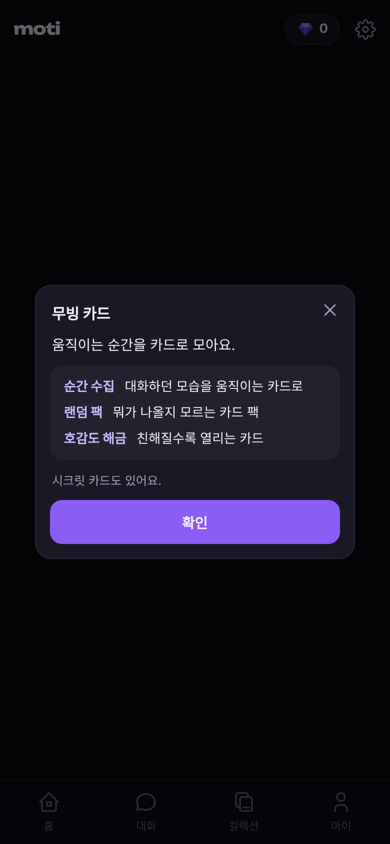

# 60 · 무빙 카드 소개 창 문구

브랜치 `step/60-card-intro`.

| 파일 | 한 일 |
|---|---|
| `data/ui.json` | `album.intro` 본문 「움직이는 순간을 카드로 모아요.」, 목록 세 줄(굵은 이름 + 설명: 순간 수집 · 랜덤 팩 · 호감도 해금), 아래 줄 「시크릿 카드도 있어요.」 |
| `index.html` | 목록 줄이 {t, d} 면 이름은 굵은 보라, 설명은 옆에. 글자 한 줄이면 예전처럼 |

## 제가 정한 것

- 「카드로 모여요」 → 「카드로 모아요」(앞말 「순간을」과 맞춤). 「카드팩」은 앱 다른 곳과 같게 「카드 팩」.
- 컬렉션 탭에 처음 들어갈 때 뜨는 창(제목 옆 (!) 로 다시 열림)의 문구를 바꿈.
