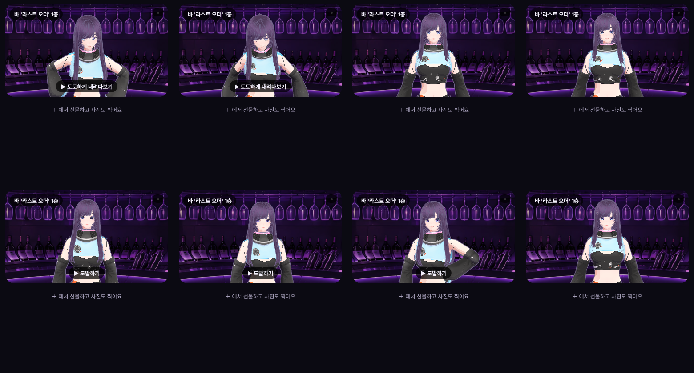

# 63 · 원투 펀치 → 도도하게 내려다보기, 도발하기 새 모션

브랜치 `step/63-m20-m21`.

## 바뀐 파일

| 파일 | 한 일 |
|---|---|
| `motions/xstage_proud_looking_down.json` | m21 새 모션(XSTAGE 「Proud - Looking down」) |
| `motions/xstage_one_hand_on_hip.json` | m20 새 모션(XSTAGE 「Standing weight to one leg with One Hands on Hips」) |
| `data/motions.json` | m21 이름 「원투 펀치」 → 「도도하게 내려다보기」, 감정 분노 → 자신감. m20·m21 을 코드 몸짓에서 XSTAGE 모션으로(`xstage`), motionVer 2 → 3(카드 그림 다시 만듦). m21 주먹 손 설정 뺌(모션에 손가락이 있음) |
| `data/motion_keywords.json` | m21 단어 「주먹·때려·제압」 → 「내려다·도도하게·깔보」 |
| `data/collection.json` | 카드 이름 m21 |
| `docs/CREDITS.md` | 두 모션 출처 |

## 구간

- m21: 원본 4.9초 전체(0.3~4.85초). 배우가 옆(−86°→−114°)을 보고 찍혀 `turn 105` 로 정면으로 돌림. 두 손을 허리에 얹고 고개를 숙여 내려다봄.
- m20: 원본 22.5초 중 6.0~12.5초 — 왼손을 허리에 얹고 한쪽 다리에 무게를 싣는 부분(앞 6초는 팔을 내린 채 서 있기라 뺌).

## 제가 정한 것

- 번호(m20·m21)·카드 번호·해금 자리는 그대로. 이미 열린 사람은 그대로 열려 있음.
- m21 은 판정 「protect」로 열리고, 그때 알림이 「서아가 처음으로 당신 앞에서 싸웠어요」, 잠긴 칸 힌트가 「위험한 순간, 당신이 먼저 그녀를 지켜 준다면.」 — 싸우는 모션이 아니게 됐지만 문구·해금 조건은 원고라 그대로 둠(바꿀지 정해 주세요).
- 바 2층(사장님 집)에서 m20·m21 을 빼는 규칙(placeBan)은 그대로.

## 64 · m21 문구 (기획자 요청: 문구만 바꾸고 열리는 때는 그대로)

- 열릴 때 알림(판정 protect, `data/seoa_story.json unlock.flag.protect.text`): 「서아가 처음으로 당신 앞에서 싸웠어요」 → 「서아가 처음으로 도도하게 당신을 내려다봤어요」. 같은 묶음의 x16 몸 낮춰 경계하기와 함께 한 번 나오는 알림.
- 잠긴 칸 힌트(`hints.m21`): 「위험한 순간, 당신이 먼저 그녀를 지켜 준다면.」 → 뒤에 「고맙다는 말 대신 이 표정.」을 붙임(여는 조건은 그대로 알 수 있게).
- 여는 조건(판정 protect)은 그대로. 원고 표 `docs/drafts/2-1-앨범힌트.md` 도 같이 고침.
