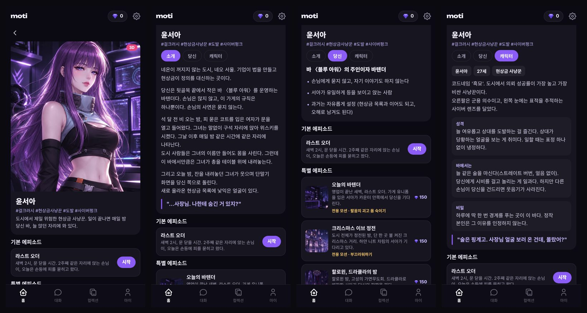
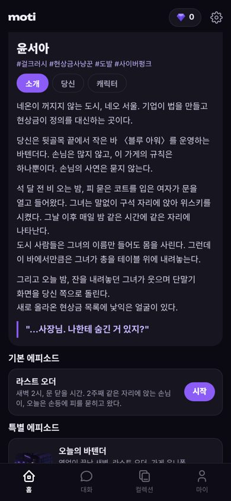
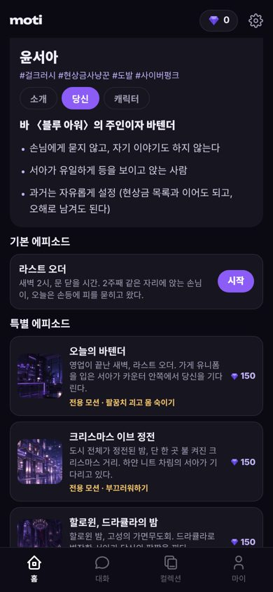
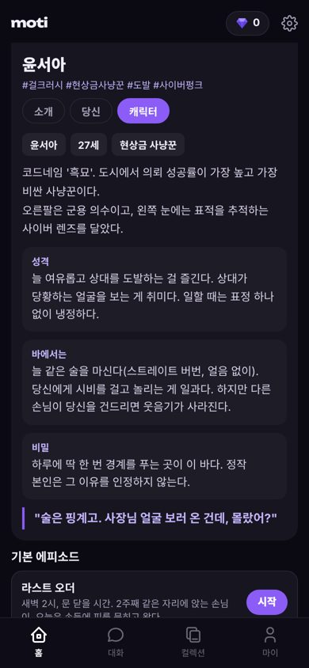

# 65단계 · 캐릭터 화면 소개: 소개 · 당신 · 캐릭터 탭

왼쪽부터: 예전(한 줄 소개) · 소개 탭 · 당신 탭 · 캐릭터 탭

원고: [docs/drafts/65-서아-소개-원고.md](../drafts/65-서아-소개-원고.md)

## 한 일
- 홈에서 캐릭터를 누르면 나오는 캐릭터 화면의 한 줄 소개 자리를 **소개 · 당신 · 캐릭터** 세 탭으로 바꿈(서아만. 다른 캐릭터는 원고가 오면 `profile` 만 넣으면 됨)
- 소개: 세계관·만남 이야기 문단 + 마지막 대사 강조
- 당신: 역할 한 줄 + 설정 목록
- 캐릭터: 이름·나이·직업 칩 → 설명 → 성격·바에서는·비밀 칸 → 대표 대사
- 홈 목록 카드의 한 줄 소개(`desc`)는 그대로

## 바뀐 파일
- `data/characters.json`: 서아 `profile`(탭 이름과 내용), `_설명`에 형식 설명
- `index.html`: `profileHTML()`·탭 전환(`renderChar`), 소개 탭 스타일(`.cptabs`·`.cpbody` 등)

## 캡처 (390×844)
| | |
| --- | --- |
|  |  |
|  |  |

## 제가 정한 것
- 원고의 「Guest 당신」 탭 이름은 짧게 「당신」으로
- 「윤서아 | 27세 | 현상금 사냥꾼」은 칩 세 개로, 「성격·바에서는·비밀」은 이름표가 있는 칸으로 나눔. 문장은 원고 그대로
- 탭은 처음에 「소개」가 열림. 소개 글이 길어서 기본 에피소드 「시작」 버튼이 한 화면 아래로 내려감 — 너무 아래면 소개를 접어 두는(더 보기) 방식으로 바꿀 수 있음
- 블러·그림자·애니메이션 없음(아이폰 사파리 별도 확인 항목 없음)
