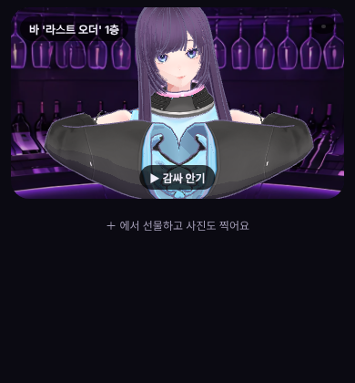

# 66 · 무빙 카드 30번 감싸 안기 팔을 둥글게

브랜치 `step/66-hug`.

| 파일 | 한 일 |
|---|---|
| `motion.js` | m18 감싸 안기(코드 몸짓): 윗팔을 앞으로 더 들고(−1.25 → −1.5) 팔꿈치를 바깥으로 벌림(0.3), 아랫팔을 안쪽으로 굽힘(1.6) → 가슴 앞에서 두 팔이 원을 만들고 손이 가운데서 만남. 예전엔 아랫팔을 세로축으로만 돌려(팔이 아래를 향한 기준 자세에서는 비틀기만 됨) 팔을 곧게 앞으로 내민 모양이었음 |
| `data/motions.json` | m18 motionVer 2 → 3(카드 그림 다시 만듦) |

## 제가 정한 것

- 들어 올리는 높이·벌림·굽힘을 몇 가지로 비교해 가슴 높이에서 둥글게 모이는 값을 고름. 몸을 앞으로 기울이는 것·고개 기울임·길이(2.6초)는 그대로.
