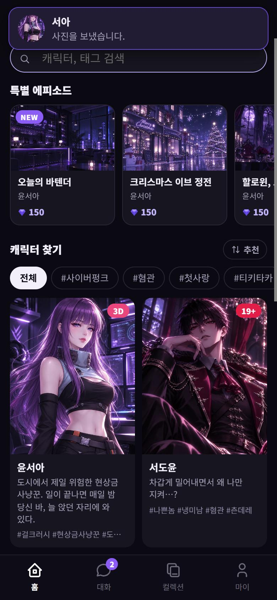
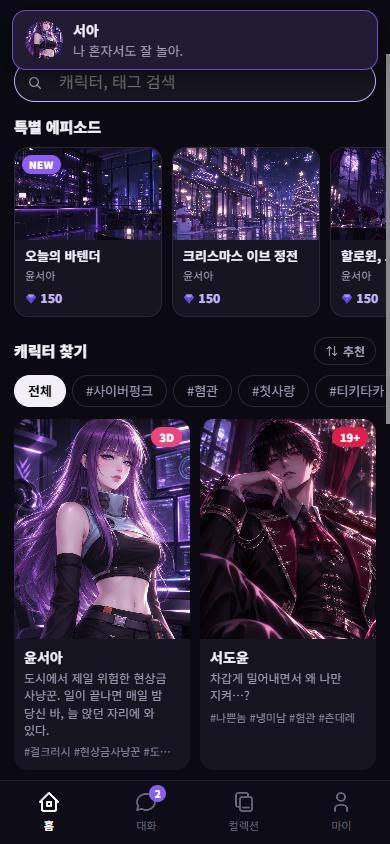
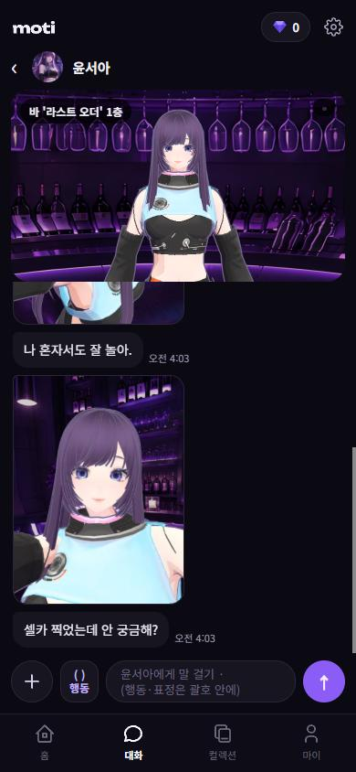
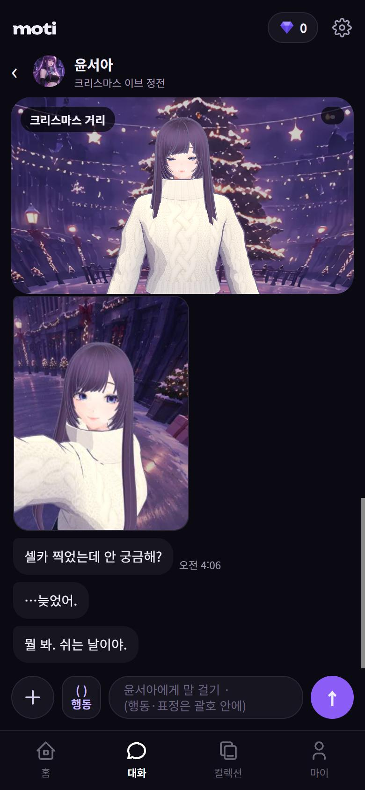

# 68 · 셀카는 「부재중 셀카」 하나로 · 앱 안 알림 · 시연 버튼

브랜치 `step/68-away-selfie`.

## 바뀐 파일

| 파일 | 한 일 |
|---|---|
| `data/seoa_photo.json` | `stage`·`casual` 은 「68: 끔」(값은 기록용으로 남김). `away` 를 새 값으로: minStage 2, minutes 10, shot selfie, place 「지금 장소」, 문구 `lines` 5줄(지시문 순서·글자 그대로). 예전 `away.list` 6줄과 hours·night·edgeMin 은 지움. 배너 시간(bannerSwapMs 1500·bannerMs 4000)·시연 분(demoMinutes 11)·살피는 간격(checkMs 1000)도 여기에 |
| `seoaphoto.js` | `stageUp`·`afterReply` 는 아무것도 안 함(호출 자리는 index.html 에 그대로). 떠난 시각 저장(대화방에서 나감 = 1초마다 살핌, 대화방에서 앱이 백그라운드로 감 = visibilitychange·pagehide), 줄기(`Thread.cur()`)마다 `S.sp.leave[줄기]`. 받을 때 = 떠난 시각 + 10분, 그 시각 자리에 말풍선을 먼저 넣고 그림은 대화방에서 채움(예전 오랜만 사진 방식 그대로). 대화방에 다시 들어오면 이번 떠남은 끝. 앱 안 알림 배너. 시연 `now()` 를 새 방식으로. 예전 밤 시각 뽑기(`awayAt`) 지움 |
| `index.html` | 배너 CSS(토스트와 같은 #211b33 바탕·#6d4bd1 테두리, 블러 없음). 시연 패널 버튼 이름을 `ui.json` 에서 읽고, 누르면 패널을 닫고 `SeoaPhoto.now()`. 호출 자리 주석 |
| `data/ui.json` | `seoaPhoto.bannerName` 「서아」, `banner` 「사진을 보냈습니다.」, `demoNow` 「10분 지난 뒤 셀카 받기」 |
| `data/demo.json` | 예전 버튼 이름 `seoaPhotoNow` 지움(ui.json 으로 옮김) |
| `docs/status.md` | 셀카 설명(12-B·32 줄은 「68단계에서 바뀜」으로 줄 긋기, 68단계 절 추가), 남은 일에 「앱 밖 알림은 시연 뒤」·아이폰 확인 |

## 캡처 (390px)

시연 버튼 → 홈 배너 「사진을 보냈습니다.」 → 1.5초 뒤 문구로

 

배너를 누르면 서아 대화방: 사진 말풍선 → 문구 말풍선, 시각은 문구 옆 (이 캡처는 시연 버튼을 두 번 눌러 두 장)

크리스마스에서 시연 버튼(에피소드 1단계) → 크리스마스 거리·스웨터 셀카

## 확인한 것

| 확인 | 결과 |
|---|---|
| 시연 버튼(대화방에서) → 홈으로 나가고 배너 → 누르면 대화방에 사진+문구 | 됨 |
| 대화 30턴(`afterReply` 30번) + 단계 3~6 올리기(`stageUp`) | 사진 0장, 기다리는 사진 0 |
| 떠난 지 5분 | 안 옴, 배너 없음 |
| 1단계, 떠난 지 11분 | 안 옴 |
| 이번 떠남에 이미 받음 | 안 옴 |
| 대화방 → 홈 → 10분 안에 다시 들어옴 | 안 옴, 떠남 기록 지워짐 |
| 다시 떠나고 10분 넘어 들어옴 | 한 장(받은 시각 = 떠난 시각 + 10분) |
| 대화방에서 백그라운드 → 11분 뒤 대화방 그대로 앞으로 | 한 장 |
| 대화방에서 백그라운드 → 홈에서 앞으로(11분 지남) | 배너 + 한 장 |
| 크리스마스에서 시연 버튼 | 크리스마스 거리·크리스마스 옷 셀카, 서버 줄도 크리스마스 줄기에만 |
| 크리스마스 엔딩을 받은 상태에서 시연 버튼 | 안 옴, 배너 없음 |
| 서버로 가는 줄 | `(서아가 크리스마스 거리에서 찍은 사진을 보냈다. 함께 보낸 말: "셀카 찍었는데 안 궁금해?")` — 예전 모양 그대로 |
| 콘솔 오류 | 없음 |
| `data/*.json` | 모두 읽힘 |

30턴은 서버에 실제로 30번 보내지 않고, 보낼 때마다 불리는 `SeoaPhoto.afterReply()` 를 30번 불러 확인했습니다.

## 제가 정한 것

- **배너 첫째 줄 「서아」:** 대화 상대 이름은 「윤서아」라서, 지시문대로 「서아」를 `ui.json seoaPhoto.bannerName` 에 따로 둠. 왼쪽에 서아 프로필 동그라미.
- **배너 숫자도 데이터로:** 1.5초·4초·시연 11분은 `seoa_photo.json away` 에.
- **시연 버튼 이름 위치:** 지시문대로 `ui.json` 에 두고, 예전 `demo.json seoaPhotoNow` 는 지움.
- **시연 버튼을 누르면 시연 패널을 닫음:** 배너가 패널에 가려지지 않게.
- **시각 표시:** 카톡처럼 같은 시각 메시지 묶음의 마지막(문구 말풍선) 옆에 한 번. 부재중 셀카에는 예전 「받은 사진에 저장」 줄을 붙이지 않음(말풍선 두 개로만 보이게). 예전 사진의 그 줄은 그대로.
- **「떠남」을 알아채는 방법:** 대화방에서 나가는 길이 여러 곳(뒤로·탭·홈 카드·시연 패널)이라, 1초마다 「서아 대화방에 있는지」를 보고 있다가 아니게 되는 순간을 떠난 시각으로 함. 백그라운드는 visibilitychange, 창을 닫을 때는 pagehide.
- **대화방에 다시 들어오면 이번 떠남은 끝:** 10분 전에 돌아오면 그 떠남에는 사진이 없고, 다시 나가면 새로 10분을 셈.
- **대화방에 있다가 앱이 다시 앞으로 오면 「다시 들어온 것」으로 봄:** 10분이 지났으면 그 자리에 사진이 들어감(배너 없음).
- **배너는 지금 이야기 줄기만:** 사진은 그 줄기의 장소·옷으로 찍어야 해서, 배너·자리 잡기는 지금 줄기의 떠남만 봄. 다른 줄기의 떠남은 그 줄기 대화방에 들어갈 때 넣음.
- **배너가 뜰 때 대화 기록에 자리를 먼저 넣음:** 그래서 대화 탭에 안 읽은 수가 바로 올라감. 그림은 대화방에 들어가면 만듦(대화방 밖에서는 3D 무대가 숨어 있어서).
- **단계:** 크리스마스처럼 에피소드 단계가 있으면 그 단계로 2단계 이상을 봄. 시연 버튼은 단계 상관없음.
- **끝난 줄기:** 실패해 잠긴 줄기(End) + 그 줄기의 장면 엔딩을 받은 경우(`endings.json when.scene`, 지금은 크리스마스 6단계 = xmasWin). 본편의 성공 에필로그는 막지 않음(지시문에 없어서).
- **서버로 보내는 사진 줄을 줄기마다 따로:** 예전엔 하나뿐이라 본편에서 받은 사진 줄이 크리스마스 대화 요청에 붙을 수 있었음. 대화하기 전에 여러 장을 받았으면 최근 3줄까지 붙임(줄 모양은 그대로, 줄바꿈으로 이음).
- **예전 저장값:** 기다리던 단계·대화 중 사진 차례는 버림. 이미 받은 사진(앨범)은 그대로.
- **문구 고르기:** 바로 앞 문구는 빼고 고름(줄기와 상관없이 하나의 「바로 앞」).

## 아이폰에서 나중에 볼 것

- 배너 모양·위치: 노치·다이나믹 아일랜드 아래(`env(safe-area-inset-top)` + 10px), 위에서 내려오는 움직임, 둘째 줄 글자 바뀜.
- 백그라운드 갔다 왔을 때: 홈 화면에서 다시 열면 배너가 뜨는지, 대화방에서 다시 열면 사진이 바로 들어오는지(사파리는 백그라운드에서 타이머가 멈춤).
- 블러는 쓰지 않음, 그림자(box-shadow)만 있음.
