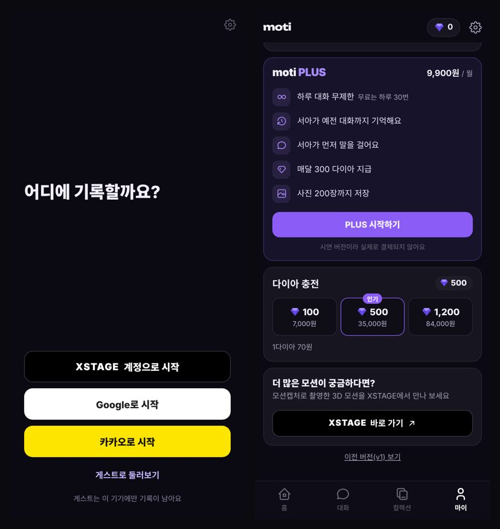
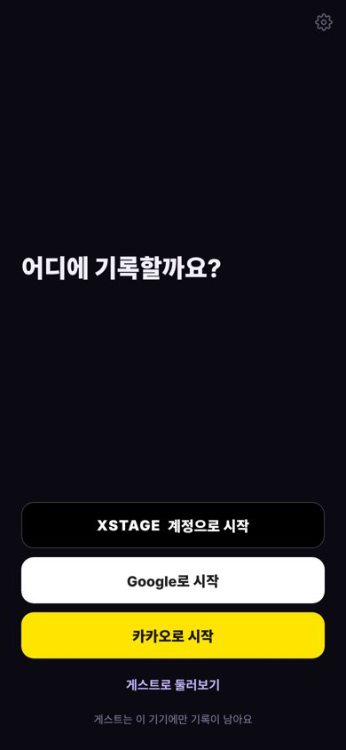
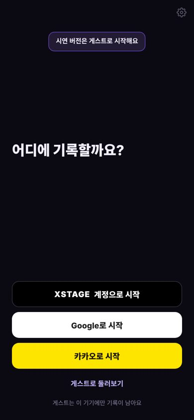
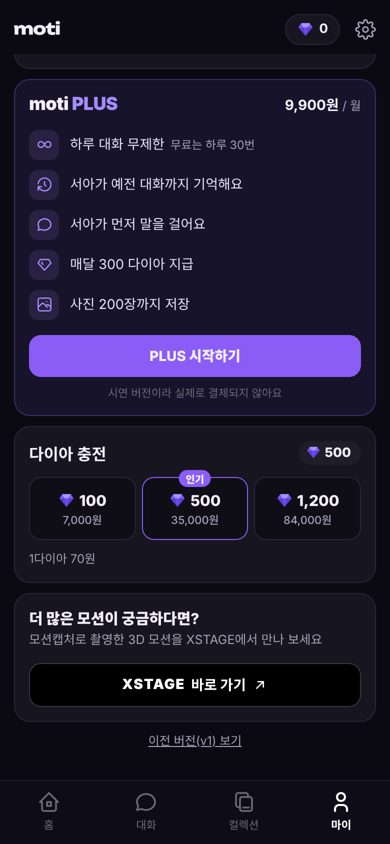

# 69단계 · XSTAGE: 로그인 버튼 · 마이 탭 바로 가기

왼쪽: 첫 로그인 화면 · 오른쪽: 마이 탭 맨 아래

## 한 일
- **첫 로그인 화면**(온보딩 마지막 「어디에 기록할까요?」): 맨 위에 **「XSTAGE 계정으로 시작」** 버튼. 시연 버전이라 Google·카카오와 같이 「시연 버전은 게스트로 시작해요」 알림 뒤 게스트로 시작
- **마이 탭 맨 아래**: 「더 많은 모션이 궁금하다면?」 카드 + **「XSTAGE 바로 가기」** 버튼. XSTAGE 공식 모션 스토어(`https://www.xstage.co/ko/motions`)가 새 탭으로 열림

## 바뀐 파일
- `onboarding.js`·`onboarding.css`: XSTAGE 버튼(검은 바탕 + 「XSTAGE」 글자 로고)
- `data/onboarding.json`: `login.xstage`
- `index.html`: 마이 탭 카드(`renderMy`)와 스타일(`.xsgo`)
- `data/ui.json`: `my.xstageTitle`·`xstageSub`·`xstageGo`·`xstageUrl`(비우면 카드가 안 보임)
- 버전 꼬리표(`node tools/version.mjs`)

## 캡처 (390×844)
| | | |
| --- | --- | --- |
|  |  |  |

## 제가 정한 것
- 실존 브랜드 이름(XSTAGE)을 화면에 넣는 것은 기획자 지시. 모션 출처라 CREDITS 와도 맞음
- XSTAGE 로그인은 실제 연동이 없어서 **버튼만** 만들고 누르면 시연용 게스트 시작. XSTAGE 아이디·비밀번호를 받는 입력 화면은 만들지 않음(실제 연동 없이 다른 서비스 계정 정보를 받는 화면이 되므로). 실제 연동은 XSTAGE 쪽 로그인(OAuth 등) 협의 후
- XSTAGE 로고 그림은 쓰지 않고 글자(「XSTAGE」)로만. 버튼 색은 검정(공식 색이 정해지면 바꿈)
- 버튼 순서: XSTAGE → Google → 카카오
- 마이 카드 설명 줄 「모션캡처로 촬영한 3D 모션을 XSTAGE에서 만나 보세요」는 Claude가 씀. 링크는 스토어 첫 화면이 아니라 모션 목록(`/ko/motions`)
- 블러·그림자·애니메이션 없음(아이폰 사파리 별도 확인 항목 없음)
