# 69 · 입장권 뒷면 이름 정하기 · 이름 거절로 단계가 내려가는 것 받기

브랜치 `step/69-user-name`. 서버는 S2·S2-1(ddododo-lang/seoa-backand main, 실서버 반영됨) 그대로, 서버 폴더는 고치지 않음.

## 바뀐 파일

| 파일 | 한 일 |
|---|---|
| `onboarding.js` | 입장권 카드 안쪽을 앞면(AI 안내·동의)·뒷면(안내 한 줄·「이름」 이름표·입력칸) 두 면으로. 앞면 아래 버튼 = 「다음」(필수 동의가 다 체크돼야 눌림, 동의는 이때 저장) → 안쪽만 짧게 흐려졌다 뒷면. 뒷면 버튼 = 「눌러서 입장」(이름이 비면 흐리고 안 눌림 · 누르면 살짝 흔들림) → `S.profile.name` 저장 → 예전 펀치 흐름(손 흔들기 → 카드 사라짐 → 로그인). 이름 규칙(앞 공백은 칠 때 바로 빼고 뒤 공백은 저장할 때 자름, 8자까지, 줄바꿈·`{ } " 「 」` 못 넣음, 한글 조합 중에는 자르지 않고 조합이 끝나면 자름). 키보드 완료/이동 = 입장(form 제출). `Onboard.openBack()` = 뒷면만 여는 모드(예전 유저·설정·시연, 이름을 정하면 구멍이 뚫리고 흐려지며 닫힘). 키보드가 올라오면 `visualViewport` 로 카드를 키보드 위로 올리고 서아 구도는 그대로 |
| `onboarding.css` | 두 면을 같은 칸(grid)에 겹쳐 카드 높이가 안 바뀜. 바꿀 때 안쪽만 opacity 0.18초. 이름칸(흰 바탕·보라 테두리, 글자 16px — 아이폰 확대 방지). 카드 `bottom` 에 `--kb`(키보드 높이) |
| `index.html` | `userName()`. `/chat`·`/judge` state 에 늘 `user_name`(본편·크리스마스). `judge_soon` 이면 답장마다 판정. 판정 뒤 단계가 내려가면 `stageDown()`(알림 한 줄·하트·게이지). 크리스마스 요청에서는 본편 이름 흐름 키를 뺌. 시연 패널 맨 위 「부르는 이름」 줄, 「바로 하기」에 「3단계 이름 장면 바로」. 「관계 초기화」가 이름 흐름 키도 비움. 이름이 없는 예전 유저는 앱을 열 때 입장권 뒷면만 |
| `data/onboarding.json` | `ticket.punchReady` 「눌러서 입장」 → 「다음」. `ticket.back`(guide·label·placeholder·enter·maxLength 8·ban). `timing.swapMs`·`backDoneMs` |
| `data/ui.json` | `top.stageDown` 「서아와의 사이가 「{name}」로 돌아갔어요.」 |
| `data/demo.json` | `userName` 「부르는 이름」, `noName`, `nameScene` 「3단계 이름 장면 바로」 |
| `docs/server-sync.md` | S2·S2-1 줄 |
| `docs/status.md` | 69 절, 남은 일(아이폰) |

## 캡처 (390px, 서버는 실서버)

입장권 앞면 「다음」 → 뒷면(빈칸, 버튼 흐림) → 9자 이상·금지 글자를 쳐도 8자까지

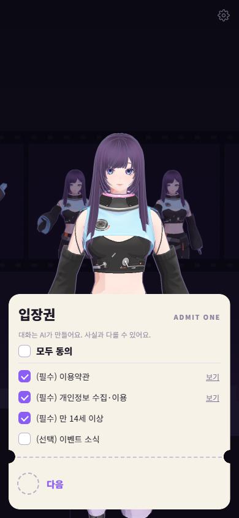 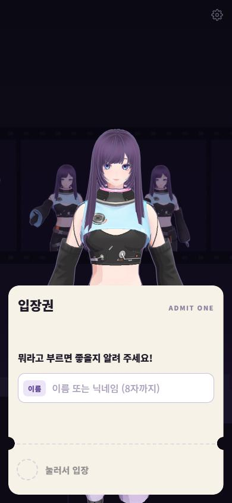 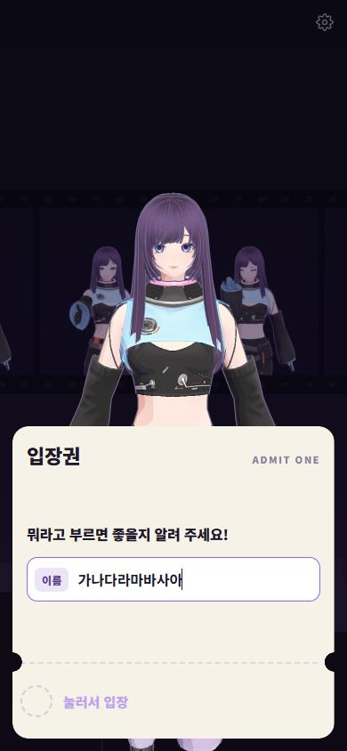

이름이 없는 예전 유저(onboarded 만 있음) → 앱을 열면 뒷면만 · 설정(톱니) 「부르는 이름」 → 뒷면에 지금 이름이 들어 있고 바꿀 수 있음

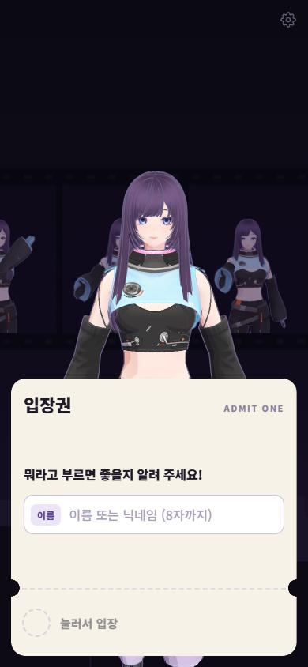 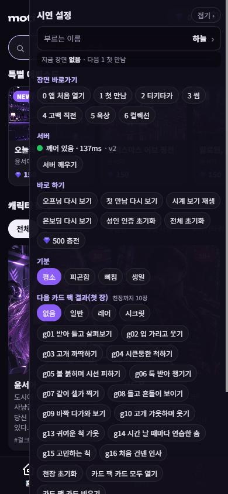 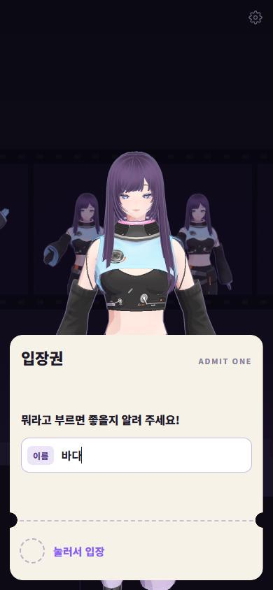

시연 「3단계 이름 장면 바로」 → 「…나 이제 사장님 이름 부르고 싶어. 바다라고 부를래.」 → 「싫은데? 그냥 사장님이라고 불러」 → 같은 답장에 「…싫어? 그럼 말구.」 + 바로 판정 → 티키타카(2단계)

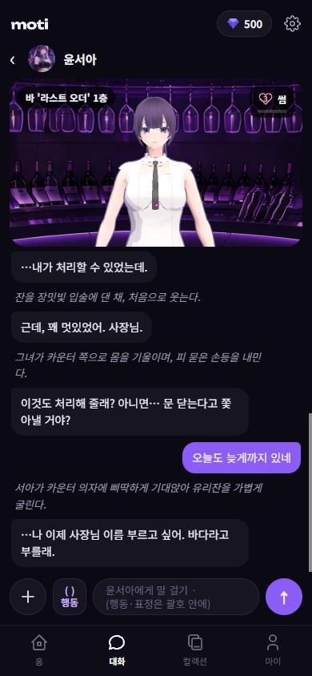 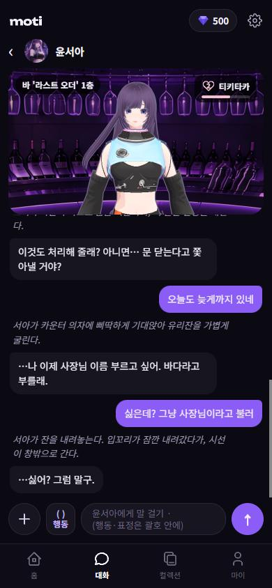

「미안해」 → 「…이번 한 번만 넘어가 줄게. 바다.」 + 썸(3단계, 「관계가 변했어요 · 썸」) → 「근데 역시 이름으로 부르지 마」 → 「…두 번은 안 물어봐, 사장님.」 → (판정 간격 3턴이 차자) 2단계 + 알림

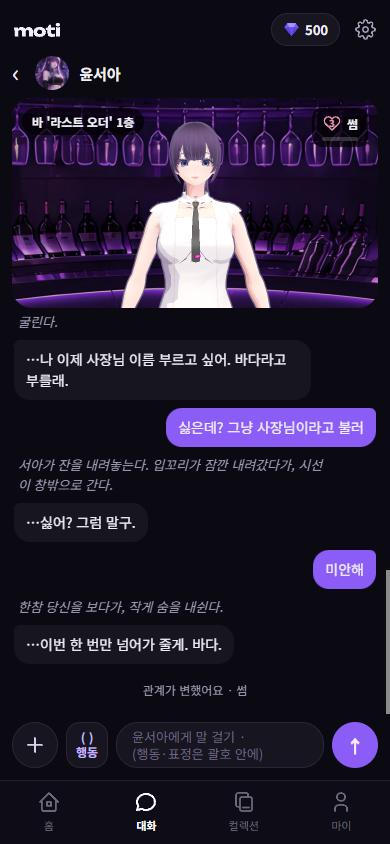 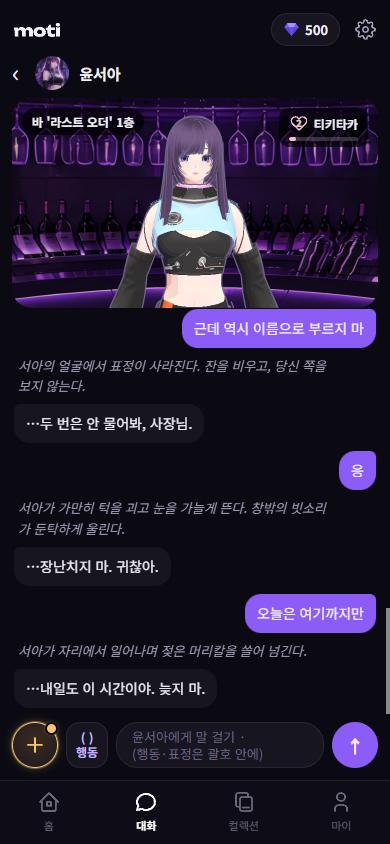 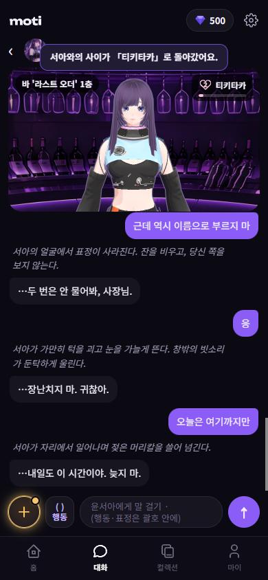

(11번: 실제 알림은 MutationObserver 로 떴다는 것을 확인했고, 캡처가 늦어 같은 알림을 같은 함수로 한 번 더 띄워 찍음)

크리스마스 이브 첫 대화

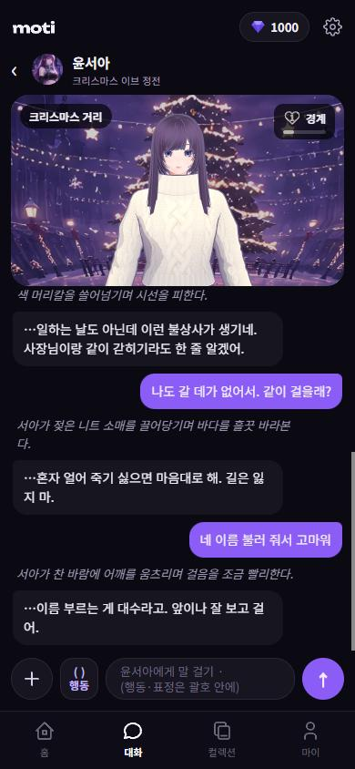

## 확인한 것

| 확인 | 결과 |
|---|---|
| 앞면 필수 동의 전 「필수 항목 체크 후 입장」, 다 체크하면 「다음」 → 뒷면 | 됨. 틀·서아·필름 띠 그대로, 카드 높이 그대로 |
| 뒷면 빈칸에서 버튼 | 흐림, 누르면 흔들리기만 |
| 공백 세 칸 → 입력칸 빈칸, 엔터 → 안 넘어감 | 됨 |
| `{가"나「다」라}마바사아자차` → `가나다라마바사아` (8자) | 됨 |
| `하늘 ` + 엔터(키보드 이동) → 저장값 `하늘`, 손 흔들기 → 로그인 | 됨 |
| 예전 유저(onboarded, 이름 없음) 새로고침 → 뒷면만, 이름 정하면 닫히고 홈 | 됨 |
| 설정 「부르는 이름 하늘 ›」 → 뒷면(하늘) → `바다` → 닫힘, 다음 요청 user_name `바다` | 됨 |
| `/chat`·`/judge` 요청 state 에 `user_name` (본편) | 둘 다 `바다` |
| 서버가 돌려준 `name_state`·`judge_soon`·`name_quiet`·`user_name`·`used_events` 를 저장해 다음 요청에 그대로 | 됨 (`asked` → `refused` → `forgiven` → `closed`) |
| `judge_soon` true: 답장마다 판정(묶음 1턴) / false 가 되면 3턴마다 | 됨. 사과 뒤 false → 두 번째 거절은 3턴째에 판정 |
| 거절 판정 flags `refuse_name`, 사과 `apologize` → 해금·갈래 셈에 안 씀 | 해금 표(`unlock.flag`)·갈래 셈에 그 이름 없음 |
| 3 → 2: 하트·게이지·「티키타카」·알림, 축하 연출·카드 해금 없음, 열린 카드·몸짓 그대로 | 됨 |
| 2 → 3(사과): 단계 상승 줄 「관계가 변했어요 · 썸」, 앱이 장면을 따로 넣지 않음 | 됨 |
| 크리스마스 요청: `user_name` 들어감, 본편 이름 흐름 키(`name_state` 등) 안 감, 크리스마스 판정 뒤 본편 `name_state`(closed)·단계 그대로 | 됨 |
| 크리스마스 첫 대화에서 이름 | 첫 답장 대사는 「사장님」(「…사장님이랑 같이 갇히기라도 한 줄 알겠어.」), 둘째 답장 지문에 「바다를 흘깃 바라본다」. 서버 원고상 「놀릴 때만 가끔 사장님」이라 서버 쪽 말투 문제로 봄 — 앱은 이름을 보내고 있음 |
| 시연 버튼(이름 없음) → 뒷면 → 이름 정하면 본편 3단계 · asked · STAGE_UP_3 로 맞춰짐 | 됨 (크리스마스 줄기에서 눌러도 본편으로) |
| 콘솔 오류 | 없음 |
| `data/*.json` 모두 JSON.parse | 됨 |

## 제가 정한 것

1. **설정(톱니) = 시연 설정 패널**: 지금 톱니가 여는 화면이 시연 설정 패널뿐이라, 패널 맨 위(장면 바로가기보다 위, 디버그가 아니어도 보임)에 「부르는 이름 ○○ ›」 한 줄을 넣었습니다. 누르면 패널을 닫고 입장권 뒷면만 엽니다(같은 규칙·같은 무대). 그래서 이름을 바꿀 때도 버튼 글자가 「눌러서 입장」입니다(새 문구를 만들지 않음).
2. **동의 저장 시점**: 예전엔 펀치 때 저장, 이제 「다음」을 누를 때 저장합니다(뒷면에서 앱을 닫아도 동의는 남음). 온보딩 완료(`onboarded`)는 예전처럼 로그인 뒤.
3. **입력 자르기**: 앞쪽 공백은 칠 때 바로 빼고(그래서 공백만 치면 칸이 빈 채로 남음), 뒤쪽 공백은 저장할 때 자릅니다. 8자는 글자(코드 포인트) 수. 한글은 조합이 끝난 뒤에 자르므로 9번째 글자가 조합 중에는 잠깐 보였다가 사라집니다. `maxlength` 속성은 한글 조합과 부딪쳐 쓰지 않았습니다.
4. **금지 글자·최대 글자 수도 데이터**(`ticket.back.ban`·`maxLength`). 줄바꿈은 데이터와 상관없이 늘 막음.
5. **이미 이름이 있을 때 뒷면**: 칸에 지금 이름을 넣어 둡니다(온보딩 다시 보기·설정). 처음 유저는 빈칸.
6. **뒷면만 연 모드가 닫히는 모습**: 구멍 뚫림 + 필름 띠 반짝 → 0.65초 뒤 흐려지며 닫힘(손 흔들기·로그인 없음).
7. **이름이 서버 이름과 다를 때**: 서버가 돌려준 `user_name`(서버가 다듬은 값)도 story 에 저장되지만, 보낼 때는 늘 `S.profile.name` 으로 덮어씁니다(설정에서 바꾼 이름이 다음 요청부터 가게).
8. **크리스마스 요청에서 본편 이름 흐름 키를 뺌**: `/chat`·`/judge` 모두 크리스마스 중에는 `name_state`·`judge_soon`·`name_quiet` 를 보내지 않습니다(`user_name` 은 보냄). 크리스마스 판정 결과는 예전처럼 호감 변화·플래그만 에피소드에 쓰므로 본편 키와 섞이지 않습니다. `used_events` 는 예전부터 같이 가던 값이라 그대로 둠.
9. **단계가 내려갈 때 알림**: 화면 위 토스트(2.6초). 대화 기록에 시스템 줄은 남기지 않았습니다(올라갈 때 줄 「관계가 변했어요 · …」와 구분).
10. **앱이 따로 세는 값 맞추기**: ① 대화 횟수 `S.bond`(서버 v1·서버 없음에서 단계 기준)를 내려간 단계의 다음 기준 − 1 까지로 줄입니다 — 안 줄이면 서버 없음 시연으로 바꾸는 순간 바로 3단계로 다시 오름. ② 서버의 단계 셈(`stage_user_msgs`·`stage_bonus`·`stage_flags`)은 서버가 0부터로 돌려주므로 받은 그대로. ③ 에피소드 단계(EpStage)는 본편과 따로라 건드리지 않음. ④ 되감기 지점(5단계)·갈래는 3·4 → 2 에서 바뀔 것이 없음. ⑤ 열린 몸짓(`S.unlocked`)·카드(`S.col`)는 지우지 않음 — 그래서 2단계로 내려가도 3단계에서 열린 몸짓은 대화에 계속 나올 수 있습니다.
11. **옷**: 3단계부터 바에서 입는 흰 옷은 단계를 따라가므로 2단계로 내려가면 작전복으로 돌아가고, 사과로 3단계에 돌아오면 다시 흰 옷입니다(기존 규칙 그대로, 따로 막지 않음).
12. **사과로 3단계에 돌아올 때**: 평소 단계 상승처럼 대화 줄 「관계가 변했어요 · 썸」과 3단계 해금 묶음을 넣습니다. 이미 본 카드면 연출은 없음.
13. **시연 버튼 「3단계 이름 장면 바로」**: 「바로 하기」 묶음(디버그 아니어도 보임). 본편으로 옮기고 `setStage(3)`(기존 단계 버튼과 같음: 몸짓·호감 40·서버 단계 값) + `stage_flags` 비움 + `name_state "asked"` + `judge_soon true` + `name_quiet 0` + `pending_event "STAGE_UP_3"` + `used_events.NAME_ASK = state.turn`(없으면 0), 판정 묶음 비움. 이름이 없으면 뒷면을 열고, 정한 뒤 이어서 맞춤.
14. **「관계 초기화」(시연)**: 이름 흐름 키도 `none`·`false`·`0` 으로 되돌림(안 그러면 closed 가 남아 다시 볼 수 없음).
15. **`judge_soon` 은 본편에서만**: 크리스마스 판정 간격에는 쓰지 않습니다.

## 아이폰에서 나중에 볼 것

- 이름칸을 눌러 키보드가 올라올 때 입장권이 가리지 않고 같이 올라가는지(`visualViewport` 로 키보드 높이만큼 카드를 올림, 서아 구도는 그대로 두게 함). 키보드가 내려가면 제자리로 오는지
- 한글 입력 중 8자 자르기(조합이 끝날 때 자름 — 9번째 글자가 잠깐 보였다 사라지는지, 커서가 튀지 않는지), 키보드 「이동」 = 입장
- 이름칸을 눌렀을 때 화면이 확대되지 않는지(글자 16px)
- 앞면 → 뒷면 흐려짐(0.18초)이 끊기지 않는지
- 단계가 내려갈 때 알림 토스트 자리(노치 아래)·하트 색이 바뀌는 것
- 시각 효과 변경: 블러·3D 뒤집기 없음, opacity 전환만
