# 7. 온보딩과 19세 이상 캐릭터 성인 인증

브랜치: `step/7-onboarding` (main 병합 안 함)

| 단계 | 커밋 | 한 일 |
| --- | --- | --- |
| 7-A | `0545210` | 온보딩 첫 화면·로그인, 처음 실행 때만, 서아 미리 불러오기, 시연 패널 연결 |
| 7-B | `f47cc45` | 입장권 약관·펀치, 3D 서아와 마네킹 인사 |
| 7-C | `132848b` | 19세 이상 캐릭터 배지와 시연용 성인 인증 |

## 흐름

```
처음 실행(onboarded 없음)
  첫 화면 ──[입장권 받기]──▶ (서아 3D 준비 안 됐으면 버튼에 로딩 표시, 준비되면)
  입장권 ──[필수 3개 동의 → 펀치]──▶ 서아 손 흔들기 + 마네킹 4명 인사 + 「어서 와요」 (약 2.2초)
  로그인 ──[Google·카카오 → 안내 토스트 → 게스트] / [게스트로 계속]──▶ onboarded 저장
  홈

두 번째 실행부터: 바로 홈   (?skipintro=1 이면 온보딩 건너뜀)

홈에서 19+ 캐릭터(서도윤) ──▶ 인증 안 했으면 인증 시트
  [본인 인증하기 (시연용)] ─ 1초 로딩 ─▶ 인증 저장 + 「인증이 완료됐어요 (시연용)」 ─▶ 대화방
  [다음에 할게요] ─▶ 시트 닫힘(홈 그대로)
인증한 뒤에는 바로 대화방
```

## 바뀐 파일

| 파일 | 내용 |
| --- | --- |
| `onboarding.js` | **새 파일.** `Onboard`(첫 화면·입장권·로그인 흐름, 체크·약관 시트·펀치·인사, 3D 빌려 오기)와 `Crowd`(코드로 만든 마네킹 4개: 만들기·숨쉬기·손 흔들기) |
| `onboarding.css` | **새 파일.** 어두운 네온 도시 배경(그라데이션·네온 사각형·SVG 건물·빗줄기), 첫 화면, 입장권 카드(점선·반원 홈 마스크, 펀치 구멍), 약관 시트, 로그인, 성인 인증 시트, 19+ 배지 |
| `data/onboarding.json` | **새 파일.** 원고 문구 전부, 입장권 3D 구도·안개, 마네킹 설정(위치·키·머리 모양·색·숨쉬기·손 흔들기), 인사 시간, 시간 값 |
| `index.html` | 3D 무대(`Stage`): 준비 끝 약속(`Stage.ready`), 셰이더 미리 만들기, 그림판 빌려주기·돌려받기(`borrow`/`release`), 항상 달린 안개(평소엔 멀리), 안 보일 때 그리지 않기, 자막·확대 없이 몸짓만(`quiet`). 처음 실행 때만 온보딩, 시작 화면은 홈. 시연 패널: 「온보딩 다시 보기」·「성인 인증 초기화」·장면 0 「앱 처음 열기」·`0` 키, 전체 초기화 → 첫 화면. 서도윤 `ageRating:19`, 홈·대화 목록·알림에서 들어갈 때 인증 확인(`enterRoom`), 인증 시트 |
| `data/demo.json` | 단축키 안내에 「0 앱 처음 열기」 |
| `docs/drafts/7-온보딩-문구.md` | 원고(커밋되지 않았던 것을 같이 커밋) |
| `docs/reports/img/7/*.jpg` | 캡처 |

## 7-A 첫 화면·로그인·처음 실행 때만·미리 불러오기

- 첫 화면: `--bg` 위에 어두운 도시(하늘 빛 그라데이션, 흐린 네온 사각형 7개, SVG 건물 두 줄과 창문 점, 빗줄기 34개). 블러 필터는 안 쓰고 그림자·그라데이션만. 로고(헤더와 같은 글꼴·굵기 800, 64px)와 소개가 0.6초 동안 나타남(`timing.fadeInMs`).
- 처음 실행 판단은 페이지가 열리자마자(데이터를 기다리지 않고) 해서 홈이 먼저 비치지 않는다.
- **미리 불러오기:** 서아 모델은 원래도 앱을 열 때 불러왔다(`Stage.init`). 이번에 준비 끝(모델·명암·살아 있게)을 알리는 `Stage.ready` 를 만들고, 첫 화면 버튼이 이것을 기다린다. 입장권 3D는 대화방의 3D 그림판을 잠깐 빌려 쓰고 돌려주므로 **모델은 한 번만 불러온다.**

| 측정 (헤드리스 Chrome, 네트워크 2.5MB/s·지연 60ms로 제한, 캐시 끔) | 값 |
| --- | --- |
| 서아 준비 끝(앱 열고부터) | 약 4.4초 (`seoa_vroid.glb` 8MB) |
| 첫 화면이 뜬 때 | 0.25초 |
| 0.78초에 「입장권 받기」를 누름 → 입장권이 뜬 때 | 4.7초 (그동안 버튼에 로딩 표시) |
| 온보딩 뒤 홈 → 서아 대화방, 서아가 그려지기까지 | **56ms** |
| 온보딩 건너뛰고(`?skipintro=1`) 바로 홈 → 서아 대화방 | 4,533ms (「서아: 잠깐, 준비하고 나갈게.」가 그동안 보임) |
| `seoa_vroid.glb` 요청 수 | 두 경우 모두 1번 |
| 제한 없음(로컬) 서아 준비 끝 | 0.15초 안팎 → 버튼을 누르면 바로 입장권 |

| 첫 화면 390 | 로딩 표시 | 로그인 390 | 로그인 안내 토스트 |
| --- | --- | --- | --- |
| 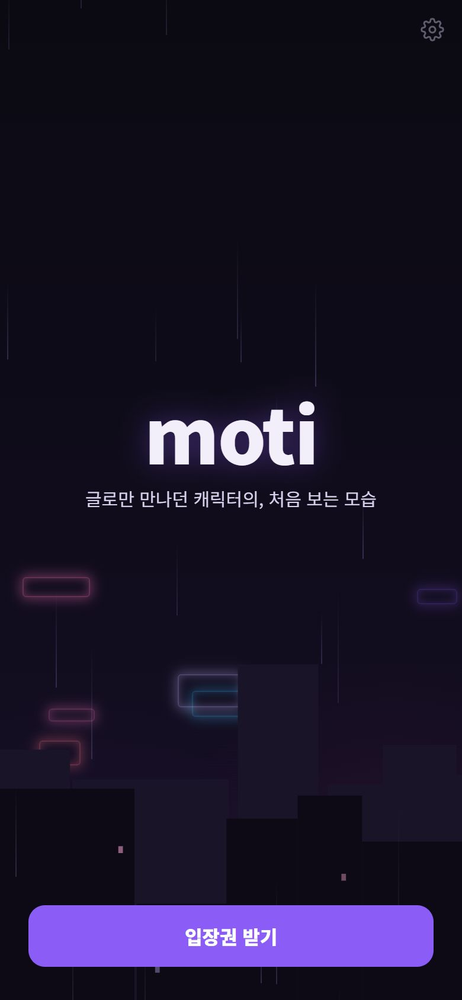 | 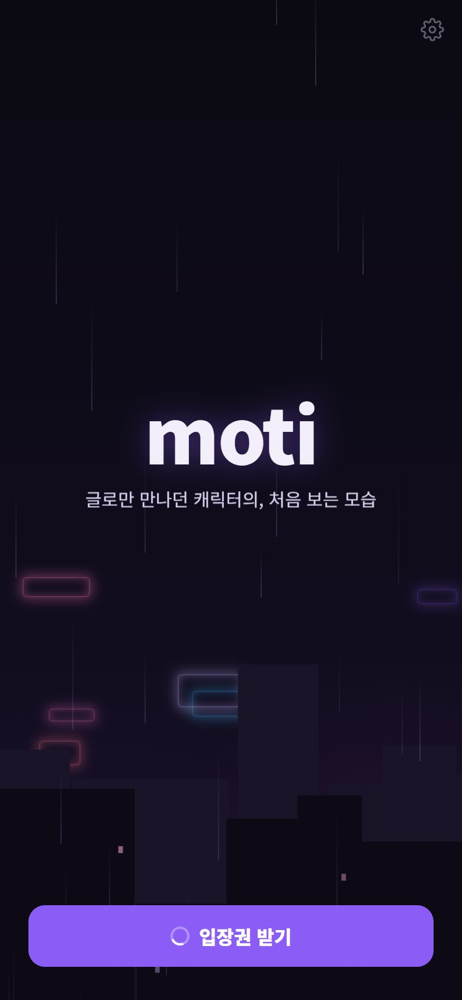 |  | 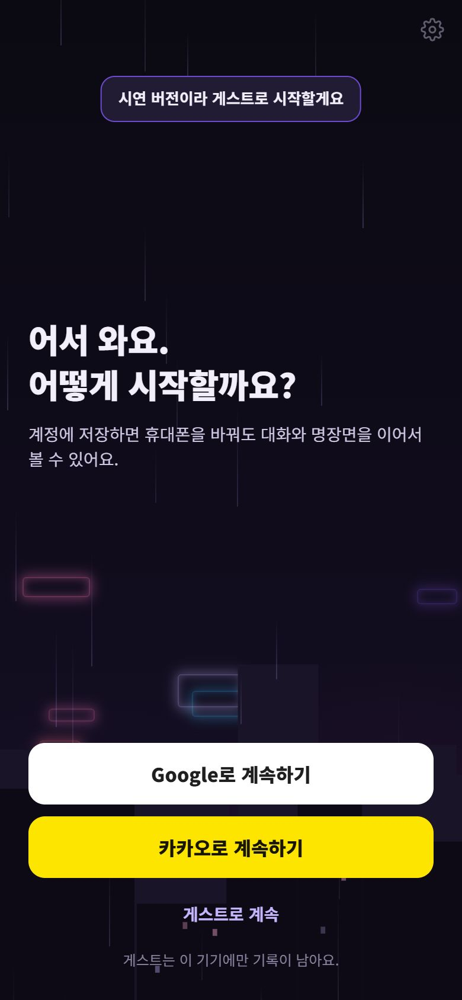 |

| 첫 화면 1280 | 로그인 1280 | 마친 뒤 홈 | 두 번째 실행(바로 홈) | 시연 패널 |
| --- | --- | --- | --- | --- |
| 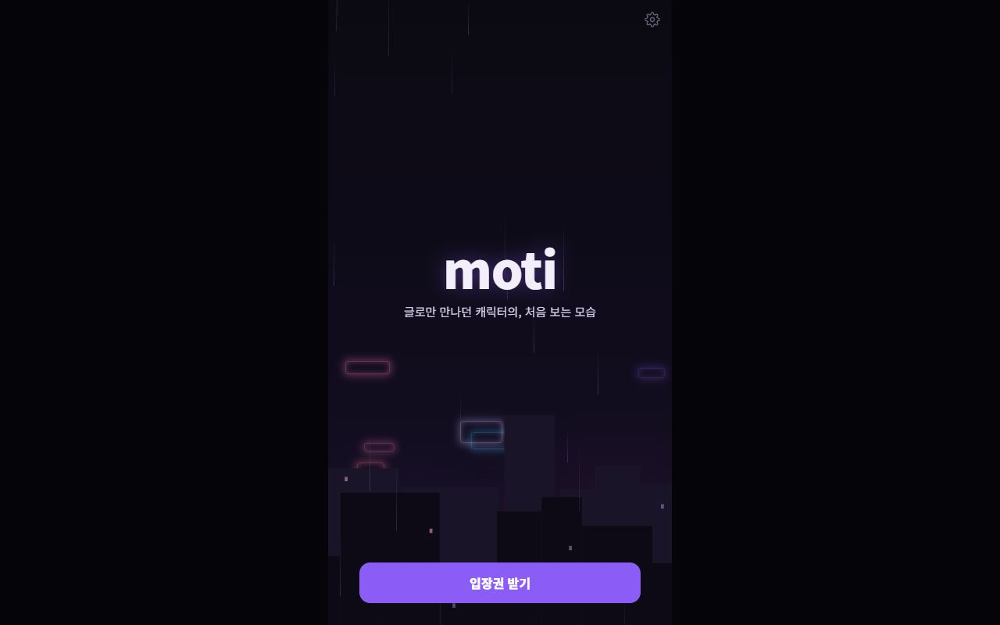 |  | 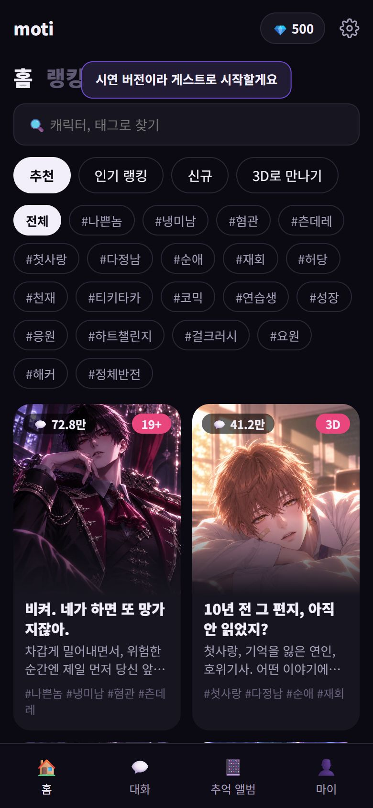 |  |  |

(7-A 때 입장권 자리 임시 화면: 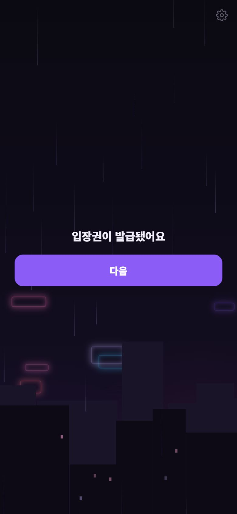, 온보딩 뒤 서아 대화방: 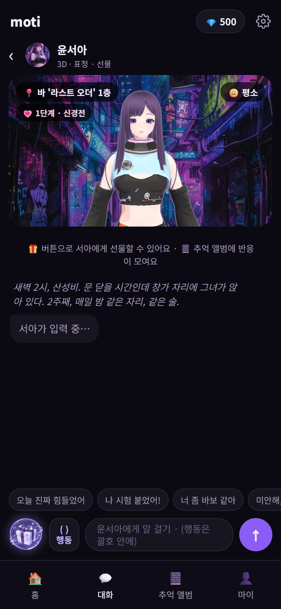)

시연 패널 확인: 「온보딩 다시 보기」 → 💎 등 다른 저장값은 그대로, 첫 화면부터 / `?debug=1` 에서 `0` 키 → 전체 초기화 후 첫 화면 / 온보딩 중 `2` 키 → 온보딩을 저장 없이 닫고 장면 ②로.

## 7-B 입장권·펀치·인사

- **3D:** 위쪽에 서아(허리 위가 카드 위로 보이게, 평소 상반신보다 넓게), 그 뒤 양옆에 마네킹 4명(긴 머리·짧은 머리·묶은 머리·올림 머리, 키 1.58~1.70m, 서아 뒤 2.4~2.8m). 명암·외곽선(look.js)과 숨쉬기·시선·머리카락(alive.js)은 그대로. 배경은 첫 화면과 같은 도시 CSS(장소 배경 이미지는 안 씀). 테두리 빛은 장소 없음 기본색, 돌려줄 때 대화 장소 색으로.
- **3D 칸 높이:** 카드 윗변 + 48px(`scene3d.overlapPx`). 화면 높이가 달라도 서아 허리 근처가 카드 윗변에 오게.
- **마네킹:** 머리 구, 몸통·팔·다리 캡슐(r128 에 캡슐이 없어 옆모습을 돌려 만듦). 마네킹마다 몸 한 덩어리 + 흔드는 팔 → 그리기 2번. 어두운 보라, 조명 0.85배, 안개(1.8~6.2m). 숨쉬기 3.8초 주기 세로 0.6%.
- **카드:** 원고 문구 그대로. 전체 동의 ↔ 항목 연동. 「보기」는 이용약관·개인정보에만(약관 시트 원고가 그 둘뿐). 펀치 칸은 점선 + 양옆 반원 홈(마스크로 실제로 뚫림).
- **펀치:** 필수 3개 전엔 흐림 + 「필수 항목에 동의해 주세요」, 누르면 흔들림(0.36초)만. 동의 후 「탭해서 펀치」 → 구멍 0.2초 → 서아 m13 + 웃는 표정, 마네킹이 바깥쪽부터 0.1초 간격으로 한 손 흔들기(0.9초), 「어서 와요」 1.7초. 1.7초에 카드가 48px 올라가며 0.45초 동안 사라지고 로그인으로.
- **저장:** 펀치할 때 `S.consent = {terms, privacy, age14, marketing, at}`. 선택 동의는 저장만.

| 측정 (헤드리스 Chrome 390×844, 소프트웨어 렌더링) | 값 |
| --- | --- |
| 입장권 화면 그리기 횟수 | **41회** (서아 33 + 마네킹 8), 삼각형 99,340 (서아만 90,932) |
| 서아 대화방(참고, 4단계) | 33회 |
| 첫 화면 → 입장권 | 서아가 준비됐으면 누르는 즉시(0ms). 느린 네트워크에선 위 표대로 서아 준비 끝까지 |
| 프레임 | 16fps — 헤드리스 소프트웨어 렌더링 값이라 실제 폰 성능과 무관. 아이폰에서 확인 필요 |

| 필수 동의 전 | 동의 전 누름(흔들림) | 동의 후 | 펀치 순간 | 인사 순간 |
| --- | --- | --- | --- | --- |
| 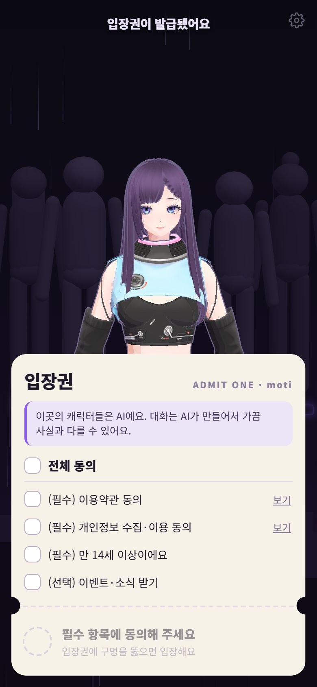 |  | 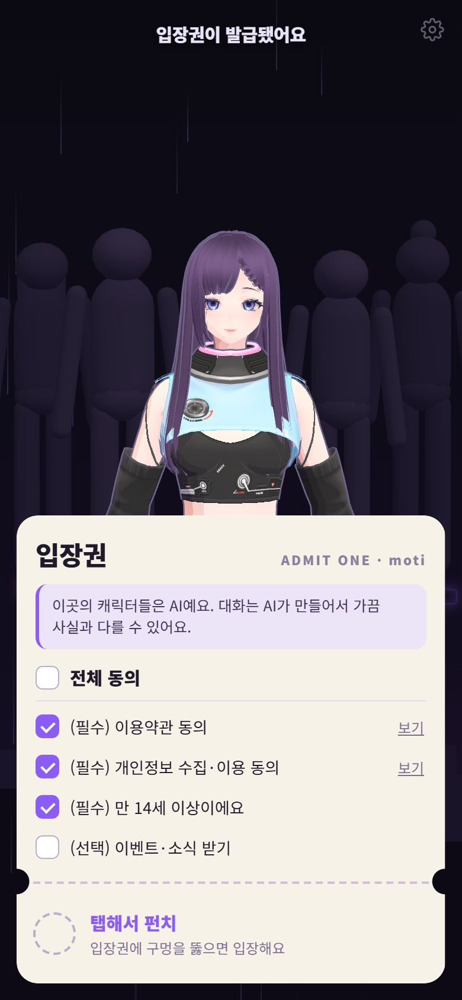 | 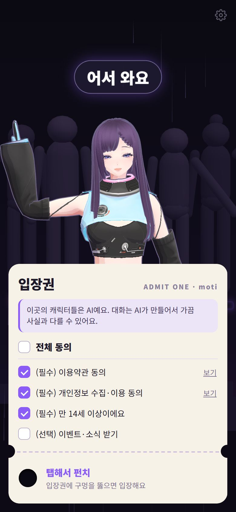 | 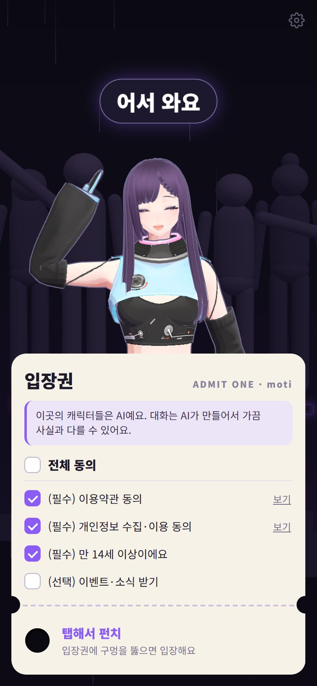 |

| 약관 시트 | 그다음 로그인 | 375×667 인사 | 1280 |
| --- | --- | --- | --- |
|  | 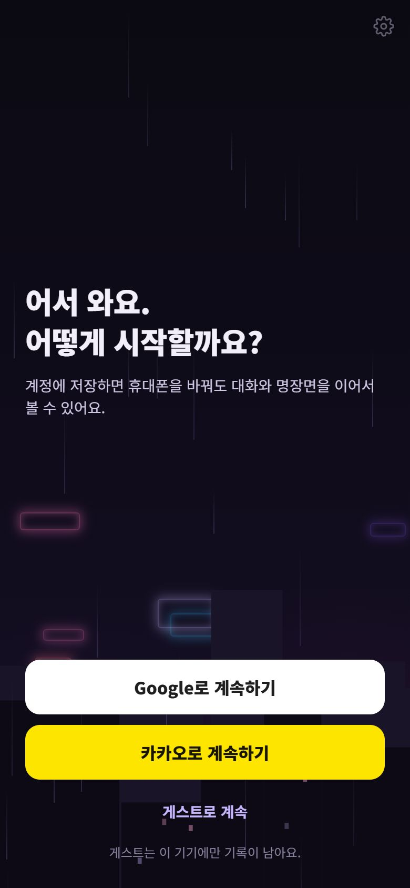 | 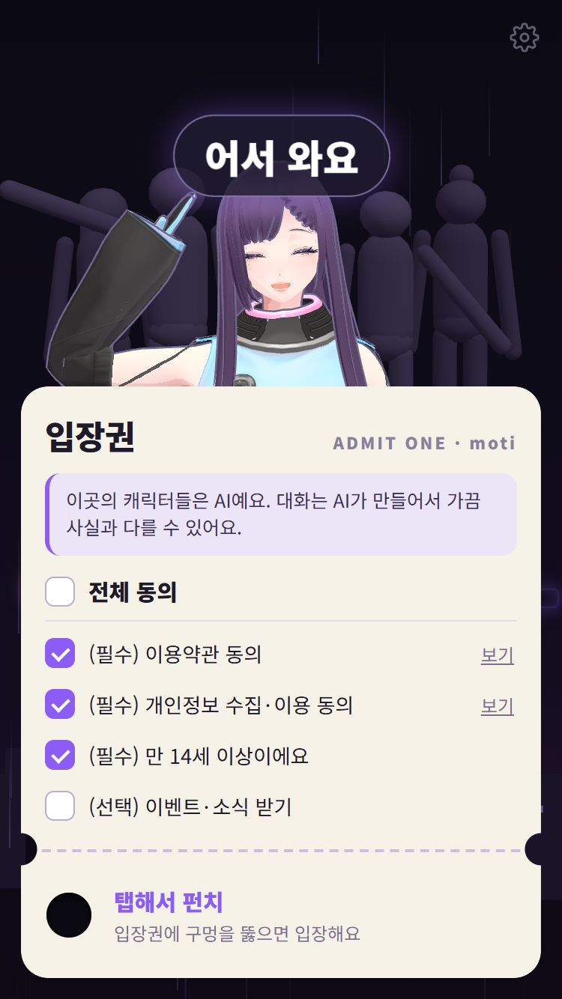 |  |

## 7-C 19세 이상 캐릭터 성인 인증 (시연용)

- 서도윤에 `ageRating: 19`, 다른 캐릭터는 없음. 배지 글자는 원고 「19+」(`data/onboarding.json adult.badge`), 색은 기존 배지 자리의 빨강.
- 홈 카드·대화 목록·헤더 알림에서 들어갈 때 확인. 인증 전이면 지금 화면 위에 시트. 「본인 인증하기 (시연용)」 → 1초 로딩 → 저장(`S.adult`) → 토스트 → 대화방. 「다음에 할게요」 → 닫힘.
- 지우기: 전체 초기화, 시연 패널 「바로 하기」의 「성인 인증 초기화」(지금 서도윤 방이면 대화 목록으로 나감).
- 확인: 인증 전 홈 그대로·시트 / 다음에 → 홈 / 인증 → 대화방(서도윤) / 다시 누르면 바로 / 인증 초기화 → 다시 시트 / 서아는 시트 없이.

| 19+ 배지 | 인증 시트 | 인증 중 | 완료 후 대화방 |
| --- | --- | --- | --- |
|  | 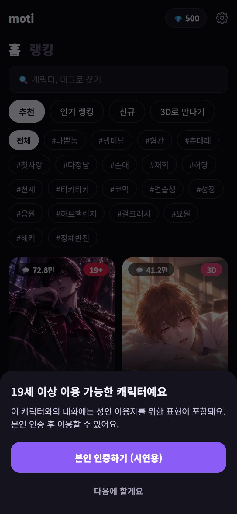 |  | 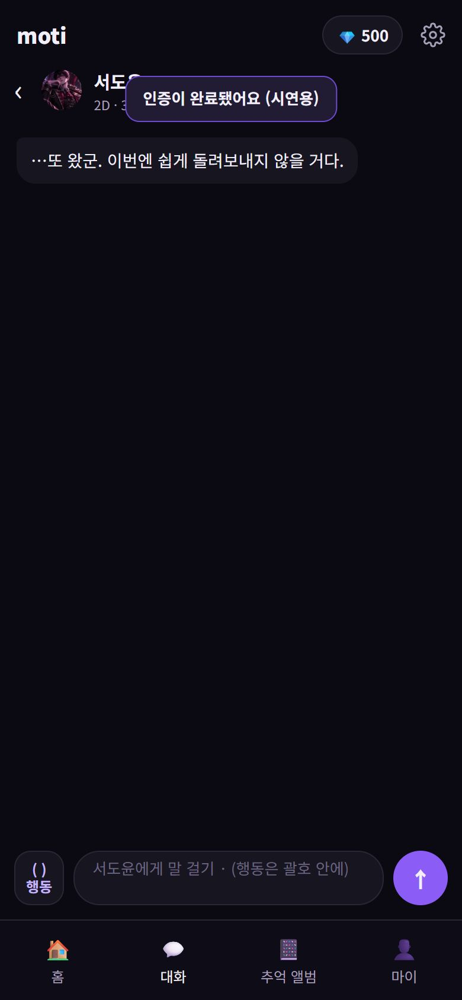 |

## 아이폰 사파리 확인 (별도 확인 항목)

헤드리스 Chrome(소프트웨어 렌더링)에서만 봤다.

- [ ] **빗줄기·나타나기 애니메이션:** 빗줄기가 끊기지 않고 천천히 떨어지는지, 로고·소개가 0.6초 동안 부드럽게 나타나는지, 네온 사각형 빛(그림자)이 무겁지 않은지
- [ ] **3D 서아 로딩 시간:** 실제 통신에서 「입장권 받기」 로딩 표시가 얼마나 보이는지(8MB). 15초가 넘으면 서아 없이 넘어감
- [ ] **마네킹과 안개:** 마네킹이 그림자처럼 어둡게, 멀리 있는 군중처럼 보이는지(너무 밝거나 너무 안 보이지 않는지). 서아 외곽선·명암이 안개 때문에 바뀌지 않았는지
- [ ] **펀치 구멍:** 양옆 반원 홈(마스크)이 뚫려 보이는지, 펀치 구멍이 0.2초에 생기는지, 동의 전 흔들림
- [ ] **서아와 마네킹 인사:** 서아 손 흔들기와 마네킹 4명이 바깥쪽부터 차례로 흔드는지, 「어서 와요」, 카드가 올라가며 사라지고 로그인으로 가는지. 이때 끊김(프레임)
- [ ] **약관 시트:** 아래에서 올라오고 닫히는지, 안전 영역(홈 바) 위로 닫기 버튼이 보이는지
- [ ] 인증 시트 로딩 표시, 로그인 토스트가 온보딩 위로 보이는지
- [ ] 온보딩을 마친 뒤 서아 대화방 3D가 정상(구도·안개 없음·테두리 빛 장소 색)인지

## 제가 정한 것

1. **3D는 새로 만들지 않고 대화방의 3D 그림판을 빌려 씀.** 서아 모델(8MB)·명암·머리카락 설정을 두 번 하지 않고, WebGL 도 하나만. 그래서 「미리 불러오기」 = 원래 앱을 열 때 시작하던 불러오기에 준비 끝 약속을 붙인 것.
2. **안개는 항상 달아 두고 평소엔 1000m 밖.** 켜고 끌 때마다 셰이더를 다시 만들면 대화방을 처음 열 때 멈칫해서. 화면엔 차이 없음.
3. **3D 칸이 안 보이면(홈·마이·첫 화면) 그리지 않음.** 원래는 안 보일 때도 매 프레임 그렸다. 모델이 준비되면 셰이더를 미리 만들어(`compile`) 처음 보일 때 멈칫하지 않게.
4. **시작 화면은 홈.** 지시 「다음부터는 바로 홈」대로. 예전엔 앱을 열면 대화 탭(마지막 대화방)이었다.
5. **예전 저장값(6단계까지 쓰던 사람)도 온보딩을 한 번 봄.** `onboarded` 가 없어서. 💎·대화 등은 그대로.
6. **온보딩 화면 오른쪽 위에 작은 톱니바퀴.** 온보딩이 헤더를 가려 시연 패널을 열 수 없어서(`D` 키는 `?debug=1` 에서만).
7. **온보딩 중 장면 바로가기(1~6)를 누르면 저장 없이 온보딩을 닫고 장면으로.** 발표 중 빠져나갈 길.
8. **Google·카카오 버튼에 로고는 넣지 않음.** 원고 문구만, 색만 흰색·노랑. 누르면 토스트를 1.1초 보여 준 뒤 게스트로.
9. **「보기」는 이용약관·개인정보에만.** 원고의 약관 화면이 그 둘뿐. 본문은 원고의 임시 문구 하나를 둘 다에.
10. **입장권 구도:** 서아 허리가 카드 윗변에 오게 3D 칸 높이를 카드 윗변 + 48px 로 맞추고, 카메라 최소 너비를 키 0.6배로(손 흔들 때 팔이 안 잘리게). 375×667 처럼 낮은 화면에서는 가슴 위만 보인다.
11. **마네킹 흔드는 팔은 바깥쪽 팔, 「바깥쪽부터」는 가운데에서 먼 순서**(왼쪽 바깥 → 오른쪽 바깥 → 왼쪽 안 → 오른쪽 안, 0.1초 간격). 팔은 어깨에서 통째로 돌림(팔꿈치 없음).
12. **동의 값 저장은 펀치할 때**(`S.consent`), 로그인 방식은 `S.loginAs`(지금은 늘 guest). 전체 초기화로 지워짐.
13. **19+ 배지 글자는 데이터에서**(`adult.badge`), 캐릭터 데이터의 `badge` 는 비움. 「신규」·「3D」 정렬은 그대로.
14. **인증 확인은 들어가는 길 세 곳(홈·대화 목록·알림) + 대화방 열기 자체에도**(인증 초기화 뒤 남은 대화방 대비).
15. 장면 0 은 시연 패널 장면 목록 맨 앞 「0 앱 처음 열기」 버튼. 「지금 장면」 표시는 없음으로.
16. `data/demo.json` 단축키 안내에 「0 앱 처음 열기」를 더함(원고에 없는 패널 안내 문구).
