# 7. 온보딩과 19세 이상 캐릭터 성인 인증

브랜치: `step/7-onboarding` (main 병합 안 함)

| 단계 | 커밋 | 한 일 |
| --- | --- | --- |
| 7-A | `0545210` | 온보딩 첫 화면·로그인, 처음 실행 때만, 서아 미리 불러오기, 시연 패널 연결 |
| 7-B | `f47cc45` | 입장권 약관·펀치, 3D 서아와 마네킹 인사 |
| 7-C | `132848b` | 19세 이상 캐릭터 배지와 시연용 성인 인증 |

## 흐름

```
처음 실행(onboarded 없음)
  첫 화면 ──[입장권 받기]──▶ (서아 3D 준비 안 됐으면 버튼에 로딩 표시, 준비되면)
  입장권 ──[필수 3개 동의 → 펀치]──▶ 서아 손 흔들기 + 마네킹 4명 인사 + 「어서 와요」 (약 2.2초)
  로그인 ──[Google·카카오 → 안내 토스트 → 게스트] / [게스트로 계속]──▶ onboarded 저장
  홈

두 번째 실행부터: 바로 홈   (?skipintro=1 이면 온보딩 건너뜀)

홈에서 19+ 캐릭터(서도윤) ──▶ 인증 안 했으면 인증 시트
  [본인 인증하기 (시연용)] ─ 1초 로딩 ─▶ 인증 저장 + 「인증이 완료됐어요 (시연용)」 ─▶ 대화방
  [다음에 할게요] ─▶ 시트 닫힘(홈 그대로)
인증한 뒤에는 바로 대화방
```

## 바뀐 파일

| 파일 | 내용 |
| --- | --- |
| `onboarding.js` | **새 파일.** `Onboard`(첫 화면·입장권·로그인 흐름, 체크·약관 시트·펀치·인사, 3D 빌려 오기)와 `Crowd`(코드로 만든 마네킹 4개: 만들기·숨쉬기·손 흔들기) |
| `onboarding.css` | **새 파일.** 어두운 네온 도시 배경(그라데이션·네온 사각형·SVG 건물·빗줄기), 첫 화면, 입장권 카드(점선·반원 홈 마스크, 펀치 구멍), 약관 시트, 로그인, 성인 인증 시트, 19+ 배지 |
| `data/onboarding.json` | **새 파일.** 원고 문구 전부, 입장권 3D 구도·안개, 마네킹 설정(위치·키·머리 모양·색·숨쉬기·손 흔들기), 인사 시간, 시간 값 |
| `index.html` | 3D 무대(`Stage`): 준비 끝 약속(`Stage.ready`), 셰이더 미리 만들기, 그림판 빌려주기·돌려받기(`borrow`/`release`), 항상 달린 안개(평소엔 멀리), 안 보일 때 그리지 않기, 자막·확대 없이 몸짓만(`quiet`). 처음 실행 때만 온보딩, 시작 화면은 홈. 시연 패널: 「온보딩 다시 보기」·「성인 인증 초기화」·장면 0 「앱 처음 열기」·`0` 키, 전체 초기화 → 첫 화면. 서도윤 `ageRating:19`, 홈·대화 목록·알림에서 들어갈 때 인증 확인(`enterRoom`), 인증 시트 |
| `data/demo.json` | 단축키 안내에 「0 앱 처음 열기」 |
| `docs/drafts/7-온보딩-문구.md` | 원고(커밋되지 않았던 것을 같이 커밋) |
| `docs/reports/img/7/*.jpg` | 캡처 |

## 7-A 첫 화면·로그인·처음 실행 때만·미리 불러오기

- 첫 화면: `--bg` 위에 어두운 도시(하늘 빛 그라데이션, 흐린 네온 사각형 7개, SVG 건물 두 줄과 창문 점, 빗줄기 34개). 블러 필터는 안 쓰고 그림자·그라데이션만. 로고(헤더와 같은 글꼴·굵기 800, 64px)와 소개가 0.6초 동안 나타남(`timing.fadeInMs`).
- 처음 실행 판단은 페이지가 열리자마자(데이터를 기다리지 않고) 해서 홈이 먼저 비치지 않는다.
- **미리 불러오기:** 서아 모델은 원래도 앱을 열 때 불러왔다(`Stage.init`). 이번에 준비 끝(모델·명암·살아 있게)을 알리는 `Stage.ready` 를 만들고, 첫 화면 버튼이 이것을 기다린다. 입장권 3D는 대화방의 3D 그림판을 잠깐 빌려 쓰고 돌려주므로 **모델은 한 번만 불러온다.**

| 측정 (헤드리스 Chrome, 네트워크 2.5MB/s·지연 60ms로 제한, 캐시 끔) | 값 |
| --- | --- |
| 서아 준비 끝(앱 열고부터) | 약 4.4초 (`seoa_vroid.glb` 8MB) |
| 첫 화면이 뜬 때 | 0.25초 |
| 0.78초에 「입장권 받기」를 누름 → 입장권이 뜬 때 | 4.7초 (그동안 버튼에 로딩 표시) |
| 온보딩 뒤 홈 → 서아 대화방, 서아가 그려지기까지 | **56ms** |
| 온보딩 건너뛰고(`?skipintro=1`) 바로 홈 → 서아 대화방 | 4,533ms (「서아: 잠깐, 준비하고 나갈게.」가 그동안 보임) |
| `seoa_vroid.glb` 요청 수 | 두 경우 모두 1번 |
| 제한 없음(로컬) 서아 준비 끝 | 0.15초 안팎 → 버튼을 누르면 바로 입장권 |

| 첫 화면 390 | 로딩 표시 | 로그인 390 | 로그인 안내 토스트 |
| --- | --- | --- | --- |
|  |  |  |  |

| 첫 화면 1280 | 로그인 1280 | 마친 뒤 홈 | 두 번째 실행(바로 홈) | 시연 패널 |
| --- | --- | --- | --- | --- |
|  | 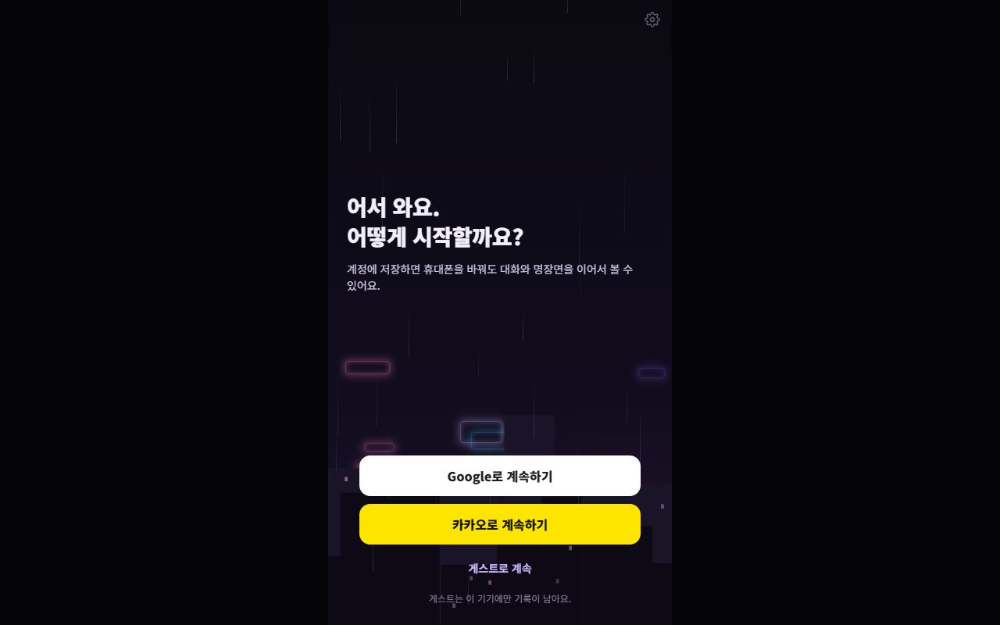 |  | 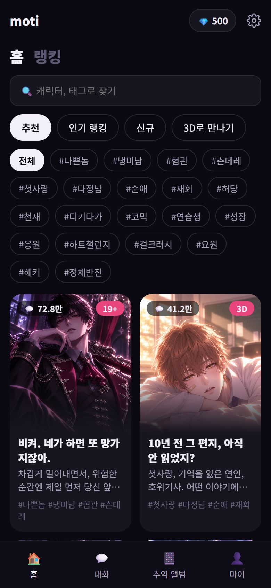 | 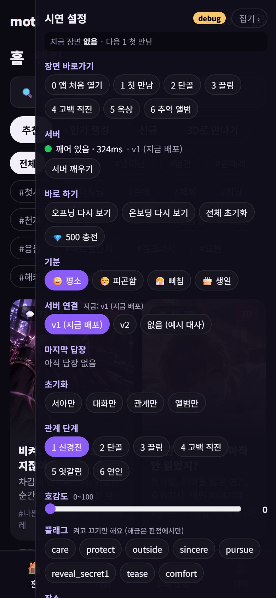 |

(7-A 때 입장권 자리 임시 화면: , 온보딩 뒤 서아 대화방: )

시연 패널 확인: 「온보딩 다시 보기」 → 💎 등 다른 저장값은 그대로, 첫 화면부터 / `?debug=1` 에서 `0` 키 → 전체 초기화 후 첫 화면 / 온보딩 중 `2` 키 → 온보딩을 저장 없이 닫고 장면 ②로.

## 7-B 입장권·펀치·인사

- **3D:** 위쪽에 서아(허리 위가 카드 위로 보이게, 평소 상반신보다 넓게), 그 뒤 양옆에 마네킹 4명(긴 머리·짧은 머리·묶은 머리·올림 머리, 키 1.58~1.70m, 서아 뒤 2.4~2.8m). 명암·외곽선(look.js)과 숨쉬기·시선·머리카락(alive.js)은 그대로. 배경은 첫 화면과 같은 도시 CSS(장소 배경 이미지는 안 씀). 테두리 빛은 장소 없음 기본색, 돌려줄 때 대화 장소 색으로.
- **3D 칸 높이:** 카드 윗변 + 48px(`scene3d.overlapPx`). 화면 높이가 달라도 서아 허리 근처가 카드 윗변에 오게.
- **마네킹:** 머리 구, 몸통·팔·다리 캡슐(r128 에 캡슐이 없어 옆모습을 돌려 만듦). 마네킹마다 몸 한 덩어리 + 흔드는 팔 → 그리기 2번. 어두운 보라, 조명 0.85배, 안개(1.8~6.2m). 숨쉬기 3.8초 주기 세로 0.6%.
- **카드:** 원고 문구 그대로. 전체 동의 ↔ 항목 연동. 「보기」는 이용약관·개인정보에만(약관 시트 원고가 그 둘뿐). 펀치 칸은 점선 + 양옆 반원 홈(마스크로 실제로 뚫림).
- **펀치:** 필수 3개 전엔 흐림 + 「필수 항목에 동의해 주세요」, 누르면 흔들림(0.36초)만. 동의 후 「탭해서 펀치」 → 구멍 0.2초 → 서아 m13 + 웃는 표정, 마네킹이 바깥쪽부터 0.1초 간격으로 한 손 흔들기(0.9초), 「어서 와요」 1.7초. 1.7초에 카드가 48px 올라가며 0.45초 동안 사라지고 로그인으로.
- **저장:** 펀치할 때 `S.consent = {terms, privacy, age14, marketing, at}`. 선택 동의는 저장만.

| 측정 (헤드리스 Chrome 390×844, 소프트웨어 렌더링) | 값 |
| --- | --- |
| 입장권 화면 그리기 횟수 | **41회** (서아 33 + 마네킹 8), 삼각형 99,340 (서아만 90,932) |
| 서아 대화방(참고, 4단계) | 33회 |
| 첫 화면 → 입장권 | 서아가 준비됐으면 누르는 즉시(0ms). 느린 네트워크에선 위 표대로 서아 준비 끝까지 |
| 프레임 | 16fps — 헤드리스 소프트웨어 렌더링 값이라 실제 폰 성능과 무관. 아이폰에서 확인 필요 |

| 필수 동의 전 | 동의 전 누름(흔들림) | 동의 후 | 펀치 순간 | 인사 순간 |
| --- | --- | --- | --- | --- |
|  | 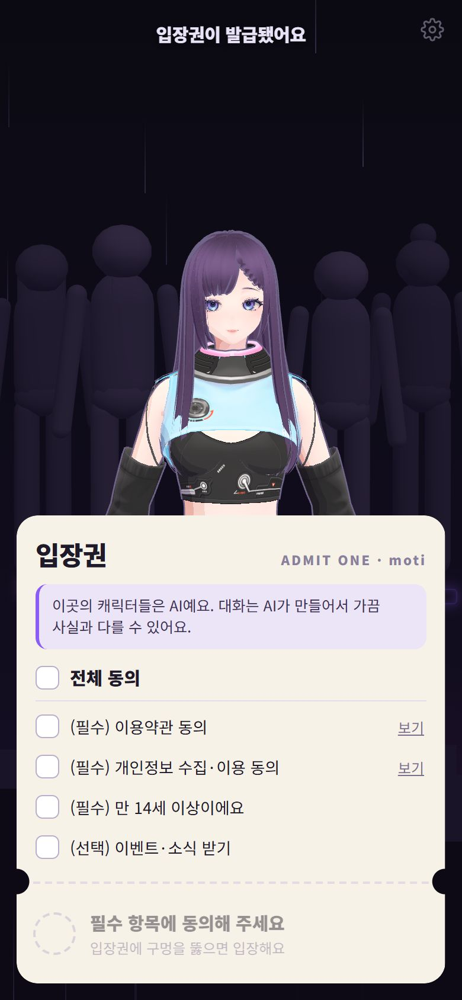 |  |  |  |

| 약관 시트 | 그다음 로그인 | 375×667 인사 | 1280 |
| --- | --- | --- | --- |
| 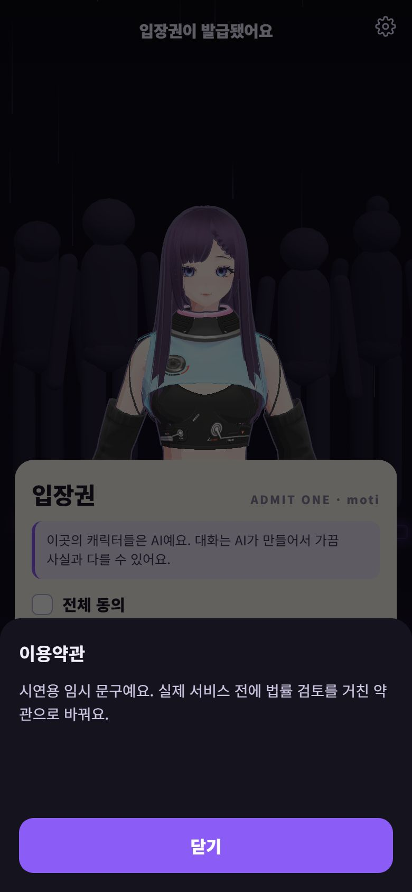 |  |  | 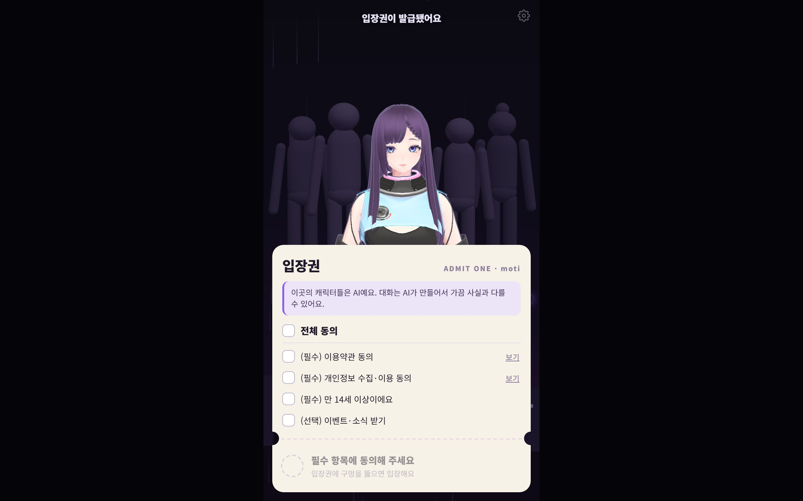 |

## 7-C 19세 이상 캐릭터 성인 인증 (시연용)

- 서도윤에 `ageRating: 19`, 다른 캐릭터는 없음. 배지 글자는 원고 「19+」(`data/onboarding.json adult.badge`), 색은 기존 배지 자리의 빨강.
- 홈 카드·대화 목록·헤더 알림에서 들어갈 때 확인. 인증 전이면 지금 화면 위에 시트. 「본인 인증하기 (시연용)」 → 1초 로딩 → 저장(`S.adult`) → 토스트 → 대화방. 「다음에 할게요」 → 닫힘.
- 지우기: 전체 초기화, 시연 패널 「바로 하기」의 「성인 인증 초기화」(지금 서도윤 방이면 대화 목록으로 나감).
- 확인: 인증 전 홈 그대로·시트 / 다음에 → 홈 / 인증 → 대화방(서도윤) / 다시 누르면 바로 / 인증 초기화 → 다시 시트 / 서아는 시트 없이.

| 19+ 배지 | 인증 시트 | 인증 중 | 완료 후 대화방 |
| --- | --- | --- | --- |
|  |  |  |  |

## 아이폰 사파리 확인 (별도 확인 항목)

헤드리스 Chrome(소프트웨어 렌더링)에서만 봤다.

- [ ] **빗줄기·나타나기 애니메이션:** 빗줄기가 끊기지 않고 천천히 떨어지는지, 로고·소개가 0.6초 동안 부드럽게 나타나는지, 네온 사각형 빛(그림자)이 무겁지 않은지
- [ ] **3D 서아 로딩 시간:** 실제 통신에서 「입장권 받기」 로딩 표시가 얼마나 보이는지(8MB). 15초가 넘으면 서아 없이 넘어감
- [ ] **마네킹과 안개:** 마네킹이 그림자처럼 어둡게, 멀리 있는 군중처럼 보이는지(너무 밝거나 너무 안 보이지 않는지). 서아 외곽선·명암이 안개 때문에 바뀌지 않았는지
- [ ] **펀치 구멍:** 양옆 반원 홈(마스크)이 뚫려 보이는지, 펀치 구멍이 0.2초에 생기는지, 동의 전 흔들림
- [ ] **서아와 마네킹 인사:** 서아 손 흔들기와 마네킹 4명이 바깥쪽부터 차례로 흔드는지, 「어서 와요」, 카드가 올라가며 사라지고 로그인으로 가는지. 이때 끊김(프레임)
- [ ] **약관 시트:** 아래에서 올라오고 닫히는지, 안전 영역(홈 바) 위로 닫기 버튼이 보이는지
- [ ] 인증 시트 로딩 표시, 로그인 토스트가 온보딩 위로 보이는지
- [ ] 온보딩을 마친 뒤 서아 대화방 3D가 정상(구도·안개 없음·테두리 빛 장소 색)인지

## 제가 정한 것

1. **3D는 새로 만들지 않고 대화방의 3D 그림판을 빌려 씀.** 서아 모델(8MB)·명암·머리카락 설정을 두 번 하지 않고, WebGL 도 하나만. 그래서 「미리 불러오기」 = 원래 앱을 열 때 시작하던 불러오기에 준비 끝 약속을 붙인 것.
2. **안개는 항상 달아 두고 평소엔 1000m 밖.** 켜고 끌 때마다 셰이더를 다시 만들면 대화방을 처음 열 때 멈칫해서. 화면엔 차이 없음.
3. **3D 칸이 안 보이면(홈·마이·첫 화면) 그리지 않음.** 원래는 안 보일 때도 매 프레임 그렸다. 모델이 준비되면 셰이더를 미리 만들어(`compile`) 처음 보일 때 멈칫하지 않게.
4. **시작 화면은 홈.** 지시 「다음부터는 바로 홈」대로. 예전엔 앱을 열면 대화 탭(마지막 대화방)이었다.
5. **예전 저장값(6단계까지 쓰던 사람)도 온보딩을 한 번 봄.** `onboarded` 가 없어서. 💎·대화 등은 그대로.
6. **온보딩 화면 오른쪽 위에 작은 톱니바퀴.** 온보딩이 헤더를 가려 시연 패널을 열 수 없어서(`D` 키는 `?debug=1` 에서만).
7. **온보딩 중 장면 바로가기(1~6)를 누르면 저장 없이 온보딩을 닫고 장면으로.** 발표 중 빠져나갈 길.
8. **Google·카카오 버튼에 로고는 넣지 않음.** 원고 문구만, 색만 흰색·노랑. 누르면 토스트를 1.1초 보여 준 뒤 게스트로.
9. **「보기」는 이용약관·개인정보에만.** 원고의 약관 화면이 그 둘뿐. 본문은 원고의 임시 문구 하나를 둘 다에.
10. **입장권 구도:** 서아 허리가 카드 윗변에 오게 3D 칸 높이를 카드 윗변 + 48px 로 맞추고, 카메라 최소 너비를 키 0.6배로(손 흔들 때 팔이 안 잘리게). 375×667 처럼 낮은 화면에서는 가슴 위만 보인다.
11. **마네킹 흔드는 팔은 바깥쪽 팔, 「바깥쪽부터」는 가운데에서 먼 순서**(왼쪽 바깥 → 오른쪽 바깥 → 왼쪽 안 → 오른쪽 안, 0.1초 간격). 팔은 어깨에서 통째로 돌림(팔꿈치 없음).
12. **동의 값 저장은 펀치할 때**(`S.consent`), 로그인 방식은 `S.loginAs`(지금은 늘 guest). 전체 초기화로 지워짐.
13. **19+ 배지 글자는 데이터에서**(`adult.badge`), 캐릭터 데이터의 `badge` 는 비움. 「신규」·「3D」 정렬은 그대로.
14. **인증 확인은 들어가는 길 세 곳(홈·대화 목록·알림) + 대화방 열기 자체에도**(인증 초기화 뒤 남은 대화방 대비).
15. 장면 0 은 시연 패널 장면 목록 맨 앞 「0 앱 처음 열기」 버튼. 「지금 장면」 표시는 없음으로.
16. `data/demo.json` 단축키 안내에 「0 앱 처음 열기」를 더함(원고에 없는 패널 안내 문구).

## 7-1 전체 초기화 한 번 클릭, 「추억 앨범」 → 「앨범」

커밋: `b29434a`

### 바뀐 파일

| 파일 | 내용 |
| --- | --- |
| `index.html` | 시연 패널 「전체 초기화」 확인 단계 삭제(`confirmAll`·`confirmT`·4초 타이머·`warn` 표시와 그 CSS). 한 번 누르면 바로 `reset("all")` + 초기화 토스트 + 온보딩 첫 화면. `<title>` 「moti」. 하단 탭·선물 시트 안내·선물 토스트·서아 방 첫 안내 문구를 `data/ui.json` 에서 읽음. 코드 주석 「앨범」 |
| `data/ui.json` | `nav.album` 「앨범」, `gift.note`·`gift.special`·`gift.albumSaved`, `chat.seoaFirst` 추가. `_album` 설명 「앨범 탭」 |
| `data/demo.json` | 안 쓰는 `resetAllConfirm` 삭제(다른 곳에서 안 씀) |
| `data/demo_scenes.json` | 장면 6 이름 「앨범」 |
| `data/seoa_story.json` | 설명 주석 `_soonText`·`_hints` 「앨범」 |

`git grep "추억 앨범"`: docs/ 밖에는 0건. `onboarding.js`·`onboarding.css` 에는 원래 없었다.

### 확인 (헤드리스 Chrome 390×844)

- 패널 「전체 초기화」 한 번 → 바로 초기화(💎 1234 → 500), 패널 닫힘, 온보딩 첫 화면. 온보딩 화면의 톱니바퀴는 같은 패널을 열어서 따로 고칠 곳 없음.
- 전체 초기화 → 온보딩(입장권 펀치 → 게스트) → 홈 → 서아 방: 오프닝 **10문단**, 몸짓 **m07 → m01 → m11** 3번, 끝난 뒤 입력 가능.
- 하단 탭 「📔 앨범」, 탭 제목 「moti」, 선물 시트 「…처음 본 반응은 앨범에 남아요.」

| 전체 초기화 한 번 누른 직후 | 하단 탭 「앨범」 | 서아 방 첫 안내 | 선물 시트 |
| --- | --- | --- | --- |
| 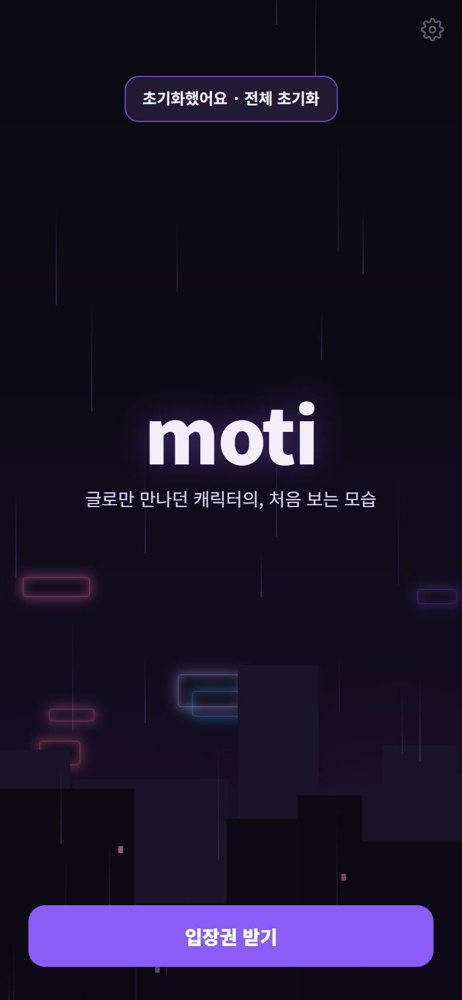 | 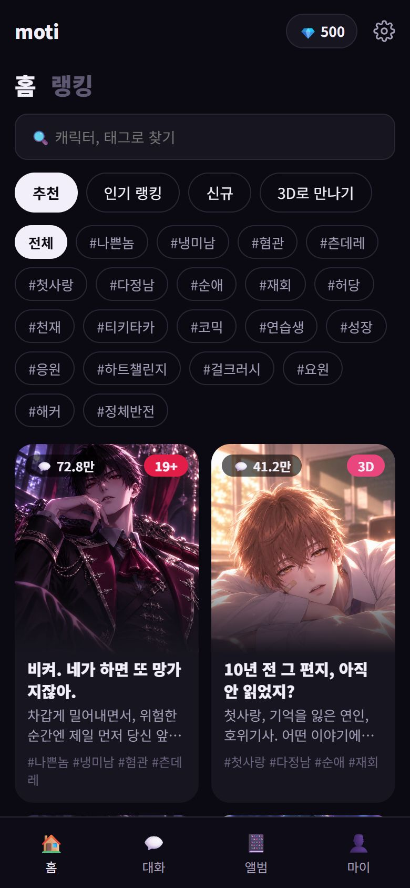 | 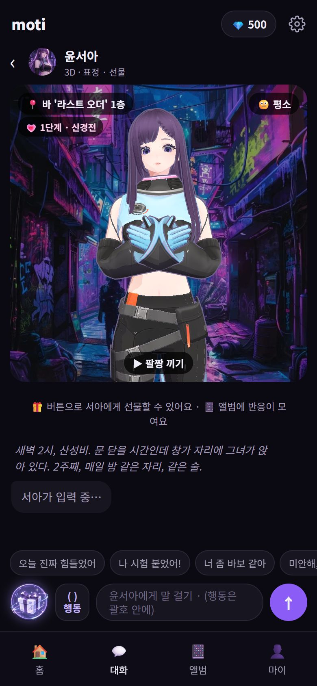 | 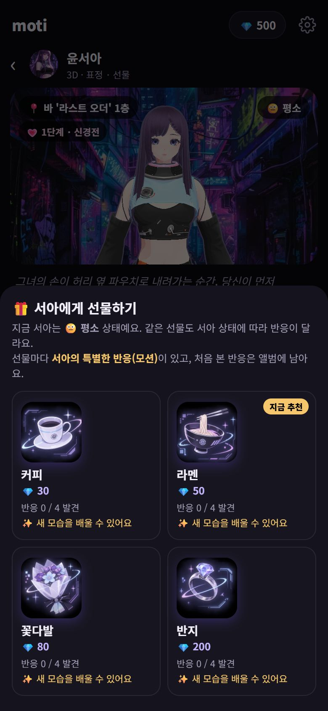 |

### 제가 정한 것

1. **`<title>` 은 HTML 에 「moti」 그대로.** 데이터를 읽기 전에 브라우저 탭에 보이는 글자라 `ui.json` 으로 옮기지 않았다.
2. **하단 탭은 HTML 에도 「앨범」을 적고, 데이터를 읽은 뒤 `ui.json nav.album` 으로 덮어씀.** 데이터가 늦게 와도 빈칸이 안 보이게. 홈·대화·마이 탭 이름은 이번 범위가 아니라 그대로 HTML 에 둠.
3. **선물 시트 안내는 「앨범」이 든 둘째 줄만 옮김**(`gift.note`, 금색 굵은 글씨 부분은 `gift.special`). 첫째 줄(서아 상태)은 그대로 코드에.
4. **이미 저장된 서아 방 첫 안내**(예전 「📔 추억 앨범에…」 메시지)는 고치지 않았다. 대화가 저장된 채라면 예전 문구가 남고, 전체 초기화·서아 초기화·대화 초기화 뒤부터 새 문구.
5. 패널의 `.warn` CSS 는 전체 초기화 확인 표시에만 쓰여서 같이 지웠다.

## 7-2 입장권 배경: 마네킹 대신 서아 몸짓 필름 띠

커밋: `9a60d08` 마네킹 제거 / `e0ed777` 서아 몸짓 필름 사진 / `7f63d7c` 휘어진 필름 띠와 펀치 연출

### 바뀐 파일

| 파일 | 내용 |
| --- | --- |
| `onboarding.js` | 마네킹(`Crowd` 전체, 손 흔들기 순서) 삭제. 첫 화면에서 `Film.prepare()`(사진 미리 불러오기·셰이더 준비), 입장권에 들어갈 때 `Film.show()`·매 프레임 `Film.tick`, 펀치 인사 때 `Film.punch()`, 떠날 때 `Film.hide()`. 서아 m13·「어서 와요」는 그대로 |
| `film.js` (새 파일) | `Film`: 3D 필름 띠 두 줄. `FilmShot`: 개발용 필름 사진 만들기(`?filmshot=1`) |
| `tools/filmshot.mjs` (새 파일) | 헤드리스 Chrome 으로 `?filmshot=1&skipintro=1` 을 열어 webp 를 저장(의존성 없음) |
| `assets/onboarding/film_seoa.webp` (새 파일) | 필름 사진 2048×368, **38.9KB** |
| `data/onboarding.json` | `crowd`·`_crowd`, `greet.crowdDelayMs` 삭제. `film`·`_film` 추가(캐릭터·사진 파일·찍을 몸짓·구도·칸 크기·띠 곡선·폭·속도·밝기·색조·펀치 배율과 시간) |
| `index.html` | `film.js` 불러오기, `?filmshot=1` 이면 `FilmShot.start()`, 안개 주석 「마네킹용」 → 「입장권 3D 배경용」. 대화방 3D 무대 동작은 그대로 |
| `docs/CREDITS.md` | `film_seoa.webp` 출처(앱에서 렌더링, 서아 모델 출처를 따름) |
| `docs/status.md` | 7-2 한 줄 |

### 필름 사진

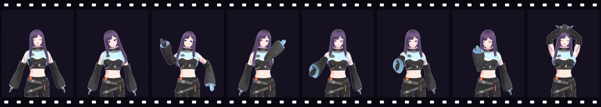

순서: m01 웃음(31%, 기쁨) · m25 고개 갸웃하며 듣기(50%) · m20 도발하기(59%, 장난) · c02 머리 쓸어 넘기기(62%) · m11 손 내밀기(50%) · m09 툭 건네주기(44%, 장난) · c01 칼라 만지작거리기(50%, 수줍음) · m22 하트 챌린지(50%, 기쁨). 괄호 안 % 는 몸짓 재생 시간 중 찍는 지점, 뒤는 표정.

- 칸 244×300(픽셀 비율 2로 그려서 줄임), 칸 사이 12px, 위아래 34px 에 필름 구멍(투명) 칸마다 6개. 칸 배경 `#15101f`, 필름 바탕 `#0b0911`. 명암·외곽선(look.js)·머리카락·시선(alive.js) 적용 상태.
- **다시 만들기:** 로컬 서버를 켜고(`python -m http.server 8765`) `node tools/filmshot.mjs` → `film.image` 위치에 저장(약 70초). 또는 브라우저로 `?filmshot=1&skipintro=1` 을 열면 화면에 결과와 「내려받기」.
- **같은 결과:** 찍는 동안 시계(`performance.now`·`requestAnimationFrame`)를 가짜 시계로 1/60초씩 넘기고 난수 씨앗을 고정해서, 두 번 돌린 결과 파일이 **바이트까지 같음**(md5 `063180a5…`)을 확인했다.

### 3D 필름 띠

- **큰 띠:** 점 6개를 지나는 곡선(`CatmullRomCurve3`, centripetal). 왼쪽 아래 가까이(서아 뒤 0.6m)에서 오른쪽 위 멀리(4.8m)로 휘어 올라감. 폭 0.5m, 오른쪽 → 왼쪽 0.07m/초.
- **얇은 띠:** 큰 띠 아래 살짝 기운 직선(1.3~1.7m 뒤). 폭 0.2m, 더 어둡게(밝기 0.3 vs 0.5), 왼쪽 → 오른쪽 0.1m/초.
- **사진 붙이기:** 띠를 길이 방향으로 같은 간격(호 길이)으로 나눠 사진 비율 그대로 반복(사진 높이 = 띠 폭) → 휘어진 곳에서도 늘어나거나 눌리지 않게. 텍스처 하나를 두 띠가 복제해 쓰고(오프셋만 따로), 띠 면은 늘 카메라 쪽을 향함.
- **재질:** 빛 영향 없는 재질(MeshBasicMaterial) × 보라 색조 `#9b80d6` × 밝기, 반투명(0.8·0.75), 깊이 쓰기 끔, 안개 적용. 서아 뒤라 서아가 띠를 가린다. 먼 쪽은 안개(1.8~6.2m)로 배경색에 묻힘.
- **펀치:** 서아 손 흔들기·「어서 와요」와 같은 때, 0.1초 만에 밝기 2.2배·속도 5배까지 올랐다가 나머지 1.1초에 걸쳐 원래대로.
- **떠날 때:** 로그인으로 넘어가며 3D를 돌려줄 때 띠 묶음을 장면에서 뺌. 대화방 3D 무대에 남지 않음(확인).

### 확인 (헤드리스 Chrome, 소프트웨어 렌더링)

| 동의 전 입장권 | 펀치 직후(0.11초) | 로그인으로 넘어간 뒤 | 대화방 3D 무대 | 375×667 |
| --- | --- | --- | --- | --- |
| 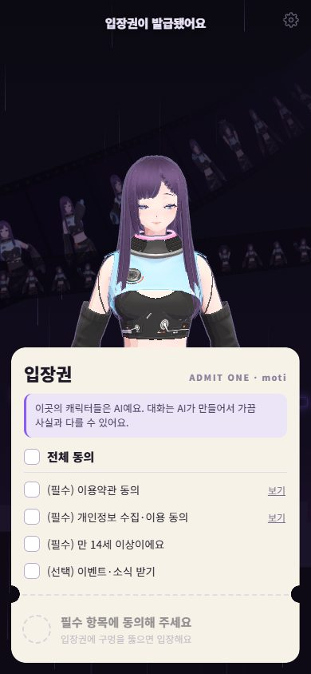 | 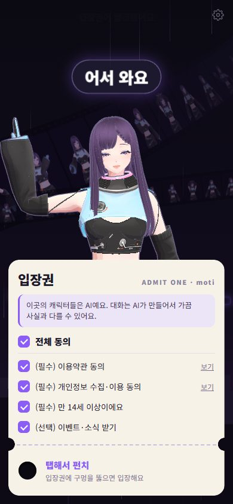 | 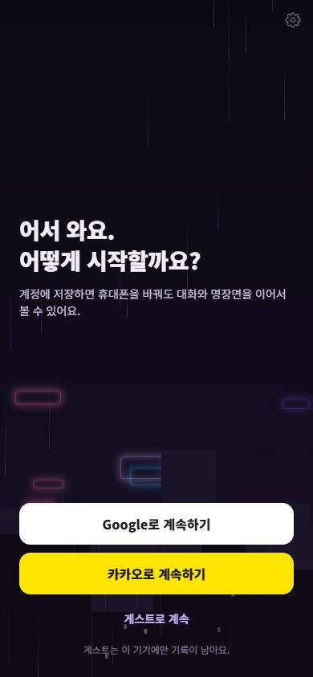 |  | 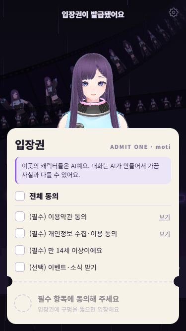 |

| 측정 | 값 |
| --- | --- |
| 입장권 화면 그리기 횟수 | **35회** (서아 33 + 띠 2). 마네킹 있던 때 41회 → 6회 줄어듦. 삼각형 91,128 (마네킹 때 99,340) |
| 대화방 3D 무대 | 33회, 장면에 띠 없음 |
| 펀치 직후 띠 색 | 기본 `#4d406b` → 펀치 0.11초 뒤 `#7c66ab`(약 1.6배, 꼭대기 2.2배를 지나 내려오는 중) |
| 375×667 | 띠가 서아 얼굴·상반신을 가리지 않음(서아 뒤에 있어 늘 서아에게 가려짐) |
| 필름 사진 파일 | 38.9KB (목표 300KB 이하) |

### 아이폰 사파리 확인 (별도 확인 항목)

- [ ] **띠 흐름:** 두 띠가 끊기거나 튀지 않고 천천히 흐르는지(큰 띠 오른쪽 → 왼쪽, 얇은 띠 반대), 사진 반복 이음매가 보이지 않는지
- [ ] **휘어진 곳의 사진:** 큰 띠가 휘는 곳에서 사진이 찌그러지거나 늘어나 보이지 않는지, 비스듬한 먼 쪽이 너무 뭉개지지 않는지
- [ ] **펀치 때 밝아짐:** 손 흔들기·「어서 와요」와 같이 띠가 잠깐 밝아지고 빨라졌다가 1.2초 안에 돌아오는지
- [ ] **처음 뜨는 시간:** 「입장권 받기」를 누른 뒤 띠가 늦게 나타나지 않는지(사진 39KB, 첫 화면에서 미리 불러옴), 처음 보일 때 멈칫하지 않는지
- [ ] 띠가 너무 밝아 서아보다 눈에 띄지 않는지(배경으로 읽히는지), 필름 구멍이 비쳐 보이는지
- [ ] 온보딩을 마친 뒤 서아 대화방 3D 에 띠가 남지 않는지

### 제가 정한 것

1. **사진 만들기는 앱 안 개발용 주소(`?filmshot=1`) + 그 주소를 열어 파일로 저장하는 `tools/filmshot.mjs` 둘 다.** 실제 앱의 3D 서아·명암·몸짓을 그대로 써야 해서 찍기는 앱 안에서, 파일 저장은 스크립트로. 스크립트는 npm 설치 없이 Node + Chrome 만으로 돈다.
2. **같은 결과를 내려고 찍는 동안만 시계와 난수를 바꿈**(`?filmshot=1` 일 때만). 눈 깜빡임·머리카락·시선 흔들림이 시간과 난수에 따라 달라져서. 찍기 시작할 때 시계를 10분 지점으로 넘기고 3초 동안 자리 잡게 한 뒤 찍는다(불러오는 시간이 달라도 같은 출발점).
3. **찍는 순간(%)과 표정**은 각 몸짓 코드에서 동작이 가장 큰 때를 계산해 정함(예: m20 은 팔 흔들림 꼭대기 59%, c02 는 손이 머리 뒤로 넘어가는 62%). 표정은 몸짓 감정에 맞춰 기쁨·장난·수줍음·평온 중에서.
4. **칸 크기 244×300.** 8칸 + 간격이 정확히 2048px 이 되게(텍스처 반복에 유리). 구도는 키 비율 위 1.17 ~ 아래 0.42(머리 위 하트 챌린지 손까지 들어오고 허벅지 중간까지).
5. **필름 구멍은 투명.** 띠가 반투명이라 구멍 사이로 뒤 배경이 비쳐 필름처럼 보이게.
6. **띠 위치는 화면 기준으로 계산해 정함:** 큰 띠가 서아 왼쪽 가슴 높이에서 시작해 머리 뒤를 지나 오른쪽 위로 사라지고, 얇은 띠는 카드 윗변 조금 위를 지나게.
7. **펀치 연출 곡선:** 1.2초 중 처음 8%(약 0.1초)에 꼭대기까지 오르고 나머지는 부드럽게(제곱) 내려옴. 오르는 비율도 `punch.rise` 로 데이터에.
8. **띠 묶음 이름 `obFilmGroup`**, 사진이 다 불러와지기 전에는 장면에 넣지 않음(빈 텍스처가 검게 보이지 않게).
9. 띠 재질은 셰이더를 고치지 않고 기본 재질(MeshBasicMaterial)의 색에 밝기를 곱해 펀치 밝기를 바꿈.
10. `film.character` 는 지금은 설명용 표시(`seoa`)이고, 다른 캐릭터로 바꿀 때는 `image`·`shots` 를 바꾸면 된다. 찍기는 지금 앱에 불러온 3D 캐릭터(서아)로만 된다.

## 7-3 입장권 다듬기: 필름 띠 크기, 얇은 띠는 빈 필름, 넘어갈 때 서아 몸 잘림 없애기

### 바뀐 파일

| 파일 | 내용 |
| --- | --- |
| `onboarding.js` | 입장권 3D 칸을 화면 아래 끝까지. 매 프레임 카메라 시야를 맞추는 `camTick`(예전 구도 그대로 + 아래로만 시야를 늘림). 카드가 사라질 때 발끝까지 들어오게 카메라가 물러남 → 잠깐 머묾 → 3D가 어두워지며 사라짐 → 로그인. 떠날 때 카메라 시야를 그림판 기본으로 되돌림 |
| `onboarding.css` | `.obstage` 화면 전체(`inset:0`, 예전 높이 60%·인라인 높이 없앰), `.obstage.fade` 서서히 사라짐 |
| `film.js` | 얇은 띠용 빈 필름을 코드로 그림(`blankTex`: 어두운 칸 + 위아래 구멍, 사진 필름과 같은 `cell` 값). 사진은 큰 띠에만 |
| `data/onboarding.json` | `film.big.points` 먼 쪽을 가깝게, `big.brightness` 0.5 → 0.62·`opacity` 0.8 → 0.82, `film.thin.blank`·`blankColor` 추가·`thin.brightness` 0.3 → 0.45. `scene3d.leave`(bottom·holdMs·fadeMs) 추가. `_film`·`_scene3d`·`_greet` 설명 갱신 |

### 바뀐 것

- **큰 띠 크기:** 곡선 점을 카메라 쪽으로 당김(화면에서 지나가는 길은 그대로, 깊이만 줄임: 가까운 점 1배 → 먼 점 0.77배). 먼 쪽 끝이 4.8m → 3.1m 뒤.
  390px 화면에서 띠 높이(= 사진 칸 높이) 실측: **오른쪽 끝(x 370) 90px → 115px (1.28배)**, 가운데 오른쪽(x 300) 102 → 124px, 왼쪽 가까운 쪽(x 20) 144 → 149px(거의 그대로).
- **큰 띠 밝기:** 펀치 전 밝기 0.5 → 0.62(약 1.24배), 불투명도 0.82.
- **얇은 띠:** 서아 사진 대신 빈 필름(칸 `#2a2140` + 위아래 투명 구멍). 칸이 사진보다 어두워서 밝기 배율을 0.45 로 올렸지만 화면에선 큰 띠보다 어둡다.
- **3D 칸 전체 높이:** 예전엔 카드 윗변 + 48px 까지만 그려서, 카드가 사라질 때 서아가 가슴 높이에서 일자로 잘려 보였다. 이제 화면 끝까지 그린다. 카메라 자리는 예전과 같고(390×844 에서 카메라 위치 `0, 1.434, 2.115` 그대로) 시야만 아래로 늘려서, 머리·상반신의 크기·위치·안개 정도가 예전과 같다.
- **넘어가는 순서:** 펀치 → 1.7초 카드가 올라가며 사라짐(0.45초, 그동안 발끝이 안 들어오는 화면이면 카메라가 뒤로 물러남) → 0.3초 서아 전신 → 0.5초 동안 3D가 어두워지며 사라짐 → 로그인. 로그인까지 2.15초 → **약 2.95초**.

### 확인 (헤드리스 Chrome, 소프트웨어 렌더링)

390×844

| 동의 전 | 펀치 직후(0.12초) | 카드가 올라가는 중(1.94초) | 카드가 사라진 뒤(2.36초) | 3D가 어두워지는 중(2.71초) | 로그인 |
| --- | --- | --- | --- | --- | --- |
| 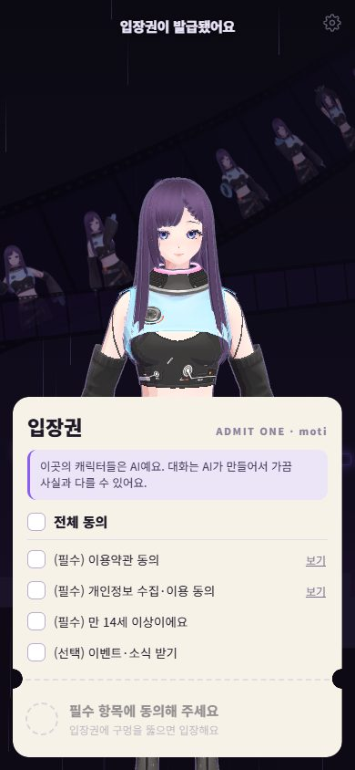 | 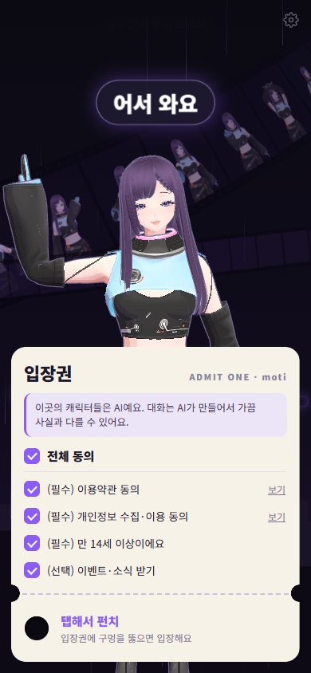 | 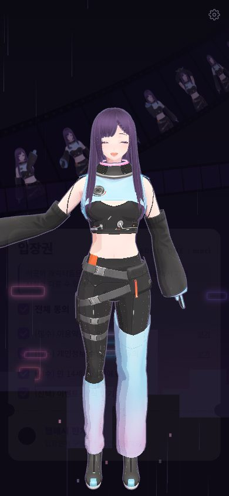 | 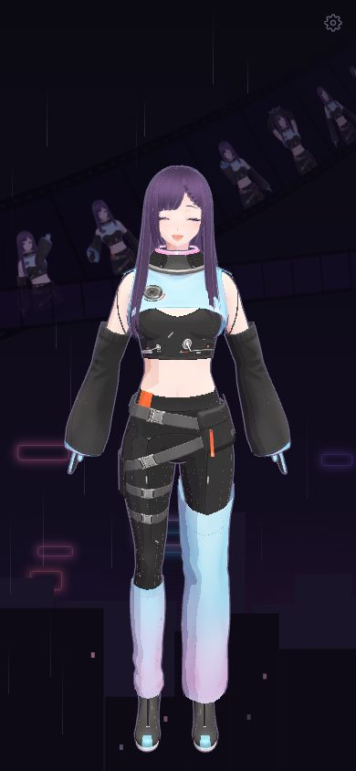 | 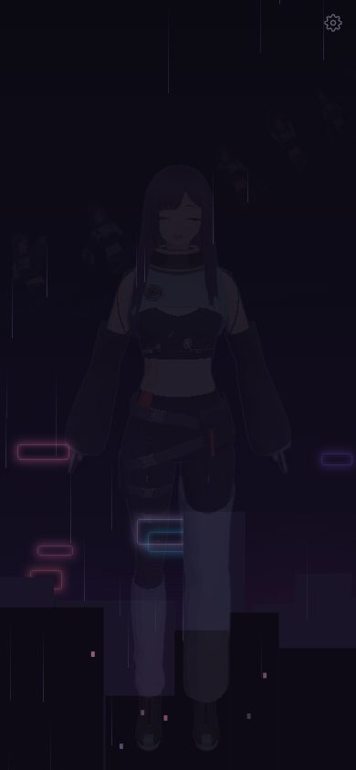 | 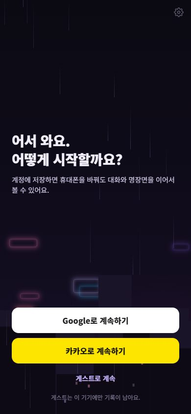 |

375×667 · 대화방(참고)

| 375×667 동의 전 | 375×667 카드가 올라가는 중 | 375×667 카드가 사라진 뒤 | 온보딩 뒤 서아 대화방 |
| --- | --- | --- | --- |
| 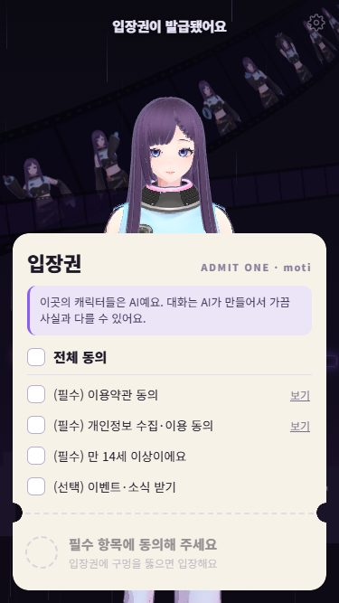 | 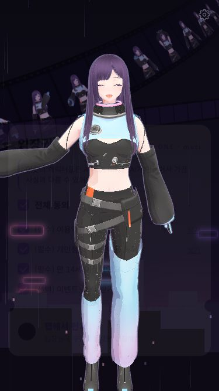 | 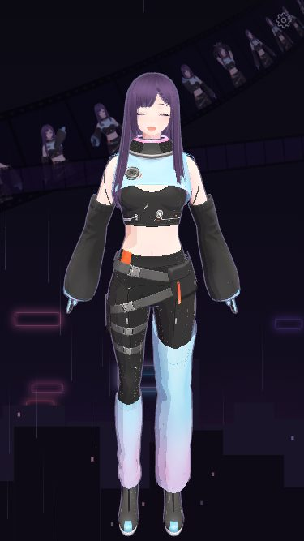 | 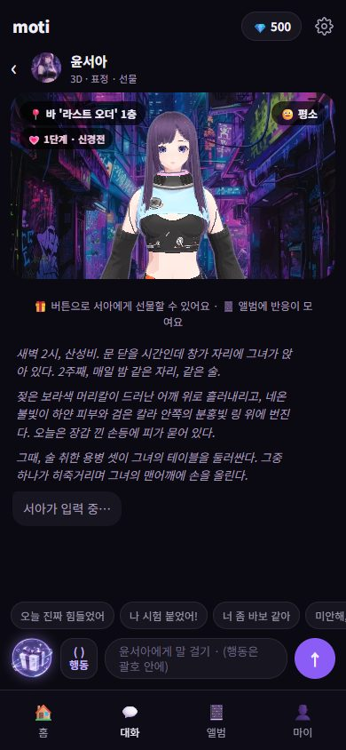 |

| 측정 | 값 |
| --- | --- |
| 입장권 화면 그리기 횟수 | **35회**(7-2 와 같음: 서아 33 + 띠 2). 삼각형 91,128. 3D 칸이 커져 칠하는 픽셀은 늘었다(390×483 → 390×844) |
| 서아 가림 | 띠는 서아 뒤라 얼굴·상반신을 가리지 않음(390·375×667 모두) |
| 대화방 3D 무대 | 33회, 띠 없음, 카메라 시야각 30°·시야 늘리기 꺼짐(예전과 같음) |

### 아이폰 사파리 확인 (추가 항목)

- [ ] 카드가 올라갈 때 서아가 잘린 모습 없이 전신으로 이어지는지, 3D가 0.5초 동안 부드럽게 어두워지며 로그인으로 가는지(뚝 끊기지 않는지)
- [ ] 3D 칸이 화면 전체가 되어 프레임이 떨어지지 않는지(칠하는 픽셀 약 1.7배)
- [ ] 큰 띠 먼 쪽 사진이 알아볼 만한 크기인지, 얇은 띠가 빈 필름(어두운 칸 + 구멍)으로 보이는지
- [ ] 안전 영역(노치·홈 바)이 있는 화면에서 서아 머리 위치가 예전과 같은지

### 제가 정한 것

1. **카메라를 뒤로 빼지 않고 시야만 아래로 늘림.** 원근 카메라는 칸이 길어져도 세로 시야각이 같아서, 그냥 칸만 늘리면 서아가 같은 크기로 보이려면 카메라가 2.1m → 3.7m 로 멀어져야 하고 그만큼 안개가 짙어져 서아가 뿌옇게 됐다(처음 시도에서 확인). 그래서 「예전 화면을 위쪽에 둔 더 큰 가상 화면」의 아래 부분까지 그리게(`setViewOffset`) 했다. 대화방 그림판 코드(`index.html`)는 바꾸지 않고, 입장권에 있는 동안만 매 프레임 카메라를 맞추고 떠날 때 되돌린다.
2. **`scene3d.frame` 의 뜻은 그대로**(예전 3D 칸 = 카드 윗변 + 48px 일 때의 구도). 그래서 값은 안 바꾸고 설명만 고쳤다.
3. **카드가 사라질 때 발끝까지:** 390×844 는 원래 발목 근처까지 보여서 거의 그대로, 375×667 은 무릎 아래가 잘려서 카메라가 카드 사라지는 0.45초 동안 뒤로 물러난다(머리 위치는 그대로). 기준은 키 비율 −0.1(`leave.bottom`) — −0.04 로는 앞으로 나온 신발 끝이 화면 끝에 걸려서 낮췄다.
4. **전신을 보여 주는 시간 0.3초, 어두워지는 시간 0.5초.** 그만큼 로그인이 약 0.8초 늦어진다(2.15 → 약 2.95초). 서아 손 흔들기(2.2초)가 끝난 뒤 전신이 잠깐 보이고 넘어간다.
5. **어두워짐은 3D 칸의 투명도로**(배경 도시가 어두워서 어두워지는 것처럼 보임). 필터·흐림은 안 씀.
6. **빈 필름은 코드로 그림**(파일 없음). 사진 필름과 같은 칸·구멍 값이라 두 띠가 같은 필름처럼 보이게. `thin.blank: false` 로 하면 다시 사진.
7. **큰 띠 먼 쪽은 1.28배**(목표 약 1.3배). 곡선이 화면에서 지나가는 길은 그대로 두려고 점을 카메라 쪽으로 비율만큼 당겼다. 띠가 가까워져 안개가 덜 끼므로 먼 쪽도 조금 밝아졌다.
8. 얇은 띠 칸 색 `#2a2140`·밝기 0.45: 빈 칸이 너무 안 보이지 않게 정한 값.
