# 70 · 마이 탭 「내 정보」 · 다이아로 이름 바꾸기 · 로그인 환영 인사 · 엔딩 기록 칸 빼기

브랜치 `step/70-my-profile`. 서버는 고치지 않음(`user_name` 은 [69]부터 `S.profile.name` 을 늘 보냄).

## 바뀐 파일

| 파일 | 한 일 |
|---|---|
| `index.html` | 마이 탭 맨 위 「내 정보」 칸(`meHTML`). 이름 바꾸기 시트(`NameSheet`, `#nameSheet`): 입력·안내·버튼(무료/다이아)·다이아 부족 줄·충전하기. 이름 규칙은 입장권 뒷면 함수(`Onboard.cleanLive`·`Onboard.cleanName`)를 그대로 씀. 바꾸면 다이아 차감·`S.profile.name`·`S.profile.nameChanges` 저장, 알림, 칸·위 다이아 바로 갱신. 엔딩 기록 칸은 `my.showEndings` 가 켜져 있을 때만. 시연 패널의 「부르는 이름」 줄·처리·CSS 뺌 |
| `onboarding.js` | 로그인 제목 두 줄(`loginTitle`): 이름이 있으면 `login.welcome` 한 줄 + `login.title`. 첫 줄이 넘치면 글자만 1px 씩 줄임(`fitWelcome`, 최소 `timing.welcomeMinPx`). 폰트가 늦게 와도 다시 맞춤. `cleanLive`·`maxName`·`loginTitle` 내보냄 |
| `onboarding.css` | `.obwel`(한 줄, 줄바꿈 없음) |
| `data/ui.json` | `my.me`(문구들), `my.nameChangeDia: 30`, `my.firstChangeFree: true`, `my.showEndings: false` |
| `data/onboarding.json` | `login.welcome` 「{name}님 환영합니다!」, `timing.welcomeMinPx: 16` |
| `data/demo.json` | 쓰지 않게 된 `userName`·`noName` 뺌 |
| `docs/status.md` | 70 절 |

## 캡처 (390px)

마이 탭 「내 정보」(엔딩 기록 칸 없음) · 지금 이름과 같으면 흐림 · 빈칸이면 흐림

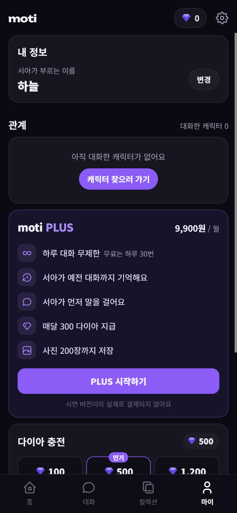 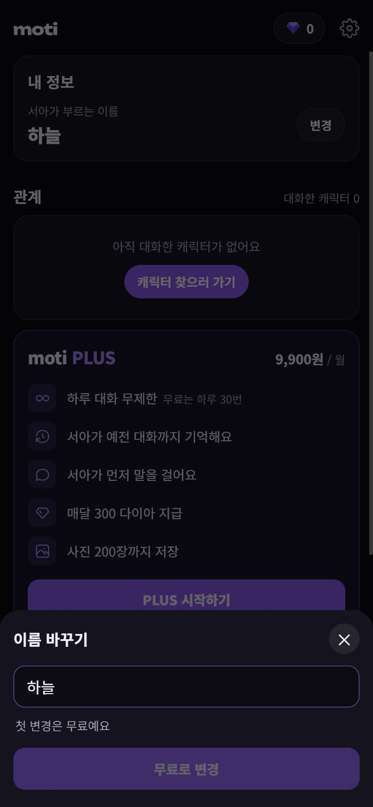 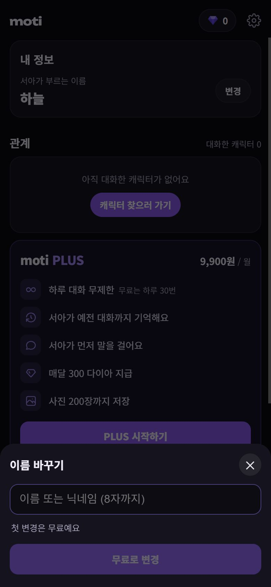

첫 변경 「무료로 변경」(`{바"다」` 를 넣으면 `바다`) → 이름 바뀜, 다이아 500 그대로 · 두 번째 「30 다이아로 변경」 → 500 → 470

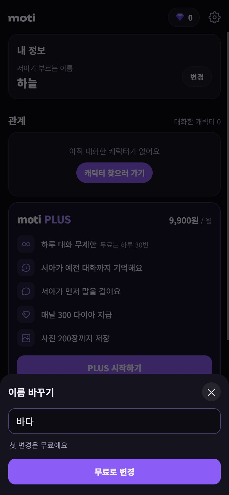 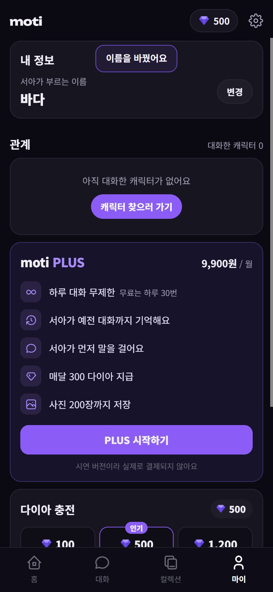 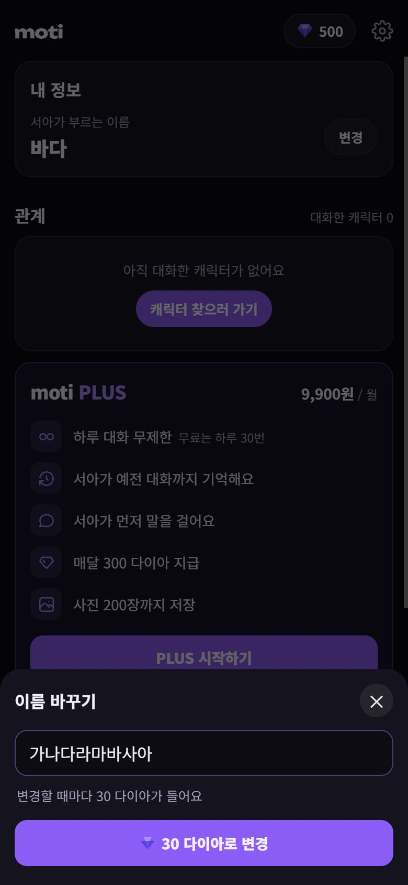 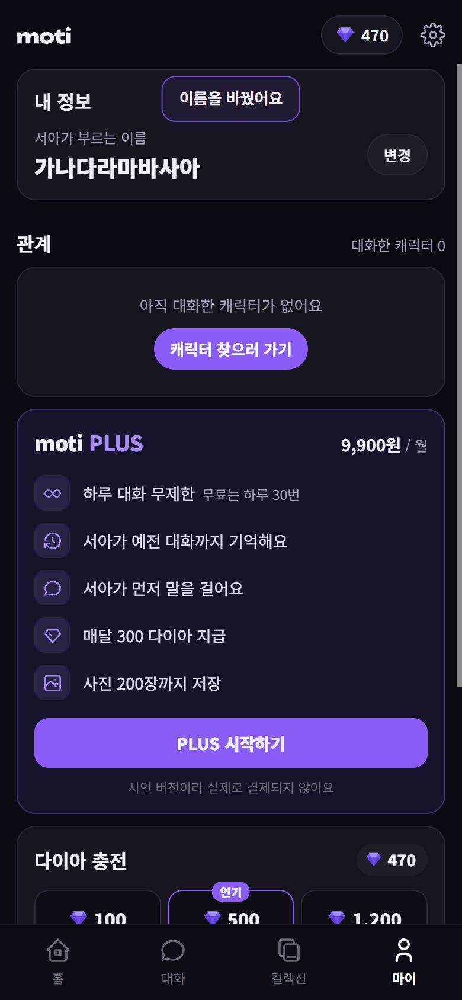

다이아 10 → 「다이아가 부족해요」 + 「충전하기」 → 시트 닫히고 다이아 충전 칸으로

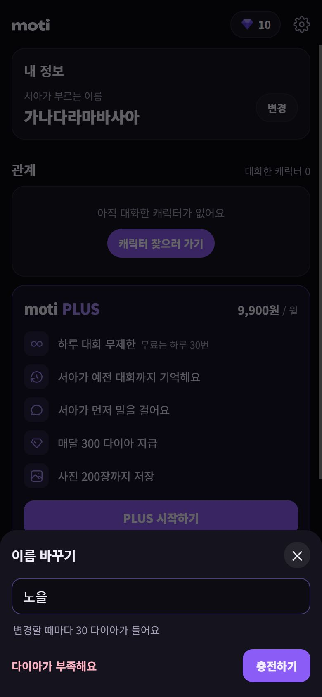 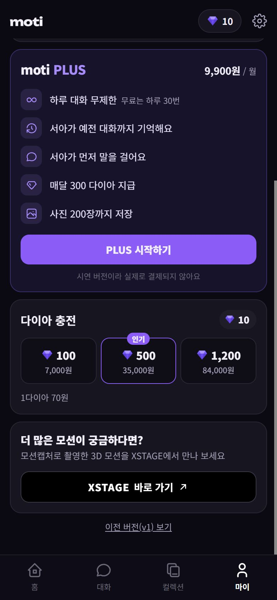

바꾼 뒤 대화(요청 본문 `state.user_name` = `가나다라마바사아`) · 설정 패널에 「부르는 이름」 없음

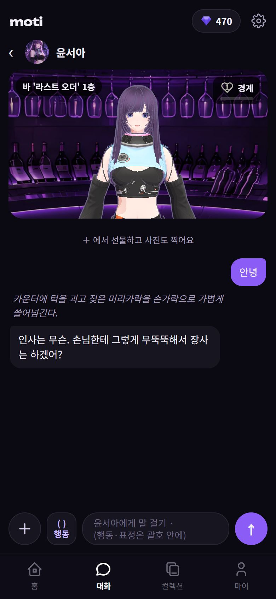 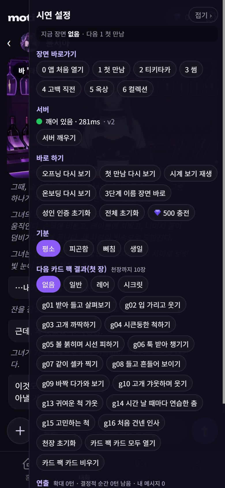

로그인 화면: 2자 이름(28px 그대로) · 8자 이름(한 줄에 들어가게 25px 로 줄임, 이름은 자르지 않음)

 

## 확인한 것

| 확인 | 결과 |
|---|---|
| 마이 탭 첫 칸 = 「내 정보」, 엔딩 기록 칸 없음 | 됨 |
| 같은 이름·빈칸(공백만 포함) → 버튼 흐림, 눌리지 않음 | 됨 |
| 첫 변경: 「첫 변경은 무료예요」 「무료로 변경」 → 이름 `바다`, 다이아 500, 횟수 1, 알림 「이름을 바꿨어요」 | 됨 |
| 두 번째: 「변경할 때마다 30 다이아가 들어요」 「30 다이아로 변경」 → 470(위 다이아도 470), 횟수 2 | 됨 |
| 10자를 넣으면 8자까지(`가나다라마바사아`) | 됨 |
| 다이아 부족 → 버튼 대신 「다이아가 부족해요」 + 「충전하기」 → 마이 탭 다이아 충전 칸으로 스크롤·반짝 | 됨 |
| 바꾼 뒤 `/chat` 요청 `state.user_name` | 새 이름 |
| 설정 패널 「부르는 이름」 | 없음 |
| 로그인 제목(새 흐름으로 입장권 → 이름 → 로그인) | 2자 `하늘님 환영합니다!` 28px / 8자 `가나다라마바사아님 환영합니다!` 25px, 둘 다 한 줄 |
| 엔딩 기록 저장(`S.endings`·`Ending` 함수·`data/endings.json`) | 그대로(지우지 않음), 시연 「엔딩 기록 비우기」 그대로 |
| 콘솔 오류 | 없음 |
| `data/*.json` 모두 JSON.parse | 됨 |

## 제가 정한 것

1. **「내 정보」 제목 자리**: 다이아 충전 칸처럼 카드 안 첫 줄에 굵게 「내 정보」(관계 칸처럼 카드 밖 제목이 아님). 이름은 19px 굵게, 길면 줄바꿈.
2. **바꾼 횟수 저장**: `S.profile.nameChanges`. 입장권 뒷면(처음 정하기·예전 유저·온보딩 다시 보기)으로 정한 것은 횟수에 넣지 않음 — 「변경」은 「내 정보」에서 바꾼 것만 셈. 그래서 첫 「내 정보」 변경은 늘 무료.
3. **`firstChangeFree: false` 이면** 첫 변경부터 `nameChangeDia`. `nameChangeDia` 가 0 이면 늘 무료 문구.
4. **이름이 없을 때 칸**: `my.me.noName`(「-」). 이름이 없는 유저는 앱을 열 때 입장권 뒷면이 먼저 뜨므로 실제로는 거의 안 보임.
5. **입력칸**: 입장권 뒷면과 같은 함수로 칠 때 바로 다듬고(앞 공백·금지 글자·8자), 한글 조합 중에는 자르지 않고 조합이 끝나면 자름. 버튼 상태는 앞뒤 공백을 자른 값으로 판단(공백만 → 흐림). 키보드 「완료」 = 변경(form 제출).
6. **다이아 부족 판단 시점**: 시트를 열 때의 다이아로 정함. 「충전하기」는 시트를 닫고 기존 `Pack.toCharge()`(마이 탭 다이아 충전 칸으로 스크롤·반짝). 충전 칸은 시트가 아니라 마이 탭의 카드라서 「충전 창 열기」를 이것으로 봄.
7. **닫기 버튼 글자**: ×(접근성 이름 「닫기」, `my.me.close`). 바깥(어두운 막)을 눌러도 닫힘.
8. **키보드**: 시트가 열려 있을 때 `visualViewport` 로 키보드 높이만큼 시트를 올림(입장권 뒷면과 같은 방식).
9. **로그인 첫 줄 크기 맞추기**: 넘치면 1px 씩 줄여 한 줄에 맞춤(최소 16px, `timing.welcomeMinPx`). 그래도 넘치면(지금 규칙상 생기지 않음) 그대로 둠. 둘째 줄 「어디에 기록할까요?」는 28px 그대로.
10. **「부르는 이름」 줄과 함께 뺀 것**: 패널 처리(`userName`), CSS(`.dpname`), `data/demo.json` 의 `userName`·`noName`. 시연 「3단계 이름 장면 바로」(이름이 없으면 뒷면부터)는 그대로.
11. **엔딩 기록 칸**: `my.showEndings` 가 true 면 예전 자리(관계 칸 아래)에 다시 나옴.

## 아이폰에서 나중에 볼 것

- 이름 시트에서 입력칸을 눌러 키보드가 올라올 때 시트(입력칸·버튼)가 가리지 않는지, 키보드가 내려가면 제자리로 오는지. 입력칸 글자 16px(눌러도 확대되지 않는지)
- 한글 입력 중 8자 자르기·커서, 키보드 「완료」 = 변경
- 로그인 화면 두 줄 제목: 8자 이름 첫 줄이 한 줄에 들어가는지(폰트가 늦게 올 때도), 두 줄 사이 간격
- 시각 효과 변경: 없음(시트는 기존 시트와 같은 아래에서 올라오는 이동, 블러 없음)
