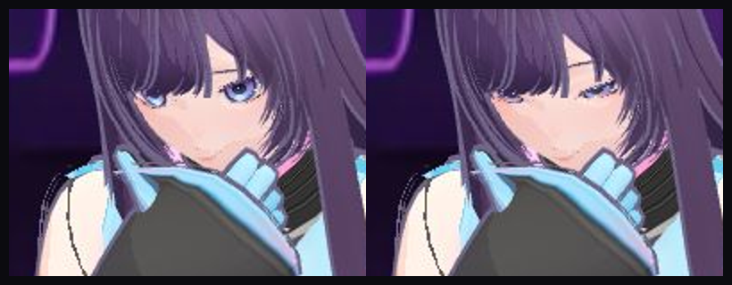
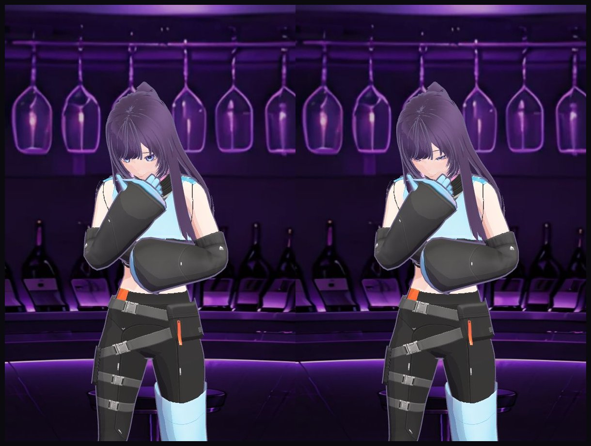

# 70단계 · 무빙 카드 「입 가리고 웃기」 표정: 수줍음 → 눈웃음

왼쪽: 예전(수줍음 — 눈썹이 올라가 위를 치켜보는 얼굴) · 오른쪽: 바뀐 표정(반달 눈웃음)

## 한 일
- 새 표정 **눈웃음**(`giggle`): 눈 반달(Fcl_EYE_Joy .55) + 입꼬리(Fcl_MTH_Fun .4) + 눈썹 편하게(Fcl_BRW_Fun .3)
- 무빙 카드 34번 「입 가리고 웃기」(g02)의 표정을 수줍음(`shy`) → 눈웃음(`giggle`)
- 모션 x19 의 `motionVer` 2 → 3: 이미 이 카드를 가진 사람도 카드 그림이 새 표정으로 다시 만들어짐(같은 모션을 쓰는 다른 카드가 있으면 그것도 다시 그려짐)

## 바뀐 파일
- `index.html`: `FACE.giggle`, `FACEKO.giggle`
- `data/collection.json`: g02 `play.f`
- `data/motions.json`: x19 `motionVer`
- 버전 꼬리표(`node tools/version.mjs`)

## 제가 정한 것
- 다섯 가지 안(예전 수줍음 · 눈웃음 · 활짝 웃음 · 살짝 눈웃음 · 살짝 미소)을 카드 그림으로 뽑아 비교해 눈웃음으로 정함. 활짝 웃음은 눈을 꼭 감고 입을 벌려 너무 크게 웃는 얼굴이 됨
- 수줍음(`shy`) 표정 자체는 그대로 둠(대화에서 서버 감정 「수줍음」에도 쓰이므로). 이 카드만 바꿈
- 3D 표정 값만 바꿈(새 애니메이션 없음). 아이폰 사파리 별도 확인 항목 없음
