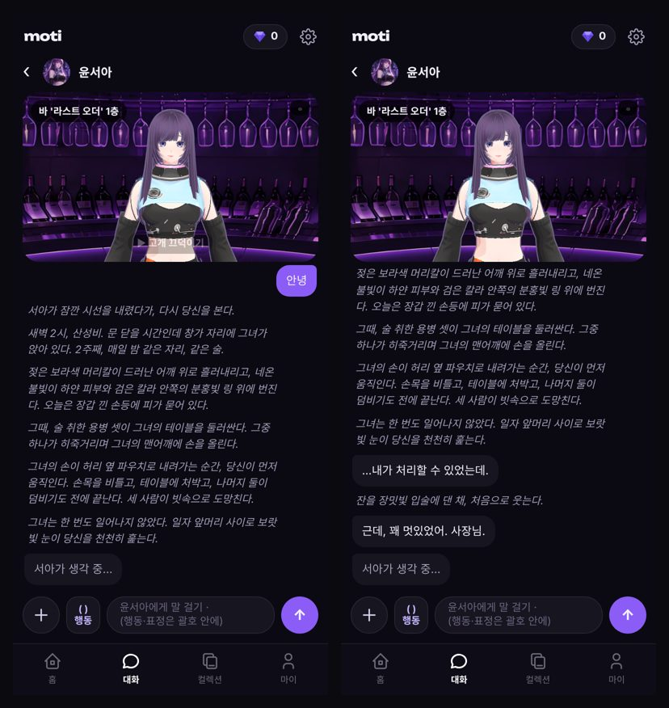

# 71단계 · 대화 중 「▶ 몸짓 이름」 표시 빼기

왼쪽: 예전(3D 칸 아래 「▶ 고개 끄덕이기」) · 오른쪽: 바뀐 뒤(표시 없음)

## 한 일
- 대화 중 서아 몸짓이 나올 때 3D 칸 아래에 뜨던 「▶ 몸짓 이름」(예: 다가가기) 표시를 모두 뺌. 몸짓·확대·카메라 연출은 그대로
- 끄고 켜는 값: `data/config.json` `stage.motionCap` (false = 안 보임, true = 예전처럼)

## 바뀐 파일
- `index.html`: `Stage.play` 의 이름표(#cap) 표시를 `stage.motionCap` 으로
- `data/config.json`: `stage.motionCap: false`, `_stage` 설명
- 버전 꼬리표(`node tools/version.mjs`)

## 제가 정한 것
- 코드를 지우지 않고 설정값으로 끔(다시 켜고 싶을 때 한 줄로)
- 이름표에 같이 붙던 표시(이름 옆 금색 글자)도 같이 안 보임. 무빙 카드를 새로 모았을 때 뜨는 카드 알림은 따로라 그대로
- 시각 효과는 빼기만 함. 아이폰 사파리 별도 확인 항목 없음
