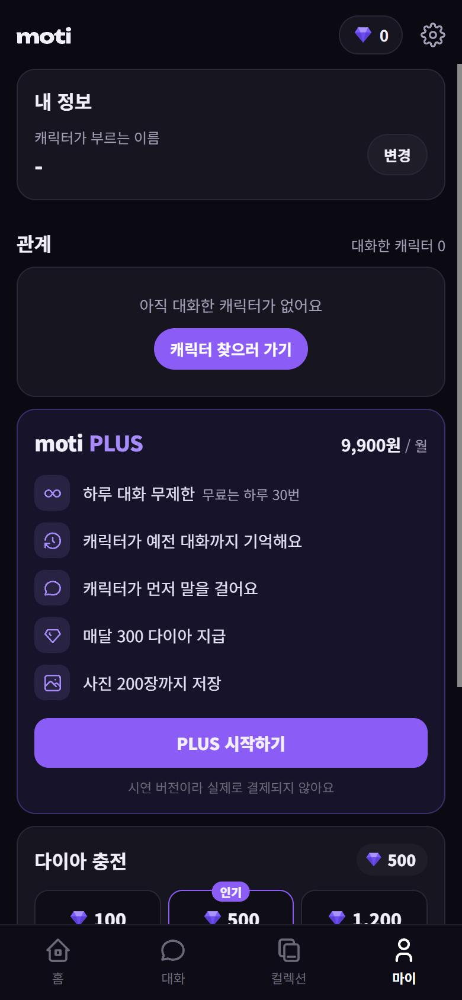

# 72 · 마이 탭 문구 「서아」 → 「캐릭터」

브랜치 `step/72-my-text`.

## 바뀐 파일

| 파일 | 한 일 |
|---|---|
| `data/ui.json` | `my.me.nameLabel` 「캐릭터가 부르는 이름」, `my.perks[1].text` 「캐릭터가 예전 대화까지 기억해요」, `my.perks[2].text` 「캐릭터가 먼저 말을 걸어요」 |

다른 파일·코드는 그대로. `data/*.json` 은 모두 JSON 으로 읽힘(node 로 확인).

## 캡처 (390px)

## 제가 정한 것

- 캡처는 시연 상태(`?skipintro=1`, 이름 없음)로 찍음. 이름 칸은 「-」.
- 시각 효과는 바꾸지 않아 아이폰 사파리 확인 항목은 없음.
