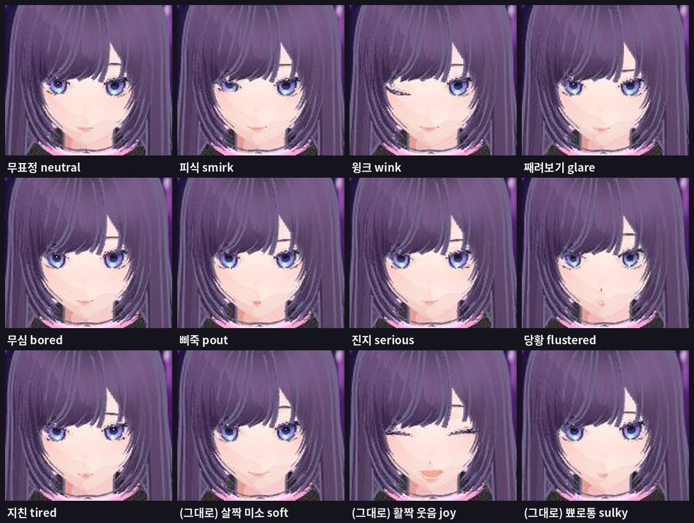

# 73단계 · 웃지 않는 표정 늘리기 · 웃음 몸짓 줄이기

새 표정 8개 + 고친 무표정. 아래 줄 「(그대로)」는 비교용 예전 표정

## 왜
- 표정 9개 중 5개(무표정·살짝 미소·수줍음·웃음·활짝 웃음)가 입꼬리를 올린 얼굴이었고, 감정이 안 맞을 때 기본값도 「살짝 미소」라 서아가 거의 늘 웃고 있었음
- 지문에 「웃」「미소」「피식」「입꼬리」 중 하나만 있어도 웃음 몸짓(m01)이 나와, 츤데레 서아의 「피식」「입꼬리를 올린다」도 크게 웃는 몸짓이 됐음

## 한 일
- **새 표정 8개**: 피식(smirk) · 윙크(wink) · 째려보기(glare) · 무심(bored) · 삐죽(pout) · 진지(serious) · 당황(flustered) · 지친(tired)
- **무표정(neutral)** 을 진짜 무표정으로(입꼬리 올림 뺌). 감정이 안 맞을 때 기본값 살짝 미소 → 무표정
- **감정 → 표정**: 도발·자신감 → 피식, 진심·긴장 → 진지, 질투 → 삐죽, 당황 → 당황, 지침 → 지친, 짜증 → 째려보기, 냉담 → 무심, 장난 → 윙크 (기쁨·설렘·슬픔·분노·놀람·삐짐·위로는 그대로)
- **지문 단어 → 표정**(새로): 서아 지문에 「피식·입꼬리·비웃·코웃음」 → 피식, 「노려·째려」 → 째려보기, 「삐죽·뾰로통」 → 삐죽, 「하품·나른·심드렁」 → 무심, 「윙크」 → 윙크, 「당황·허둥」 → 당황, 「지친·피곤」 → 지친. 감정 표정보다 먼저
- **웃음 몸짓(m01)** 은 크게 웃을 때만: 「환하게 웃」「크게 웃」「소리 내어 웃」「웃음을 터뜨」「깔깔」 등. 「피식 웃으며」「미소를 지으며」는 몸짓 없이 표정만

확인(실제 앱에서 단어 규칙):
| 지문 | 표정 | 몸짓 |
| --- | --- | --- |
| 피식 웃으며 잔을 내려놓는다. | 피식 | 없음(예전: 웃음) |
| 환하게 웃으며 손을 흔든다. | 감정대로 | 웃음 |
| 잠깐 노려보다가 고개를 돌린다. | 째려보기 | 시선 피하기 |
| 입술을 삐죽 내민다. | 삐죽 | 없음 |
| 하품을 하며 턱을 괸다. | 무심 | 팔꿈치 괴고 몸 숙이기 |
| 윙크를 하며 잔을 건넨다. | 윙크 | 툭 건네주기 |

## 바뀐 파일
- `index.html`: `FACE`·`FACEKO` 새 표정, `neutral` 고침, `wordFace()`(지문 → 표정), 답장 표정에 적용. 서버 감정 「냉담」은 표정이 무심으로 바뀌어도 예전처럼 삐짐 상태
- `data/emotion_face.json`: `default` neutral, `words`(새), `map` 고침
- `data/motion_keywords.json`: m01 단어
- `data/motions.json`: `faceEmotion` 에 새 표정
- 버전 꼬리표(`node tools/version.mjs`)

## 제가 정한 것
- 서아 앞머리가 눈썹을 가려서 눈썹만 바꾸는 표정은 안 보임 → 눈(가늘게·반쯤 감기·한쪽 감기)과 입(다물기·내밀기)으로 표정을 냄. 값은 카드 그림으로 뽑아 보며 맞춤
- 장난 → 윙크로 바꿈(재미·fun 은 그대로 웃음)
- 서버가 몸짓 id 로 웃음(m01)을 직접 고른 경우는 그대로 나옴(서버 쪽 규칙). 너무 잦으면 서버 프롬프트에서 줄여야 함
- 대화 화면 3D 칸이 작아서 가는 표정(진지·지친)은 작게 보임. 확대 연출 때 잘 보임
- 70단계(PR #6, 입 가리고 웃기 눈웃음)가 아직 main 에 없어서 이 단계는 그것 없이 만듦. 70을 적용할 때 표정 목록이 겹치므로 맞춰서 병합해야 함
- 3D 표정 값만 바꿈(블러·그림자·새 애니메이션 없음). 아이폰 사파리 별도 확인 항목 없음
