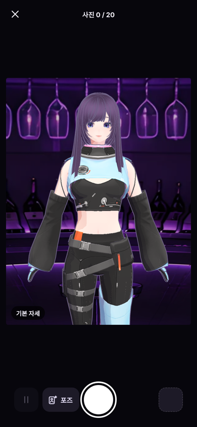
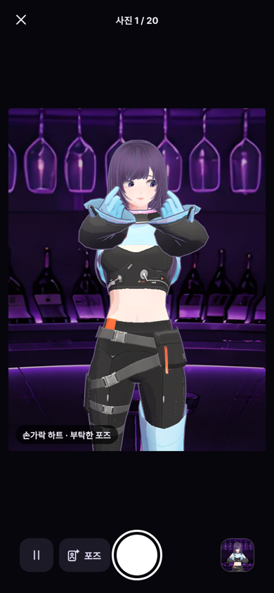
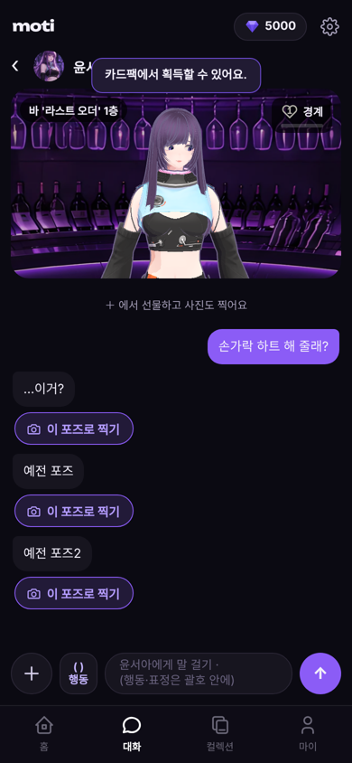
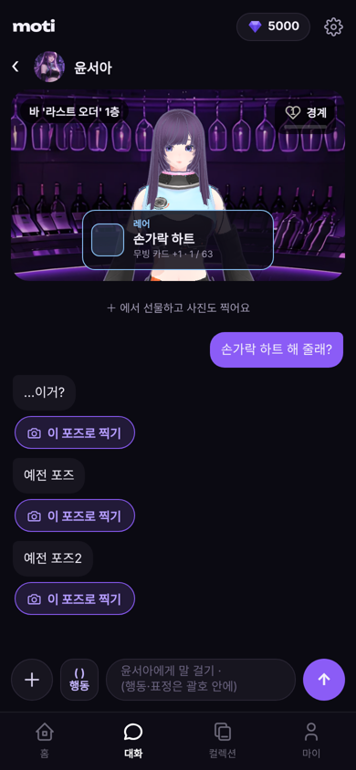
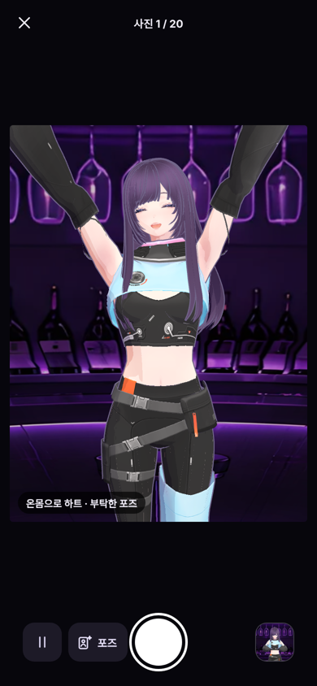
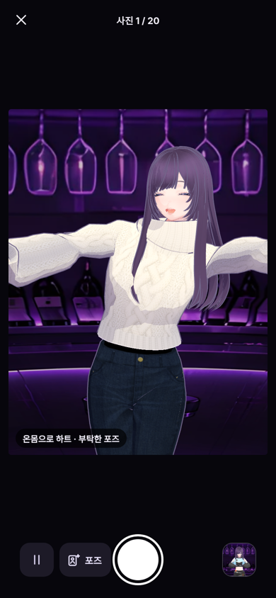

# 78-1 · 포즈 획득 조건 및 카메라 오류 수정

브랜치 `step/78-1-pose-fix`. 커밋 `[78-1 A]` 손가락 하트 카드 획득 조건 · `[78-1 B]` 카메라 초기화 · 포즈 사용 권한.

## 바뀐 파일

| 파일 | 한 일 |
|---|---|
| `index.html` | `firstSeen()`·`Fx.first()`: `only` 가 있는 이벤트 전용 카드는 일반 대화 첫 획득·확대 연출에서 뺌 |
| `photos.js` | `Cam.open()` 주석 뒤에 붙어 실행되지 않던 코드를 줄바꿈으로 살림. `Cam.open()`·`Cam.setPose()` 에서 쓸 수 없는 포즈는 받지 않음 |
| `cards.js` | 카드 크게 보기: 주석 뒤에 붙어 실행되지 않던 `cvfx`(등급 빛 효과) 코드를 줄바꿈으로 살림(B2) |
| `pose.js` | `Pose.info()` 가 지금 쓸 수 있는 포즈만 돌려줌(무료 포즈 · 가진 포즈 카드). 예전 대화의 「이 포즈로 찍기」·`Pose.ask()` 도 다시 확인 |

## 오류 원인

- **A. 손가락 하트 카드:** `firstSeen(mid)` 는 `source: "chat"` 인 카드를 대화에서 처음 재생되면 기록함. p01 은 78 추가에서 `source: "chat"` 이 되어, 대화창에서 손가락 하트를 부탁하면(포즈 답장이 p01 을 재생) photoAsk 없이 RARE 카드가 생김. `Fx.first` 도 같은 조건이라 첫 획득 확대 연출까지 나올 수 있었음.
- **B1. 카메라:** 78-B 에서 `Cam.open()` 의 한 줄 앞부분만 바꾸며 주석(`// 78: …`)을 붙였는데, 그 줄 뒤쪽 코드(`paused=false;held=null;Stage.camLoop(info);` 고른 포즈 표정)가 주석 안으로 들어가 실행되지 않았음. 그래서 「이 포즈로 찍기」로 들어가도 포즈가 바로 재생되지 않고(촬영 화면 안 「포즈」로 다시 고르면 됐음), 멈춤 상태가 남을 수 있었음.

## 고친 내용

- **A:** 두 함수에 `it.only` 조건 추가. p01 카드는 `Pose.cardEvent("photoAsk")` 로만 얻음. x17 「첫 만남」(`only: "firstMeet"`)도 같은 규칙인데, 원래 첫 만남 연출에서만 주던 카드라 그 경로는 그대로.
- **B1:** 주석과 코드를 줄바꿈으로 분리(코드 내용 그대로). 일반 진입 = 기본 자세, 「이 포즈로 찍기」 = 그 포즈 + 지정 표정, 다시 들어오면 멈춤·보류 없음.
- **B3:** `Pose.info()` 한 곳에서 권한 확인 → `Pose.pick`·`Pose.ask`·「이 포즈로 찍기」 버튼·`Cam.open({pose})`·`Cam.setPose` 가 모두 이것을 거침. 못 쓰면 「카드팩에서 획득할 수 있어요.」(pose.locked)만 띄우고 카메라를 열지 않음.

## B2 · 78 에서 주석 뒤에 코드가 붙은 곳

78·78 추가·79 커밋에서 더한 js·html 줄 중 `// ` 뒤에 코드(`;`·`{}`·함수 호출)가 이어진 줄을 모두 찾음(28줄 검사):

| 파일 | 자리 | 숨어 있던 코드 | 처리 |
|---|---|---|---|
| `photos.js` | `Cam.open()` (180줄) | `paused=false;held=null;Stage.camLoop(info);if(o&&o.pose&&o.pose.f)Stage.setFace(o.pose.f);` | 줄바꿈으로 분리 |
| `cards.js` | 카드 크게 보기 `view()` (205줄) | `$v(".cvfx").innerHTML=fx(x.grade);` — 크게 보기에서 등급 빛 효과가 이전 카드 것으로 남을 수 있었음 | 줄바꿈으로 분리 |

그 밖의 주석은 줄 끝에서 끝남(코드 없음). `index.html` 선물 창의 `<!-- 75 … -->` 는 HTML 글 안의 주석이라 실행에 영향 없음.

## 화면 (390px)

| 일반 카메라 = 기본 자세 | 「이 포즈로 찍기」 = 손가락 하트 + 수줍음 | 예전 버튼(일반 몸짓) = 사용 불가 |
|---|---|---|
|  |  |  |

| 사진 부탁 이벤트 = 대화 RARE 획득 | 얻은 카드 팩 포즈 촬영 | 크리스마스 |
|---|---|---|
|  |  |  |

## 테스트 결과 (서버 막음 · 시연 패널 · 대신 응답 「…이거?」)

| 항목 | 결과 |
|---|---|
| 1. p01 미획득 상태에서 카메라 촬영 | ✅ 사진 0 → 1, 카드 없음 |
| 2. 대화창에서 p01 부탁 | ✅ 포즈 재생, 카드 없음, 확대 연출 없음 |
| 3. 「이 포즈로 찍기」 | ✅ 손가락 하트 + 수줍음 표정 바로 재생 |
| 4. 사진 부탁 이벤트 | ✅ 대화 · RARE 카드 획득, 레어 알림 |
| 5. 같은 이벤트 다시 | ✅ 새로 얻은 카드 0장 |
| 6. 미획득 포즈(p05)·일반 몸짓(m02)의 예전 촬영 버튼 | ✅ 「카드팩에서 획득할 수 있어요.」, 카메라 안 열림. `Cam.setPose` 로 직접 넣어도 무시 |
| 7. 얻은 카드 팩 포즈(p03) | ✅ 정상 촬영 |
| 8. 일반 카메라 진입 | ✅ 직전 몸짓(m02) 없이 기본 자세 |
| 9. 멈춤 → 닫기 → 다시 진입 | ✅ 멈춤 풀림, 기본 자세 |
| 10. 사진 저장 · 일반 대화 카드(m03) 획득 | ✅ |
| 11. 크리스마스 | ✅ 니트 차림으로 포즈 재생 |
| 12. 콘솔 오류 · data JSON | ✅ 없음 · 모두 읽힘 |
| `node tools/check_gacha.mjs` | ✅ 모두 통과 |

## 제가 정한 것

- 이벤트 전용 판단은 `only` 가 있는지로(카드 데이터에 이미 있는 값). p01 외에 x17 첫 만남도 같은 규칙에 들어감 — 첫 만남 연출에서만 얻는 카드라 원래 뜻과 같음.
- 권한 확인을 `Pose.info()` 한 곳에 모아, 버튼·부탁·카메라 경로가 모두 같은 규칙을 따르게 함.
- 사용 불가 안내는 기존 「카드팩에서 획득할 수 있어요.」 하나로(일반 몸짓의 예전 버튼에도 같은 문구).

## 아이폰에서 나중에 볼 것

- 시각 효과 변경 없음. 「이 포즈로 찍기」로 들어갈 때 포즈가 바로 나오는지(모션 파일을 받는 동안 잠깐 기본 자세).
