# 78 · 촬영 전용 포즈 시스템 — FBX 모션 적용 · 무료 포즈 · 카드팩 연동

브랜치 `step/78-camera-poses`. 커밋 `[78-A]` 변환·적용 · `[78-B]` 카메라 포즈 개편 · `[78-C]` 카드팩·컬렉션·검증.

## 바뀐 파일

| 파일 | 한 일 |
|---|---|
| `motions/pose_*.json` 14개 | 받은 FBX 14개 변환 결과(아래 표) |
| `data/motions.json` | 몸짓 p01~p14(`only: "pose"` = 촬영 전용), 재생 구간(`xstage`), 새 값 `loopFrom` |
| `data/collection.json` | 포즈 카드 p01~p14(번호 56~69, `pose: true`, p01 은 `source: "free"`), 카드 그림 순간(`card.momentById`) |
| `index.html` | `loopFrom`(촬영 화면 반복 때 자세 잡기는 처음 한 번만, 끝에서 기본 자세로 돌아가지 않음), 촬영 화면 반복 몸짓을 바로 불러오기, 컬렉션 「카드 팩」 탭에 무료 포즈 카드도, `Stage.seek`(확인용) |
| `pose.js` | 포즈 목록 = 포즈 카드만(무료 → 가진 것 → 못 가진 것), 무료 포즈 지급(`grantFree`), 못 가진 포즈는 고를 수 없음 |
| `photos.js` | 촬영 화면을 열 때 직전 대화 몸짓을 이어받지 않음 → 기본 자세 |
| `cards.js`·`cards.css` | 포즈 카드 오른쪽 위 「포즈」 표시(목록 칸·크게 보기) |
| `data/ui.json` | `pose.locked` 「카드팩에서 획득할 수 있어요.」, 포즈 목록 안내 줄에 「n / 전체」, `album.card.pose` 「포즈」 |
| `tools/fbx2motion.mjs` | 한 장짜리 포즈 FBX(키 2개: T자 → 포즈) 처리 — 끝 키를 뽑아 5초 두 장으로 |
| `tools/build_collection.mjs` | `source: "free"` 칸도 그대로 둠 |
| `tools/check_gacha.mjs` | 78 포즈 카드 검사 추가, 52 번호 검사에서 뒤에 붙은 포즈 카드 빼기 |
| `docs/CREDITS.md` | 모션 14개 출처 |
| `data/demo.json` | (78 추가) 시연 패널 「사진 부탁 이벤트」 |
| `data/characters.json` | (함께) 캐릭터 소개 탭 순서·이름 |

## 받은 FBX와 적용 결과 (14개 모두 성공)

| 원본 파일 | 결과 | ID | 카드 번호 | 이름 | 등급 | 얻는 법 | 표정 |
|---|---|---|---|---|---|---|---|
| [standard] Pass Finger Heart.fbx | ✅ | p01 | 56 | 손가락 하트 | RARE (78 추가) | 포즈는 기본 무료 · 카드는 대화 이벤트 | 수줍음 |
| [standard] Cute - Hand heart.fbx | ✅ | p02 | 57 | 볼 옆 하트 | RARE | 카드팩 | 윙크 |
| [standard] Lovely - Heart 2.fbx | ✅ | p03 | 58 | 온몸으로 하트 | SECRET | 카드팩 | 활짝 웃음 |
| [standard] V Sign Pose.fbx | ✅ | p04 | 59 | 연달아 브이 | RARE | 카드팩 | 웃음 |
| [standard] Body pose 53.fbx | ✅ | p05 | 60 | 다리 꼬고 갸웃 | DAILY | 카드팩 | 살짝 미소 |
| [standard] Body pose 54.fbx | ✅ | p06 | 61 | 꽃받침 | DAILY | 카드팩 | 활짝 웃음 |
| [standard] Body pose 68.fbx | ✅ | p07 | 62 | 팔 감싸고 수줍게 | DAILY | 카드팩 | 수줍음 |
| [standard] Body pose 71.fbx | ✅ | p08 | 63 | 두 팔 번쩍 만세 | DAILY | 카드팩 | 웃음 |
| [standard] Body pose 74.fbx | ✅ | p09 | 64 | 한 발 들고 브이 | DAILY | 카드팩 | 윙크 |
| [standard] Body pose 78.fbx | ✅ | p10 | 65 | 양손 브이 | DAILY | 카드팩 | 피식 |
| [standard] Body pose 82.fbx | ✅ | p11 | 66 | 한 손 들어 브이 | DAILY | 카드팩 | 살짝 미소 |
| [standard] Body pose 90.fbx | ✅ | p12 | 67 | 몸 숙여 바라보기 | DAILY | 카드팩 | 피식 |
| [standard] Body pose 94.fbx | ✅ | p13 | 68 | 검지 세우고 갸웃 | DAILY | 카드팩 | 삐죽 |
| [standard] Body pose 95.fbx | ✅ | p14 | 69 | 한 팔 번쩍 | DAILY | 카드팩 | 활짝 웃음 |

### 재생 구간

- **Body pose 10개(p05~p14):** 원본이 움직임 없는 한 장짜리 포즈(키 2개: T자 → 포즈)라, 끝 키를 뽑아 5초짜리로 만듦. 1초 동안 기본 자세에서 그 자세로 옮겨 가고, 약 3초 유지한 뒤 돌아옴. 촬영 화면에서 반복할 때는 1.2초(자세 완성)부터 다시 이어서, 자세를 다시 잡거나 기본 자세로 돌아가지 않음(`loopFrom`). 손가락은 원본 그대로 고정. 바닥에서 뜨지 않고 제자리.
- **p01 손가락 하트(원본 10초):** 앞 2.9초는 고개를 깊이 숙여 손을 모으는 준비(머리 꼭대기만 보임)라 빼고, 하트를 들어 올린 뒤 8.8초까지. 반복은 3.6초(하트가 완성된 뒤)부터.
- **p02 볼 옆 하트(6.6초)·p03 온몸으로 하트(10.7초)·p04 연달아 브이(4.25초):** 처음 T자 0.3초만 빼고 원본 전체. 여러 자세가 이어지는 모션이라 한 자세로 줄이지 않음. 반복은 처음부터(끝에서 잠깐 기본 자세를 거쳐 다시).
- 멈춤(일시정지)은 원하는 순간에 그대로 멈춤 — 기존 촬영 화면 기능.

### 등급을 정한 이유

- **p01 손가락 하트 — RARE:** 78 추가 지시대로(카드팩 분류와 따로, 컬렉션 「대화」 카드).
- **p02 볼 옆 하트 — RARE:** 볼 옆에서 하트를 흔들다가 허리에 손을 얹는 두 자세가 자연스럽게 이어짐. 상체 위주.
- **p03 온몸으로 하트 — SECRET:** 머리 위 큰 하트 → 두 팔 활짝 → 옆으로 뻗기까지 여러 자세를 연달아. 팔·허리·고개를 크게 쓰는 전신 동작이라 찍을 순간이 가장 많음.
- **p04 연달아 브이 — RARE:** 가슴 앞 → 위 → 얼굴 옆 → 아래로 브이 자세가 빠르게 바뀜. 동작 변화는 뚜렷하지만 상체만 쓰고 4초로 짧아 SECRET 보다 아래.
- **p05~p14 — 모두 DAILY:** 한 장짜리 정적 포즈(원본에 움직임이 없음). 「한 자세 유지 = DAILY」 규칙대로. 만세·한 발 들기처럼 자세가 커도 하나의 정지 자세라 올리지 않음. 유지 시간도 늘리지 않음.

### 포즈별 실제 촬영 화면 (390px)

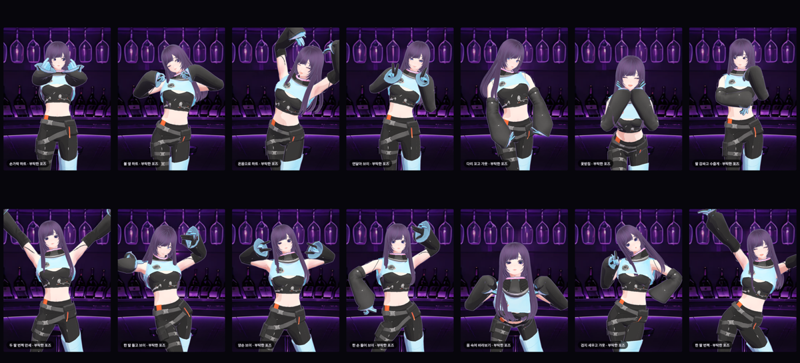

위 줄 p01~p07, 아래 줄 p08~p14.

## 화면

| 포즈 목록(획득 전) | 카드팩에서 획득 | 포즈 목록(획득 후) |
|---|---|---|
| 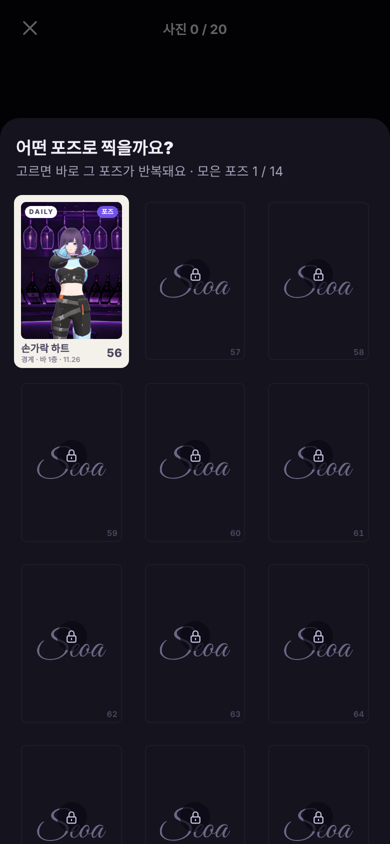 | 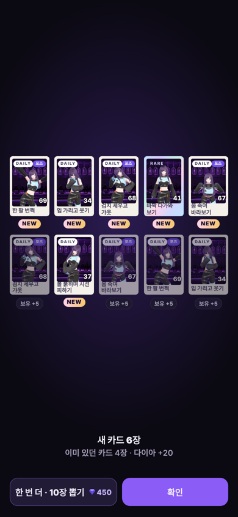 | 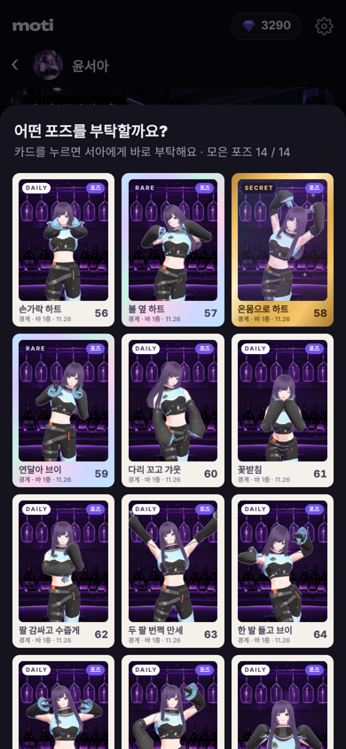 |

| 카메라: 대화 몸짓 뒤 열어도 기본 자세 | 크리스마스에서 포즈 |
|---|---|
| 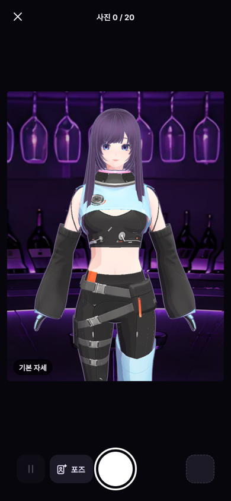 | 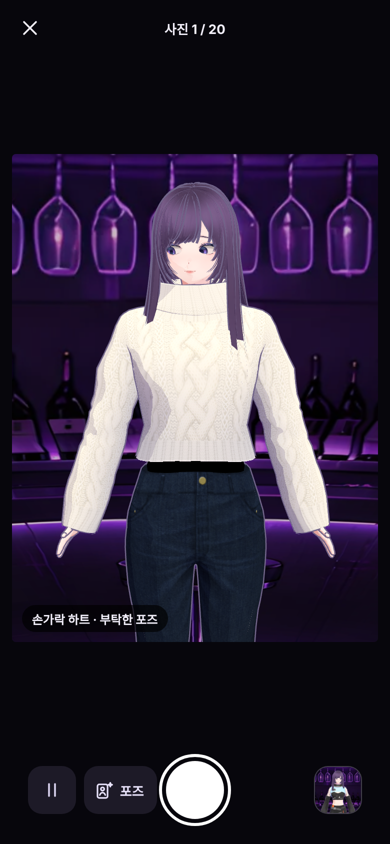 |

컬렉션 「카드 팩」 탭(포즈 표시) · 크게 보기:

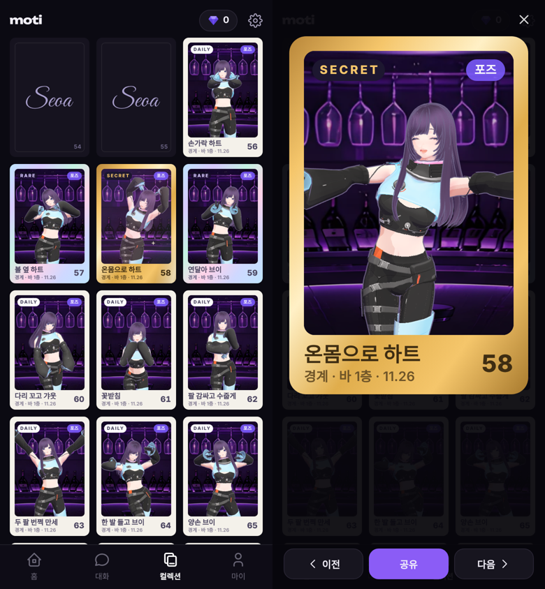

## 테스트 결과 (실제 브라우저, 서버 호출 막음)

| 항목 | 결과 |
|---|---|
| 1. FBX 14개 누락 없이 적용 | ✅ 14개 모두 변환·재생(실패 없음) |
| 2. 손가락 하트만 기본 무료 | ✅ 저장값에 p01 이 없던 예전 사용자도 새로고침하면 p01 을 가짐. 다른 포즈는 0장 |
| 3. 나머지는 카드팩에서만 | ✅ `check_gacha`: p02~p14 만 팩 후보, p01 은 후보 아님. 단계·판정 해금 목록에 없음 |
| 4. 정적·역동 등급 구분 | ✅ 위 표 |
| 5. 역동 포즈 원본 동작 유지 | ✅ p02~p04 원본 전체, p01 은 준비 동작만 뺌 |
| 6. 일반 모션이 포즈 목록에서 빠짐 | ✅ 목록 14칸 = 포즈 카드만 |
| 7. 잠긴 포즈 사용 불가 | ✅ 뒷면 + 자물쇠, 누르면 「카드팩에서 획득할 수 있어요.」, 골라지지 않음 |
| 8. 카드팩 획득 즉시 사용 | ✅ 10장 뽑기 직후 포즈 목록에 바로 보임 |
| 9. 표정·동작·유지 구간 | ✅ 포즈마다 표정 다름(수줍음·윙크·피식·삐죽 등) |
| 10. 포즈 변경·멈춤·셔터·앨범 | ✅ 멈춤·포즈 바꾸기 확인, 셔터 후 「사진 1 / 20」 |
| 11. 새로고침 후 유지 | ✅ |
| 12. 예전 사용자 무료 포즈 | ✅ (2번) |
| 13. 기존 대화 몸짓·카드팩 | ✅ AI 가 p05 를 골라 보내도 앱이 받지 않음(대화 몸짓 목록에 p 없음), 카드팩 확률·가격·천장·중복 보상 그대로 |
| 14. 본편·크리스마스 | ✅ 크리스마스(s2) 에서도 14장 모두, 니트 차림으로 재생 |
| 15. 390px | ✅ 캡처 |
| 16. 콘솔·JSON 오류 | ✅ 없음 |
| 17. 스크립트 | ✅ `node tools/build_collection.mjs` 다시 실행해도 칸 68개 그대로(포즈 카드 안 사라지고 중복 없음), `node tools/check_gacha.mjs` 모두 통과 |

- 카메라에서 포즈를 바꾸거나 찍을 때 서버 호출 0번. ＋ 기능판 「포즈」로 부탁할 때만 예전처럼 「{이름} 해 줄래?」를 보냄(유료 API 대신 막아 둔 응답 → 「…이거?」 + 그 포즈 + 「이 포즈로 찍기」).

## 78 추가 수정 · 무료 포즈 컬렉션 획득 방식

| 항목 | 내용 |
|---|---|
| 대상 | p01 손가락 하트(`[standard] Pass Finger Heart.fbx`) |
| 등급 | RARE |
| 컬렉션 | 「대화」 탭(`source: "chat"`), 카드 번호 56 그대로 |
| 카드팩 | 나오지 않음 |
| 카메라 | 처음부터 무료로 씀(포즈 목록 맨 앞, 카드를 안 가졌으면 실루엣 앞면 + 아래 줄 「기본 포즈」) |
| 카드 얻기 | 이야기 이벤트 `photoAsk`(서아가 대화 중 먼저 사진을 찍어 달라고 부탁)가 `Pose.cardEvent("photoAsk")` 를 부를 때만 |

- **데이터:** `data/collection.json` p01 = `{source: "chat", grade: "rare", pose: true, free: true, only: "photoAsk"}`. `only` 는 「정해진 연출에서만 얻는 칸」(x17 첫 만남 `firstMeet` 과 같은 방식)이라 `build_collection` 을 다시 돌려도 그대로 남음. 카드 이벤트 설명은 `_cardEvents`.
- **연결 지점:** `Pose.cardEvent(이름)` — 그 이름의 카드를 아직 안 가졌으면 기록(`S.col.p01.event = "photoAsk"`) → 카드 그림 만들기 → 기존 등급 카드 알림(`notifyNew`, 레어 알림·연출). 이미 가졌으면 아무 일 없음(돌려주는 값 0). 사진 부탁 이벤트를 만들 때 그 연출 끝에서 이 함수만 부르면 됨. 백엔드는 안 바꿈.
- **얻지 않는 경우:** 카메라를 열기, 무료 포즈 고르기, 그 포즈로 찍기 — 모두 확인(찍은 뒤에도 카드 없음).
- **78 첫 판 저장값:** 첫 판은 처음부터 카드를 줬기 때문에(`S.col.p01.free`), 그 기록은 한 번 지움(`S.poseFree78`). 이벤트로 얻은 카드는 지우지 않음.
- **시연 패널:** 「사진 부탁 이벤트(손가락 하트 카드)」 버튼 = `Pose.cardEvent("photoAsk")`. 두 번째는 「이미 가진 카드예요」.
- `tools/check_gacha.mjs`: 무료 포즈가 대화·RARE·`photoAsk`·팩 제외인지 검사, 모두 통과.

| 카드 없이 무료 포즈 | 사진 부탁 이벤트로 카드 얻음(레어 알림) | 컬렉션 「대화」 탭 |
|---|---|---|
| 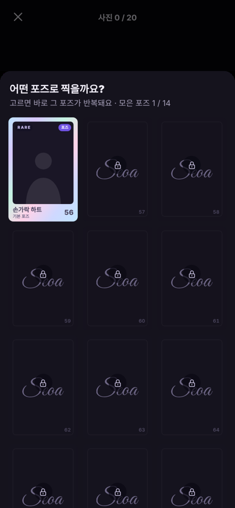 | 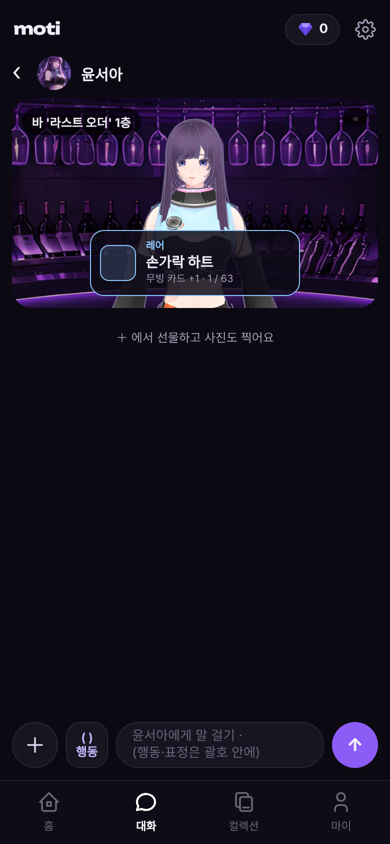 | 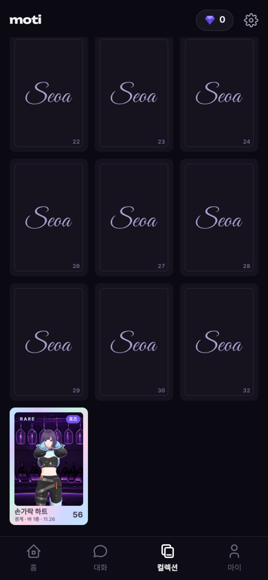 |

## 함께 바꾼 것 · 캐릭터 소개 탭

- 서아 캐릭터 화면 탭 순서 「소개 · 당신 · 캐릭터」 → **「소개 · 캐릭터 · 내 역할」**. 유저(바 주인) 설명 탭 이름 「당신」 → 「내 역할」(`data/characters.json` profile.tabs). 탭 안 글은 그대로.

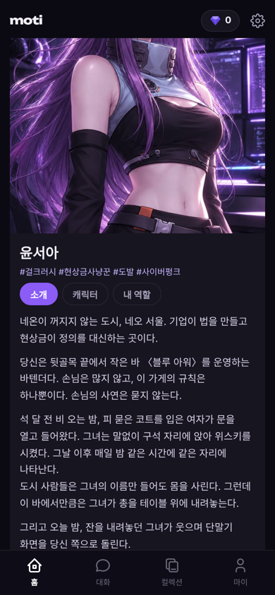

## 제가 정한 것

- **ID·이름:** 몸짓·카드 id 를 같은 p01~p14 로 맞춤. 이름은 실제 동작을 보고 지음(표).
- **DAILY/RARE/SECRET** = 앱 등급 common/rare/special(카드에 이미 이 영문 표시가 나옴).
- **카드 그림 순간:** 정적 포즈는 자세가 다 잡힌 순간(60%), 역동 포즈는 가장 특징적인 자세(하트·브이가 완성된 순간). 크게 보기는 모션 전체가 움직임.
- **포즈 표시:** 카드 오른쪽 위 보라 알약 「포즈」(등급 표와 같은 크기). 카드 공유 그림에는 넣지 않음.
- **포즈 목록 안내 줄:** 「모은 포즈 n / 14」로 바꿈.
- **반복 이음매:** 정적 포즈와 손가락 하트는 `loopFrom` 으로 끊김 없이 그 자세 유지. 나머지 역동 포즈는 처음부터 다시(끝에서 잠깐 기본 자세를 지남 — 원본 흐름을 살리려고).
- **카메라 아래 칩:** 포즈를 고르면 「{이름} · 부탁한 포즈」(예전 문구 그대로).
- **카드팩 풀:** 포즈 카드 13장이 늘어 팩 일반 카드가 6 → 16장. 등급별 확률은 그대로라 한 장 한 장의 확률만 나뉨.
- **변환 도구:** 한 장짜리 포즈 처리 방식을 `tools/fbx2motion.mjs` 에 넣음(다음 포즈 FBX 도 그대로 변환됨).
- **78 추가 · 무료 포즈 칸 모양:** 카드를 안 가진 동안은 그림 대신 실루엣(카드 그림은 카드를 얻을 때 만듦), 아래 줄 「기본 포즈」. 이름 「당신」 → 「내 역할」(탭 안 글이 유저의 역할 설명이라).
- **예전 대화 몸짓 카드(무빙 카드)로 찍던 포즈:** 목록에서 빠짐(카드·몸짓 자체는 그대로).

## 아이폰에서 나중에 볼 것

- 새 시각 효과는 카드 「포즈」 알약(반투명 보라 바탕)뿐. 블러·애니메이션 없음.
- 포즈 목록 시트에서 포즈 카드 그림이 처음에 만들어지는 동안(카드 14장) 끊김이 없는지.
- 촬영 화면에서 포즈를 처음 고를 때 모션 파일(최대 200KB)을 받는 동안 기본 자세가 잠깐 보이는지.
