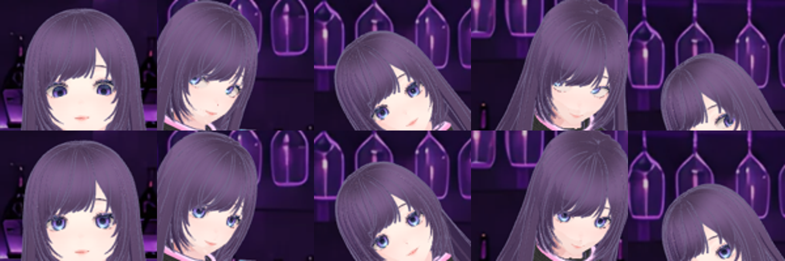

# 79 · 고개를 돌리면 눈도 고개를 따라가게

브랜치 `step/79-eyes-follow-head`.

## 왜

포즈·몸짓이 고개를 숙이거나 갸웃하면, 서아 눈동자만 계속 카메라를 쫓아서 **눈을 치켜뜨거나 한쪽으로 몰린 것처럼** 보였다(특히 촬영 전용 포즈 「몸 숙여 바라보기」 「다리 꼬고 갸웃」 「검지 세우고 갸웃」). 기획자 결정: 서아가 꼭 카메라를 보지 않아도 됨.

## 한 일

| 파일 | 한 일 |
|---|---|
| `alive.js` | 시선(gaze): 몸짓이 고개를 기본 자세에서 돌린·숙인 각도가 `eyeReduceDeg` 를 넘으면 눈이 카메라 쫓기를 차츰 멈추고 고개가 향한 쪽을 봄(부드럽게 바뀜). 예전부터 있던 「고개 따라 돌리기 줄이기(reduceDeg)」와 같은 방식 |
| `data/look.json` | `seoa.alive.gaze.eyeReduceDeg: [6, 18]` — 6°부터 줄기 시작, 18° 이상이면 눈은 정면(고개 방향) |

- 모든 몸짓에 적용(대화 몸짓·촬영 포즈 모두). 고개가 거의 안 움직이는 대기·작은 몸짓에서는 예전처럼 눈이 카메라를 봄.
- 표정(윙크·피식 등)은 그대로.

## 전후 (위 = 전, 아래 = 후)

왼쪽부터 몸 숙여 바라보기 · 다리 꼬고 갸웃 · 검지 세우고 갸웃 · 한 발 들고 브이 · 볼 옆 하트

## 제가 정한 것

- 각도 6°~18°. 더 일찍(더 작게 고개를 돌려도) 눈을 정면으로 두려면 숫자를 줄이면 됨.
- 확대·시선 피하기(수줍을 때 눈 돌리기)도 같은 비율로 줄어듦 — 고개를 크게 돌린 몸짓 중엔 눈을 따로 굴리지 않음.

## 아이폰에서 볼 것

- 시각 효과 없음(뼈 회전만).
