# [8] 홈 정리: 캐릭터 카드 가로 넘기기 + 고른 카드 아래 에피소드 목록

- 브랜치: `step/8-home` (main 병합 안 함)
- 시작 전 확인: `step/7-onboarding` 은 main 에 병합돼 있음(`afe64e1`)
- 원고: `docs/drafts/8-홈-문구.md` — 문구는 모두 그대로 넣음(못 넣은 문구 없음)
- 커밋: `[8-A] 캐릭터·에피소드 데이터로 옮기기, 홈 원고 반영` → `[8-B] 홈 카드 가로 넘기기와 에피소드 목록`

## 바뀐 파일

| 파일 | 내용 |
| --- | --- |
| `data/characters.json` | **새 파일.** 예전 `index.html` 의 `CH`. `list`(지금 순서) + `recommend`(추천 탭 순서: 윤서아 → 서도윤 → 한지후 → 이준 → 류하람). 예전 `FIRST_MIN` 도 캐릭터마다 `firstMin` 으로 옮김 |
| `data/episodes.json` | **새 파일.** `basic`(캐릭터마다 기본 에피소드 제목·상황) + `special`(예전 `STORIES`, 캐릭터 id `char` 추가) |
| `data/ui.json` | `home` 묶음 추가: 홈/랭킹, 정렬 칩 4개, 섹션 이름, 버튼 표시(시작·이어하기·19+ 인증·무료·💎·구매함), 「곧 공개돼요」, 특별 에피소드 안내, 전용 모션 표시, 특별 이야기 시작 표시, 💎 부족 |
| `index.html` | `CH`·`STORIES`·`FIRST_MIN` 을 데이터에서 불러오게. 홈(`renderHome`) 다시 씀: 검색·태그 줄 빼고, 카드 가로 넘기기(`Car`), 고른 카드 아래 에피소드 목록(`renderEps`). `adultSheet(cid, then)` 에 인증 뒤 할 일 추가, `startStory` 에 19+ 확인 추가. 쓰지 않는 CSS(검색창·태그 칩·2열 격자) 지움 |
| `docs/drafts/8-홈-문구.md` | 원고(받은 그대로 커밋) |
| `docs/reports/img/8/*.jpg` | 캡처 |

### A. 데이터로 옮기기 (원고 반영)

- 윤서아: desc·tags 원고대로(hook 은 원래와 같음)
- 한지후: `badge` "3D" → "" (3D 표시는 윤서아만)
- 서아 특별 에피소드: s1 이름·설명·첫 대사, s2 설명·첫 대사, s2 장소 네온 골목(2) → 바 '라스트 오더' 1층(0). 가격·몸짓·표정은 그대로
- 캐릭터 5명 기본 에피소드 제목·상황 추가
- 추천 탭만 `recommend` 순서. 인기 랭킹(대화 수)·신규(NEW 먼저)·3D로 만나기(3D 표시만)는 예전 규칙 그대로
- 다른 곳의 `STORIES` 사용: 마이 페이지 등에서는 쓰지 않음(홈과 `startStory` 만). `CH` 를 쓰는 곳(대화 목록·안 읽은 수·알림·대화방)은 모두 같은 변수를 쓰므로 그대로 동작

### B. 홈 화면

- 위쪽: 홈/랭킹 전환 + 정렬 칩 4개만. 랭킹 화면은 손대지 않음
- 카드 가로 한 줄, 브라우저 스크롤 + `scroll-snap`(가운데 맞춤, 한 번에 한 장 `scroll-snap-stop`)
  - 가운데 카드: 연보라 테두리. 옆 카드: 크기 0.9, 투명도 0.5 (blur 없음)
  - 넘겨서 가운데 온 카드가 바로 골라지고 아래 에피소드 목록이 바뀜. 옆 카드를 누르면 가운데로 오며 골라짐
  - 카드 아래 점 표시(고른 카드는 길쭉한 점)
  - 정렬 칩을 바꾸면 그 순서로 다시 놓고 첫 카드를 고름
  - 노트북: 세로 마우스 휠은 한 번에 한 장, 가로 휠(트랙패드)은 그대로 스크롤, 마우스 끌기. ←/→ 키는 쓰지 않음(카드에 포커스가 있어도 넘어가지 않게 막음, 시연 패널 단축키는 그대로 받음)
- 카드 내용: 그림, 이름, 한 줄 대사(hook), 태그 앞 3개. 위 표시(대화 수, 19+, 3D, NEW)는 예전 규칙(`badgeOf`)
- 에피소드 목록
  - 「기본 에피소드」: 제목 + 상황 + 버튼(시작/이어하기). 누르면 `enterRoom` (서아는 처음이면 오프닝부터)
  - 「특별 에피소드」: 있으면 예전처럼(가격·구매함·전용 모션), 아래 안내 문구. 없으면 「곧 공개돼요」. 누르면 `startStory`
  - 19세 이상 캐릭터이고 인증 전이면 버튼이 「19+ 인증」. 누르면 지금 인증 시트 → 인증이 끝나면 그 에피소드로 바로(기본 = 대화방, 특별 = 그 이야기 시작)
  - 카드를 고를 때는 인증 시트를 띄우지 않음
- 카드 그림 높이는 화면 높이에 맞춰 줄어듦(`clamp(170px, 100dvh − 468px, 300px)`): 844 → 300px, 667 → 199px

## 캡처

| 홈 첫 화면(서아) | 넘겨서 서도윤 | 서도윤 에피소드 → 인증 시트 | 한지후(곧 공개돼요) | 3D로 만나기 |
| --- | --- | --- | --- | --- |
| 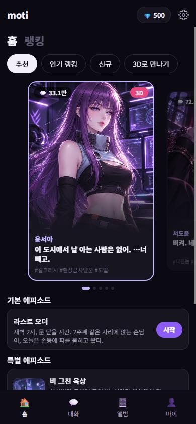 | 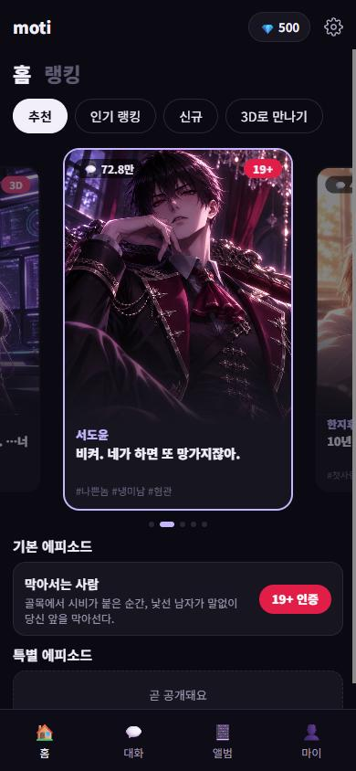 | 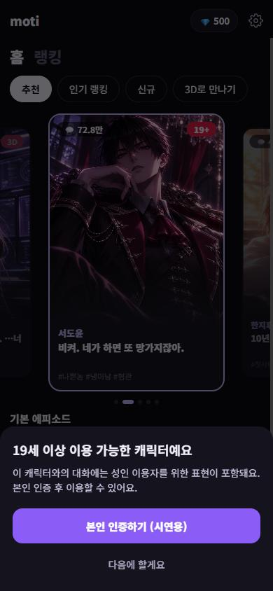 | 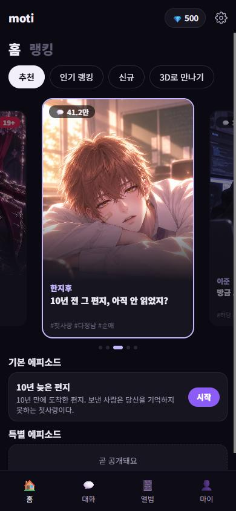 | 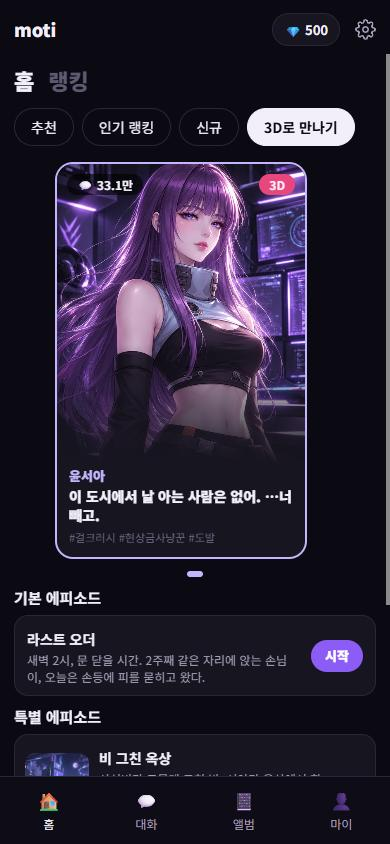 |

| 서아 특별 에피소드 목록 | 서아 특별 에피소드 시작 직후 | 375×667 | 1280 | 전체 초기화 → 온보딩 → 홈 → 서아 기본 에피소드 |
| --- | --- | --- | --- | --- |
| 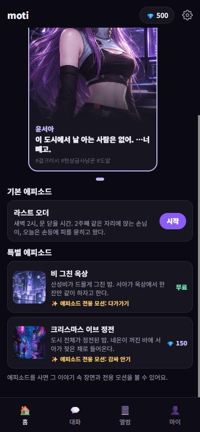 | 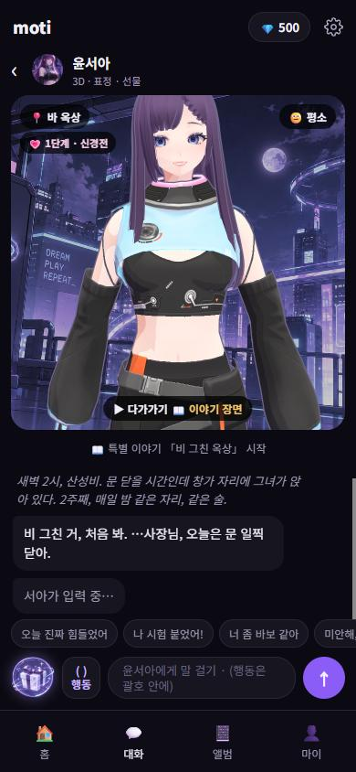 | 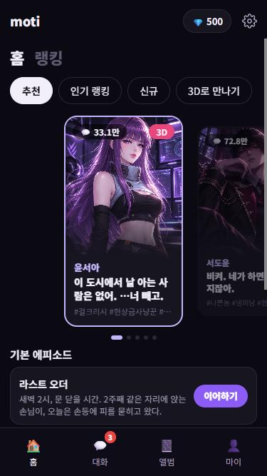 | 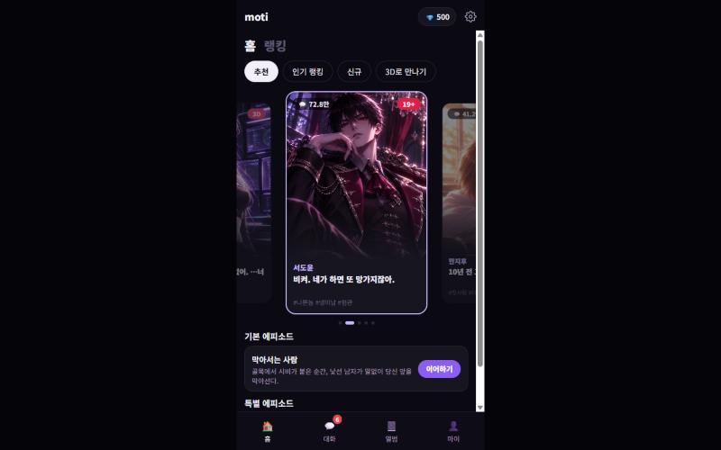 | 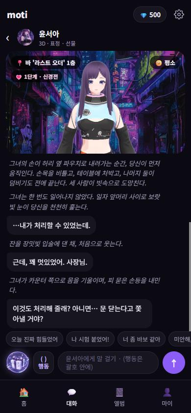 |

확인한 것 (390×844, 로컬 서버)

- 끌어서 넘기기 → 서도윤이 가운데·골라짐, 기본 에피소드 「막아서는 사람」·「19+ 인증」, 특별 「곧 공개돼요」
- 「19+ 인증」 → 인증 시트 → 「본인 인증하기」 → 서도윤 대화방으로 바로
- 옆 카드(한지후) 누르기 → 가운데로 오며 골라짐, 3D 표시 없음
- 3D로 만나기 → 서아 카드 하나만
- 「비 그친 옥상」 → 대화방, 바 옥상, 「📖 특별 이야기 「비 그친 옥상」 시작」 + 첫 대사 + m12
- 「크리스마스 이브 정전」 → 💎 500 → 350, 장소 바 1층(0), 홈에 돌아오면 「구매함」
- 전체 초기화 → 첫 화면 → 입장권 → 로그인(게스트) → 홈(서아 골라짐, 「시작」) → 「시작」 → 오프닝 10문단 모두 나옴. 다시 홈에 오면 「이어하기」
- 375×667: 카드와 기본 에피소드가 스크롤 없이 함께 보임
- 1280: 마우스 휠 한 번에 한 장 넘어감
- 페이지 가로 넘침 없음(문서·홈 모두 scrollWidth 390 = clientWidth 390)
- 랭킹 화면 그대로(5명)
- 콘솔 오류 없음

## 아이폰 사파리 확인 항목 (기획자 확인 필요)

- [ ] 손가락으로 넘길 때 끊기지 않는지(옆 카드 크기·투명도 바뀜 포함)
- [ ] 놓았을 때 스냅이 카드 가운데에 정확히 서는지(한 번에 한 장)
- [ ] 페이지 전체가 옆으로 밀리지 않는지(카드 줄만 움직이는지)
- [ ] 카드 줄 위에서 세로로 쓸어 올릴 때 페이지 세로 스크롤이 되는지
- [ ] 홈 ↔ 다른 탭을 오간 뒤 돌아왔을 때 고른 카드가 가운데에 있는지
- [ ] 375×667 급(아이폰 SE)에서 기본 에피소드가 첫 화면에 보이는지

## 제가 정한 것

- **「이어하기」 기준:** 그 캐릭터 대화방에 한 번이라도 들어간 적이 있으면(대화 목록에 있으면, `S.rooms`) 「이어하기」. 메시지를 보냈는지가 아니라 대화방이 생겼는지로 정함(서아는 오프닝을 본 뒤부터 「이어하기」)
- **가운데 카드를 누르면:** 아무 일도 안 함. 들어가기는 에피소드 버튼으로만(카드를 고를 때 인증 시트를 띄우지 않는다는 규칙과 맞추려고)
- **특별 에피소드 19+ 처리:** 19+ 캐릭터의 특별 에피소드도 인증 전이면 「19+ 인증」, 인증 뒤 그 이야기 시작. 💎는 인증이 끝난 뒤에 차감. (지금은 19+ 캐릭터의 특별 에피소드가 없어 화면에는 안 나옴)
- **`startStory` 를 캐릭터별로:** 예전엔 늘 서아 방을 열었는데, 에피소드의 `char` 방을 열게 함(지금 데이터는 모두 서아라 동작은 같음)
- **「무료」 표시:** 예전 「무료 맛보기」 → 원고대로 「무료」
- **섹션 이름:** 예전 「📖 특별 에피소드」 → 원고대로 이모지 없이 「특별 에피소드」
- **특별 에피소드 안내 문구·특별 이야기 시작 표시·💎 부족 토스트:** 문구는 그대로 두고 `data/ui.json` 으로만 옮김
- **카드 아래 설명(desc):** 원고가 카드 내용을 이름·hook·태그 3개로 정해 카드에는 desc 를 넣지 않음(데이터에는 그대로 있음)
- **카드 크기:** 그림 높이를 화면 높이에 맞춰 170~300px, 카드 폭 = 그림 높이 × 0.84. 노트북에서도 앱 폭(최대 440px) 안에서 같은 모양
- **세로 마우스 휠:** 카드 줄 위에서는 페이지를 내리지 않고 카드를 한 장씩 넘김(0.45초에 한 번). 페이지를 내리려면 카드 줄 밖에서 휠
- **첫 메시지 시간(FIRST_MIN):** 숫자라서 `characters.json` 의 `firstMin` 으로 같이 옮김
- **추천 탭 지정 방식:** `recommend` 에 id 목록 전체를 적음(빠진 캐릭터는 맨 앞으로 가므로 새 캐릭터를 넣으면 여기에도 넣어야 함)
- **1280 캡처:** 미리보기 창 크기 때문에 1280×800 화면이 800×500 으로 줄어든 이미지로 저장됨
- **s2 그림:** 장소를 바 1층으로 바꿔 목록 그림도 바 1층 이미지가 됨. 바 1층 전용 그림이 아직 없어 지금은 임시 이미지(`bg_seoa_alley.jpg`, 네온 골목 느낌)가 보임 — 「이미지 필요」 항목 그대로

## 알려 둘 것

- 서아 오프닝을 아직 안 본 상태에서 특별 에피소드를 시작하면 오프닝 문단과 특별 에피소드 첫 대사가 섞여 나옴. 8단계 전에도 같았던 동작이라(`startStory` → `openRoom`) 바꾸지 않음. 캡처 「서아 특별 에피소드 시작 직후」가 이 경우

## 8-1 홈 다듬기

커밋: `[8-1] 오프닝 전 특별 에피소드, 홈 카드 높이`

### 바뀐 것

| 파일 | 내용 |
| --- | --- |
| `index.html` `startStory` | 서아 오프닝을 아직 안 봤으면 오프닝을 본 것으로 처리(`S.introDone`)한 뒤 대화방을 엶 → 특별 에피소드 첫 대사만 나옴. 기본 에피소드 「시작」은 그대로 오프닝 10문단부터 |
| `index.html` CSS `.hcar` | 카드 크기 값을 한 곳의 CSS 변수로: `--hcMax`(그림 최대 높이 300 → **224px**), `--hcMin` 170px, `--hcGap` 468px, `--hcRatio` 0.84. 그림 높이 = `clamp(--hcMin, 100dvh − --hcGap, --hcMax)`, 카드 폭 = 그림 높이 × `--hcRatio` 라 폭과 높이가 같이 줄어 그림 비율이 그대로 |
| `docs/reports/img/8/81-*.jpg` | 캡처 3장 |

### 캡처

| 390×844 홈 첫 화면 | 오프닝 전 특별 에피소드 시작 직후 | 375×667 홈 첫 화면 |
| --- | --- | --- |
| 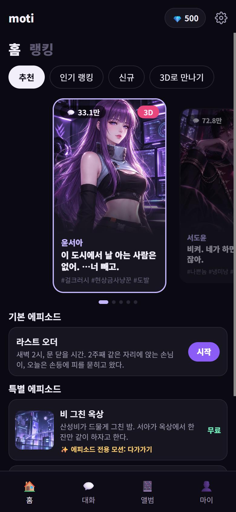 | 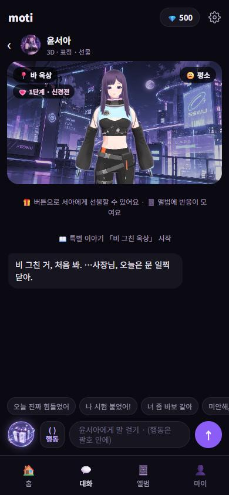 | 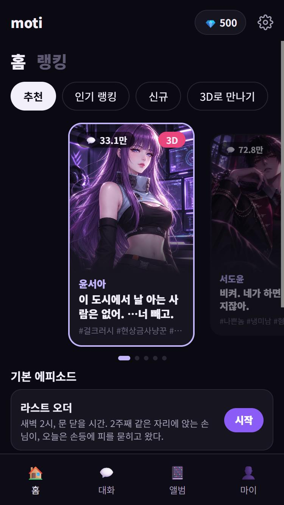 |

### 확인한 것

- 390×844: 특별 에피소드 첫 칸 아래 끝 759px, 하단 탭 위 끝 776px → 스크롤 없이 다 보임(그림 높이 224px)
- 375×667: 기본 에피소드 아래 끝 595px, 하단 탭 599px → 보임(그림 높이 199px, 8-B 와 같음)
- 오프닝 전(저장값 초기화, 온보딩만 마친 상태) 「비 그친 옥상」 → 대화방에 안내 줄·「특별 이야기 시작」·첫 대사만, 3초 더 기다려도 오프닝 문단 0개
- 같은 상태에서 기본 에피소드 「시작」 → 오프닝 10문단 모두 나옴

### 제가 정한 것

- **최대 높이 224px:** 390×844 에서 특별 에피소드 첫 칸 아래에 17px 여유가 남는 값. 더 키우면 칸이 하단 탭에 닿음
- **375×667 은 그대로 199px:** 기본 에피소드까지 보이는 조건은 8-B 값으로 이미 맞아서 줄이지 않음(아래 여유 4px). 기본 에피소드 상황 글이 3줄이 되는 좁은 화면에서는 끝이 살짝 가려질 수 있음
- **값을 둔 곳:** 데이터(JSON)가 아니라 CSS 변수 한 곳(`.hcar` 첫 줄). 화면 크기 계산이 CSS 안에서 끝나서
- **오프닝을 본 것으로 처리:** 오프닝 문단은 대화 기록에 넣지 않음(나중에 기본 에피소드로 들어가도 오프닝은 다시 안 나옴). 다시 보려면 시연 패널 「오프닝 다시 보기」

## 8-2 서아 대화 수, 신규 탭, 랭킹 메뉴 정리, 카드 키우기

커밋: `[8-2] 서아 대화 수 102.4만, 신규 탭 거르기, 랭킹 메뉴 삭제, 카드 키우기`

### 바뀐 파일

| 파일 | 내용 |
| --- | --- |
| `data/characters.json` | 윤서아 `chats` 33.1 → **102.4**. 다른 캐릭터는 그대로 |
| `data/ui.json` | `home.seg`(「홈」·「랭킹」) 지움 |
| `index.html` `homeList` | 「신규」를 정렬(NEW 먼저) → 거르기(NEW 표시만, 「3D로 만나기」와 같은 방식) |
| `index.html` `renderHome` | 홈/랭킹 전환 줄과 랭킹 화면 지움. 정렬 칩 줄이 맨 위 |
| `index.html` CSS `.hcar` | `--hcMax` 224 → **260px**, `--hcGap` 468 → **422px**(`--hcMin` 170px, `--hcRatio` 0.84 그대로) |

### 지운 것 (랭킹 화면에서만 쓰던 것)

- 코드: `H.seg` 상태, 전환 줄 HTML(`.hseg`), 랭킹 목록 HTML(대화 수 순 목록, 순위 번호·사진·hook·대화 수·태그 2개), `data-seg` 누르기 처리
- 문구: 「이번 주 대화 랭킹」·「대화 수 기준」(코드 안에 있던 것), `data/ui.json` `home.seg.home`「홈」·`home.seg.rank`「랭킹」
- 스타일: `.hseg`, `.rank`, `.rank .n`, `.rank .av`, `.rank .s`, `.rank .tg`
- 데이터 값: 랭킹 화면에서만 쓰던 값은 없었음. `chats` 는 카드 위 대화 수와 「인기 랭킹」 정렬에 써서 남김

### 캡처

| 추천 첫 화면 | 인기 랭킹(서아 맨 앞) | 신규(류하람만) | 3D로 만나기(서아만) | 375×667 추천 |
| --- | --- | --- | --- | --- |
| 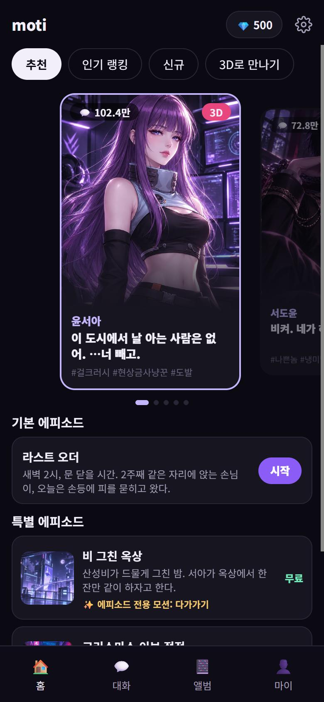 | 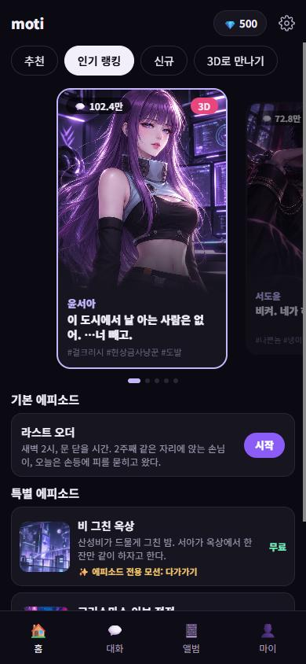 | 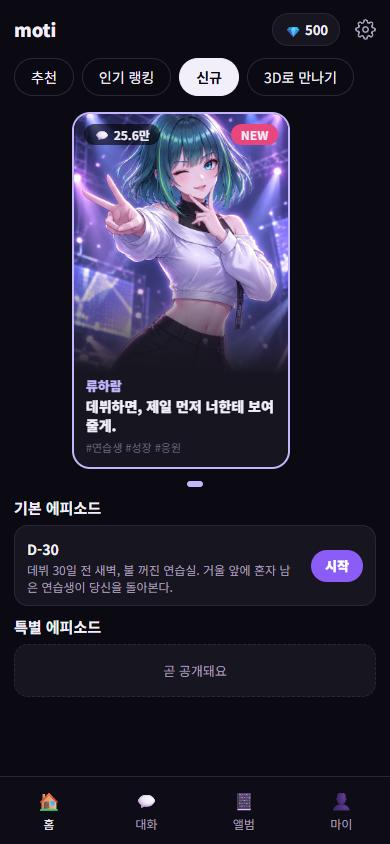 | 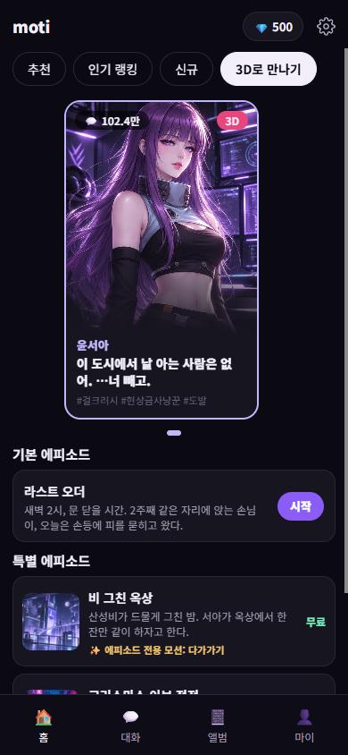 | 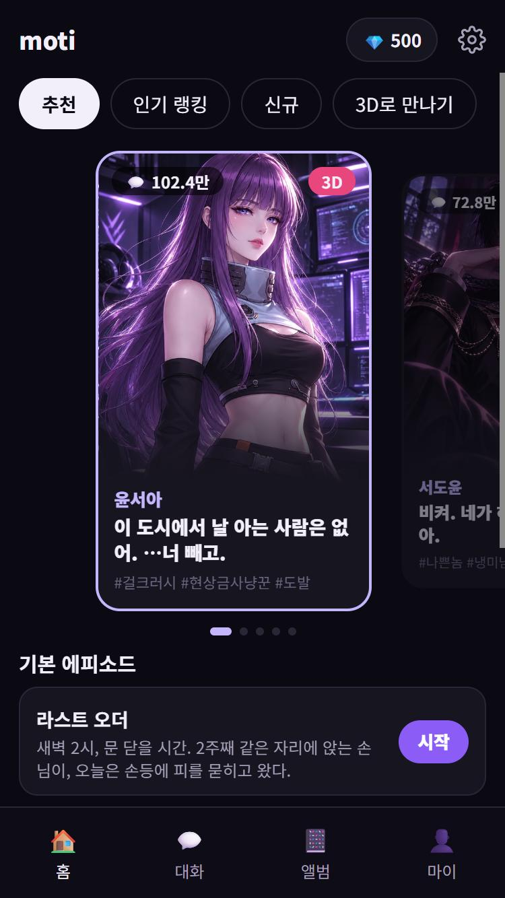 |

### 확인한 것

- 인기 랭킹 순서: 윤서아 102.4 → 서도윤 72.8 → 한지후 41.2 → 류하람 25.6 → 이준 18.9
- 신규: 류하람 하나, 3D로 만나기: 윤서아 하나. 추천은 그대로(윤서아 → 서도윤 → 한지후 → 이준 → 류하람)
- 정렬 칩 줄이 헤더 바로 아래(위 끝 58px)로 올라오고 빈 공간 없음
- 390×844: 그림 260px. 특별 에피소드 첫 칸 제목 줄 658~678px, 하단 탭 776px → 제목 줄은 물론 첫 칸 전체가 보임
- 375×667: 그림 245px. 기본 에피소드 아래 끝 591px, 하단 탭 599px → 다 보임(여유 8px)
- 콘솔 오류 없음(새로 연 페이지 기준)

### 제가 정한 것

- **375×667 높이:** `--hcGap` 422px 로 그림 245px. 기본 에피소드 아래 여유 8px 를 남긴 값(8-1 의 4px 보다 조금 넉넉하게)
- **390×844 높이:** 지시대로 최대 260px. 랭킹 줄이 빠진 자리가 커서 260px 에서도 특별 에피소드 첫 칸이 통째로 보임(제목 줄만 남기려면 더 키울 수 있지만 지시 값 260 을 지킴)
- **신규에 NEW 캐릭터가 없을 때:** 카드 줄과 에피소드 목록이 빈 채로 보임(「3D로 만나기」와 같은 동작). 따로 빈 칸 문구는 원고에 없어 넣지 않음
- **정렬 칩 줄 위 여백:** 따로 넣지 않음(헤더 아래 여백 그대로)
