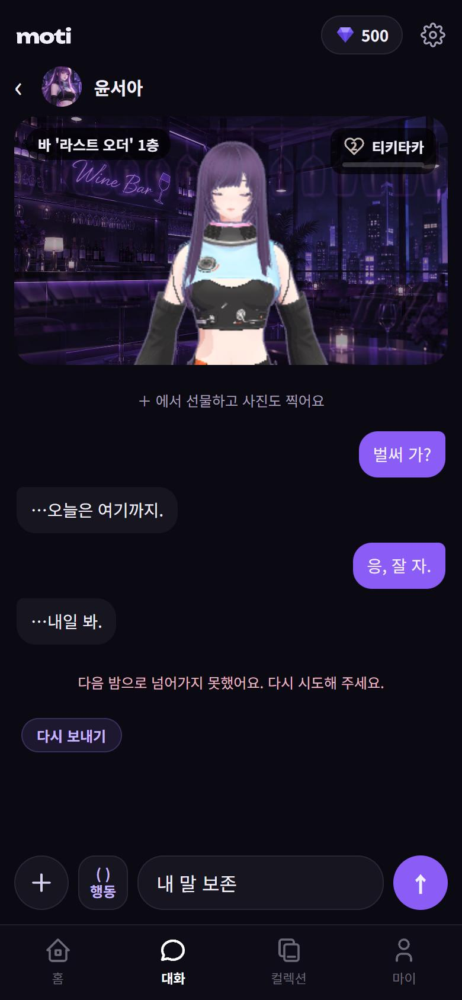
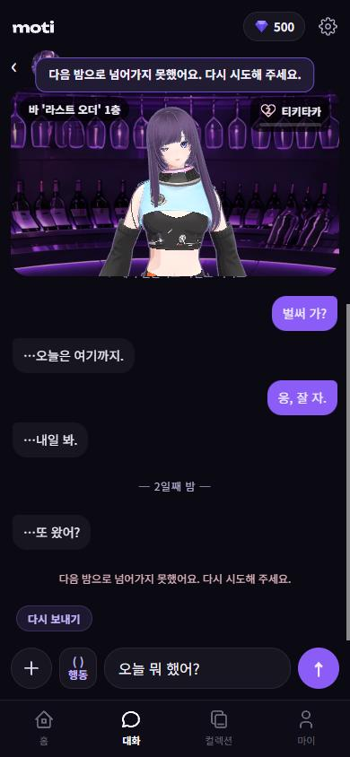

# 80-1. 밤 전환 예외 처리 보완

브랜치: `step/80-1-night-recovery` · 서버 수정·유료 API 호출 없음 · 가짜 `/chat`·`/judge` 응답으로 확인

## 오류 원인

1. **밤 전환 직전 판정 실패(A):** `Night.run()` 의 ph "go" 는 남은 일반 판정 묶음을 `runJudge()` 로 보내고 결과와 상관없이 시간 카드 → 「[다음 밤]」 /chat 으로 넘어갔음. `runJudge()` 는 실패해도 오류를 내지 않고(묶음 `S.judgeBuf` 만 남음) 끝나서, 판정을 못 받은 이전 밤 상태로 다음 밤이 시작될 수 있었음.
2. **첫마디 뒤 판정 실패(B):** 「[다음 밤]」 /judge 가 자동 재시도까지 실패하면 ph "judge" 로 남지만, `send()` 관문이 그 판정을 한 번 더 해 보고 실패해도 내 말을 일반 /chat 으로 보냈음 → 서버 state 는 아직 이전 밤(night_next·날짜 그대로)인 채 대화가 이어짐.

## 수정 내용 (`index.html`, `data/ui.json`)

- **선물:** 밤 넘기기가 남아 있으면 `give()` 가 다이아를 빼기 전에 막음(아래 「제가 정한 것」 3).

- **A:** ph "go" 에서 `runJudge()` 뒤 `S.judgeBuf` 가 남아 있으면(= 판정 실패) 그 자리에서 멈춤. ph "go"·묶음 그대로, 시간 카드·구분선·「[다음 밤]」 요청 없음. 정상 판정이 끝나야(묶음이 빔) 기존 순서(카드 → 첫마디 → 판정)로 이어 감.
- **B:** `send()` 관문을 「밤 넘기기가 남아 있으면(go·card·chat·judge) 일반 /chat 을 보내지 않음」으로 바꿈. 내 말은 입력창에 그대로 두고 `Night.retry()` 로 남은 단계만 다시(ph judge 면 같은 「[다음 밤]」 /judge 만). 판정이 성공해 서버 state 를 반영한 뒤에만 일반 대화가 됨.
- **멈춤 표시:** 자동 재시도(「[다음 밤]」 판정은 기존 `night.judgeTries` 2회 그대로)까지 실패하면 `S.night.stuck = true`, 입력창은 풀고(busy false) 토스트 + 대화 끝에 안내 줄 「다음 밤으로 넘어가지 못했어요. 다시 시도해 주세요.」(`data/ui.json` `chat.nightFail`)과 「다시 보내기」 버튼. 이 줄은 대화 기록에 저장하지 않고 그릴 때만 붙여서(새로고침·여러 번 실패해도 하나) 서버 history·recent 에도 안 들어감.
- 「다시 보내기」(또는 입력창에서 보내기) → stuck 을 풀고 그 단계부터 다시. 이미 보인 유저 말·서아 답장·첫마디·시간 카드·구분선은 다시 만들지 않음(ph·`div` 로 구분, 80 그대로).

## 테스트 결과 (가짜 서버, 390px)

| # | 항목 | 결과 |
| --- | --- | --- |
| 1 | 밤 전환 직전 일반 판정 실패 | ✅ /judge 500 → ph go·stuck·묶음 2개 그대로, 시간 카드 안 뜸, 구분선 0, 「[다음 밤]」 /chat 0, 안내 줄·다시 보내기 표시, 입력창 풀림 |
| 2 | 판정 재시도 성공 → 정상 전환 | ✅ 다시 보내기 → /judge(묶음) 성공 → 카드·구분선 1 → 「[다음 밤]」 /chat → /judge |
| 3 | 첫마디 뒤 /judge 연속 실패 | ✅ 자동 2회 실패 → ph judge·stuck·안내 줄. 그때 내 말 보내기 → 「[다음 밤]」 /judge 만 2번, 일반 /chat 0 |
| 4 | 재시도 성공 → 서버 상태 반영 후 일반 대화 | ✅ 다시 보내기 → 판정 성공(day 2, night_next null) → 안내 줄 사라짐 → 다음 내 말 /chat state 에 day 2 · night_next null |
| 5 | 실패 중 입력 보존 | ✅ 「내 말 보존」「오늘 뭐 했어?」 둘 다 입력창에 그대로, 유저 말풍선 안 생김 |
| 6 | 새로고침·줄기 전환·되감기 | ✅ 새로고침 → stuck·ph judge 유지, 대화방에 들어오면 같은 판정만 다시(첫마디 1·구분선 1). 크리스마스로 갔다 오면 크리스마스 관문 none, 돌아와서 판정만 다시. 멈춘 채 되감기 → S.night null(지점 값), 안내 줄 없음, 요청 0 |
| 7 | 정상 밤 전환 · 크리스마스 | ✅ 마무리 → 한 번 답 → 카드 → 첫마디 → 판정(안내 줄 없음). 크리스마스 대화 3번 → /chat 3 · /judge 1, 에피소드 단계 이름 그대로 |

- 콘솔 오류: 가짜 주소 깨우기 요청 실패(ERR_NAME_NOT_RESOLVED)뿐. `data/ui.json` JSON 통과.
- 확인 중 한 번, 새로고침 → 크리스마스 갔다 오기를 한 스크립트에서 이어 돌렸을 때 S.night 가 ph "user" 로 보이고 요청이 0개로 찍힌 적이 있음. 같은 순서를 나눠서 세 번 다시 해 봤지만 재현되지 않았고(모두 ph judge 유지·판정만 다시), 그 스크립트가 중간에 오류로 끊겨 원인을 확정하지 못함. 실기기에서 같은 흐름이 보이면 알려 주세요.

## 캡처 (390px)

| 밤 전환 직전 판정 실패 | 첫마디 뒤 판정 실패(입력 보존) |
| --- | --- |
|  |  |

## 제가 정한 것

1. **A 의 자동 재시도 횟수:** 전환 직전 묶음 판정은 따로 바로 다시 하지 않고 한 번 실패하면 멈춤(묶음 판정은 판정 대기 시간이 길어 연달아 다시 하면 화면이 오래 잠김). 이미 queueJudge 가 보낸 판정이 실패했으면 run 이 한 번 더 보내므로 실제로는 최대 2번.
2. **안내 문구 위치:** 지정 문구를 A·B 공통으로 씀. 토스트 한 번 + 대화 끝 안내 줄 + 「다시 보내기」(기존 `chat.retry`, 예비 지문 다시 보내기 칩과 같은 모양). 안내 줄은 저장하지 않음.
3. **멈춘 동안 보내기·선물:** 입력창 보내기 = 다시 보내기와 같음(말은 입력창에 남김). 포즈는 send 관문에서 멈추고 고른 포즈는 그대로. 선물은 `give()` 가 다이아를 빼기 전에 `Night.gate()` 를 보고 안내 토스트로 막음(멈춘 채 선물을 눌러 다이아만 빠지는 일 방지, 확인: 💎 500 그대로, 밤이 끝난 뒤엔 정상 차감 490).
4. **새로고침 뒤:** 대화방에 들어오면 멈춘 단계를 한 번 자동으로 다시(80 의 resume 그대로). 실패하면 다시 멈춤 표시.

## 아이폰에서 나중에 볼 것

- 안내 줄·「다시 보내기」 버튼이 키보드가 올라온 상태에서 가려지지 않는지
- 토스트와 안내 줄이 겹쳐 보이는 시간

