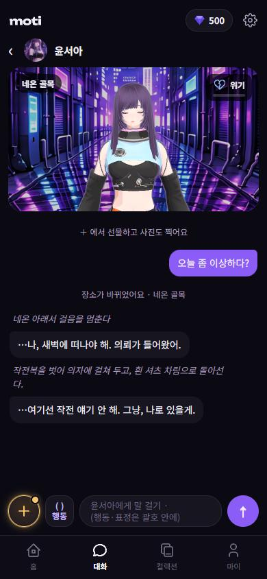
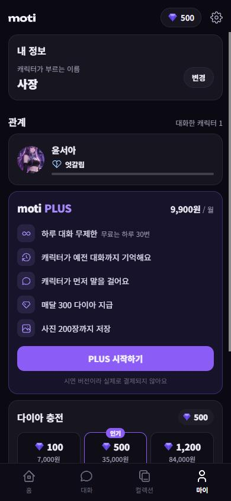
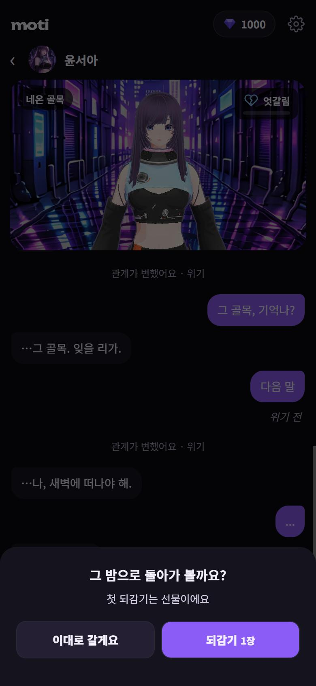
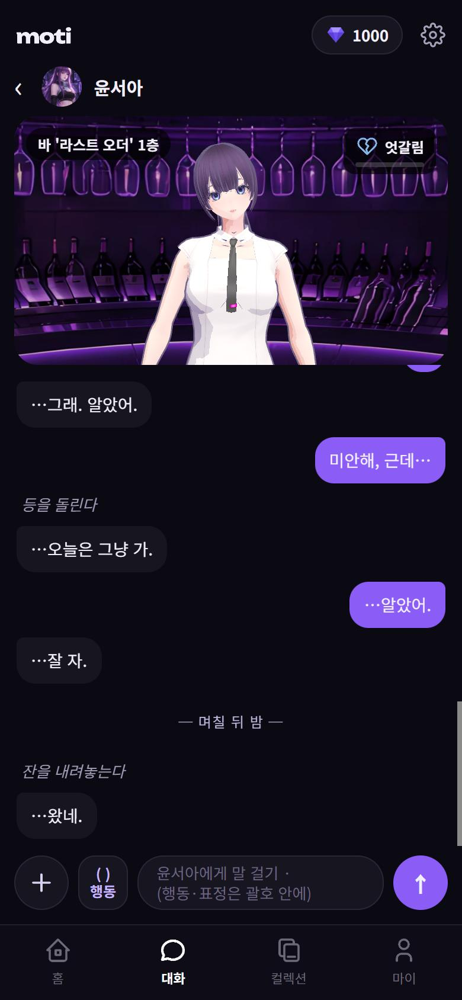
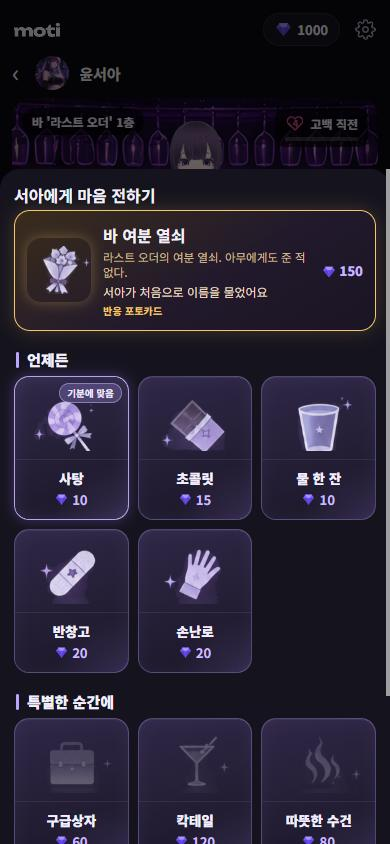

# 80. 앱 S4 통합 연동 — 위기·엇갈림·화해·밤 넘기기·기억·순간 선물

서버 `ddododo-lang/seoa-backand` main 에 S4 · S4-1 · S4-1-1(PR #21, 2026-11-26 병합)까지 들어간 것을 확인하고 앱에 맞춤. 서버 보고서끼리 다른 곳은 S4-1-1 → S4-1 → S4 순으로 따름. 서버 저장소는 고치지 않음. 유료 Gemini 호출 없이 브라우저 안 가짜 `/chat`·`/judge` 응답으로 확인.

브랜치: `step/80-s4-integration`

## 바뀐 파일

| 파일 | 바뀐 것 |
| --- | --- |
| `index.html` | `mainStageName`(stage_label) · `EpStage.nameOf`(에피소드 단계 이름) · 하트 줄·마이 관계·대화 목록·시연 패널 이름 · `usedFlags`(withdraw 빼기) · `Route.nightDue/night`(첫 밤 마무리 갈래) · `S4_KEYS`·`MAIN_KEYS`·`clearS4`·`noNameFlow`(크리스마스 요청에서 본편 키 빼기) · `judgeText`(reply_ok·메시지 단위 자르기) · `recentTalk`(실패 답장 제외 recent 80) · `runJudge`(recent 조건·reply_ok·S4.judged, 예전 departed 실패 호출 뺌) · `S4.judged`(엇갈림 알림·위기 지점·권유·밤 준비) · `trimChat`(보관량) · `askServer(…,{auto})` · `send()`(밤 넘기기 관문·정상 답장 판별 `srvOk`·`bad` 표시·사건 비우기·밤 시작) · `afterReply(v, used)` · `Moment.words`(칵테일 말) · 선물 창 설명 줄 · `End`(crisisPoint·offer·showOffer·clearMain, rewind/doRewind 의 권유 경로, 본편 예전 에필로그 재생 안 함, migrate 끔, snap 에 밤 진행·판정 시점 자르기) · `Night`(밤 넘기기 전체) · 시간 카드 `#nightCard` 와 CSS · 시연 패널 「위기 바로」「엇갈림 바로」「밤 넘기기 바로」, 「본편 실패」 숨김 |
| `data/seoa_story.json` | stageNames 5 「위기」, `riftLabel` 「엇갈림」, affectionAt `[0,10,25,40,55,100]`, route.decide.night |
| `data/episodes.json` | s2 `stage.stageNames`(크리스마스 「엇갈림」 그대로) |
| `data/config.json` | `chatKeep`(서아 실제 대화 100 · 한 방 300줄 · 다른 캐릭터 60), `judgeIgnoreFlags` ["withdraw"], `night`(cardMs 1500 등) |
| `data/demo.json` | serverStage.minMsgs `{2:9, 3:9, 4:6}`, `s4` 버튼 이름·시간 카드 문구, 갈래 정한 때 「첫 밤 마무리」 |
| `data/ui.json` | `top.rift` 「서아와의 사이가 엇갈렸어요.」, `chat.nightDivider` 「─ {card} ─」 |
| `data/rewind.json` | `offer` 문구(원고 4-4) |
| `data/gifts.json` | flower → 바 여분 열쇠(🔑, desc, 가격·x29·when 그대로), `momentWords`(칵테일) |
| `data/collection.json` · `data/motions.json` | gm04 카드 이름 · x29 몸짓 이름 → 바 여분 열쇠 |
| `docs/server-sync.md` | S3·S4·S4-1·S4-1-1 처리함 줄, 「80 · S4 통합 — 지금 규칙」 절, 51 절에 「예전 출발 구조」 표시 |
| `docs/status.md` | 80 절 |

커밋: 구현은 A~F 가 서로 부름(판정 → `S4.judged` → 되감기 지점·권유·밤 넘기기)이라 따로 나누면 중간 커밋이 동작하지 않아서 `[80 A-F]` 한 커밋으로(본문에 절마다 한 일). 보고서·버전은 따로.

## S4 · S4-1 · S4-1-1 연동 내용

### A. 관계 단계 · 갈래 · 상태값
- 본편 5단계 이름 「위기」. 지금 본편 단계 이름은 서버 `state.stage_label` 을 그대로(엇갈림이면 「엇갈림」). 값이 없는 예전 저장은 `crisis == "rift"` 면 `riftLabel`, 그 밖은 stageNames. 대화방 하트 줄·마이 관계·대화 목록·시연 패널이 같은 함수.
- 크리스마스는 `EpStage.nameOf`(s2 stageNames)로 따로 — 5단계 「엇갈림」 그대로. 마이 관계는 늘 본편 값.
- affectionAt `[0,10,25,40,55,100]` 는 게이지·시연 값에만. 엇갈림(호감 40)에서 게이지 0%(아래로 안 감), 하트 숫자 5, 연인 100%.
- 갈래: 판정 결과를 저장하고 이번 판정의 장난·다정을 센 뒤, 2단계 · route null · (`night_next` == NIGHT_START_2 또는 `used_events.NIGHT_END_2`) 면 그 자리에서 정함 → 다음 요청에 들어감. 예전 조건(호감 40·outside)이 먼저면 그때. 밤 넘기기 「[다음 밤]」 직전에 한 번 더 확인. 서버가 준 route 는 그대로, `Route.check`·`decide` 는 값이 있으면 안 바꿈. 크리스마스에서는 안 정함.
- 새 키는 `/judge` 응답 state 를 통째로 저장하는 기존 동작으로 받은 그대로 다음 본편 요청에 감.
- 본편 전용 관리: `MEMO_KEYS` 에 `stage_note_queue`. `MAIN_KEYS` = S4 키 13개 + route·scene·scene_judges_left·used_events. 크리스마스 `/chat`·`/judge` 에서 빼고 pending_event 는 null. 본편 값은 그대로(확인함).
- 엇갈림 알림: 판정 전 crisis 가 rift 가 아니었고 뒤가 rift 면 토스트 한 번(단계 하락 알림과 같은 토스트). stageDown 안 부름. 위기·화해 성공으로 stage 6 이 오면 기존 stageUp(연출·해금) 그대로.

### B. 판정 · 사건 · 기억
- judgeEvery 3, judge_soon 이면 답장마다(그대로). withdraw 는 `judgeIgnoreFlags` 로 결정적 순간·몸짓 해금·갈래 집계에서 뺌(호감은 서버 값 그대로).
- pending_event: `send()` 에서 특별 에피소드가 출처를 바꾸기 전 값(`srvOk`)으로 실제 서버 성공을 가림. 본편 정상 서버 답장일 때만, 그 요청에 실은 사건이 아직 그대로면 비움. HTTP 오류·시간 초과·서버 「…」·앱 예비 지문·크리스마스 답장은 안 비움. 판정·사건 해금도 `srvOk` 일 때만.
- `/judge reply_ok`: 묶음에는 정상 답장만 들어가므로 새 묶음 항목에 `ok:1` → 남은 메시지 수만큼 true. `ok` 가 없는 예전 묶음이 섞이면 reply_ok 생략. last_user 가 1000자를 넘으면 오래된 메시지를 통째로 빼고(reply_ok 도 같이), 하나 남은 메시지가 그래도 길면 그 메시지 끝 1000자(줄바꿈 경계 그대로).
- `recent`: 본편에서 need_summary 또는 stage_note_due != null 또는 stage_note_queue 가 비어 있지 않으면 최근 실제 대화 80개(`historyMessages`). 앱 예비 지문(`bad`·`fb`) 답장과 그 바로 앞 내 말은 뺌. 시간 구분선·시스템 줄·「[다음 밤]」은 대화 기록에 실제 대화로 없어서 안 들어감.
- 보관량: `chatKeep.seoaTalk` 100 — 서아 대화방은 실제 대화 100개를 지키고 그보다 오래된 줄을 지움. 한 방이 300줄을 넘으면 오래된 시스템·사진 줄부터. 다른 캐릭터 60줄 그대로. 이미 잘린 기록은 만들지 않음.

### C. 밤 넘기기 (진행 순서와 실패 복구)
`S.night = {ph, card, next, div, reply, fails}` (본편 전용, 저장·되감기 지점에 같이).

| ph | 뜻 | 넘어가는 때 |
| --- | --- | --- |
| end | 마무리 사건(NIGHT_END·RIFT_START) 답장 기다림 | 판정 state 에 night_next 가 생김(사건이 이미 나간 예전 저장이면 바로 user) |
| user | 유저 한 번 답 기다림 | 그 사건을 실은 /chat 이 정상 답장 |
| go | 전환 시작 | 유저 한 번 답의 정상 답장(실패 답장은 안 셈) |
| card | 시간 카드 | 남은 일반 판정 묶음을 먼저 판정(같은 묶음에 안 섞음) · 갈래 확인 · 서버가 이미 넘겼으면 끝 |
| chat | 「[다음 밤]」 /chat | 화면이 어두워짐 → 가운데 `night_card` → 어두운 동안 바 1층 → 밝아짐. 구분선 「─ {card} ─」 한 번(`div`) |
| judge | 「[다음 밤]」 /judge | 정상 첫마디를 평소 답장처럼(장소·표정·몸짓) 표시 |
| (끝) | | 판정 state 반영(날짜·장소·시간대·night_next 는 서버 값) |

- 「[다음 밤]」은 말풍선·대화 기록·history 에 없음. S.bond·순간 선물 턴·확대 턴·판정 횟수(요약 주기)에 안 셈. /judge 는 last_user 「[다음 밤]」, last_reply 첫마디, need_summary false, reply_ok [].
- 전환 중(go·card·chat·judge 실행 중) `busy` → 입력·선물·포즈(모두 send 를 거침) 잠김.
- /chat 실패: 기존 예비 지문 + 「다시 보내기」(retry "night") → 같은 첫마디 요청만 다시. 그 사이 내 말을 보내면 말은 입력창에 두고 첫마디부터 다시.
- /judge 실패: `night.judgeTries`(2)번까지 바로 다시. 그래도 안 되면 입력창을 풀고, 다음 내 메시지 때 같은 판정만 먼저 한 번 한 뒤 내 말을 보냄(첫마디는 다시 안 만듦). 무한 재시도 없음.
- 새로고침: 대화방에 들어오면 이어 감. 구분선은 `div` 로, 첫마디는 ph 가 judge 로 바뀐 뒤라 다시 안 만듦. 실패 줄이 떠 있으면 다시 보내기를 기다림.
- 시연 초기화·장면 이동·줄기 바꾸기·되감기·처음부터: `Night.stop()` + 토큰·GEN 으로 앞 작업 결과를 버림.

### D. 되감기 지점 · 권유 · 재화
- 지점: 본편 판정이 5단계 + pending CRISIS 를 돌려준 그 자리(`End.crisisPoint`). state 통째 · 대화 기록 · 장소 · 갈래와 집계 · 판정 묶음·요약 주기 · 밤 진행. 판정을 기다리는 동안 먼저 기록된 다음 내 말은 빼고(판정을 보낸 때 마지막 줄까지 + 그 뒤 시스템 줄) 저장. 위기 지점이 이미 있으면 덮어쓰지 않음(CRISIS 를 「…」로 다시 받아도). 예전 51 지점(위기 지점 아님)은 새 위기가 오면 바꿈.
- 권유: `rewind_offer` true 판정 → 「그 밤으로 돌아가 볼까요?」 [이대로 갈게요] [되감기 n장 / 💎200]. 엇갈림이 된 판정(`used_events.RIFT_START`)마다 한 번(`offered`), 같은 응답·새로고침으로 다시 안 뜸. 대화방이 아니면 들어올 때 한 번. 지점이 없으면 안 띄움(지점을 만들거나 차감하지 않음).
- 재화: 처음 권유가 뜰 때 첫 무료 1장(실패 엔딩과 같은 `S.rwFirst`, 한 번만). 장 우선 → 없으면 200💎 확인창 → 모자라면 기존 안내. 「이대로 갈게요」·바깥 눌러 닫기는 차감 없음. 권유는 r.end 와 따로라 본편을 잠그지 않음.
- 되감기: `S.story` 를 지점 값으로 통째(crisis·crisis_msgs·rift_sorry·used_events·pending_event·scene_msgs·stage_note_queue·stage_note_due·stage_notes·promises·summary·route 를 섞지 않음). 카드·사진·보상·엔딩 기록·다이아 그대로.
- 본편 예전 실패 엔딩 끔: runJudge 의 departed → End.fail 호출 뺌, 5단계 뒤 지점(stageUp·replied)·예전 저장 지점 만들기(migrate) 끔, 「본편 실패」 시연 버튼 숨김. 이미 departed 로 잠긴 저장은 끝 화면(되감기·처음부터)만 보이고 「떠난 밤」 에필로그를 새로 재생하지 않음. 앱에 「떠나기까지 이틀」 같은 남은 날 표시는 원래 없었음(grep 확인). 크리스마스 실패·자정·되감기·처음부터와 stayed 성공 엔딩은 그대로.

### E. 바 여분 열쇠 · 칵테일
- `flower` = 「바 여분 열쇠」 🔑, 설명 「라스트 오더의 여분 열쇠. 아무에게도 준 적 없다.」(선물 창 맨 위 칸), 150💎, x29, when 그대로. id 그대로라 저장값·준 기록·컬렉션 gm04·쿨다운 호환. 서버로 가는 `gift_moments` 이름·선물 줄 「[유저가 선물함: 바 여분 열쇠] · 순간 선물」 확인. 지난 대화의 꽃다발 문구는 그대로.
- 칵테일: `momentWords.cocktail` — 본편 2단계, 내 말 또는 서아 답장(지문·대사)에 「칵테일」「한 잔 타 줄게」「술 만들어」(띄어쓰기 무시)면 서버 gift_moment 없이(`momentSrv` 와 상관없이) 엶. 실제 서버 정상 답장 턴만, 크리스마스 아님, 준 적 없음, 쿨다운 아님, 다른 순간 선물이 닫혀 있을 때만. 3턴·쿨다운 10턴·가격·x27 그대로.

### F. 시연 패널 (바로 하기 줄)
- 「위기 바로」: 5단계 · 호감 55 · crisis on · 위기 · pending CRISIS · used_events.CRISIS = turn · judge_soon · route 없으면 care, 앞 장면·화해 예약 정리 → 판정을 받은 것처럼 `S4.judged` → 위기 지점 저장.
- 「엇갈림 바로」: 위기 바로 상태와 지점을 먼저 만든 뒤 호감 40 · rift · RIFT_START · RIFT_NIGHT · 「며칠 뒤 밤」 · rewind_offer → 실제 알림·권유·밤 넘기기 준비가 그대로 돎.
- 「밤 넘기기 바로」: 2단계 · 호감 10 · day 1 · NIGHT_END · NIGHT_START_2 · 「2일째 밤」 · night_wait 0 · used_events.NIGHT_END_2 · 갈래 없으면 집계로 정함.
- 단계 버튼·장면 바로가기·관계 초기화는 `clearS4`(위기·밤 넘기기·장면 예약 비움) · 위기 지점·권유 기록 비움.

## 테스트 결과 (가짜 /chat·/judge, 390px, 2026-11-26)

브라우저 안에서 `fetch` 를 가짜 서버로 바꿔(요청 본문 기록) `?server=2&api=http://fake.test&debug=1` 로 확인. 실제 Gemini 응답으로는 확인하지 않음.

| # | 항목 | 결과 |
| --- | --- | --- |
| 1 | 위기·엇갈림 표시, 마이·대화 목록 일치 | ✅ 하트 줄 「위기」→「엇갈림」, 마이 관계·대화 목록도 「엇갈림」, 게이지 0% |
| 2 | 서버 route 유지 · 첫 밤 마무리에서 결정 | ✅ 장난 3·다정 1 + NIGHT_END_2 판정 → tease(정한 때 night), 다음 /chat 에 route tease. 서버 route care 는 집계(장난 5)와 달라도 그대로, check·night 도 안 바꿈 |
| 3 | judge_soon 답장마다 · 일반 3개씩 | ✅ 위기 중 답장마다 /judge, 일반은 세 번째 답장 뒤 |
| 4 | /chat 실패 시 pending 유지 · 재시도 | ✅ 500 → ROOFTOP 그대로·판정 안 함·`bad` 표시 → 다시 보내기 → 같은 사건 실어 보내고 성공 뒤 비움 |
| 5 | reply_ok 와 last_user 개수·순서 | ✅ [true,true,true]. 1000자 넘는 묶음은 오래된 메시지 통째로 빠지고 개수 같이 줄어듦. 예전 묶음(ok 없음)은 생략 |
| 6 | 실제 대화 80개 보관·요청 | ✅ 300줄 넣어도 실제 대화 100개 남음, /chat history 80, recent 80, 다른 캐릭터 60 |
| 7 | need_summary false + stage_note_due → recent | ✅ need_summary false 인 판정에 recent 36(그때 있던 전부, 실패 답장 제외) |
| 8 | 새 키 저장·초기화·크리스마스 분리 | ✅ 크리스마스 /chat·/judge state 에 본편 키 0개, pending null, 크리스마스 판정이 rift·night_next·queue 를 비우는 응답을 줘도 본편 값 그대로. 새로고침 뒤 S.night·키 유지. 단계 버튼·관계 초기화에서 비워짐 |
| 9 | 위기 소식 → 성공 → 6단계 | ✅ 「관계가 변했어요 · 연인」, 하트 6 |
| 10 | 위기 실패 → 엇갈림 알림 → 권유 | ✅ 토스트 「서아와의 사이가 엇갈렸어요.」 한 번, 권유 창, 같은 state 를 다시 받아도 알림·권유 없음 |
| 11 | 두 버튼 · 중복 권유·차감 없음 | ✅ 이대로 갈게요 = 차감 0·엇갈림 유지 · 되감기 = 첫 무료 1장 사용 / 장 없을 때 확인창 → 1000→800 / 💎 50 이면 부족 안내·차감 0 |
| 12 | CRISIS 답장 직전으로 복원 | ✅ stage 5·crisis on·위기·pending CRISIS·rift_sorry 없음·S.night null, 대화 끝 「*…다시, 그 밤.*」. 판정이 늦을 때 먼저 기록된 다음 내 말은 지점에 없음 |
| 13 | 마무리 → 한 번 → 정상 답장 → 카드 → 첫마디 | ✅ end → user → go → card → chat → judge → 끝 |
| 14 | [다음 밤] /chat 뒤 바로 /judge · 메시지 수 그대로 | ✅ 순서 /chat(한 번 답) → /judge(남은 묶음) → /chat [다음 밤] → /judge [다음 밤]. S.bond·turnN 은 내 말 한 번만 +1, judgeN 은 묶음 판정만 +1 |
| 15 | 구분선 · history 에 숨은 메시지 없음 | ✅ 「─ 며칠 뒤 밤 ─」「─ 2일째 밤 ─」, history·recent 에 「[다음 밤]」 없음, 유저 말풍선 없음 |
| 16 | 실패·재시도·새로고침 | ✅ 카드 중 새로고침 → 구분선 3개 그대로(중복 없음), 첫마디 500 → 예비 지문 + 다시 보내기 → 성공. /judge 500 두 번 → 입력창 풀림, 다음 내 말 때 같은 판정만 먼저 → 성공, 첫마디 하나 |
| 17 | 바 여분 열쇠 | ✅ 이름·설명·🔑·150·x29·when, 컬렉션 gm04·x29 이름, gift_moments 이름, 선물 줄, 준 기록 id flower |
| 18 | 유저·서아 칵테일 말 | ✅ 「칵테일 한잔 타줄게」(내 말) · 「…내가 술 만들어 볼까.」(서아) 로 열림(momentSrv true 상태) |
| 19 | 중복 방지 | ✅ 준 적 있음·쿨다운·구급상자 열려 있음·서버 실패 턴·3단계 → 안 열림 |
| 20 | 크리스마스 실패·되감기·단계 이름 | ✅ 「크리스마스 실패」 시연 → 에필로그 4문단·끝 화면, 단계 이름 5 「엇갈림」 |
| 21 | [78]·[78-1] 포즈·카메라·카드 | ✅ pose.js·카드 획득 코드 안 건드림(diff 없음) |
| 22 | 사진·카드·선물·엔딩 기록 보존 | ✅ 되감기·권유는 S.col·사진·S.giftGiven·S.endings·다이아(차감 빼고)를 안 건드림 |
| 23 | 390px · 콘솔 · JSON | ✅ 콘솔 오류는 가짜 주소 깨우기 요청 실패(ERR_NAME_NOT_RESOLVED)뿐, data/*.json 21개 JSON 통과 |
| 24 | `node tools/check_gacha.mjs` | ✅ 모두 통과 |

테스트 중 제 실수: 처음에 확인용 함수 이름을 `say` 로 지어 앱의 자막 함수 `say` 를 덮어써서 답장이 다시 보내지는 반복이 생겼음(앱 문제 아님). 이름을 바꾸고 전체 초기화 뒤 처음부터 다시 확인함. 그 테스트 저장값은 미리보기 창(8765) 것뿐.

## 캡처 (390px)

| 위기 | 엇갈림(마이) | 권유 창 |
| --- | --- | --- |
|  |  |  |

| 시간 카드 | 시간 구분선(엇갈림 → 며칠 뒤 밤) | 바 여분 열쇠 |
| --- | --- | --- |
|  |  |  |

## 제가 정한 것

1. **커밋 묶음**: A~F 는 판정 하나가 S4.judged → 되감기 지점·권유·밤 넘기기로 이어져 서로 부르므로, 절마다 나누면 중간 커밋이 깨짐. 전체 테스트 뒤 `[80 A-F]` 한 커밋(본문에 절마다 한 일)으로 넣음.
2. **stage_label 우선**: 지금 단계 이름은 stage_label 이 있으면 단계 숫자와 상관없이 그 값(서버가 기준). 시연 단계 버튼은 stage_label 을 지워 어긋나지 않게 함.
3. **last_reply**: 묶음의 서아 답장들을 지금처럼 줄바꿈으로 이어 보냄(마지막 답장이 맨 끝, 실제 지문·대사). 판정 모델이 묶음 앞 메시지의 맥락을 잃지 않게. judge_soon(위기·화해 문)일 때는 답장 하나라 마지막 답장과 같음. 2000자를 넘으면 오래된 답장부터 통째로 뺌.
4. **실패 답장 표시 `bad`**: 서버 v2 를 쓰다 실패한 모든 서아 답장(선물·포즈 예비 대사 포함)에 붙여 recent 에서 그 답장과 바로 앞 내 말을 뺌. 예전 저장은 `fb` 만 보고 뺌(선물·포즈 예비 대사는 구분 못 함).
5. **판정·해금 조건을 `srvOk` 로**: 드라큘라처럼 단계가 없는 에피소드에서 출처를 "server" 로 바꾼 예비 대사가 판정·사건 해금으로 가던 것도 막음(B2 「실패한 사건에 대한 해금·판정 없음」).
6. **보관량 100**: historyMessages·recent 80 + 이번 말·여유. 서아 대화방(본편·크리스마스 줄기 모두)에 같은 규칙. 한 방 최대 300줄.
7. **크리스마스 요청에서 route 도 뺌**: 지시 A5 「갈래 관련 상태값도 본편 전용」과 서버 S4-1 「크리스마스는 본편 키 보관만」에 따라(51 때는 route 를 보냈음).
8. **시간 카드 모양**: 대화 화면 전체를 덮는 어두운 막(블러·그림자 없이 투명도만) 가운데 글자. 어두워짐 400ms · 카드 1500ms · 밝아짐 500ms, 바 1층으로는 어두운 동안 바로 옮김(장소 전환 막을 한 번 더 쓰지 않음). 값은 `config.night`. 대화방 밖이면 카드 없이 구분선·장소만.
9. **밤 넘기기 중 내 말**: 첫마디 전이면 내 말은 입력창에 두고 첫마디 요청부터(대화 순서가 꼬이지 않게). 판정만 남았으면 그 판정을 한 번 먼저 하고 내 말을 보냄(실패해도 대화는 막지 않음).
10. **[다음 밤] /judge 의 recent**: B4 조건(stage_note_due·queue)이 맞으면 보냄. 서버는 「[다음 밤]」만 온 판정에서 모델을 안 부르므로 실제로 쓰이지는 않음.
11. **night_next 가 있는데 사건이 이미 나간 예전 저장**: 바로 「한 번 답 기다림」(user)부터. 서버가 night_next 를 비우면(스스로 넘김) 시작 전 진행은 지움.
12. **엇갈림 알림 기준**: 판정 전 crisis ≠ rift → 뒤 rift 일 때 한 번(저장된 이전 값 기준이라 새로고침해도 다시 안 뜸).
13. **권유 한 번의 기준**: `used_events.RIFT_START` 값. 처음 뜰 때 바로 「닫힘」으로 저장(바깥을 눌러 닫아도 「이대로 갈게요」와 같음). 대화방 밖이면 들어올 때 한 번. 첫 무료 장은 권유가 처음 뜰 때.
14. **위기 지점 덮어쓰지 않기**: 한 번 생긴 위기 지점은 처음부터·관계 초기화·시연 장면 이동 전까지 유지. 예전 51 지점은 위기 지점이 아니라 새 위기가 오면 바꿈.
15. **예전 departed 저장**: 끝 화면만(에필로그 문단 수를 다 본 것으로). 끝 화면 문구(「서아가 떠났어요」)는 예전 그대로 둠.
16. **칵테일 말의 이유 줄**: 따로 짓지 않고 비워 둠 → 선물 창 맨 위 칸에 그 선물의 when 이 나옴.
17. **바 여분 열쇠 설명 자리**: 선물 창 맨 위 순간 선물 칸 이름 아래 한 줄(gifts.json `desc`). 컬렉션 카드·몸짓 이름도 바 여분 열쇠로(사용자에게 보이는 현재 이름).
18. **시연 버튼 자리**: 늘 보이는 「바로 하기」 줄(3단계 이름 장면 바로 옆).

## 열쇠 아이콘

- **열쇠 아이콘 필요**: 지금 `icons/gift2_flower.png`(꽃다발 그림)을 임시로 씀. 그림이 오면 `data/gifts.json` flower 의 `icon` 만 바꾸면 됨(그림 문자 🔑 은 그림이 없을 때만 보임).

## 아이폰에서 나중에 볼 것

- 시간 카드: 어두운 막이 화면 전체(안전 영역 포함)를 덮는지, 글자 페이드·위치, 막이 걷힐 때 3D 무대 깜빡임
- 권유 창(아래에서 올라오는 시트) 버튼 줄 「이대로 갈게요 | 되감기 1장」 줄바꿈
- 시간 구분선 줄 글자 간격, 선물 창 설명 줄 두 줄 넘김

## 실서버에서 나중에 볼 것

- 두 갈래의 핵심 사건이 중간에 끊기지 않는지(reply_ok 로 정상 답장 4개 셈)
- 위기에서 「가지 마」 같은 짧은 진심을 sincere·pursue 로 잘 잡는지
- withdraw 를 서운함·장난·망설임에 과도하게 적용하지 않는지
- 화해 성공 대사 중복 및 누락
- 밤 전환 전후 대화의 자연스러움(「[다음 밤]」 첫마디가 앞 밤과 이어지는지)
- 단계별 기억(stage_notes)과 실제 대화 구간이 맞는지(recent 80)
- 실제 /judge 응답의 night_card·stage_label·rewind_offer 값·타이밍이 가짜 응답과 같은지
