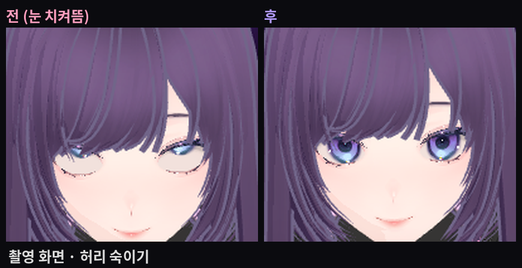
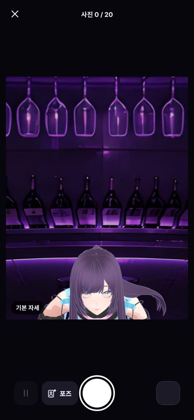
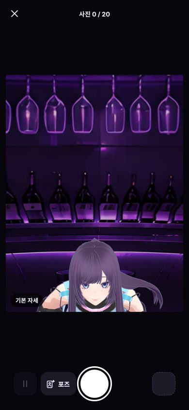

# 80단계 · 눈 치켜뜨는 얼굴 고치기

## 왜
79단계(고개를 돌리면 눈도 따라가기) 뒤에도 서아가 눈을 치켜뜨는 일이 남아 있었음. 재 보니 시선(카메라 쫓기)이 몸짓 중에 눈을 **위로** 굴리고 있었음:
- 대화 화면: 붙잡기 7.6°, 허리 숙이기 6.6°, 꽃받침 5.9°, 그 밖의 거의 모든 몸짓 3~5°(몸짓 시작에 고개가 숙는 순간 + 시선 흔들림)
- 촬영 화면(카메라가 더 위·가까움): 허리 숙이기 **14.8°** — 흰자가 보일 만큼 치켜뜸
애니 눈은 조금만 위로 가도 눈동자가 윗눈꺼풀에 가려 「치켜뜬」 얼굴이 됨.

## 한 일
- 눈이 위로 굴러가는 최대 각도를 **1°** 로(`data/look.json` `gaze.eyeMaxUpDeg`). 아래·옆으로는 예전 그대로
- 카메라가 위에 있어 올려다봐야 할 때는 눈 대신 고개가 조금 드는 몫(예전부터 있던 headFollow)이 맡음
- 고친 뒤 모든 몸짓에서 눈이 위로 간 최대값 0.8° 이하(대화 화면에서 재 봄)

## 바뀐 파일
- `alive.js`: 시선 위·아래 한계를 따로(위 = eyeMaxUpDeg, 아래 = eyeMaxPitchDeg)
- `data/look.json`: `gaze.eyeMaxUpDeg: 1`, `_alive` 설명
- 버전 꼬리표(`node tools/version.mjs`)

## 캡처 (390×844, 촬영 화면 허리 숙이기)
| 전 | 후 |
| --- | --- |
|  |  |

## 제가 정한 것
- 1°: 0이면 위를 전혀 안 봐서 카메라가 위에 있을 때 시선이 살짝 어긋나 보일 수 있음. 더 줄이거나 늘리려면 `eyeMaxUpDeg`
- XSTAGE(댄스트럭트) 모션 파일에는 몸 뼈 20개만 있고 얼굴(표정) 데이터는 없음 — 앱의 표정은 모두 우리 표정 값(73단계)
- 뼈 회전만 바꿈(시각 효과 없음). 아이폰 사파리 별도 확인 항목 없음
