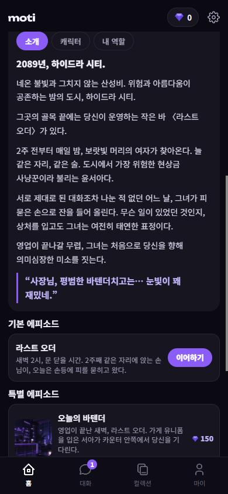
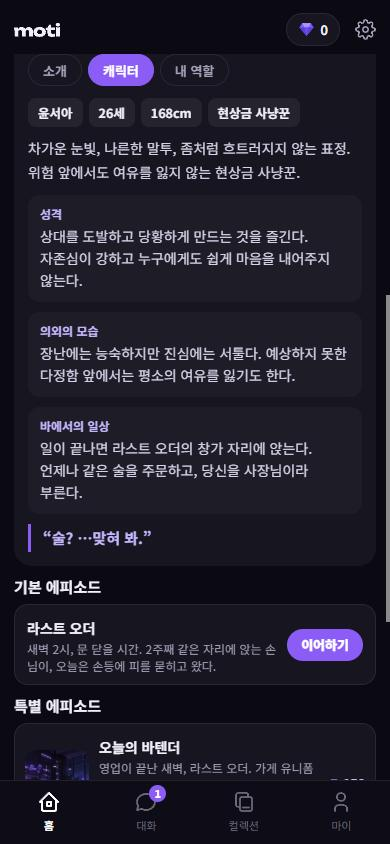
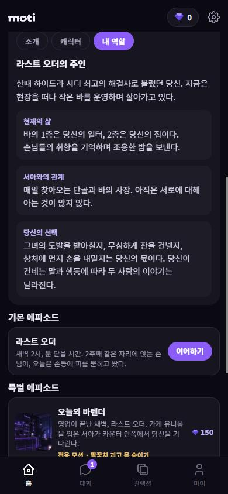

# 82. 윤서아 캐릭터 설정집 개편

브랜치: `step/82-seoa-profile`

## 한 일
- `data/characters.json` 의 `seoa.profile.tabs` 를 확정 원고로 바꿨다. 탭 이름과 순서(소개 → 캐릭터 → 내 역할)는 그대로다.
- 기존 `profileHTML` 블록 형식을 그대로 썼다(h·p·meta·kv·q). 코드와 CSS는 바꾸지 않았다.

## 바뀐 파일
| 파일 | 내용 |
|---|---|
| `data/characters.json` | 서아 `profile.tabs` 교체(서아 줄의 `profile` 값만 바뀜. 이름·태그·desc·intro·이미지는 그대로) |
| `docs/reports/82-캐릭터-설정집.md` | 이 보고서 |
| `docs/reports/img/82/*.jpg` | 390px 캡처 3장 |
| 버전 꼬리표 파일들 | `node tools/version.mjs` 결과 |

## 기존 설정과 바뀐 설정
| 항목 | 기존 | 바뀐 뒤 |
|---|---|---|
| 도시 | 네오 서울 | 2089년, 하이드라 시티(산성비) |
| 바 이름 | 〈블루 아워〉 | 〈라스트 오더〉 |
| 서아가 처음 온 때 | 석 달 전 | 2주 전부터 매일 밤 |
| 나이·키 | 27세, 키 없음 | 26세, 168cm |
| 코드네임·몸 | 흑묘, 군용 의수, 표적 추적 렌즈 | 없음 |
| 술 | 스트레이트 버번(얼음 없이) | 「같은 술」로만 표기(「술? …맞혀 봐.」) |
| 소개 끝 장면 | 현상금 목록에 낯익은 얼굴 | 피 묻은 손으로 잔을 든 밤, 첫 미소 |
| 캐릭터 항목 | 성격 / 바에서는 / 비밀 | 성격 / 의외의 모습 / 바에서의 일상 |
| 내 역할 | 바텐더, 목록 3줄(과거 자유 설정) | 전직 해결사인 바 주인, 현재의 삶 / 서아와의 관계 / 당신의 선택 |

## 테스트 결과
390px 화면은 다른 대화가 이미 띄워 둔 이 폴더의 로컬 서버(`localhost:8765`, 같은 작업 폴더를 보여 줌)를 앱의 브라우저 칸으로 열어서 확인했다.

| # | 항목 | 결과 |
|---|---|---|
| 1 | 소개·캐릭터·내 역할 순서 및 전환 | 통과. 탭 3개 순서 맞음, 누를 때마다 해당 탭만 보이고 `on` 표시가 옮겨 감 |
| 2 | 원고 누락·오탈자 | 통과. 화면 글자를 뽑아 원고와 한 줄씩 맞춰 봄 |
| 3 | 옛 설정 제거 | 통과. 서아 설정집에서 네오 서울·블루 아워·27세·석 달·흑묘·의수·렌즈·현상금 목록 모두 0건 |
| 4 | 스포일러 없음 | 통과. 방문 이유·1년 전 사건 언급 없음(1년·이유·복수·과거·의뢰 0건) |
| 5 | 390px 잘림·가로 넘침 | 통과. 세 탭 모두 화면 밖으로 나가는 요소 0개, 문서 가로 스크롤 없음. CSS 수정 안 함 |
| 6 | 다른 캐릭터·에피소드 목록·대화 버튼 | 통과. 서도윤 화면 정상(설정집 없는 캐릭터는 예전처럼 소개 문단), 서아 기본·특별 에피소드 목록과 「이어하기」 버튼 보임, 콘솔 오류 없음. 대화 시작은 서버를 부르므로 누르지 않음 |
| 7 | JSON 문법 | 통과(`JSON.parse`) |

## 390px 캡처
| 소개 | 캐릭터 | 내 역할 |
|---|---|---|
|  |  |  |

## 제가 정한 것
- **소개 탭 문단 나누기**: 원고의 줄마다 문단(p) 하나씩 두었다(5개). 문단 사이 간격이 기존 설정집과 같다.
- **「당신의 선택」 두 줄**: kv 설명 칸(`.cpkv p`)은 줄바꿈을 보여 주지 않아서, 두 문장을 띄어쓰기 한 칸으로 이어 한 칸에 넣었다. 글자는 그대로다. 줄을 나눠 보이게 하려면 CSS 한 줄이 필요해 이번엔 손대지 않았다.
- **따옴표**: 원고대로 굽은 따옴표(“ ”)를 썼다. 기존 설정집은 곧은 따옴표(")였다.
- **정보 칩**: 원고의 「/」 를 칩 4개(윤서아·26세·168cm·현상금 사냥꾼)로 나눴다. 390px 에서 한 줄에 들어간다.
- **확인 서버**: 미리보기 서버 자리가 다른 대화 것으로 차 있어 새로 띄우지 못했고, 이미 떠 있던 같은 폴더 서버를 빌려 썼다(그 서버는 건드리지 않음).

## 참고(손대지 않음)
- 서아 기본 에피소드 「라스트 오더」 설명은 「2주째 같은 자리에 앉는 손님」으로, 새 설정집과 이미 맞는다.
- 홈 카드 소개(desc)·태그·이미지는 지시대로 그대로 두었다.

## 아이폰에서 나중에 볼 것
- 시각 효과는 바꾸지 않았다. 다만 글이 길어졌으니 아이폰 사파리에서 세 탭을 넘겨 보며 굽은 따옴표·〈 〉 괄호·「…」 가 글꼴에서 어색하지 않은지, 「캐릭터」 탭 정보 칩이 한 줄에 들어가는지만 한 번 봐 주세요.
