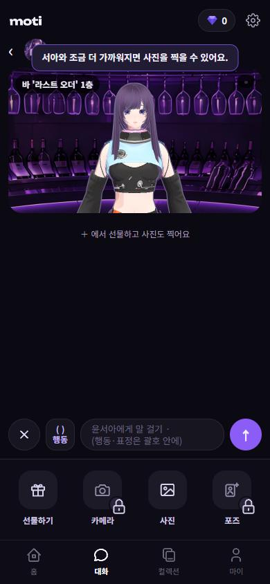
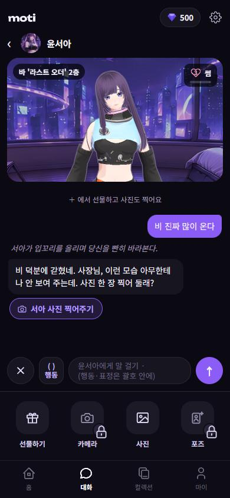
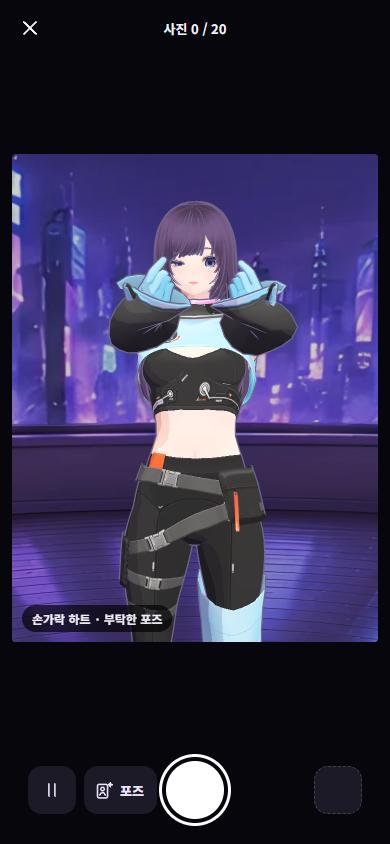
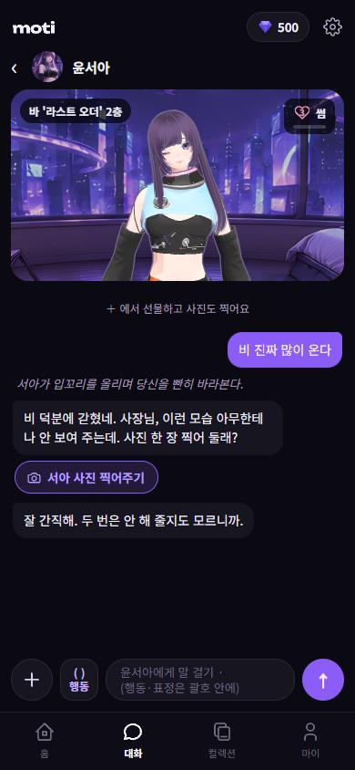
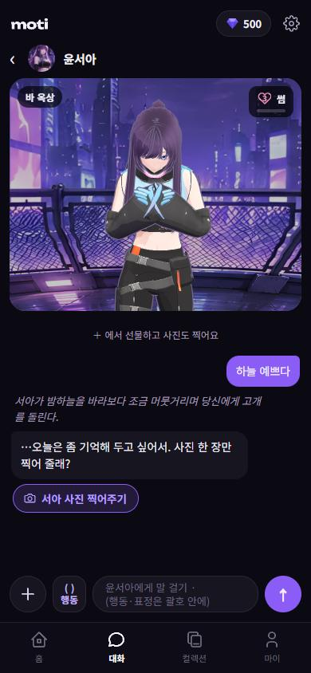
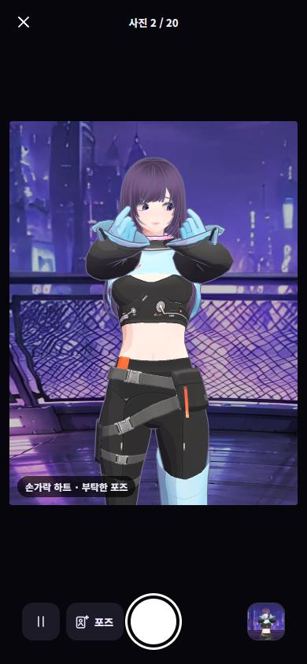
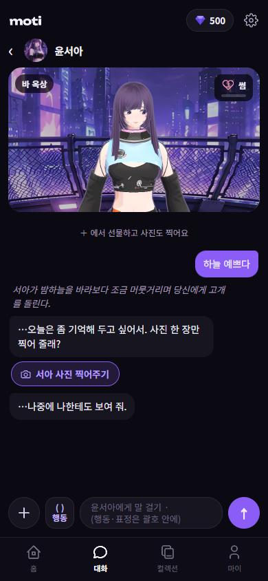
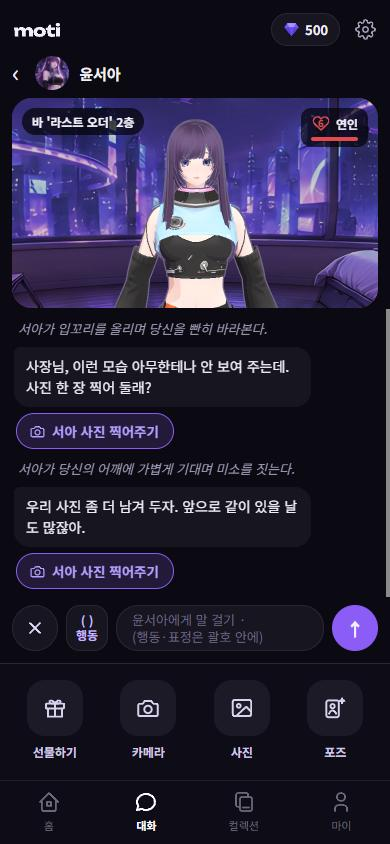

# 83. 사진 촬영 제안 · 관계별 카메라 해금

서버 `ddododo-lang/seoa-backand` main 의 S5(PR #22, `[S5] 사진 촬영 제안 이벤트`)를 확인하고 앱에 붙였다. 서버 저장소는 고치지 않음. 유료 API·새 서버 요청 없음 — 확인은 브라우저 안 가짜 `/chat`·`/judge` 응답(`?api=` 로 실제 서버 주소를 막고 `fetch` 를 가로챔)과 시연 패널로 했다.

브랜치: `step/83-photo-ask`

## 바뀐 파일

| 파일 | 바뀐 것 |
| --- | --- |
| `photoask.js` (새 파일) | `PhotoAsk` 모듈 — 서버 키 보내기(`req`·`strip`·`fromJudge`), 제안 확인(`check`)·기록(`offer`)·카드(`after`), 카메라 권한(`gate`)·자물쇠(`lockUI`), 제안 촬영 세션(`begin`·`saved`·`end`·`fixed`), 촬영 뒤 반응(`reaction`), 초기화(`reset`·`forget`), 말풍선 버튼(`btn`·`shoot`·`bind`) |
| `index.html` | `photoask.js` 불러오기 · `readReply`/`askSeoa` 에 `photoAsk` · `chatState`(본편만 `photo_ask_v`·`photo_asks`) · `noNameFlow`(에피소드에서 두 키 뺌) · `runJudge`·밤 넘기기 `judgeOnce` 요청/응답(합집합 후 story 에서 뺌) · `send()` 제안 확인·표정·`msg.pa`·카드 · `renderLog` 버튼 · `Fn`(자물쇠, ＋ 포즈 관문) · `End.restart` · 시연 초기화(서아·관계·전체) · 시연 「썸 촬영 제안 바로 보기」「연인 촬영 해금 바로 보기」(`photoAskDemo`) · ＋ 칸 자물쇠 CSS |
| `photos.js` | `Cam.open` 마지막 관문(`PhotoAsk.gate`) · `Cam.close` → `PhotoAsk.end` · 셔터: 누른 때의 세션으로 `Photos.add` 성공 때만 `PhotoAsk.saved` · 3단계 제안 촬영 중 포즈 버튼·`setPose` 막기 |
| `pose.js` | `Pose.sheet("chat")`·`Pose.ask` 에 권한 확인(잠겼으면 안내만) |
| `data/seoa_story.json` | `photoAsk` — ids · pose p01 · 단계 · 갈래별 기본 표정 · 허용 표정 · 촬영 뒤 반응 대사 |
| `data/ui.json` | `photoAsk` — 버튼 「서아 사진 찍어주기」, 잠금 안내 4줄, `poseFixed` |
| `data/demo.json` | `photoAskDemo` — 시연 버튼 이름 · 서버가 돌려줄 답장(서버 `yoon_seoa_prompt.md` PHOTO_* 블록 원고 그대로) |
| `docs/server-sync.md` · `docs/status.md` | 83 줄·절 |

## 서버 연동 규격 (S5)

- **보냄:** 본편 `/chat`·`/judge`(일반 판정·밤 넘기기 판정) state 에 `photo_ask_v: 1`, `photo_asks: [보여 준 id]`(= `S.photoAsk.offered`). 크리스마스 등 에피소드 요청(`chatState` 에피소드 줄기·`EpStage.judgeState`)에는 두 키가 없음(확인함).
- **받음:** `/chat` 응답 `photo_ask` → `readReply` → `v.photoAsk`. 아래를 모두 만족할 때만 처리, 아니면 무시:
  - 실제 서버 정상 답장(`src0==="server"`, 「…」·예비 지문·시간 초과 아님), 본편 줄기, 에피소드 아님, 포즈 부탁·선물 답장 아님, 서버 v2
  - `id` 가 `photo_3`·`photo_6`, `pose` 가 `p01`
  - 지금 본편 단계가 그 id 단계(3 · 6)
  - 아직 `offered` 에 없음(같은 응답이 다시 와도 보상·기회·반응 중복 없음)
  - `photo_3` 은 갈래가 tease·care(응답 route → 없으면 state.route)
- **/judge 응답:** state 를 통째로 저장하는 기존 동작은 그대로. 그 뒤 `photo_asks` 를 앱 목록에 합집합으로 더하고 `photo_ask_v`·`photo_asks` 를 story 에서 뺌 → 옛 판정 응답으로 offered 가 줄어들지 않음.

## 저장 키 `S.photoAsk` (본편 전용)

| 키 | 뜻 |
| --- | --- |
| `offered` | 보여 준 제안 id. 서버 `photo_asks` 로 감. 제안 답장이 대화 기록에 들어가는 같은 `save()` 에 기록 |
| `used` | 촬영 기회를 쓴 id. 제안 버튼으로 연 촬영에서 `Photos.add` 가 처음 성공한 순간 기록(새로고침·강제 종료에도 남음) |
| `reacted` | 촬영 뒤 반응을 처리한 id(보여 줬거나, 어색해져 건너뜀) |
| `unlocked` | 6단계 자유 촬영 해금. `photo_6` 이 보이는 순간 true |
| `ev` | 제안 때의 자리 `{id: {stage, route, scene, cf, at}}` — 반응이 어색한지 볼 때, 버튼 표정 |

대화 기록의 제안 답장에는 `pa: {id, cf}`(버튼), 촬영 뒤 반응 줄에는 `pr: id`.
`S.story` 에는 넣지 않아 되감기 지점(state 통째 스냅숏)에 들어가지 않음 → 되감아도 쓴 기회가 돌아오지 않고 offered 도 그대로.

## 카메라 권한 조건 (`PhotoAsk.gate`)

본편 줄기(`Thread.cur()==="main"`)에서만. 크리스마스·드라큘라 등 에피소드는 예전 그대로 열림.

| 본편 단계 | 일반 카메라·＋ 포즈 | 제안 버튼 | 잠금 안내 |
| --- | --- | --- | --- |
| 1~2 | 잠금 | (없음) | 「서아와 조금 더 가까워지면 사진을 찍을 수 있어요.」 |
| 3, 제안 전 | 잠금 | (없음) | 같은 줄 |
| 3, 제안 후·기회 남음 | 잠금 | `photo_3` → 특별 촬영 | 「서아가 사진을 부탁한 대화에서 촬영할 수 있어요.」 |
| 3, 기회 씀 | 잠금 | 잠금 | 「서아와 더 가까워지면 다시 사진을 찍을 수 있어요.」 |
| 4~5 | 잠금 | 잠금(버튼은 대화에 남음) | 같은 줄 |
| 6, 제안 전 | 잠금 | (없음) | 「서아와 함께한 순간을 남길 수 있는 날이 곧 찾아와요.」 |
| 6, `photo_6` 후 | 열림(횟수 제한 없음) | 열림 | — |

- 확인 지점: ＋ 카메라(`Fn.run`) · ＋ 포즈(`Fn.run`·`Pose.sheet("chat")`·`Pose.ask`) · 제안 버튼(`PhotoAsk.shoot`) · 예전 「이 포즈로 찍기」(→ `Cam.open`) · **`Cam.open` 마지막 관문**.
- 막지 않는 것: 앨범·사진 보기(`PhotoUI`), 카드팩, 이미 얻은 포즈 카드, 카드 그림 만들기(`Cards.capture` — `Cam.open` 을 안 거침), 부재중 셀카(`SeoaPhoto` — `Shot.take` 직접).
- ＋ 기능판 카메라·포즈 칸: 숨기지 않고 오른쪽 아래 작은 자물쇠(`.fnlock`), 아이콘 색만 조금 흐리게. 기능판을 열 때마다 다시 그림.

## 특별 촬영 · 반응

- `photo_3` 버튼: p01 + `camera_face`(장난 wink · 다정 shy) 바로 적용. 촬영 화면 「포즈」 → 「이번 사진은 서아가 부탁한 포즈로 찍어요.」, `setPose` 도 막음. 각도·확대·멈춤·셔터는 그대로, 매수 제한 없음.
- `photo_6` 버튼: p01 + soft 로 열고 포즈 바꾸기 자유(자유 촬영).
- 셔터를 누른 때의 세션을 잡아 두고 `Photos.add` 성공 뒤에만 `saved` → 그 세션의 epoch 가 지금과 같고 본편일 때만 `used` 에 기록. 저장 실패·가득 참·누르지 않음은 안 셈. 저장 도중 닫으면 저장이 끝난 뒤 기록하고 반응까지 처리. 초기화·처음부터는 epoch 를 올려 그 전 세션의 저장 결과를 버림.
- 반응(카메라를 나온 뒤 한 번): 장난 「잘 간직해. 두 번은 안 해 줄지도 모르니까.」 · 다정 「…나중에 나한테도 보여 줘.」 · 6단계 「잘 나왔어? 우리 다음에도 찍자.」 — `addReply` 로 서아 말(다음 `/chat` history 에 들어감, 확인함). 표정 = camera_face. 서버 호출·`S.bond`·판정 묶음·호감 변화 없음(확인함). 답장을 기다리는 중(`busy`)이면 끝난 뒤.
- 본편 줄기·단계·(3단계) 갈래·장소가 제안 때와 다르면 보이지 않고 `reacted` 로 처리.
- 6단계 일반 카메라 촬영은 반응 없음.

## 테스트 결과 (가짜 /chat·/judge, 390px, 2026-11-26)

| # | 항목 | 결과 |
| --- | --- | --- |
| 1 | 1~2단계 잠금 · ＋ 카메라 · ＋ 포즈 · `Cam.open()` 직접 · `Cam.open({pose})` · 예전 「이 포즈로 찍기」 · 제안 버튼 | 모두 안 열림, 안내 「조금 더 가까워지면…」 ✓ |
| 2 | 3단계 장난: 요청 state `photo_ask_v 1`·`photo_asks []` → 응답 photo_3 → 표시·버튼·제안 표정 smirk(사진 촬영 화면 wink) · p01 | ✓ |
| 3 | 3단계 다정: 제안 표정 soft · 촬영 화면 shy · p01 · 바 옥상 | ✓ |
| 4 | photo_3 처음 표시 때 손가락 하트(p01) 카드 1장, 같은 제안 다시 와도 카드 그대로 | ✓ |
| 5 | 촬영 안 하고 닫기 → `used` 없음, 다시 열림 | ✓ |
| 6 | 한 세션에서 여러 장 → 모두 저장(장당 인코딩 약 2.5초, 그 사이 누른 셔터는 기존대로 무시) | ✓ |
| 7 | 촬영 뒤 닫기 → `used`·반응 한 번, 버튼·일반 카메라 「더 가까워지면 다시…」 | ✓ |
| 8 | 저장 실패(`Photos.add` 예외) → `used` 없음·반응 없음·다시 열림 | ✓ |
| 9 | 제안 뒤 일반 대화 → 정상, history 에 제안·반응 줄 포함, 같은 photo_3 재응답은 무시 | ✓ |
| 10 | 4~5단계 잠금 · 예전 버튼도 잠금 · 사진 시트 열림 | ✓ |
| 11 | 6단계 제안 전 「날이 곧 찾아와요」 → photo_6 → 해금, 제안 표정 joy · 버튼 촬영 soft · 일반 카메라·＋ 포즈 열림 · 일반 촬영 반응 없음 · 버튼 촬영 반응 한 번(두 번째 세션엔 없음) | ✓ |
| 12 | 새로고침 뒤 `S.photoAsk`·버튼·자물쇠 유지 · 되감기(위기 지점 5단계) 뒤 `S.photoAsk` 그대로·5단계 잠금·6단계로 오면 다시 열림 · 본편 처음부터 → 상태 비움(카드·사진은 그대로) · 판정 응답 `photo_asks []` 와도 offered 유지 · 잘못된 pose·id·「…」 응답 무시 | ✓ |
| 13 | 저장 도중 닫기 → 저장 끝난 뒤 `used`·반응 · 저장 도중 초기화 → 다른 이벤트에 기록 안 됨 · 강제 종료(저장만 되고 닫힘 없음) → 다음 실행 `init` 에서 반응 한 번 · 장소가 바뀐 뒤 닫기 → 반응 없음(처리됨) | ✓ |
| 14 | `node tools/check_gacha.mjs` 모두 통과 · `node tools/test_away_selfie.mjs .` 53 통과 0 실패 · 카드 얻기 연출 그대로 | ✓ |
| 15 | 크리스마스 줄기: ＋ 카메라 그대로 열림 · 요청 state 에 두 키 없음 · photo_ask 응답 무시 | ✓ |
| 16 | 제안·촬영·반응에서 추가 `/chat`·`/judge` 0건, 호감·`S.bond`·판정 묶음 변화 없음 | ✓ |
| 17 | 시연 「썸 촬영 제안 바로 보기」「연인 촬영 해금 바로 보기」: 서버 호출 0건, 실제 처리 함수로 표시·카드·해금 · 기존 「사진 부탁 이벤트」 카드 버튼 그대로 | ✓ |
| 18 | `node --check` (photoask.js·photos.js·pose.js), index.html 본 스크립트 문법, data/*.json 파싱, 콘솔 오류 — 테스트용 막은 주소(포트 9)와 일부러 낸 저장 실패 말고 없음 | ✓ |

## 캡처 (390px)

| | |
| --- | --- |
| 잠긴 카메라(1단계, ＋ 자물쇠 + 안내) |  |
| 장난형 제안(바 2층) |  |
| 장난형 촬영(p01 · wink) |  |
| 장난형 촬영 뒤 반응 |  |
| 다정형 제안(바 옥상) |  |
| 다정형 촬영(p01 · shy) |  |
| 다정형 촬영 뒤 반응 |  |
| 연인 카메라 해금(photo_6 뒤 ＋ 자물쇠 없음) |  |

## 제가 정한 것

1. **커밋을 `[83 A-E]` 한 개로:** A~E 가 `photoask.js` 한 모듈과 같은 연결 지점(send·Cam.open·gate)을 함께 써서 나누면 중간 커밋이 동작하지 않음(80 단계와 같은 이유). 보고서·버전은 따로.
2. **새 파일 `photoask.js`:** index.html 이 이미 3,700줄이라 따로 둠. `pose.js` 다음에 불림.
3. **`S.photoAsk.ev` 추가:** 지시의 네 값 외에 제안 때의 단계·갈래·장소·촬영 표정을 남김(반응이 어색한지 판단, 오래된 버튼 표정).
4. **`used` 는 첫 저장 성공 순간 기록:** 「한 장 이상 저장한 뒤 종료」와 결과가 같고, 새로고침·강제 종료에도 기회를 다시 쓰지 못하게 하는 기준(지시 D1)이 됨. 세션 안에서는 계속 찍을 수 있음(권한은 열 때만 봄).
5. **`photo_6` 도 버튼 세션에서 저장하면 `used` 에 넣음:** 6단계 권한과는 상관없고 반응 한 번 판단에만 씀.
6. **6단계 반응은 제안 버튼으로 연 촬영만:** ＋ 카메라로 찍은 것은 「일반 자유 촬영」으로 봄.
7. **표정 값:** 서버 값이 그 id 허용 목록(photo_3 face smirk·soft / camera wink·shy, photo_6 joy / soft)에 있으면 그대로, 아니면 갈래 기본값. 잘못된 표정만으로는 제안을 버리지 않음(id·pose·단계가 틀리면 버림).
8. **갈래:** photo_3 은 응답 route → 없으면 state.route, 둘 다 tease·care 가 아니면 무시. photo_6 은 route 없으면 care.
9. **＋ 포즈 칸에도 자물쇠:** 지시는 카메라 칸이지만 포즈(촬영 부탁)도 같이 막히므로 같은 표시. 포즈를 누르면 카메라와 같은 잠금 안내.
10. **3단계 제안 촬영 중 「포즈」 안내 문구** 「이번 사진은 서아가 부탁한 포즈로 찍어요.」는 화면 안내라 새로 씀(`data/ui.json` photoAsk.poseFixed).
11. **반응 줄은 감정 없이(`emo: ""`) 서아 말 한 줄**, 몸짓은 대기 동작, 표정은 camera_face. 답장을 기다리는 중이면 끝난 뒤(최대 약 24초 기다림, 그 뒤엔 보이지 않음).
12. **어색함 기준:** 본편 줄기 아님 · 지금 단계 ≠ 제안 단계 · (3단계) 갈래가 다름 · 장소가 다름 → 반응을 보이지 않고 처리한 것으로.
13. **초기화 범위:** 본편 처음부터 · 시연 「서아 초기화」「관계 초기화」「전체 초기화」에서 비움. 시연 단계 버튼·장면 이동은 그대로 둠(되감기와 같은 규칙 확인용).
14. **시연 바로 보기:** 그 제안 하나만 처음 상태로 돌린 뒤(`forget`) 실제 처리 함수에 서버 S5 원고 답장을 넣음. 썸은 처음엔 지금 갈래(없으면 tease), 앞서 본 photo_3 이 있으면 다른 갈래로 바꿔(누를 때마다 장난 ↔ 다정) 그 갈래 장면 장소(바 2층·옥상)로 옮김 — 시연이라 갈래 값도 바꿈. 연인은 6단계 + `ending: "stayed"`.
15. **예전 앱 저장값:** `S.photoAsk` 가 없으면 빈 값으로 시작 → 이미 6단계인 저장은 서버가 photo_6 을 낼 때까지 잠김(지시 C1 대로).

## 아이폰에서 나중에 볼 것

- ＋ 기능판 자물쇠 배지(원형·그림자 `box-shadow`)가 칸 모서리에서 잘리지 않는지.
- 「서아 사진 찍어주기」 버튼(기존 `.poseshoot` 그대로) 줄바꿈·터치.
- 제안 버튼 → 촬영 화면 진입 때 p01 포즈와 표정이 첫 프레임부터 맞는지(모션 파일을 처음 받을 때 잠깐 기본 자세가 보일 수 있음).
- 새 블러·3D·애니메이션은 넣지 않음(자물쇠 배지만 CSS 추가).

## 실제로 확인하지 못한 것

- 실제 배포 서버의 S5 응답(유료 호출 금지라 가짜 응답만). 서버 보고서 예시 그대로의 응답 모양으로 확인함.
- 아이폰 사파리.
- 이 세션의 미리보기 서버를 새로 띄우지 못해(폴더당 5개 한도, 다른 대화 소유) 같은 폴더를 서비스하는 기존 로컬 서버(8765)에 다른 주소(127.0.0.1)로 붙어 확인함 — 파일은 같은 작업 폴더.
