# 84-1. 신규 모션 리소스 등록·보정 및 함께하기 안정화

새 XSTAGE 모션 9개(x40~x48)를 변환·보정해 **검수 전용**으로 등록하고, x19 와 같은 파일을 쓰는 x49 를 더했다. AI 생성 웃음 모션을 뒤로 젖히지 않게 보정해 **m01 웃음을 교체**했다. [84] 함께하기의 탭 전환·백그라운드·권한·타이머 예외 처리를 보완했다.
신규 모션을 일반 대화·교감 행동·카드에 연결하는 일은 하지 않았다([84-2]).

브랜치: `step/84-1-motion-assets` (시작 main `e833d10` [84])
커밋: `67c0d7f` [84-1 A] 변환·보정 · `468520c` [84-1 B] 웃음 보정 · `aa3e574` [84-1 C] 검수용 등록 · `9b18d7d` [84-1 D] 함께하기 안정화 · `7994093` [84-1 E] 통합 테스트 수정 · 보고서 · 버전 꼬리표 · main 병합

백엔드 수정·유료 API 호출 없음. 확인은 `?server=0`(서버 없음 = 예시 대사) + `?debug=1` 시연 패널, 390×844 브라우저에서 했다.

## 바뀐 파일

| 파일 | 내용 |
| --- | --- |
| `motions/xstage_*.json` 10개 (새 파일) | x40~x48 9개 + `xstage_natural_laugh.json`(m01) |
| `tools/xs_upright.mjs` (새 파일) | 변환된 모션 JSON 의 상체·목·머리 **앞뒤 기울기만** 비율로 줄이는 도구(웃음 보정) |
| `data/motions.json` | m01 `motionVer` 3→4 · xstage `m01` 추가 · x40~x49 이름·감정·`only "preview"` · xstage x40~x49 구간 · `preview`(검수용 표정 후보) · `_xstage` 설명 |
| `data/demo.json` | 시연 패널 「신규 모션 검수」 문구 |
| `index.html` | 시연 패널 「신규 모션 검수」 칸(?debug=1 만) · 기존 「몸짓」 목록에서 검수 전용 제외 · 검수 전용 파일은 일반 사용자 기기에서 미리 받지 않음 |
| `together.js` | `Together.preview` · 용도별 권한(`actOk`·`freeMotionOk`) · 탭/단계/백그라운드 정리(`settle`) · 타이머 목록 정리 |
| `docs/CREDITS.md` | 새 리소스 출처(라이선스 **확인 필요**, AI 생성 명시) |
| `docs/reports/img/84-1/` | 캡처 |

원본은 `_src/xstage_84-1/`(gitignore)에 이름 그대로 복사했다. `git check-ignore` 로 확인, 커밋에 FBX 없음.

## A. 원본 파일

기획자 경로 `C:\Users\KDH\Downloads\new_motion_data` — 11개 모두 있음(이름이 지시문과 글자 하나까지 같음, 확장자 `.fbx`).

| ID | 원본 파일 | 원본 길이 | 뼈 | 손가락 뼈 | 배우 방향 | 시작 |
| --- | --- | --- | --- | --- | --- | --- |
| x40 | `[standard] Point, Move Finger Up-Down.fbx` | 15.81초 | 20/20 | 30 (모두 움직임) | −3 ~ −9° | 0초 T자, 0.33초부터 서 있기 |
| x41 | `[standard] Ridiculous_Raising both hands.fbx` | 7.57초 | 20/20 | 30 | −1 ~ −4° | 0초 T자 |
| x42 | `[standard] Standing - Look Side.fbx` | 7.25초 | 20/20 | 30 | 0° | 0초 T자 |
| x43 | `[standard] Adjusting Hair or Head.fbx` | 16.13초 | 20/20 | 30 | −19 ~ +11°(몸을 흔듦) | 0초 T자 |
| x44 | `[standard] Backstep Tease.fbx` | 11.69초 | 20/20 | 30 | 0 → −49°(물러나며 돎) | 0초 T자 |
| x45 | `[standard] Elbow Nudge.fbx` | 6.63초 | 20/20 | 30 | 0 ~ −16° | 0초 T자 |
| x46 | `[standard] Head Tilt with Raised Hand.fbx` | 6.91초 | 20/20 | 30 | 0° | 0초 T자 |
| x47 | `[standard] Cute - Jealousy2.fbx` | 16.34초 | 20/20 | 30 | −18 ~ +55°(베베 꼼) | 0초 T자 |
| x48 | `[standard] Lovely - Embarrassing 2.fbx` | 18.59초 | 20/20 | 30 | 0 ~ −54° | 0초 T자 |
| m01 | `smile_haveto_fix.fbx` (XSTAGE AI 생성) | 5.00초 | 20/20 | 30 중 6개만 움직임(24개는 기본 손) | 0° | 0초 T자 |
| (보류) | `[standard] Lovely - Receive candy 1.fbx` | — | — | — | — | 원본만 `_src/` 에 복사. 변환·등록 안 함([86] x31) |

분석은 변환 전 FBX 를 three.js 로 읽어 0.25~0.4초마다 골반 방향·이동, 등·가슴·목 앞뒤 기울기, 턱 각도, 머리 좌우, 두 손 위치(머리 기준), 검지·중지 굽힘을 표로 뽑아서 했다(분석 스크립트는 작업용이라 저장소에 넣지 않음). 기존 `tools/fbx2motion.mjs` 가 새 파일 뼈를 모두 읽어서 변환기는 고치지 않았다.

## B. 모션별 최종 값과 특징

`from`·`to`·`skip` 은 원본 파일 시각(초). 재생 길이 = to − from − 건너뛴 길이. damp·tiltMax 는 이번에 쓴 모션 없음(고개를 깊게 숙이는 모션이 없었음).

| ID | 이름 | 구간 | 재생 | turn | inPlace | fade(초) | 핵심 동작(원본 시각) |
| --- | --- | --- | --- | --- | --- | --- | --- |
| x40 | 손가락으로 가리키기 | 5.3~10.9 | 5.6초 | 7 | ✓ | 0.5 / 0.8 | 5.9 왼손을 허리에 → 6.9~9.6 오른손 **검지를 펴고(검지 굽힘 0°, 중지 95°) 정면을 가리키며 위아래로** → 9.9~10.2 내림. 왼손은 끝까지 허리라 끝 섞기로 내림 |
| x41 | 어이없어 양손 들기 | 1.8~6.4, skip 3.3~4.8(0.3) | 3.1초 | 2 | ✓ | 0.4 / 0.6 | 2.3 두 손을 머리 높이 옆으로 들어 손바닥을 위로(어깨 으쓱) → 5.6 내림. 유지 구간 1.5초를 건너뜀. 손은 머리 높이·어깨 바깥 정도로 화면 안 |
| x42 | 옆을 바라보기 | 0.9~6.0, skip 2.3~4.6(0.3) | 2.8초 | 0 | ✓ | 0.4 / 0.6 | 1.3~1.7 **몸은 정면 그대로 고개만 약 60°** 옆으로 → 5.3~5.6 돌아옴. 등을 보이지 않음 |
| x43 | 머리 가볍게 만지기 | 6.2~10.6 | 4.4초 | 5 | ✓ | 0.5 / 0.6 | 6.6 왼손을 머리 옆으로 올려 가볍게 만짐, 고개를 살짝 숙이고 기울임, 몸이 −19°까지 흔들림 → 10.2 내림. 골반이 옆으로 15% 밀려 inPlace |
| x44 | 장난스럽게 물러서기 | 3.0~6.6 | 3.6초 | 20 | ✗(이동 유지) | 0.4 / 1.0 | 3.2부터 **실제로 뒤로 걸어 물러남**(골반 뒤로 약 0.3배 골반 높이), 두 손을 턱 앞으로 모아 장난스럽게, 몸이 −27~−39° 돎(turn 20 으로 −7~−19°) |
| x45 | 팔꿈치로 툭 치기 | 0.7~5.3 | 4.6초 | 30 | ✓ | 0.4 / 0.6 | 1.2 두 주먹을 가슴 앞으로 → 2.8~3.2 몸을 옆으로 21° 기울여 팔꿈치로 옆을 툭 → 고개는 내내 옆(−30~−42°). turn 30 으로 그 옆이 화면 쪽이 되게 |
| x46 | 고개 갸웃하며 손 올리기 | 1.2~6.0, skip 2.6~4.6(0.3) | 2.8초 | 0 | ✓ | 0.4 / 0.6 | 1.6 두 손바닥을 펴서 옆으로 벌려 올리며 고개를 갸웃(「응?」) → 5.6 내림. 손이 머리에 닿지 않음 |
| x47 | 질투하기 | 1.4~4.6 | 3.2초 | 0 | ✓ | 0.4 / 0.6 | 두 손을 등 뒤로 모으고 몸을 ±20° 베베 꼬며 고개를 숙이고(−25°) 옆으로 눈을 피함. 원본 4.8~7.2초(몸 55°까지 크게 꼼)는 유아적으로 보여 뺌 |
| x48 | 부끄러워 얼굴 가리기 | 0.9~4.6 | 3.7초 | 0 | ✓ | 0.4 / 0.7 | 1.6 왼손으로 얼굴을 가리고 오른손은 가슴 앞, 몸을 ±13° 흔듦. 원본 4.4초부터 몸을 −54° 돌려 숨는 부분은 방어처럼 보여 뺌 |
| x49 | 수줍게 웃기 | 1.6~4.5 | 2.9초 | 95 | ✗ | 0.5 / 0.8 | x19 와 **같은 파일**(`xstage_shy_short_laugh.json`)·같은 값. 입을 가리고 짧게 웃음 |
| m01 | 웃음 | 0.1~4.4 | 4.3초 | 0 | ✓ | 0.4 / 0.7 | 아래 C |

손가락: 9개 모두 손가락 30개가 움직이는 데이터(45-1 방식 그대로 담김). x40 검지 펴기, x46·x41 펼친 손, x45 주먹, x48 얼굴 가린 손이 원본 그대로 나옴.

### 핵심 자세 (390px, 함께하기 구도, 실제 서아 모델)

| x40 | x41 | x42 | x43 | x44 |
| --- | --- | --- | --- | --- |
| 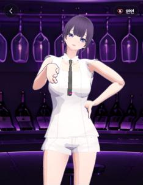 |  | 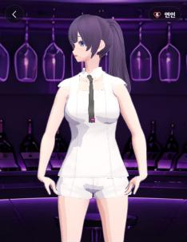 | 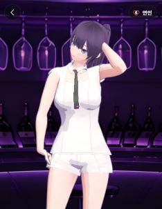 | 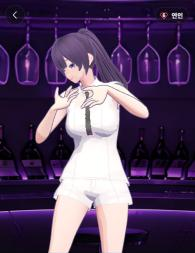 |
| **x45** | **x46** | **x47** | **x48** | **x49** |
| 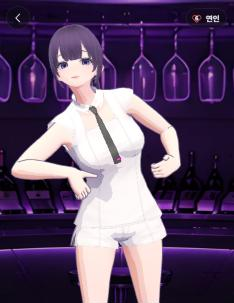 | 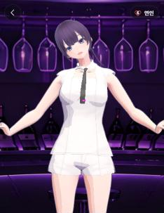 | 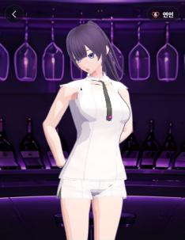 | 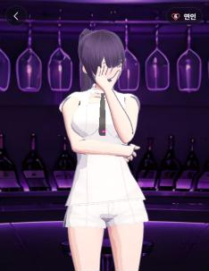 | 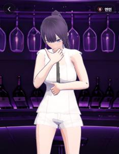 |

대화 구도: x46 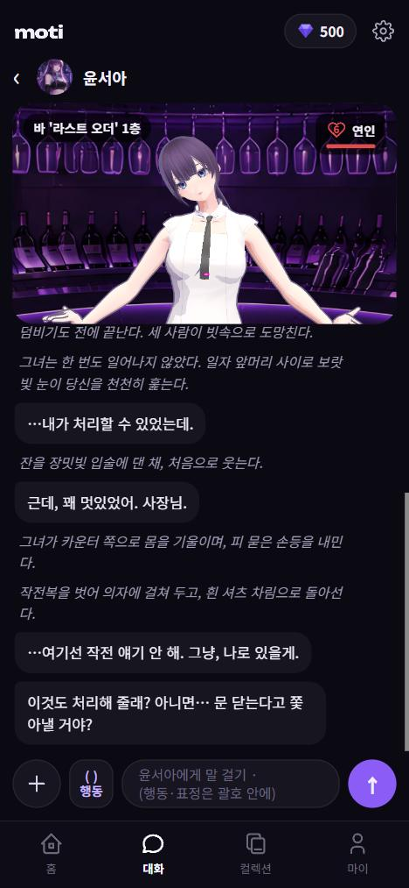 · x44 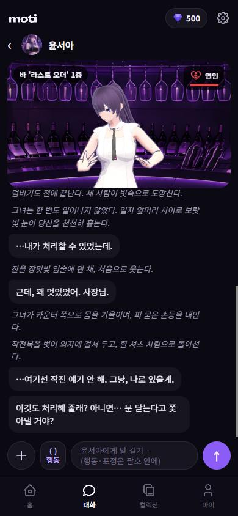

## C. 웃음 모션 보정과 m01 교체

원본(AI 생성): 0.2~2.0초 어깨를 들썩이며 웃는 동안 **가슴 −31°·머리 −61°** 까지 뒤로 젖힘, 2.2~3.2초 반대로 **가슴 +45°** 숙임, 3.6초부터 잦아듦.

방법(`tools/xs_upright.mjs`):
- tiltMax 는 세로에서 기운 각도를 앞뒤·좌우 가리지 않고 자르고, damp 는 그 뼈의 모든 움직임(좌우·돌림 포함)을 같이 줄여서 쓰지 않았다.
- 변환된 JSON 에서 뼈마다 프레임별 **앞뒤 기울기만** 재서, 모션 전체에서 가장 크게 기운 순간이 한계값이 되도록 **같은 비율로** 줄였다(작은 들썩임도 같은 비율로 남아 리듬이 살아 있음 — 처음엔 tanh 로 잘랐다가 젖힌 동안 내내 같은 각도가 돼 리듬이 사라져서 바꿈).
- 어깨·팔·손·손가락은 가슴과 같은 만큼 같이 돌려 몸에 대한 팔 자세를 그대로 둠. 다리·골반 이동·좌우 기울기·몸 돌림은 손대지 않음. 원본 FBX·변환 원본 JSON(`_src/xstage_84-1/natural_laugh_raw.json`)은 그대로.

| 뼈 | 뒤로(원본 → 보정) | 앞으로(원본 → 보정) |
| --- | --- | --- |
| Hips | −15° → −4° | 1° → 1° |
| Spine | −16° → −4° | 11° → 8° |
| Spine01 | −16° → −4° | 14° → 10° |
| Spine02(가슴) | **−31° → −5°** | **45° → 14°** |
| neck | −31° → −5° | 44° → 14° |
| Head | **−61° → −4°** | 33° → 16° |

실제 서아 모델에서 잰 값(재생 중 0.1초마다, 기본 자세 대비): 가슴 원본 −18°(뒤) ~ +49° → 보정 **+1 ~ +11°(뒤로 젖힘 없음, 살짝 앞)**, 머리 원본 −40°(턱 들림) ~ +35° → 보정 **0 ~ +4°(정면~살짝 아래)**.

| 기존 코드 m01 | 원본 1.15초 | 보정 1.15초 | 원본 2.7초 | 보정 2.7초 | 보정 · 대화 구도 |
| --- | --- | --- | --- | --- | --- |
| 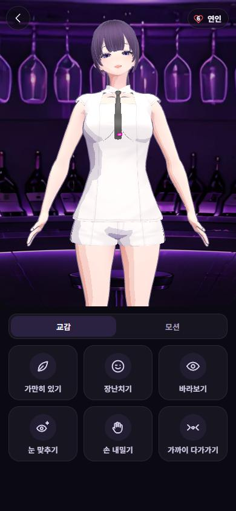 | 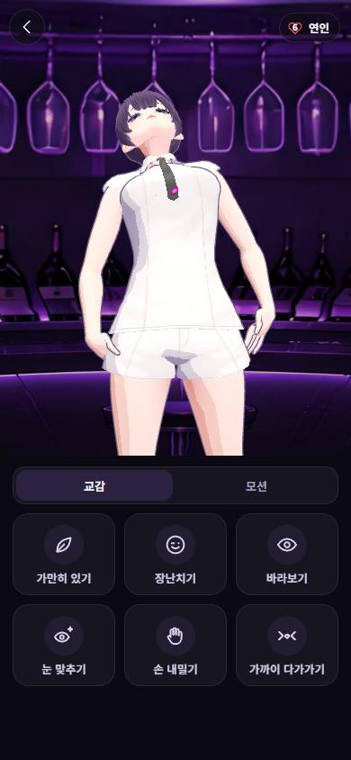 | 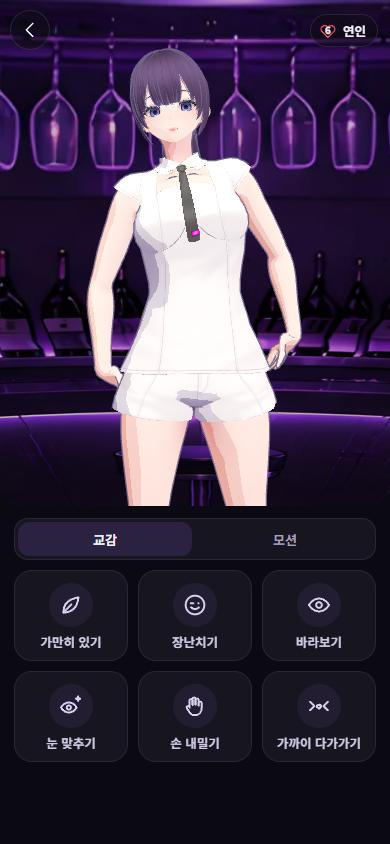 | 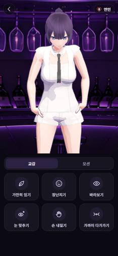 | 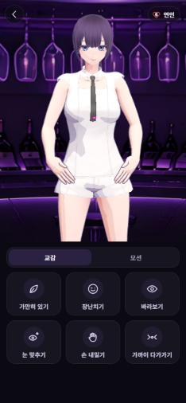 | 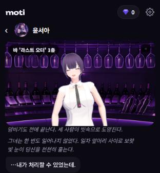 |

**m01 교체함.** 보정본은 얼굴이 정면에서 보이고 어깨 들썩임·살짝 숙였다 돌아오는 리듬이 남아 있어, 1.6초짜리 코드 웃음(상체를 조금 흔드는 정도)보다 자연스럽다고 판단했다.
- `data/motions.json` xstage `m01`(0.1~4.4초, motionVer 4) 추가. motions `m01` 이름·감정·해금·컬렉션 id 그대로, `motionVer` 3→4.
- 코드 웃음(`motion.js RIG.M.m01`)은 지우지 않음 — xstage 에 m01 이 있으면 무대가 그것을 씀(기존 규칙).
- `Cards.verOf("m01")` = 4 확인. 옛 카드(mv 3, 장소 4·의상 private·날짜 2026-11-20)를 넣고 `Cards.refresh()` → 그림만 다시 만들고 **mv 4, 장소·의상·날짜 그대로** 확인(테스트 기록은 지움).
- 표정 값·다른 모션 뼈 설정은 건드리지 않음.

## D. 검수 전용 등록 · 시연 패널

- x40~x49 = `only: "preview"`. 사용 중인 ID 가 아님을 다시 확인(저장소 전체에서 x40~x49 참조 없음).
- 기존 `only` 거름을 그대로 탐: `unlockedIds()`(대화 몸짓·서버 motion_list·키워드 고르기) 에서 빠짐. 「전부 열기」를 눌러도 시연 패널 「몸짓」 목록에서 빠져 있어 `S.unlocked` 에 안 들어감.
- x49 는 새 JSON 을 복제하지 않고 x19 파일을 그대로 가리킴. x19(only gift) 줄은 바뀌지 않음(diff 확인).
- **시연 패널 「신규 모션 검수」**(?debug=1 일 때만): 몸짓마다 ID·이름·재생 길이(+ 방금 재생한 실제 길이), 표정 후보(`data/motions.json preview.faces`, 감정 후보에서 고름), 「대화 구도」·「함께하기 구도」 버튼.
  - 대화 구도 = `Stage.play(id,{quiet:true})` → 최근 몸짓·이름 칩·확대·모션 강조·도감·카드에 안 들어감.
  - 함께하기 구도 = 실제 진입 조건으로 함께하기를 열고 `Together.preview(id, 표정)` — 사용자 행동처럼 하나만 재생, 끝나면 기본 자세·표정, 자동 교감 다시 셈. 서비스 권한 검사(아래 E-3) 대신 재생 가능 여부만 봄. `?debug=1` 이 아니면 거부.
- 검수 전용 파일 10개(약 2.3MB)는 일반 사용자 기기에서 **미리 받지 않음**(쉬는 틈 미리 받기 `xsRest` 에서 뺌, ?debug=1 이면 받음).

## E. 함께하기 예외 처리 보완

- **E-1 탭 전환·단계 변경** — `settle(why, again)` 하나로: 사용자 행동 끝냄(불러오는 몸짓 결과 무효) · 자동 교감 끝냄(불러오는 것 포함) · 지금 몸짓을 섞으며 기본 자세로 · 시선·표정(지금 단계 기본 표정)·카메라 복구 · 입력 잠금 풀기 · 자동 교감을 12초(firstMs)부터 다시 셈. 탭 전환과 허용 단계끼리 바뀔 때 부름(단계가 바뀌면 새 단계 후보도 미리 받음). 잠긴 단계·화면 밖이면 `stayWhy` 가 먼저 닫아서 타이머를 만들지 않음.
- **E-2 백그라운드** — 숨으면 `settle("hidden")`(행동·자동·카메라 확대·입력 잠금 정리, 재예약 없음). 자동 교감의 「내 것인지」 확인에 `!document.hidden` 을 더해 숨은 동안 받은 몸짓은 재생하지 않음. 돌아오면 `stayWhy` 로 세션을 다시 보고 12초부터 셈.
- **E-3 권한 분리** — `baseOk`(재생 가능·장소·에피소드) 위에
  - 교감·자동 `actOk`: 일반 대화 몸짓은 해금된 것만(`unlockedIds`), 전용(only) 몸짓은 `only "together"` 만 허용(앞으로 함께하기 전용을 만들 때), preview·gift·pose·wait·onboarding·selfie·pack·walk 차단. 지금 단계별 행동 후보·자동 후보는 모두 해금 조건을 만족해 행동 목록·결과는 같음(단계 1~6 대조).
  - 자유 모션 `freeMotionOk`: 재생·장소 + 검수 전용 차단. 기존 카드 소유·유형·카드팩 허용 목록(x32·x34)·춤(x33) 제외는 `freeOk` 그대로, 검수 전용은 팩 목록에 있어도 막음.
  - 시연 패널 검수 재생(`preview`)은 따로.
- **E-4 타이머** — `timers` 배열 → `Set`, 끝난 타이머는 스스로 빠지고 취소할 때도 빠짐(`drop`). `withTimeout` 은 먼저 받으면 기다림 타이머를 바로 지움. 닫을 때 남은 것 모두 취소, 자동 교감도 죽은 표시. 12~20초 간격·500ms 입력 대기 등 수치는 그대로.

## F. 테스트 결과

확인 방식: **재생** = 브라우저에서 실제 서아 모델로 재생해 화면으로 봄 · **측정** = 브라우저에서 상태·값을 잼 · **코드** = 코드·diff 로만 확인.
브라우저 창이 가려진 상태라 그리기 루프가 멈춰 있어, 화면 확인은 몸짓을 그 시각에 멈춘(`Stage.seek`) 정지 화면으로 했다. **연속 재생의 자연스러움(움직임 흐름·이음매)은 눈으로 끝까지 보지 못했다** — 아래 「아이폰에서 나중에 볼 것」에 넣음.

| # | 항목 | 결과 | 확인 |
| --- | --- | --- | --- |
| 1 | 원본 10개 이름·실제 파일 일치 | ✓ 11개(보류 1 포함) 모두 이름 그대로 | 코드 |
| 2 | FBX 수정·추적 없음 | ✓ `_src/`(gitignore), 커밋에 없음 | 코드 |
| 3 | JSON 변환 | ✓ 10개, 뼈 20/20 | 코드 |
| 4 | 유효 재생 길이 | ✓ 모든 구간이 파일 길이 안, skip 이 구간 안. 함께하기 측정 x41 3.1초 = 계산값 | 측정 + 코드 |
| 5 | 정면·골반 이동 | ✓ turn·inPlace 적용, x44 만 이동 유지(의도) | 재생(정지 화면) |
| 6 | 손가락 | ✓ x40 검지, x41·x46 펼친 손, x45 주먹, x48 가린 손 | 재생(정지 화면) |
| 7 | 시작·끝 전환 | △ fade 값은 원본 자세 차이로 정함, 연속 재생은 눈으로 못 봄 | 코드 |
| 8 | 심한 관통 | ✓ 정지 화면에서 없음(x43 손·머리, x48 손·얼굴, x46 손) | 재생(정지 화면) |
| 9 | [92] 눈 위쪽 한계 | ✓ x46·m01·x41 재생 중 눈맞춤에서 눈 위쪽 회전 0°(아래 1~7°) | 측정 |
| 10 | 검수 패널 재생 | ✓ x40 대화 구도·x41 함께하기 구도 버튼으로, 나머지는 같은 경로 | 재생 + 측정 |
| 11 | 웃음 보정 전후 기울기 | ✓ 위 표 | 측정 |
| 12 | 턱 과도하게 안 올라감 | ✓ 머리 0~+4°(아래쪽) | 측정 |
| 13 | 웃음 리듬 | △ 비율 보정이라 들썩임 시간 그대로, 연속 재생은 눈으로 못 봄 | 측정 + 코드 |
| 14 | 대화·함께하기 구도 | ✓ 둘 다 캡처 | 재생(정지 화면) |
| 15 | m01 ID·카드 기록 | ✓ 이름·감정·해금·컬렉션 id 그대로 | 측정 |
| 16 | motionVer | ✓ `Cards.verOf("m01")` 4 | 측정 |
| 17 | 카드 다시 그리기 | ✓ 장소·의상·날짜 유지, mv 4 | 측정 |
| 18 | motion_list 제외 | ✓ 「전부 열기」 뒤에도 `motionList()` 에 x4x 없음 | 측정 |
| 19 | 키워드 미등장 | ✓ 키워드에 없음 · 서버가 x40/x49 를 줘도 `pickMotion` 이 안 고름 | 측정 + 코드 |
| 20 | 함께하기 행동·자동 | ✓ 행동 후보에 x40 을 끼워 넣어도 표정만(재생 없음), 자동 목록에 x41 을 넣어도 표정만 | 측정 |
| 21 | 자유 모션 | ✓ `playCard("x40")` 거부 | 측정 |
| 22 | 선물·포즈 목록 | ✓ gifts.json·collection.json·pose 에 x40~x49 없음 | 코드 |
| 23 | x19 초콜릿 반응 | ✓ x19 줄·파일 그대로(diff 없음). 선물 연출 자체는 재생해 보지 않음 | 코드 |
| 24 | x49 검수 재생 | ✓ | 재생(정지 화면) |
| 25 | 자동 중 탭 전환 | ✓ 바로 멈춤(재생 null) | 측정 |
| 26 | 행동 중 탭 전환 | ✓ 행동·카메라·쿨다운 정리, 버튼 잠금 없음 | 측정 |
| 27 | 탭 전환 뒤 재개 | ✓ firstMs 뒤 자동 재개 | 측정(firstMs 를 페이지 안에서만 1.5초로 줄여 잼) |
| 28 | 불러오는 중 탭 전환 | ✓ 2.5초 늦게 받은 몸짓이 재생 안 됨 | 측정(`Stage.xs` 지연) |
| 29 | 백그라운드 신규 재생 없음 | ✓ 불러오는 중에 숨겨도 4초 동안 재생 없음 | 측정(`document.hidden` 대체) |
| 30 | 복귀 뒤 재개 | ✓ | 측정 |
| 31 | 단계 변경 정리 | ✓ 6→4: 행동 끝, 칩 4단계, 자동 다시 셈 | 측정 |
| 32 | 닫은 뒤 상태 | ✓ 타이머 0 · 자동 off · 빌림 없음 · 시선 null · 카메라 1 · 3초 뒤에도 재생 없음 | 측정 |
| 33 | 전용 모션 직접 재생 차단 | ✓ x40·x19(gift) 후보 → 표정만 | 측정 |
| 34 | 자유 모션 소유·카드팩 | ✓ m07·m10·g13(x32)·g15(x34) 만, g14(x33)·x17·p01 빠짐, m07 재생 | 측정 |
| 35 | 장시간 반복 | ✓ 약 100초 · 행동 26번 + 자동 + 탭 전환 섞어도 타이머 최대 3개, 고착 0 | 측정 |
| 36 | [84] 단계별 행동 | ✓ together.json 변경 없음, 단계별 후보 = 해금 대조 일치 | 측정 + 코드 |
| 37 | [91] 모션 강조 | △ 코드 변경 없음(무대 재생 코드 안 건드림). 창이 가려져 강조 발동은 못 봄 | 코드 |
| 38 | 함께하기 MotionCue 없음 | ✓ quiet·solo 그대로 | 코드 |
| 39 | [83] 사진 제안 | ✓ photoask.js·pose.js 변경 없음 | 코드 |
| 40 | [83-1] 포즈 권한 | ✓ 변경 없음 | 코드 |
| 41 | [92] 시선 | ✓ alive.js·look.json 변경 없음 + 9번 측정 | 측정 + 코드 |
| 42 | [93] 선물 그림·로직 | ✓ gifts.json·icons 변경 없음 | 코드 |
| 43 | 크리스마스 | ✓ 에피소드·장면 코드 변경 없음 | 코드 |
| 44 | /chat·/judge 0건 | ✓ fetch 감시 0건 | 측정 |
| 45 | 호감·다이아·카드·기록 | ✓ 카드 수·해금·단계·호감·다이아·bond·대화 수·최근 몸짓 그대로 | 측정 |
| 46 | check_gacha | ✓ 모두 통과 | 코드 |
| 47 | test_away_selfie | ✓ 통과 53 · 실패 0 | 코드 |
| 48 | JS·JSON·모션 ID | ✓ `node --check`·index.html 스크립트·data/*.json 파싱, 모든 몸짓에 동작 데이터, 구간 유효. data 의 몸짓 참조 중 없는 ID 는 `x31`(gifts·collection 키, [86] 예정, 이번 전부터 있던 것) 뿐 | 코드 |
| 49 | 콘솔 오류 | ✓ 없음 | 측정 |

## 추가 개선이 필요한 모션

- **x44 장난스럽게 물러서기**: 뒤로 물러나는 이동을 살렸기 때문에 끝 섞기(1.0초) 동안 제자리로 **미끄러져 돌아옴**. 다음 몸짓이 바로 이어지거나 길게 머무는 연출이면 끝 처리(이동량 일부만 쓰기 등)를 따로 정해야 함.
- **x45 팔꿈치로 툭 치기**: 1인 화면이라 「옆 사람을 치는」 동작으로 읽힘. turn 30 으로 화면 쪽을 향하게 했지만 상대가 없어 의미가 약함 → 일반 대화 적용은 **보류 권장**, 함께하기 연인 단계 「장난치기」 정도만 후보.
- **x40**: 가까이 다가가기처럼 카메라가 확대된 상태에서는 앞으로 뻗은 손이 크게 보일 수 있음(확대 중 사용은 피하는 편이 좋음).
- **m01**: 웃는 동안 두 손이 허리·허벅지 옆에 놓임(원본 팔 자세). 대사·표정(joy)과 같이 볼 때 어색하면 팔만 기본 자세 쪽으로 조금 섞는 보정을 더 할 수 있음.
- **x47·x48**: 원본의 큰 몸짓 구간을 뺐으므로 감정이 더 커야 하는 장면이 생기면 다른 구간(x47 7.4~11초, x48 9.8~13.4초)을 별도 ID 로 둘 수 있음.

## [84-2] 추천 활용

| ID | 추천 | 조건 |
| --- | --- | --- |
| x40 | 장난치기(4~6단계), 대화 도발·장난 | 표정 smirk·wink. 카메라 확대 중엔 피함 |
| x41 | 대화 「어이없/기가 막혀」 반응, 장난치기 3단계+ | surprised·flustered |
| x42 | 자동 교감(평온, 작은 동작), 바라보기(away) | soft. 고개를 25° 넘게 돌려 Alive 가 시선을 상쇄하지 않음(머리 따라가기 0) |
| x43 | 자동 교감, 수줍음 3단계+ | c02(오른손으로 머리를 귀 뒤로 넘겨 목선까지)와 다름 — 왼손으로 머리 옆을 가볍게 만지고 고개를 기울임 |
| x44 | 장난치기 2~3단계 | 이동이 있어 가까이 다가가기와 같이 쓰지 않음 |
| x45 | 보류 또는 6단계 장난치기 | 위 개선 항목 |
| x46 | 대화 궁금함, 바라보기·눈 맞추기 반응 | surprised·soft |
| x47 | 질투(현재 m07 하나) 보강, 6단계 장난치기 | pout·sulky |
| x48 | 손 내밀기·가까이 다가가기 반응 4~6단계, 수줍음 | shy |
| x49 | 손 내밀기 3단계, 대화 수줍음 | shy. x19 선물 반응과 같은 동작이라 선물 직후 연달아 나오지 않게 |

## 제가 정한 것

- **분석 도구**: FBX 분석·기울기 측정 스크립트는 작업용으로 scratchpad 에만 두고 저장소에 넣지 않음. 저장소에는 실제로 결과물을 만드는 `tools/xs_upright.mjs` 만 넣음.
- **커밋 묶음**: x40~x49 의 xstage 구간 값은 보정 결과라 A 커밋에, `only "preview"` 와 이름도 재생 확인이 필요해 A 에 같이 들어감. C 는 시연 패널·preview 경로·문구. 통합 테스트에서 찾은 미리 받기 문제와 CREDITS 는 E 커밋.
- **웃음 보정 방식**: tiltMax/damp 대신 변환 JSON 을 따로 처리(지시문 C-2 의 「필요한 경우」). 한계값은 가슴·목 뒤 5°·앞 14°, 머리 뒤 4°·앞 16°, 골반·등 뒤 4°. 「가장 크게 기운 순간 = 한계」 비율 방식(리듬 유지). 처음 tanh 자르기는 리듬이 사라져 버림.
- **m01 교체**: 자연스럽다고 판단해 교체. 길이가 1.6초 → 4.3초로 길어짐(연출의 m01 큐는 다음 몸짓이 오면 바로 바뀌는 기존 규칙이라 그대로 둠).
- **m01 motionVer**: `Cards.verOf` 는 xstage 의 motionVer 를 읽으므로 xstage m01 에 4, motions m01 도 4 로 맞춤.
- **x44 이동 유지**: 「무조건 0으로 만들지 말 것」에 따라 inPlace 를 끔. 대화 구도는 카메라가 골반을 따라가지 않지만 뒤(멀어지는 쪽)로만 가서 화면 밖으로 안 나감, 함께하기는 카메라가 70% 따라감.
- **x45 turn 30**: 옆 사람을 치는 방향을 화면 쪽으로 돌림. 그래도 의미가 약해 보류 권장으로 기록.
- **x42 끝**: 고개를 돌린 채 유지하는 2.3초를 건너뛰어 2.8초로 짧게(대화 몸짓 길이에 맞춤).
- **표정 후보**: 지시문의 감정 후보를 기존 FACE 이름으로 옮김(장난 → fun·smirk 등). 데이터(`data/motions.json preview.faces`)로 둠.
- **검수 재생 길이 표시**: 계산 길이(구간 값)를 늘 보여 주고, 재생하면 「방금 재생 n초」도 표시. 창이 가려진 환경에서는 타이머가 1초 단위로 늦어져 실측이 1초쯤 길게 나올 수 있음.
- **시연 패널 기존 「몸짓」 목록**: 검수 전용을 빼서 「전부 열기」가 저장값(`S.unlocked`)에 x40~x49 를 넣지 않게 함.
- **검수 전용 미리 받기 제외**: 지시에 없지만, 일반 사용자 기기가 쓰지 않는 2.3MB 를 받게 되어 막음.
- **함께하기 단계 변경 시**: 새 단계 행동 후보 파일도 미리 받게(`preload`) 함.
- **라이선스**: 새 XSTAGE 9개와 AI 생성 웃음 모두 기존 XSTAGE 리소스와 같은 「확인 필요」 상태로 기록. 배포 권한에 문제가 있다는 정보는 없어서 기존 XSTAGE 리소스와 같은 기준으로 병합함. AI 생성 리소스의 배포 조건이 확인되면 CREDITS 를 고치고, 문제가 있으면 m01 을 코드 웃음으로 되돌리기는 xstage `m01` 한 줄 삭제로 됨.

## 아이폰에서 나중에 볼 것

이번에 CSS 시각 효과(블러·그림자·애니메이션·3D 효과)는 바꾸지 않음(시연 패널 검수 칸 배치 CSS 만, ?debug=1 전용).
- **연속 재생의 자연스러움**(이번엔 정지 화면만): m01 웃음 리듬·시작/끝 섞기, x41·x46 건너뛰기 이음매(skipBlend 0.3초), x44 끝에 제자리로 미끄러짐, x47 몸 꼬기 속도.
- 사파리에서 함께하기를 띄운 채 홈 화면으로 나갔다 돌아올 때(visibilitychange) 자동 교감이 12초 뒤 다시 시작하는지, 카메라·입력 잠금이 남지 않는지.
- 새 모션 파일(130~355KB)을 검수 패널에서 처음 재생할 때 받는 시간.
