# 84-2. 신규 모션 서비스 적용 및 관계별 교감 고도화

[84-1] 에서 검수 전용으로 등록한 x40~x49 와 새 m01 웃음을 실제 서비스(일반 대화·함께하기·무빙 카드·카드 팩)에 연결했다.

브랜치: `step/84-2-motion-integration` (시작 main `dd2f10a` [84-1])
구현 커밋: `f51fabe` [84-2 A] 웃음 · `55de08c` [84-2 B] 대화 모션 · `6e9c7cd` [84-2 C] 함께하기 · `2c17249` [84-2 D] 카드·카드 팩 · [84-2 E] 통합 테스트 · [84-2] 보고서 · [84-2] 버전 꼬리표

백엔드 수정·유료 API 호출 없음. 이 작업은 **두 세션**에 걸쳐 했다. 첫 세션이 E 통합 테스트 중 사용량 한도로 끊겼고, 두 번째 세션이 E 나머지·보고서·병합을 했다. 아래 테스트 표는 **어느 세션의 결과인지** 따로 적는다.

## 바뀐 파일

| 파일 | 커밋 | 내용 |
| --- | --- | --- |
| `data/motions.json` | A·B·C·D | `motionFace`(몸짓 추천 표정·m01 표정 흐름·부딪치는 감정), m01 `motionVer 5`, x40~x49 `only "preview"` 해제(x44 `only together`, x45 `only pack`), x44 왕복 재생(`back`) |
| `data/seoa_story.json` | B | 단계 해금(1 x42 · 2 x41·x46 · 3 x43·x49 · 4 x40·x47·x48), 5단계 `stageMute`(x40·x47·x48·x49 제외) |
| `data/motion_keywords.json` | B | 지문 단어 8종 추가, x19·x49 같은 몸짓 묶음 |
| `data/together.json` | C·D | 단계별 자동 교감 후보·비중·표정, 행동별 반응 묶음(variants)·비중(w)·표정 후보, `camBan`, 자유 모션 `packMotions` 에 x45 |
| `together.js` | C | 같은 몸짓 연속 방지, 재생 직전 권한 재확인, 미리 받기는 지금 쓸 수 있는 후보만, 같은 파일 한 번만 받기, x44 `back` 재생 |
| `index.html` | A·B·C | 답장 표정 흐름(평온·미지정일 때만), 표정 복귀 타이머, 웃음 중 입 움직임 줄임, 시연 패널 검수 목록, x44 거꾸로 재생 |
| `data/collection.json` | A·D | m01 카드 표정 joy, 대화 카드 70~76, 카드 팩 g17(77), x49 `noCard` |
| `data/demo.json` | A | 시연 패널 문구 |
| `tools/test_motion_keywords.mjs` | B | 기대값 26개 + 예전 단어 목록과 말뭉치 비교 |
| `tools/build_collection.mjs` · `tools/check_gacha.mjs` | D | x49 카드 없음, 84-2 카드 번호·값 검사 |
| `docs/CREDITS.md` | E | x40~x48 「쓰는 곳」을 84-2 기준으로 고침(라이선스 **확인 필요** 그대로) |
| `docs/reports/img/84-2/` | E | 캡처 |

## A~D 구현 결과

### A. 웃음 모션과 표정

- m01 표정 흐름(몸짓이 실제로 시작한 시각 기준): 0초 살짝 미소(soft) → 0.3초 활짝 웃음(joy) → 2.0초 웃음(fun) → 3.4초 살짝 미소.
- 서버 감정이 슬픔·화남·노려봄·피곤·삐침·지루함·진지·삐죽이면 m01 몸짓을 빼고 표정만 둠(`clash`).
- 표정 흐름은 서버 표정이 평온·미지정(neutral·soft·smirk·wink)일 때만. 선물 반응·포즈 부탁·사진 제안·서사 장면의 정해진 표정은 안 바꿈.
- 표정 복귀 타이머가 몸짓 도중에 무표정으로 돌리지 않음. 웃는 동안 대사 입 움직임을 줄임(립싱크와 웃음 입 모양 충돌 완화).
- 무빙 카드 m01 표정 joy, `motionVer 5`(카드 그림 다시 만듦).

| 전 (1.0초, 무표정) | 후 (1.0초, 활짝 웃음) | 후 (2.6초, 웃음) | 무빙 카드 |
| --- | --- | --- | --- |
| 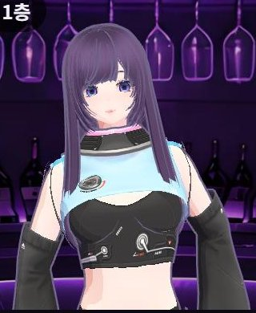 | 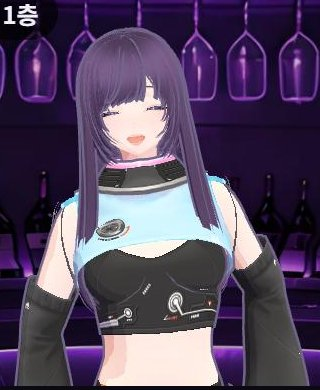 | 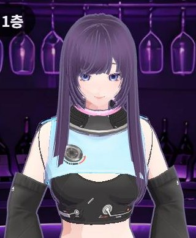 | 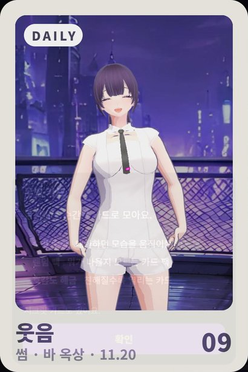 |

### B. 신규 모션별 해금과 사용 범위

| 몸짓 | 이름 | 감정 | 대화 해금 | 함께하기 | 카드 | 그 밖 |
| --- | --- | --- | --- | --- | --- | --- |
| m01 | 웃음(새 모션) | 기쁨 | 1단계(기존) | 장난치기 4·6단계 | 기존 카드(joy) | |
| x40 | 손가락으로 가리키기 | 장난 | 4단계 | 장난치기 4·6단계 | 74번 RARE | 5단계 제외, 다가간 동안 제외 |
| x41 | 어이없어 양손 들기 | 당황 | 2단계 | 장난치기 2·3단계 | 71번 DAILY | |
| x42 | 옆을 바라보기 | 평온 | 1단계 | 자동 교감 2~6단계, 바라보기 3단계 | 70번 DAILY | |
| x43 | 머리 가볍게 만지기 | 평온 | 3단계 | 자동 교감 3~6단계, 바라보기 4·6단계 | 73번 RARE | c02 와 연달아 안 나옴 |
| x44 | 장난스럽게 물러서기 | 장난 | — | 장난치기 2·3단계 (**함께하기 전용**) | 없음 | 다가간 동안 제외 |
| x45 | 팔꿈치로 툭 치기 | 장난 | — | 연인(6단계) 자유 모션, **g17 카드를 가진 사람만** | 카드 팩 g17 77번 RARE | 대화·키워드에 안 나옴 |
| x46 | 고개 갸웃하며 손 올리기 | 놀람 | 2단계 | 장난치기 2·3단계, 바라보기 4·6단계 | 72번 DAILY | |
| x47 | 질투하기 | 질투 | 4단계 | 장난치기 6단계(비중 0.35) | 75번 RARE | 5단계 제외 |
| x48 | 부끄러워 얼굴 가리기 | 수줍음 | 4단계 | 눈 맞추기·손 내밀기·가까이 다가가기 4단계 | 76번 RARE | 5단계 제외 |
| x49 | 수줍게 웃기 | 수줍음 | 3단계 | 장난치기 4·6, 눈 맞추기 3·4·6, 손 내밀기 3·6, 가까이 다가가기 6 | **없음**(g02·x19 와 같은 파일) | 5단계 제외, x19 와 같은 묶음 |

- 모든 신규 대화 몸짓은 본편 전용. 크리스마스 에피소드의 기존 모션 정책은 그대로.
- 감정 매핑은 서버 감정 집합 안(x41 당황, x46 놀람 등).

### C. 관계별 함께하기 모션 매핑

| 행동 | 2단계 | 3단계 | 4단계 | 6단계 |
| --- | --- | --- | --- | --- |
| 자동 교감 | m07·c02·x42 | m07·c02·x42·x43 | m07·c02·x42·x43 | x42·x43 중심(비중 2) + c02·m07 |
| 가만히 있기 | 무표정 | 살짝 미소 | 살짝 미소 | 살짝 미소 |
| 장난치기 | m20·x41·x46·x44 | m20·m03·x41·x46·x44 | m01·m05·x40·x49 | m01·m20·x40·x47·x49 |
| 바라보기 | — | 눈 피했다 보기 / x42 | 눈 맞춘 뒤 c02·x43·x46 | 카메라 응시 웃음 / x43·x46 |
| 눈 맞추기 | — | m05·x49 | **2초 응시** 후 m05·x48·x49 | 응시 웃음 / 3초 응시 후 x49 |
| 손 내밀기 | — | m11·x49 | m11·x48 | m11·x49 |
| 가까이 다가가기 | — | — | m03·m06·x48 | m12·x49 |

- 행동마다 반응 묶음(variants)과 비중(w)을 두고, 표정도 후보 배열에서 고름.
- 같은 몸짓(표정만 다른 것, x19/x49 묶음 포함)은 연달아 나오지 않음. 자동 교감은 c02 ↔ x43 연달아 피함.
- 관계별 눈 맞춤 시간(4단계 2초 등)은 기존 값 그대로.

| x47 질투하기 | 4단계 눈 맞추기 후 x48 | 연인 자유 모션 x45 |
| --- | --- | --- |
| 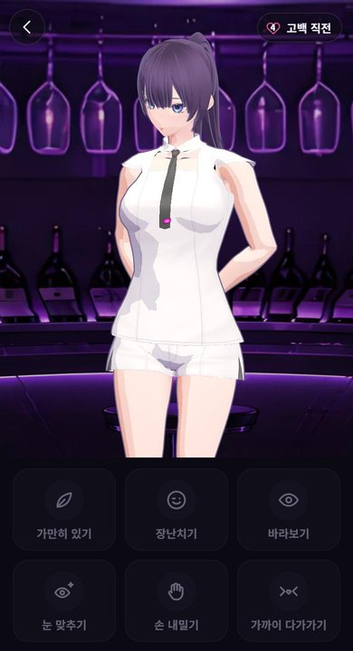 | 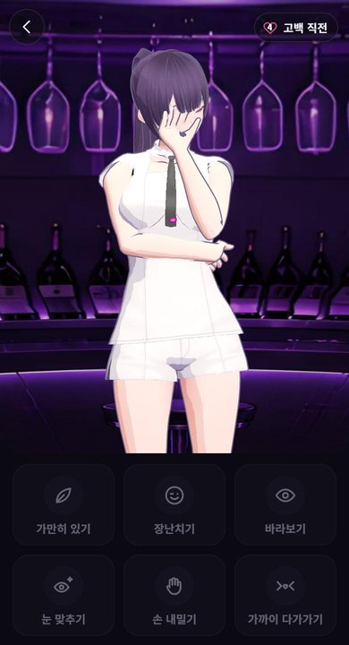 | 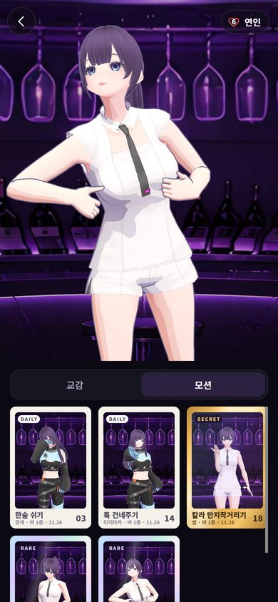 |

### x44 왕복 재생 보정

원본은 끝까지 뒤로만 물러나고 제자리로 오는 발 디딤이 없다. 예전(3.0~6.6초 + 끝 섞기 1초)은 끝에서 약 24cm 를 미끄러져 돌아왔다. 3.0~5.4초를 재생한 뒤 같은 구간을 **거꾸로**(`back`) 재생해 같은 발 디딤으로 제자리에 온다(총 4.8초). 이동·turn 20 그대로.
→ 정지 화면·좌표로 끝 위치가 제자리인 것은 확인(이전 세션). **연속 재생에서 거꾸로 걷는 모습이 자연스러운지는 눈으로 끝까지 보지 못했다.**

### D. 신규 대화 카드와 g17 카드 팩

- 대화 카드 7장: x42(70)·x41(71)·x46(72) DAILY, x43(73)·x40(74)·x47(75)·x48(76) RARE. 기존 카드 번호는 그대로.
- x49 는 카드를 만들지 않음(g02 「입 가리고 웃기」·x19 와 같은 모션 파일·구간).
- 카드 팩 g17 「팔꿈치로 툭 치기」(77번, 레어, x45, 표정 fun). 카드 팩 레어 14% ÷ 레어 8장 = **한 장 1.75%**.
- 연인 자유 모션 허용 목록에 x45(카드를 가진 사람만). x33 제외는 유지.

| g17 카드 |
| --- |
| 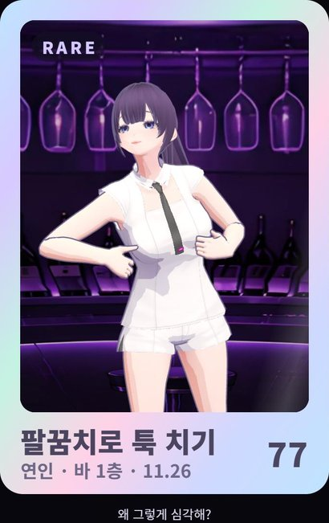 |

### 같은 모션 파일 중복 다운로드 방지

같은 파일을 쓰는 몸짓(x19·x49 = `xstage_shy_short_laugh.json` 등)은 한 번만 받는다. 함께하기 미리 받기는 지금 단계·장소에서 쓸 수 있는 후보만.
→ 이번 세션 확인: 일반 사용자 주소(`?skipintro=1`, 3단계)로 새로 열었을 때 `xstage_shy_short_laugh.json` 은 한 번만 받았고, 아직 못 쓰는 x44·x45·x47·x48 파일은 받지 않았다(네트워크 기록).

## 통합 테스트 (E)

### 이번 세션(2026-11-26, 두 번째 세션)

확인 방법: 390×844 브라우저, `?debug=1&skipintro=1`. 서버 `/chat`·`/judge` 는 **페이지 안에서 가짜 응답으로 가로챔**(실제 요청 0건, 유료 API 호출 없음). 브라우저 창이 가려진 상태라 그리기 루프가 멈춰 있어, 몸짓은 `Stage.seek` 로 한 시각에 멈춘 뒤 캡처(캡처가 한 프레임을 그림)로 확인했다.

| # | 항목 | 결과 | 근거 |
| --- | --- | --- | --- |
| 1 | [91] 일반 대화 MotionCue | ✅ 일반 답장 몸짓(x42, 이미 본 몸짓) 시작 때 무대 테두리 강조 1회(`MotionCue.fire` 1회, `.mcue` 애니메이션 1개) | 측정 · 캡처 e1 |
| 1-1 | 처음 보는 몸짓 | ✅ 확대 연출(Fx)이 있으면 강조 없음 — [91] 설계 그대로(가짜 답장 첫 두 턴이 여기에 해당) | 코드 `Stage.play` `o.fx` |
| 2 | 함께하기 안 MotionCue | ✅ 함께하기 중 답장 몸짓 호출은 거부(solo), 장난치기 m01 재생 중에도 강조 0회 | 측정 · 캡처 e2 |
| 3 | [92] 눈 위로 1° | ✅ `data/look.json` `eyeMaxUpDeg: 1`, `alive.js` 이 브랜치에서 안 바뀜 | 데이터·diff |
| 4 | [83] 사진 제안 | ✅ 시연 「썸 촬영 제안 바로 보기」: 제안 대사·「서아 사진 찍어주기」 버튼·서버 표정(smirk) 그대로(A 의 표정 흐름이 덮지 않음) | 캡처 e4 |
| 4-1 | [83-1] 포즈 권한 | ✅ 제안 촬영에서 p01 고정, `Cam.setPose` 로 m01·x45·안 가진 p05 를 넘겨도 p01 그대로. `photos.js` 는 이 브랜치에서 안 바뀜 | 측정·diff |
| 5 | [93] 선물 그림·반응 | ✅ 선물 시트 그림 9개 모두 로드(깨진 그림 0) | 측정 |
| 6 | x19 초콜릿 | ✅ 초콜릿 → x19 입 가리고 웃기 재생, 표정 shy(선물 표정 유지), 강조 없음 | 캡처 e5 |
| 7 | 신규 모션 검수 패널 | ✅ m01·x40~x49 11개, 추천 표정·구도 버튼. x47·x45·x44 대화 구도 재생, 최근 몸짓·컬렉션에 안 들어감 | 측정 |
| 8 | 일반 사용자에게 패널 미노출 | ✅ `?debug=1` 없이: `DEBUG=false`, 톱니 「시연 설정」을 열어도 「신규 모션 검수」 없음, 단축키 D 무시 | 측정 |
| 9 | JS·JSON 문법, 모션 ID | ✅ 루트 `*.js` `node --check` 통과, `data/*.json` 모두 파싱. data 안의 몸짓 번호 참조가 모두 `motions.json` 에 있음, xstage 파일 모두 존재(x31 반지는 main 때부터 있는 예약 칸) | 스크립트 |
| 10 | `node tools/test_motion_keywords.mjs` | ✅ 26개 통과. 예전 단어 목록과 비교: data·원고 말뭉치 2,988문장 중 바뀐 것 10건 — 모두 신규 몸짓 이름·설명 문구(개발 메모)이고 실제 대사 지문 변화 없음 | 실행 |
| 11 | `node tools/check_gacha.mjs` | ✅ 모두 통과(84-2 카드 번호·값·x49 없음·g17) | 실행 |
| 12 | `node tools/test_away_selfie.mjs .` | ✅ 통과 53 · 실패 0 | 실행 |
| 13 | 콘솔 오류 | ✅ 오류 0 | 콘솔 |

| e1 일반 대화 강조 | e2 함께하기(강조 없음) | e4 사진 제안 | e5 초콜릿 x19 |
| --- | --- | --- | --- |
| 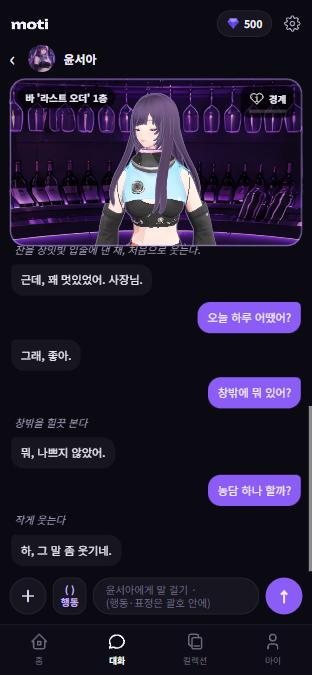 | 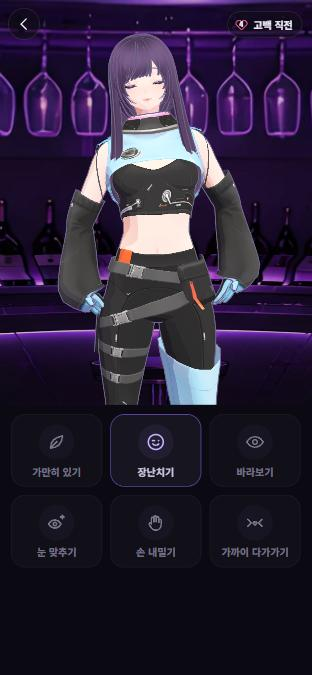 | 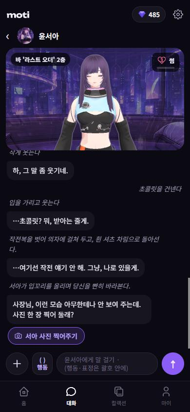 | 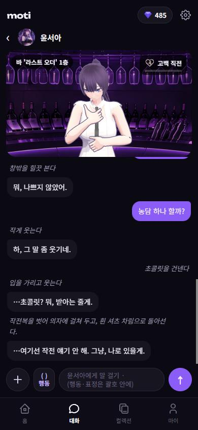 |

(e1·e2 는 0.4배, e4·e5 는 0.5배로 줄인 캡처. 390px 화면을 찍은 것.)

### 이전 세션(첫 세션, 결과만 전달받음)

아래는 첫 세션이 남긴 결과다. **이번 세션에서 근거 파일(로그·측정 기록)을 찾지 못했고 다시 돌리지도 않았다**(창이 가려진 환경이라 그리기 루프가 멈춰 같은 조건으로 재현할 수 없음). 미검증에 가까운 참고값으로 본다.

- 함께하기 장시간 반복 약 85초: 행동 23회 + 탭 전환, 타이머 최대 3개, 상태 고착 없음, 같은 몸짓 연속 0회.
- B 커밋 메시지 기준: 기존 키워드 회귀 2,018문장 비교(이번 세션은 말뭉치를 다시 만들어 2,988문장으로 비교, 위 10번).
- C 커밋 기준: 탭 전환·백그라운드·늦은 로딩 회귀, 로딩 후 권한 재확인.
- D: check_gacha 통과(이번 세션도 통과).
- A·C·D 캡처(`m01-*`, `x45-*`, `x47-*`, `x48-*`, `debug-review-panel.jpg`)는 첫 세션이 찍은 것.

## 발표 GIF 재현 방법

모두 `주소?debug=1` 로 열고, 오른쪽 위 톱니(또는 단축키 D) 「시연 설정」 패널에서 한다. 새 녹화 기능은 만들지 않았다 — 화면 녹화 도구로 직접 찍는다. 재생은 기록·해금·카드를 바꾸지 않는다(검수 재생).

| 장면 | 방법 |
| --- | --- |
| m01 자연스럽게 웃기 | 「신규 모션 검수」 → m01 웃음 「추천 표정」(표정 흐름 포함) → 「대화 구도」. 표정 없이 비교하려면 「표정 없이(몸짓만)」 |
| x47 질투하기 | 「신규 모션 검수」 → x47 「추천 표정」(삐죽) → 「대화 구도」 |
| 4단계 눈 맞추기 후 x48 | 「관계 단계」 4 고백 직전 → 「함께하기 열기」 → 「눈 맞추기」. 2초 응시 뒤 m05·x48·x49 중 하나가 무작위(x48 이 안 나오면 다시 누름). x48 만 확실히 보려면 「신규 모션 검수」 x48 「함께하기 구도」 |
| 2단계와 6단계 장난치기 차이 | 「관계 단계」 2 → 「함께하기 열기」 → 「장난치기」 몇 번(m20·x41·x46·x44) → 닫고 「관계 단계」 6 → 다시 「장난치기」(m01·m20·x40·x47·x49). 후보에서 무작위라 같은 몸짓 연속은 안 나옴 |
| 6단계 가까이 다가가기 | 「관계 단계」 6 연인 → 「함께하기 열기」 → 「가까이 다가가기」: 카메라가 다가가며 응시 → m12(비중 3) 또는 x49 |
| g17 카드 팩 획득·재생 | 「💎 500 충전」 → 「다음 카드 팩 결과(첫 장)」 에서 「g17 팔꿈치로 툭 치기」 → 컬렉션 탭 「카드 팩」 칸 배너에서 1장 뽑기 → 뽑은 g17 카드를 눌러 재생 |
| 연인 모션 탭 x45 | g17 을 가진 상태에서 「관계 단계」 6 → 「함께하기 열기」 → 아래 「교감 / 모션」 탭 중 「모션」 → 「팔꿈치로 툭 치기」 |

팁: 몸짓을 처음 보는 경우 확대 연출이 먼저 나온다. 깔끔한 GIF 는 「확대 쿨다운 비우기」 후 한 번 보고 두 번째를 찍는다.

## 제가 정한 것

- **MotionCue 확인 방법:** 서버를 가짜 응답으로 바꿔 실제 답장 흐름으로 보냈더니 첫 두 턴은 처음 보는 몸짓이라 확대 연출이 나와 강조가 없었다([91] 설계). 그래서 「이미 본 몸짓 + 정상 답장 조건」으로 `react(…, cue=true)` 를 직접 불러 강조를 확인했다. `send()` 의 강조 조건 줄은 이 브랜치에서 바뀌지 않음(diff 확인).
- **[83-1] 일반 촬영 화면의 포즈 권한:** 제안 촬영(p01 고정)은 실제로 확인. 일반 촬영 화면은 창이 가려진 환경에서 `Cam.open()` 이 열리지 않아 실제 확인을 못 했고, `photos.js` 가 이 브랜치에서 안 바뀐 것으로 갈음했다.
- **키워드 회귀 말뭉치:** 첫 세션의 2,018문장 파일이 저장소에 없어서, `data/*.json` 과 `docs/drafts/` 의 모든 한글 문장(2,988개)으로 다시 만들어 `dd2f10a` 단어 목록과 비교했다.
- **이전 세션 장시간 테스트:** 근거 파일이 없어 다시 돌리지 않고 「이전 세션 결과」로만 적었다(같은 조건 재현 불가).
- **CREDITS.md:** x40~x48 의 「쓰는 곳」이 84-1 기준(검수 전용)으로 남아 있어 84-2 기준으로 고쳤다. 라이선스 「확인 필요」는 그대로.
- 테스트 중 브라우저 저장값(관계 단계·💎)을 바꾼 것은 이 확인용 브라우저에만 남는다. 저장소·사용자 데이터는 건드리지 않았다.

## 아이폰에서 나중에 볼 것

- m01 표정 흐름(미소 → 활짝 → 웃음 → 미소)이 몸짓과 맞는지, 웃는 동안 입 움직임.
- 신규 몸짓 x40~x49 의 **연속 재생**(이음매·끝 섞기). 이번 두 세션 모두 정지 화면으로만 봄.
- x44 거꾸로 재생(물러섰다 같은 걸음으로 돌아오기)이 어색하지 않은지, 발 미끄러짐.
- 함께하기 단계별 반응(특히 4단계 눈 맞추기 → x48, 6단계 가까이 다가가기 카메라 + x49).
- MotionCue 테두리 강조(투명도 애니메이션)가 사파리에서 무대 둥근 모서리를 따라 보이는지 — 시각 효과는 이번에 바꾸지 않았지만 새 몸짓과 함께 확인.
- g17 카드 그림(손가락 포함)과 카드 팩 뒤집기.

## 한계

- **연속 재생을 직접 보지 못했다.** 브라우저 창이 가려져 그리기 루프가 멈춘 환경이라 몸짓은 특정 시각에 멈춘 화면으로만 봤다. 모션의 시각적 품질(움직임 흐름·이음매·발 디딤)은 **완전히 검증했다고 보지 않는다.**
- 실제 기기(아이폰·안드로이드) 검수 없음.
- 실제 서버 응답으로는 확인하지 않음(유료 API 금지). 서버가 신규 몸짓 번호(x40~x49)를 `motion_id` 로 보낼지는 서버 프롬프트 쪽 일이다(백엔드 수정 안 함).
- XSTAGE 리소스(x40~x48, AI 생성 m01 웃음)의 라이선스 범위 **확인 필요** — [CREDITS.md](../CREDITS.md).
