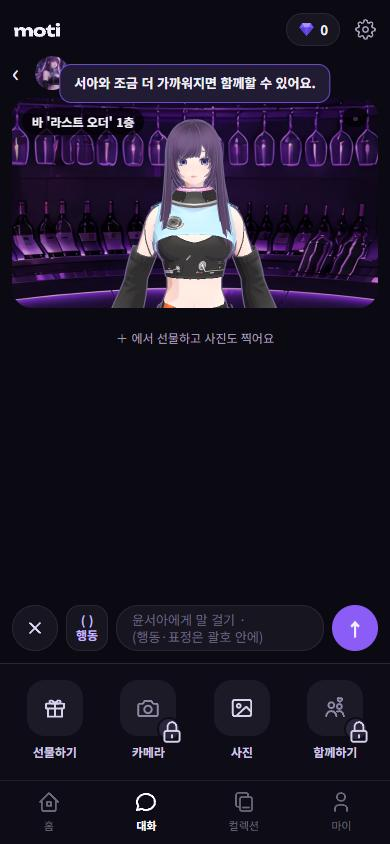
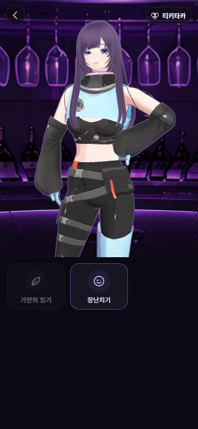
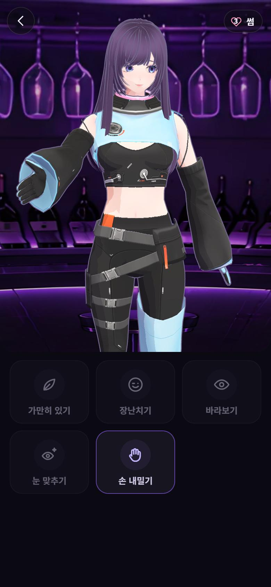
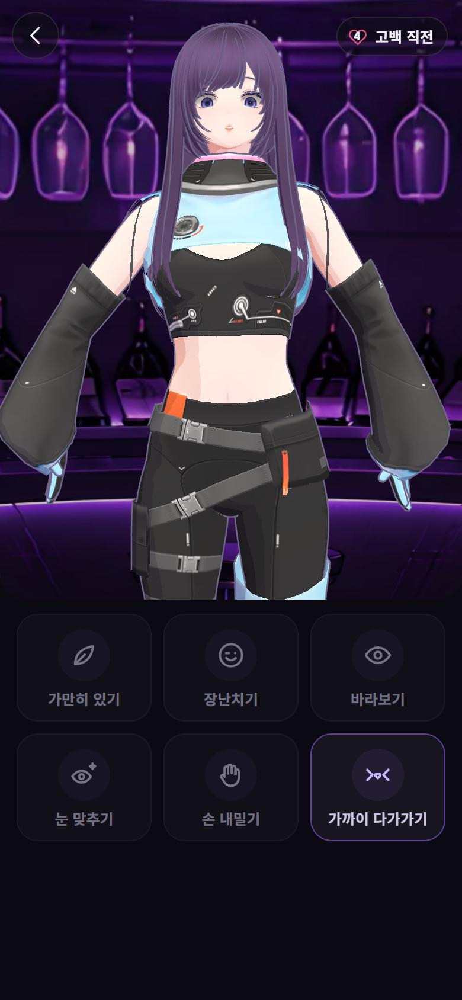
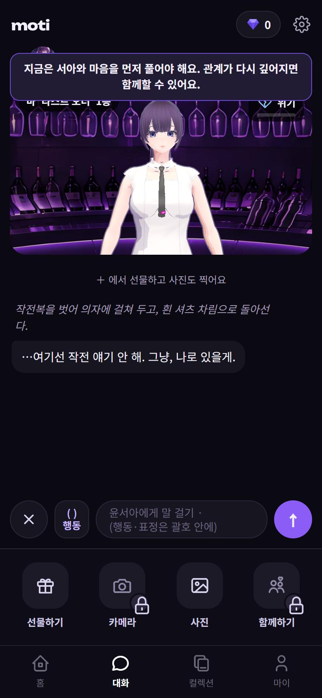
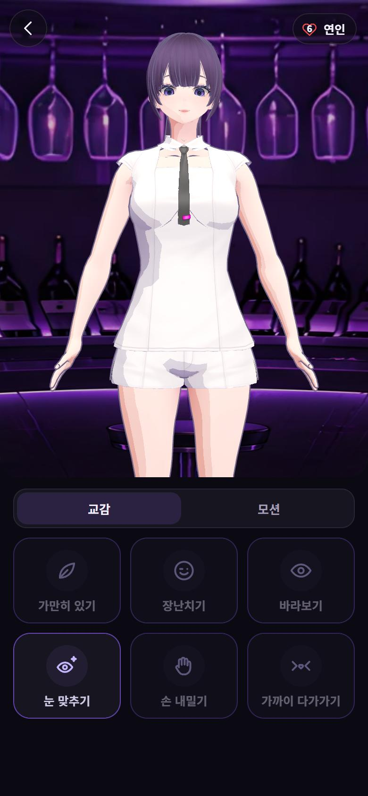
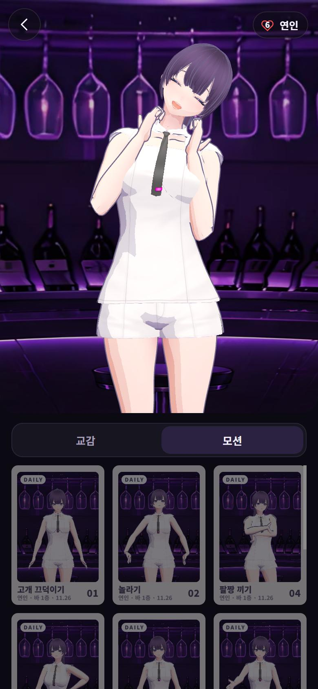

# 84. 함께하기 — 관계 기반 실시간 교감

서아 본편 대화방에서 서아와 「시간을 보내는」 화면을 새로 만들었다. 대화(관계 형성) → **함께하기(관계 체감)** → 사진(순간 기록) → 컬렉션(추억 수집). 관계 단계마다 할 수 있는 행동과 서아의 반응이 다르고, 모든 반응은 앱 안에서만 처리한다(서버·호감·대화 횟수·대화 기록·다이아·카드·서사 이벤트 변화 없음).

브랜치: `step/84-together` (시작 main `50faacd` [94])
커밋: `f419251` [84 A-D] 구현 · `08e497b` [84 E] 통합 테스트 수정 · 보고서 · 버전 꼬리표 · main 병합

백엔드 수정·유료 API 호출 없음. 확인은 실제 서버 주소를 `?api=http://127.0.0.1:9` 로 막고 `fetch` 를 감시한 브라우저(390×844)와 시연 패널로 했다.

## 구현한 화면 · 기능

### 진입 (A-1)
- 본편 서아 대화방 ＋ 기능판의 「포즈」 칸 자리에 **「함께하기」** 칸(두 사람 + 작은 하트 선 아이콘, 기존 아이콘과 같은 굵기 1.8·둥근 끝). 크리스마스 등 에피소드 줄기에서는 예전 「포즈」 칸 그대로.
- 관계 단계로 잠겼으면(1단계·5단계·실패 끝) 칸 오른쪽 아래 작은 자물쇠(사진 칸과 같은 모양). 누르면 안내만 뜨고 들어가지 않음.
- 자물쇠는 `Together.fnUI()` 가 따로 그림 — `PhotoAsk.lockUI()` 는 `camera`·`pose` 칸만 보므로 서로 영향 없음. **함께하기 해금은 관계 단계만 봄**(사진 제안 전이어도 2단계부터 열림, 확인함).
- 카메라 칸·촬영 화면 안의 포즈 선택은 그대로.

### 화면 (A-2)
- 앱 전체를 덮는 몰입형 화면(`.tg`, 촬영 화면과 같은 층). 위 60% = 서아 3D + 지금 장소 360도 배경 + 지금 의상, 머리~무릎 근처 구도. 왼쪽 위 뒤로, 오른쪽 위 관계 칩(하트 숫자 + 단계 이름, 엇갈림이면 「엇갈림」).
- 아래 40% = 행동 버튼 3열(아이콘 + 짧은 이름). 아래 칸만 세로 스크롤, 위 3D 칸은 터치 스크롤을 막음.
- 어두운 바탕·보라 포인트·둥근 칸·반투명 버튼. 발광·블러 없음. 누른 버튼만 보라 테두리, 나머지는 잠깐 흐려짐(쿨다운 숫자·막대 없음 — 게임 스킬처럼 보이지 않게).
- iPhone safe-area: 뒤로·칩은 `env(safe-area-inset-top)` 아래, 버튼 목록 아래 여백에 `env(safe-area-inset-bottom)`.

### 3D 재사용 (A-3)
- `Stage.borrow(그림판 칸, null, tick, {pano: 지금 장소, owner:"together", yield})` — 모델을 다시 불러오지 않고 대화 무대의 그림판·캐릭터·의상·360도 장소를 그대로 씀.
- 카메라는 함께하기 전용 `tick` 이 매 프레임 계산(구도 `data/together.json camera.frame`, 화면 비율에 맞춰 거리·aspect, 화각 `camera.fov`). `frameTo` 를 쓰지 않아 다른 곳의 구도 예약(확대 돌아오기, x30 구도 타이머)이 덮어쓰지 못함.
- 닫으면 `Stage.release()` 가 빌리기 전 화각·비율·그림판 크기·360도 배경으로 되돌림(확인: 366×210, aspect 1.7429, fov 그대로, 함께하기 fov 를 36 으로 바꿔 열었다 닫아도 30 으로 돌아옴).

## 관계 단계별 해금 행동 (B-1)

| 단계 | 함께하기 | 행동 |
| --- | --- | --- |
| 1 경계 | 잠금 | — |
| 2 티키타카 | 열림 | 가만히 있기 · 장난치기 |
| 3 썸 | 열림 | + 바라보기 · 눈 맞추기 · 손 내밀기 |
| 4 고백 직전 | 열림 | + 가까이 다가가기 |
| 5 위기·엇갈림 | 잠금 | — |
| 6 연인 | 열림 | 6개 + **「교감 / 모션」 탭** |

단계는 `curStage()`(= `S.story.stage`, 본편)로만 판단. 따로 저장하지 않음. 함께하기 중에 단계가 바뀌면(시연 단계 버튼 등) 다시 그리고, 허용하지 않는 단계가 되면 닫음.

## 행동별 모션 · 표정 (B-3 ~ B-8)

모두 `data/together.json actions` 의 `by[단계].steps`(행동 시작 기준 at ms 에 표정 f · 시선 gaze · 몸짓 후보 pick · 카메라 cam). 몸짓 후보는 지금 장소에서 쓸 수 있는 것만, 둘 이상이면 직전 것(몸짓+표정)을 빼고 무작위.

| 행동 | 2 | 3 | 4 | 6 |
| --- | --- | --- | --- | --- |
| 가만히 있기 | 기본 자세 · neutral | 기본 자세 · soft | 기본 자세 · soft | 기본 자세 · soft |
| 장난치기 | m20 smirk | m20 wink / m03 fun | m01 fun / m05 shy | m01 joy / m20 wink |
| 바라보기 | — | 시선 옆 soft → 1.1초 나를 봄 → 1.6초 shy(시선 살짝 피함), 3.8초 | 시선 옆 → 1.0초 나를 봄 → 1.4초 c02 shy | 시선 옆 → 1.0초 나를 봄 soft → 1.8초 joy → 2.7초 soft, 4.2초 |
| 눈 맞추기 | — | 바로 눈 맞춤 soft **1초** → m05 shy(피함) | 눈 맞춤 **2초** → m05 flustered / shy | 눈 맞춤 soft → 1.5초 joy → 2.3초 soft, 피하지 않고 **3.6초** |
| 손 내밀기 | — | 시선 옆 shy 0.9초 망설임 → m11 shy | m11 soft | 나를 보며 m11 joy / soft |
| 가까이 다가가기 | — | — | 카메라 12% 다가감(600ms) → m03 flustered / m06 shy → 끝나면 800ms 동안 돌아옴 | 나를 보며 soft, 카메라 12% → m12 soft / joy(서아도 다가옴) |

- **바라보기 vs 눈 맞추기:** 바라보기는 서아가 다른 곳을 보다가(시선 옆) 내 시선을 알아차리고 돌아보는 순서, 눈 맞추기는 처음부터 흔들림 없이 서로 보는 시간(1·2·3.6초)이 핵심. 측정한 시선 순서 — 3단계 바라보기 `away → steady(1.1초) → 평소(1.6초, shy 로 피함)`, 3단계 눈 맞추기 `steady → (1.0초) m05`.
- **가까이 다가가기:** 카메라 거리 배율 1 → 0.88(측정 0.880, 카메라 z 2.106 → 1.853), 약 600ms. 연속 클릭은 행동 중 입력이 막혀 누적되지 않음(배율은 늘 「목표 0.88」이라 겹쳐도 더 가까워지지 않음). 「동작 줄이기」면 카메라를 움직이지 않고 몸짓·표정만(측정 배율 1, 몸짓 m06 재생).
- **6단계 m12 겹침 방지:** m12 는 서아를 0.42m 앞으로 옮김. 카메라가 서아 뿌리의 앞뒤 이동을 70%(`camera.rootFollow`) 따라 물러나서, 실제 거리 감소는 18.6%에서 그침(12% + 20%가 그대로 겹치지 않음).
- **장소 제한:** 바 2층(장소 1)은 m20·m12·m21 금지 → 6단계 장난치기는 m01 만, 6단계 다가가기는 m12 가 빠져 표정만(faceOnlyMs 2.6초)으로 반응(확인함).

## 자동 교감 (C-1)

- 숨쉬기·눈 깜빡임·시선 흔들림(Alive)은 늘 그대로. `Stage.solo` 는 몸짓·표정·입만 막고 `lock` 처럼 깜빡임을 끄지 않음.
- 진입 뒤(또는 사용자 행동이 끝난 뒤) **12초** 동안 행동이 없으면 첫 자동, 자동이 끝난 때부터 **12~20초** 무작위 간격.
- 후보: m07 팔짱 · c02 머리 쓸어 넘기기(직전 것 제외) 또는 40% 확률로 표정만(단계별 2: neutral·smirk / 3·4: soft·shy / 6: soft·joy). 쓸 모션이 없으면 표정만. 대사·카드·기록 없음.
- 측정: 행동 끝 +12.0초 c02 → c02 끝(약 4초) +13.4초 m07. 처음 진입 +12.0초 표정 smirk.

## 재생 상태 관리 (C-2 ~ C-5)

- **중복 방지:** 행동 중 다른 행동·카드 입력 무시(연속 `run` 3번 모두 거부 확인), 끝난 뒤 500ms 쉼. 자동 몸짓 중에 누르면 자동을 끊고(섞으며 기본 자세로) 그 행동부터(자동 m07 중 장난치기 → m01, 확인함).
- **세션 토큰:** 열고 닫을 때마다 `tok`+1. 모든 타이머·모션 불러오기 결과가 토큰·지금 행동을 확인. 닫을 때 타이머 전부 해제.
- **실제 시작 기준:** XSTAGE 모션은 `Stage.xs()` 로 파일을 다 받은 뒤 `Stage.play` → 그 순간부터 `Stage.dur × 1/speed` 로 끝을 셈. 파일이 2.5초 늦게 와도 끝 = 도착(2.60초) + 길이(6.90초) = 9.49초(측정 9.486초). 8초 넘게 못 받거나 실패하면 바로 기본 자세·기본 표정, 입력 풀림(실패 32ms 뒤 끝, 다음 카드 바로 재생 확인).
- **닫은 뒤 늦게 온 파일:** 불러오는 중 닫고 4번 빠르게 열고 닫기 → 파일이 도착해도 재생 없음(`Stage.playing()` 계속 null), 다시 열어도 끼어들지 않음.
- **대화 상태와 격리:** 함께하기 몸짓은 `Stage.play(…, {quiet, solo})` — quiet 라서 `lastMid`·`recent`(대화 몸짓 고르기·반복 방지)·이름 칩·확대(View)·x30 구도·모션 강조에 안 들어감. `cur` 와 `lastEnd` 는 Stage 가 쓰므로, 닫을 때 `Stage.release()`(cur 비움) + 새 `Stage.clearLast()`(lastEnd 비움) → 닫은 뒤 `Stage.recentMotion()` null(촬영 화면·카드 그림·자동 몸짓이 함께하기 몸짓을 「직전 대화 몸짓」으로 보지 않음, 확인함).
- **바깥 예약 막기:** 함께하기 동안 `Stage.solo(true)` — 답장 몸짓·해금 연출·사진 반응·7초 뒤 기본 표정(faceReset) 등 바깥에서 오는 `Stage.play`·`Stage.setFace`·입 움직임을 받지 않음(cue 를 단 몸짓을 직접 보내도 막힘 확인). 함께하기 쪽은 `solo:true` / `"solo"` 로만 통과. 대화 자동 몸짓(시계 보기)·답장 기다림·인사·카드 그림 만들기는 원래 「무대가 빌려져 있으면」 멈추는 조건으로 쉼(카드 그림은 `Together.isOn()` 도 기다림 조건에 넣음).
- **[91] 모션 강조:** 진입 때 `MotionCue.clear()`, 함께하기 몸짓에 cue 를 넘기지 않음(함께하기 안에서 강조 0번). 닫은 뒤 일반 몸짓 cue → 강조 켜지고 정상 종료(확인함). 강조 값·조건은 그대로.

## 진입 조건 (C-6) · 종료 (C-7)

`Together.why()` 하나를 ＋ 버튼과 직접 호출(`Together.enter()`) 모두 지남:
서아 본편 대화방 · 1·5단계 아님 · 실패 끝 아님 · 내 메시지 처리·답장 기다림·관계 판정(`busy`·`waiting`·`judgeP`) 아님 · 밤 전환 아님 · 서사 장면·걷기·첫 만남·끝 화면 연출·장소 전환 막·오프닝 문단 아님 · 해금·카드 얻기 연출 아님 · 촬영·카드 확대·카드 팩·사진 보기·온보딩·다른 곳이 그림판을 빌린 상태 아님 · 셀카 보내는 중·다시 들어올 때 인사 아님 · 3D 준비 끝.
→ 판정·busy·waiting·밤·해금 줄·카드 얻기 연출·크리스마스 줄기·실패 끝에서 차단 확인(안내: 1단계 「조금 더 가까워지면」, 5단계 「마음을 먼저 풀어야」, 실패 「되감거나 처음부터」, 그 밖 「잠시 뒤에」).

닫는 곳: 뒤로 · 탭 이동(`setTab`) · 대화 목록(`showList`) · 다른 대화방·에피소드(`openRoom`·`Thread.go`) · 되감기(`End.restore`)·처음부터(`End.restart`) · 시연 동작·초기화(`Demo.cancel`) · 촬영(`Cam.open`)·카드 확대(`Cards.open`) · 그 밖에 누가 그림판을 빌리면(`Stage.borrow` 의 yield) · 0.5초마다 확인해 단계·줄기·대화방·실패·판정·밤 등이 바뀌면.
백그라운드로 가면 자동 타이머 멈춤, 돌아오면 조건을 다시 보고(단계가 5로 바뀌었으면 닫힘 확인) 12초부터 다시.
닫을 때: 타이머 전부 해제 · 토큰 +1 · 시선 모드 해제 · solo 해제 · 그림판·화각·크기·360도 반환 · 끝난 몸짓 기록 지움 · 표정은 대화 기본(평소 neutral, 삐짐 sulky, 지침 sorrow) · 대화 기록·스크롤은 건드리지 않음.
진입·종료는 `S.room`·`curTab` 을 바꾸지 않아 부재중 셀카 「떠남·돌아옴」으로 세지 않음.

## 연인 자유 모션 (D)

- 6단계에서만 탭 「교감 / 모션」. 모션 탭 = 가진 카드만(3열, 컬렉션 카드 칸 `Cards.grid`·그림 `Cards.hydrate` 재사용). 없으면 「아직 함께 볼 수 있는 모션이 없어요…」.
- **필터(`freeOk`):** 가진 카드(`S.col`) · 서아 카드 · (대화 카드 `source chat` 이고 포즈·연출 카드 아님) **또는** (카드팩 카드이고 몸짓이 허용 목록 `free.packMotions` = x32·x34) · `exclude`(x17 첫 만남 · x33 춤 · m23 옥상 춤) 아님 · `data/motions.json only` 전용(선물·포즈·셀카·온보딩·프롤로그·답장 대기·걷기) 아님 — 허용 목록은 통과 · `ban`·`extraMotions.move`(걷기) 아님 · `canPlay` · `placeOkMotion`(장소 금지·장소 전용·에피소드 전용). 시연 「전부 열기」 상태여도 가진 카드만.
- **확인:** 대화 카드 12장 + x17·p01·g13(x32)·g14(x33)·g15(x34)·g01(카드팩 m25)·g11(선물)·gm01(순간)·p02(포즈)·g16(온보딩) 을 가진 상태 → 목록 m02·m03·m07·m20·m12·m11·m01·c02·m05·m21·g13·g15. 바 2층에서는 m20·m12·m21 빠짐. 직접 `Together.playCard` 로 g14·m10(안 가짐)·p02·x17·g11 → 모두 거부.
- **재생:** `Cards.motionOf` 의 몸짓·표정·속도 그대로. 대화 기록·카드 지급·다이아·중복 획득 없음. 카드 클릭은 함께하기 화면 안에서 따로 받음(컬렉션 상세 열리지 않음 확인). 탭을 바꾸면 하던 행동을 끝냄.
- [86] 반지 x31: 순간 선물(source moment)이고 `only:gift` 라 들어올 수 없음.

## 시선 제어

- `Stage.aimAt` 은 `still()` 안에서만 쓰는 사진·셀카용 정지 자세 함수 → 실시간에는 쓰지 않음.
- 새 `Stage.gaze(mode)`(함께하기 동안만): `"steady"` = Alive 에 `avert:false, steady:true`(시선 흔들림 없이 카메라를 봄) · `"away"` = `avert:true`(기존 시선 피하기 그대로 옆·조금 아래) · `null` = 평소(표정 shy·몸짓 m05 면 저절로 피함). `alive.js` 는 `steady` 일 때 흔들림(jitter)만 건너뜀.
- 눈 위·아래·좌우 한계(`eyeMaxUpDeg 1`·`eyeMaxPitchDeg`·`eyeMaxYawDeg`)·`eyeReduceDeg`·`headFollow` 는 그대로 아래에서 적용. 3단계 눈 맞추기 동안 40ms 간격으로 잰 눈 위쪽 각도 최대 0°(1° 넘지 않음).
- 닫을 때 `Stage.gaze(null)`.

## 렌더러 사용권

- `Stage.borrow` 에 빌린 쪽 이름 `owner` 와 `yield`(다른 곳이 빌리려 하면 먼저 돌려받을 함수)를 붙임. 함께하기가 빌린 채 다른 화면이 빌리면 함께하기를 먼저 닫고(그림판·저장값을 돌려받고) 빌려줌. 기존 호출(촬영·카드 확대·온보딩·필름)은 인자가 없어 동작 그대로.
- 함께하기는 `Stage.isLent()` 면 들어가지 않고, 촬영·카드 확대는 열 때 `Together.close()` 를 먼저 부름. 촬영 중 `Together.enter()` → 거부 확인.

## 카메라 권한과의 분리

- 함께하기 해금 = 관계 단계(`data/together.json stages`). 사진 권한 = `PhotoAsk.gate`. 서로 읽지 않음.
- 3단계 photo_3 전·6단계 photo_6 전(카메라 잠김)에도 함께하기 열림 확인. 함께하기 행동은 `S.photoAsk`·포즈 카드에 손대지 않음.

## 추가 · 수정한 파일

| 파일 | 바뀐 것 |
| --- | --- |
| `together.js` (새) | `Together` 모듈 — 진입 조건 `why`·유지 조건 `stayWhy`·＋ 칸 `fnUI`, 화면 `build`·`render`·`busyUI`, 카메라 `tick`·`camGo`, `open`·`close`·`check`·`onVis`, 행동 `run`·`step`·`pick`·`motion`·`playM`·`end`·`stopAct`, 자동 `scheduleAuto`·`autoGo`, 자유 모션 `freeOk`·`freeList`·`playCard`, 확인용 `info` |
| `together.css` (새) | 함께하기 화면 · ＋ 칸 숨김 |
| `data/together.json` (새) | 단계별 행동 · 구도·화각·다가가기 · 시간 · 단계별 기본 표정 · 자동 교감 · 행동 연출 · 자유 모션 허용·제외 |
| `index.html` | 스크립트·CSS 불러오기 · `loadData` 에 together.json · Stage(`solo`·`gaze`·`toRest`·`clearLast`·`lentTo`·borrow owner/yield, `play`·`setFace`·`talk` 의 solo 막기, Alive 에 시선 모드) · ＋ 함께하기 칸 · `Fn.set`·`Fn.run` · 닫는 곳(`setTab`·`showList`·`openRoom`·`Thread.go`·`End.restore`·`End.restart`·`Demo.cancel`) · 시연 「함께하기 열기」 |
| `alive.js` | `o.steady` 면 시선 흔들림 건너뜀(한 줄) |
| `photos.js` | `Cam.open` 첫머리 `Together.close()` |
| `cards.js` | `Cards.open` 첫머리 `Together.close()` · 카드 그림 기다림 조건에 `Together.isOn()` |
| `data/ui.json` | `fn.together` · `together`(뒤로·칩·탭·행동 이름·잠금 안내 4줄·빈 목록·불러오는 중·카드 이름) |
| `data/demo.json` | `together` 시연 버튼 이름 |

## 신규 모션이 들어왔을 때 ([84-1])

1. 변환한 모션을 `data/motions.json` `xstage` 에 새 id(예: x40)로 등록(이름은 `motions`). 함께하기 전용이면 `"only": "together"` 를 붙여 대화·자유 모션 목록에 안 나오게.
2. `data/together.json actions.{행동}.by.{단계}.steps[].pick` 의 `m` 을 새 id 로 바꾸거나 후보를 더함(표정 `f` 는 `FACE` 이름). 자동 교감은 `auto.motions`.
3. 코드 수정 없음 — 후보는 `canPlay`·장소 검사를 지나야 쓰이고, 없는 id 는 표정만으로 대신함.

## [84-1]에서 더 할 만한 것

- 신규 XSTAGE 교감 모션으로 바라보기(작은 고개 움직임)·눈 맞추기·손 내밀기(3단계 망설임)·다가가기 교체.
- 가만히 있기 전용 대기 자세(지금은 기본 자세 + Alive).
- 단계별 연출 시간 미세 조정(실기기에서).
- 연인 모션 탭에 「모션 이름만 보기」 같은 작은 칸 보기(카드가 커서 한 화면에 6장).

## 다른 작업과 충돌할 수 있는 파일

- `index.html` Stage — `play()` 첫 줄 근처(solo), `setFace` 내보내기, `borrow`·`release` 첫머리, 그리기 루프의 `Alive.update` 줄. 몸짓 재생·렌더러를 건드리는 작업([84-1]·[86])과 겹침.
- `index.html` `setTab`·`showList`·`openRoom`·`Thread.go`·`End.restore`·`End.restart`·`Demo.cancel` 첫 줄(한 줄씩), `Fn` 두 줄, ＋ 기능판 HTML.
- `alive.js` 시선 흔들림 한 줄 · `photos.js Cam.open` · `cards.js open`·`busyNow`.
- `data/ui.json` 끝(together 절) · `data/demo.json` 끝.

## 테스트 결과 (가짜 서버 주소 · 시연 패널 · 390×844, 2026-11-26)

확인 방식: **브라우저** = 실제 화면에서 함수·상태를 읽음 · **측정** = 브라우저에서 값을 시간에 따라 잼 · **코드** = 코드 경로만 확인.

| # | 항목 | 결과 | 확인 |
| --- | --- | --- | --- |
| 1 | 1단계 잠금 표시·진입 차단 | ✓ 자물쇠, 안내, 화면 안 열림 | 브라우저(클릭) |
| 2 | 2단계 2개만 | ✓ 가만히 있기·장난치기, 탭 없음 | 브라우저 |
| 3 | 3단계 5개 | ✓ | 브라우저 |
| 4 | 4단계 6개 | ✓ | 브라우저 |
| 5 | 5단계 잠금·차단 | ✓ 열린 화면이 단계 5가 되자 닫힘, 자물쇠·안내 | 브라우저 |
| 6 | 6단계 6개 + 교감/모션 탭 | ✓ | 브라우저 |
| 7 | 단계별 같은 행동 차이 | ✓ 장난치기 2단계 m20 smirk · 6단계 m01 joy / m20 wink, 가만히 있기 기본 표정 단계별 | 브라우저 + 데이터 |
| 8 | 바라보기 vs 눈 맞추기 | ✓ 시선 순서 away→steady→평소 / steady→m05 | 측정 |
| 9 | 다가가기 이동·복구 | ✓ 0.88, 600ms · 800ms 복구 | 측정 |
| 10 | 사진 제안 전에도 사용 | ✓ 3·6단계 카메라 잠김 상태에서 열림 | 브라우저 |
| 11 | 머리~무릎 구도 | ✓ (캡처) | 브라우저 |
| 12 | 의상·360도 유지 | ✓ 대화 의상·바 1층 360도 그대로, 장소가 바뀌면 배경도 따라감 | 브라우저 |
| 13 | 390px 3열 | ✓ 행동·카드 3열, 가로 넘침 없음 | 브라우저 |
| 14 | 위 고정·아래만 스크롤 | ✓ 모션 탭 728/274px 아래만 스크롤, 위 칸 터치 스크롤 막음 | 브라우저 |
| 15 | 가로 넘침·잘림 | ✓ 390×844 · 375×667(아래 칸 내부 스크롤) | 브라우저 |
| 16 | 닫은 뒤 카메라·배경 | ✓ 그림판 #stage 로, 366×210·aspect·fov 그대로 | 브라우저 |
| 17 | 동작 줄이기 | ✓ 카메라 그대로, 몸짓만 | 측정(matchMedia 대체) |
| 18 | 촬영과 렌더러 중복 | ✓ 촬영 중 진입 거부, 촬영·카드 확대 열면 먼저 닫힘 | 브라우저 + 코드 |
| 19 | 자동 첫 실행·간격 | ✓ 12.0초 · 13.4초 | 측정 |
| 20 | 사용자 행동 우선 | ✓ 자동 m07 → 장난치기 m01 | 브라우저 |
| 21 | 연속 클릭 | ✓ 겹침 없음, 고착 없음(끝 뒤 0.5초면 다시 받음) | 브라우저 |
| 22 | 로딩 지연 | ✓ 끝 = 도착 + 길이 | 측정(fetch 2.5초 지연) |
| 23 | 로딩 실패 | ✓ 32ms 뒤 기본 자세·입력 풀림 | 브라우저(fetch 실패) |
| 24 | 빠르게 열고 닫기 | ✓ 늦게 온 파일도 재생 안 됨 | 측정 |
| 25 | 백그라운드 | ✓ 숨김 → 자동 멈춤, 돌아오면 다시 셈·단계 바뀌면 닫힘 | 브라우저(hidden 대체) |
| 26 | 판정 중 차단 | ✓ | 브라우저 |
| 27 | 밤·사건·해금 연출 차단 | ✓ 밤(go)·해금 줄·카드 얻기 표시. 서사 장면·걷기·장소 전환 막은 같은 함수 | 브라우저 + 코드 |
| 28 | 초기화·되감기·탭 이동 | ✓ 탭·목록·대화방 다시 열기·시연 취소·처음부터에서 닫힘. 되감기는 같은 `End.restore` 첫 줄(실패 끝·5단계에서만 되감기가 있어 함께하기는 이미 잠김) | 브라우저 + 코드 |
| 29 | [92] 위쪽 시선 한계 | ✓ 눈 맞추기 중 위쪽 0°(≤1°) | 측정 |
| 30 | 닫은 뒤 표정·시선·자동 | ✓ 시선 모드 null, 기본 표정, 대화 자동 몸짓 조건(무대 보임)으로 돌아옴 | 브라우저 |
| 31 | 6단계 전 모션 탭 없음 | ✓ | 브라우저 |
| 32 | 가진 사용 가능 카드만 | ✓ | 브라우저 |
| 33 | 미획득 직접 호출 차단 | ✓ m10 | 브라우저 |
| 34 | 전용 모션 제외 | ✓ x17·p01·p02·g11·gm01·g16·g01 | 브라우저 |
| 35 | 카드팩 허용 목록·소유 | ✓ g13·g15 만 | 브라우저 |
| 36 | 춤 제외 | ✓ g14(x33) | 브라우저 |
| 37 | 신규 카드 없음 | ✓ S.col·카드 그림 줄 그대로 | 브라우저 |
| 38 | 호감·다이아·횟수·기록 | ✓ bond·affection·stage·dia·대화 수·turn·판정 묶음·해금·선물·순간·셀카 떠남 모두 같음 | 브라우저 |
| 39 | /chat·/judge 0건 | ✓ 0건 | fetch 감시 |
| 40 | 최근 몸짓 오염 없음 | ✓ `Stage.recent`·`last`·`recentMotion` 비어 있음 | 브라우저 |
| 41 | 함께하기 MotionCue 없음 | ✓ cue 를 달아 보내도 막힘 | 브라우저 |
| 42 | 닫은 뒤 MotionCue | ✓ 발동·종료 | 브라우저 |
| 43 | [83] 제안·p01 고정 | ✓ 「썸 촬영 제안」 → 버튼 → p01 고정 | 브라우저 |
| 44 | [83-1] setPose 차단 | ✓ p05·m02 막힘 | 브라우저 |
| 45 | 6단계 카메라·포즈 | ✓ 「연인 촬영 해금」 뒤 ＋ 카메라, 가진 p02 적용 | 브라우저 |
| 46 | 크리스마스 포즈·카메라 | ✓ 포즈 칸 보임·시트 열림·카메라 열림, 함께하기 칸 숨김·직접 호출 거부 | 브라우저 |
| 47 | [93] 선물 그림 11종 | ✓ `gifts.json`·`icons/` 손대지 않음 | 코드(diff) |
| 48 | 선물 가격·단계·반응·조건 | ✓ 손대지 않음 | 코드(diff) |
| 49 | 부재중 셀카 | ✓ 셀카 떠남 기록 그대로, 스크립트 통과 | 브라우저 + 스크립트 |
| 50 | `node tools/check_gacha.mjs` | ✓ 모두 통과 | 스크립트 |
| 51 | `node tools/test_away_selfie.mjs .` | ✓ 통과 53 · 실패 0 | 스크립트 |
| 52 | JS·JSON 문법·콘솔 | ✓ 모든 `*.js` `node --check`, index.html 본 스크립트, data/*.json 파싱, together.json 의 모션·표정 id 가 모두 실제 데이터에 있음 | 스크립트 |

## 캡처 (390px)

| | |
| --- | --- |
| 1. 1단계 잠금(＋ 자물쇠 + 안내) |  |
| 2. 2단계(장난치기 m20 smirk 중) |  |
| 3. 3단계(손 내밀기 m11 shy 중) |  |
| 4. 4단계 가까이 다가가기(카메라 12% · m03 flustered) |  |
| 5. 5단계 잠금(＋ 자물쇠 + 안내) |  |
| 6. 6단계 교감 탭(눈 맞추기 중) |  |
| 7. 6단계 모션 탭(x32 귀여운 척 갸웃 재생 중, 나머지 카드는 잠깐 흐림) |  |

5·6·7 의 흰 옷은 기존 의상 규칙(3단계 이상 + 바 1층 = 편한 옷)이 대화방으로 돌아올 때 고른 것. 3·4 는 함께하기 안에서 단계만 바꿔 그때 입은 옷 그대로(함께하기는 의상을 바꾸지 않음).

## 실제 브라우저 확인과 코드 확인의 구분 · 테스트 한계

- 이 세션의 미리보기 서버를 띄우지 못해(폴더당 5개 한도, 모두 다른 대화 소유) 같은 작업 폴더를 서비스하는 기존 로컬 서버(8765)에 `127.0.0.1` 로 붙어 확인함([83] 과 같음).
- 브라우저 창이 숨겨진 상태라 `requestAnimationFrame` 이 돌지 않아, 측정 동안 rAF 를 16ms 타이머로 바꿔 그리기 루프를 돌림(페이지 코드는 그대로, 새로고침하면 원래대로). 소프트웨어 3D 라 초당 약 30프레임.
- 몸짓의 **움직임 자체**(자연스러움)는 정지 캡처와 재생 중 상태 값으로만 확인. 실제 폰에서 부드러운지, 다가가기 600/800ms 가 어색하지 않은지는 아이폰에서 볼 것.
- 백그라운드 전환은 `document.hidden` 을 바꾸고 `visibilitychange` 를 보내 확인(실제 앱 전환 아님). 동작 줄이기는 `matchMedia` 를 바꿔 확인.
- 되감기 중 닫힘은 코드 경로(실패 끝·5단계에서만 되감기가 열려 그때 함께하기는 잠김).
- 실제 배포 서버 응답·아이폰 사파리는 확인 못 함.

## 제가 정한 것

1. **커밋을 `[84 A-D]` 하나 + `[84 E]` 로:** A~D 가 `together.js` 한 모듈과 같은 Stage 연결(solo·gaze·borrow)을 함께 써서 단계별로 나누면 중간 커밋이 동작하지 않음([83] 과 같은 이유). 테스트에서 고친 것(＋ 칸 숨김 CSS · 구도 · joy 박자)만 [84 E] 로 따로.
2. **카메라는 `frameTo` 대신 함께하기 `tick` 이 직접:** 대화 무대의 구도 예약(확대에서 돌아오기, x30 구도 타이머, 인사 구도)이 빌린 동안에도 `frameTo` 를 부를 수 있어서, 촬영·카드 확대처럼 매 프레임 직접 계산.
3. **구도 값:** 머리 위 여백 1.05 ~ 무릎 근처 0.31(키 비율), 화각 30(대화와 같음 — 값은 `camera.fov` 로 바꿀 수 있고 닫으면 원래 값).
4. **`Stage.solo` 새로:** 기존 `Stage.lock`(포토부스)은 눈 깜빡임까지 꺼서 「Alive 유지」 조건과 맞지 않아 몸짓·표정·입만 막는 별도 깃발을 둠.
5. **`Stage.toRest`·`clearLast` 새로:** 가만히 있기·자동 중단 때 지금 몸짓을 섞으며 끝내는 함수가 없었고(`play(IDLE)` 은 갸웃 몸짓 m25), 닫은 뒤 `lastEnd` 가 남으면 촬영 화면 등이 「직전 대화 몸짓」으로 볼 수 있어 지우는 함수를 둠.
6. **시선 모드:** 「바라보기」는 시선 옆 → 나를 봄 → (3단계) 수줍게 피함, 「눈 맞추기」는 처음부터 흔들림 없이(steady) 마주 봄. steady 는 Alive 의 시선 흔들림만 끄고 각도 한계는 그대로.
7. **joy 표정:** 눈을 감는 웃음이라 6단계 눈 맞추기·바라보기에서는 0.8~0.9초 웃음 박자로만 쓰고 soft 로 돌아옴(지시의 soft·joy 후보 유지).
8. **3단계 바라보기 표정:** 지시 후보 soft·shy 만 씀(처음 초안의 surprised 는 뺌).
9. **6단계 다가가기 겹침 방지:** 카메라가 서아의 앞뒤 이동을 70% 따라감(`rootFollow`). 다가감 중심은 가슴·얼굴 높이(`focus 0.8`) — 머리가 위로 잘리지 않게.
10. **자동 교감 간격:** 지시대로 첫 12초, 이후 자동이 끝난 때부터 12~20초. 사용자 행동이 끝난 뒤에도 다시 12초부터 셈. 표정만 확률 40%.
11. **행동 뒤 쉼 500ms 동안** 버튼은 잠깐 흐리게(숫자·막대 없음).
12. **잠금 안내 문구 4줄·빈 목록 문구는 새로 씀**(화면 안내라 원고 대상 아님, `data/ui.json together`). 5단계 문구 「지금은 서아와 마음을 먼저 풀어야 해요. 관계가 다시 깊어지면 함께할 수 있어요.」는 위기·엇갈림을 직접 말하지 않게 둠 — 바꿀 문구가 있으면 `together.lock.crisis`.
13. **함께하기 칸 아이콘:** 두 사람 + 작은 하트(선 아이콘, 직접 그림). 행동 아이콘(잎·윙크 얼굴·눈·반짝이는 눈·손바닥·안으로 모이는 화살표 + 하트)도 직접 그림 — 외부 자산 없음.
14. **＋ 칸:** 「포즈」 칸을 지우지 않고 본편이면 숨기고 「함께하기」 칸을 보임(크리스마스 등 에피소드에서는 반대). 칸 수(4)는 같음.
15. **자유 모션 허용 기준:** 대화 카드(`source chat`, 포즈·연출 카드 아님) + 카드팩 허용 목록 x32·x34. 대화 카드라도 x17(첫 만남)·m23(옥상 춤)·`ban`·걷기·에피소드 전용은 뺌. 카드팩의 대화 몸짓 카드(g01~g10)는 허용 목록 방식이라 뺌.
16. **모션 탭 카드:** 컬렉션 칸 모양 그대로(그림·등급 표·이름 띠·번호). 카드 접근성 이름만 「○○ 보기」로 바꿈.
17. **시연 패널 「함께하기 열기」 한 줄 추가:** 실제 진입 조건을 그대로 거침(단계 우회 없음). 단계는 기존 단계 버튼으로.
18. **화면 높이 비율:** 위 60%(`.tgtop flex-basis`), 낮은 화면(375×667)은 아래 칸 안에서 스크롤.
19. **닫은 뒤 표정:** 대화의 기본 표정 규칙(`faceReset` 과 같은 neutral·sulky·sorrow)으로 바로.
20. **진입·종료 때 `S.room`·`curTab` 을 바꾸지 않음** → 부재중 셀카·안 읽은 수·인사 조건이 함께하기를 「대화방에 있음」으로 봄(새 대화로 세지 않음).

## 아이폰에서 나중에 볼 것

- 전체 화면 전환: 위 3D 칸 아래 둥근 모서리(22px, `overflow:hidden`)가 WebGL 그림판을 잘 자르는지.
- safe-area: 노치 아래 뒤로·관계 칩 위치, 홈 막대 위 버튼 목록 여백.
- 위 3D 칸에서 끌어도 화면이 튀지 않는지(`touchmove` 막음), 아래 목록만 관성 스크롤되는지.
- 가까이 다가가기 카메라 600ms / 800ms, 6단계 m12 와 함께 너무 가깝지 않은지.
- 시선(steady·away) 바뀔 때 눈·고개가 툭 튀지 않는지(Alive 속도 그대로).
- 반투명 버튼(`rgba` 바탕, 블러 없음) · 모션 탭 카드 그림 로딩.
- 새 블러·그림자·3D 효과는 없음(뒤로 버튼·칩의 반투명 바탕, 카드 칸 테두리 한 겹만).
