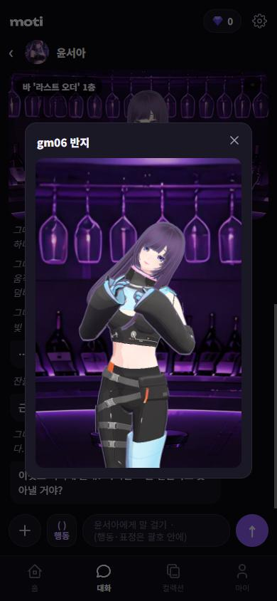
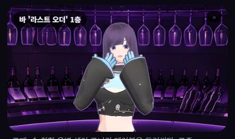
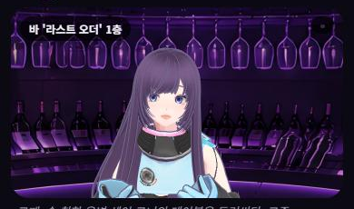
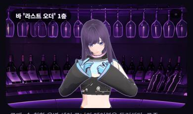
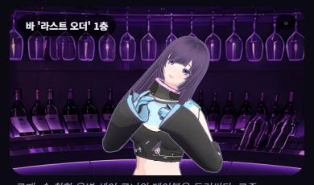
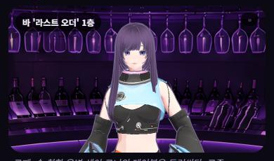
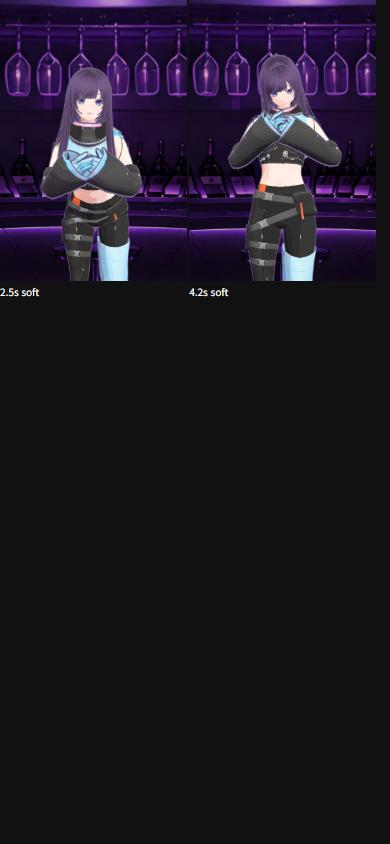
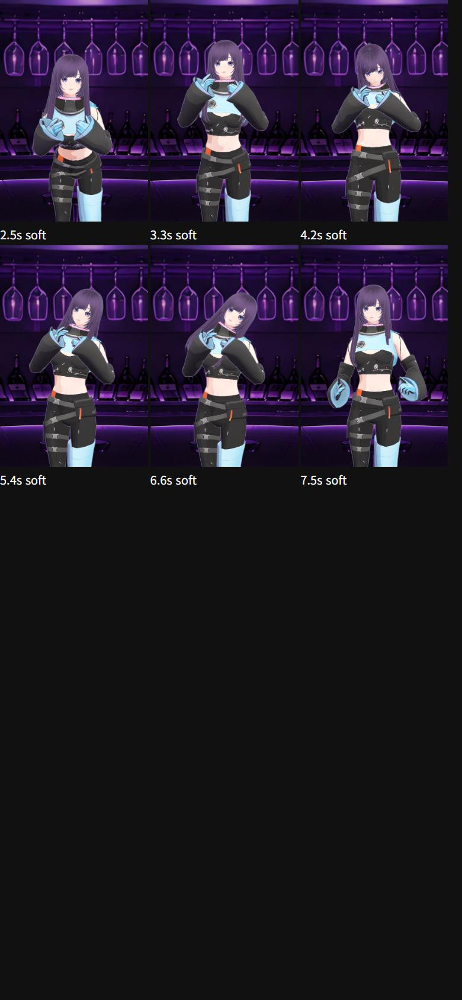
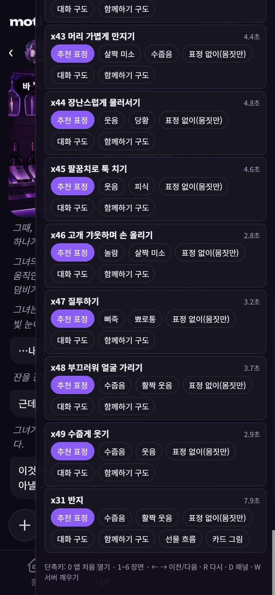

# 86-1. 반지 선물 전용 반응 모션 구현

연인(6단계) 순간 선물 「반지」의 반응 몸짓 x31 을 XSTAGE 모션으로 완성하고, 반지 무빙 카드 gm06 과 시연 패널 검수에 연결했다. 다른 선물·대화·함께하기 모션은 바꾸지 않았다.

브랜치: `step/86-1-ring-motion` (시작 main `b59bdde` [84-2])
구현 커밋: `722ac8e` [86-1] 반지 반응 x31 모션·표정 흐름·gm06·검수 버튼

백엔드 수정·유료 API 호출 없음. 서버 응답은 페이지 안에서 가짜로 가로채 확인했다(`api=` 를 로컬 가짜 주소로, 실제 서버 요청 0건).

## 사용한 원본

- XSTAGE `[standard] Lovely - Receive candy 1.fbx` — `C:\Users\KDH\Downloads\new_motion_data` 에 있음. 84-1 때 `_src/xstage_84-1/` 에 복사해 둔 파일과 바이트 단위로 같음(`cmp`).
- 원본 14.18초, 30fps, 몸 뼈 20/20, 손가락 뼈 30개(모두 움직임), 배우 정면(몸 방향 −18° ~ +21° 로 흔듦), 0초 T자.

## 원본 흐름(분석)

변환 전 FBX 를 three.js 로 읽어 0.1~0.25초마다 몸 방향, 등·가슴 앞뒤 기울기, 머리 숙임·돌림, 두 손 위치(머리 기준), 검지 굽힘을 뽑았다.

| 원본 시각 | 동작 |
| --- | --- |
| 0~0.7 | T자 → 서 있기 |
| 0.75~1.25 | 두 손을 턱 앞으로 모아 올림(놀람) |
| 1.25~2.6 | 그대로 멈춤(손 위치 변화 거의 없음) |
| 2.75~4.5 | 허리를 약 35° 숙이며 두 손을 앞으로 내밀어 받음, 3.25초부터 왼손으로 쥠(왼손 검지 굽힘 4° → 70°) |
| 4.75~6.2 | 몸을 세우고 가슴 앞에 든 선물을 내려다봄(머리 25° 숙임) |
| 6.25~9.2 | 선물을 가슴에 안고 몸을 왼쪽으로 −18° 흔들었다 돌아옴, 고개 갸웃 |
| 9.3~11.5 | 오른쪽으로 +21° 한 번 더 흔듦 |
| 12.25~13.3 | 손을 내림 → 서 있기 |

원본 의미는 「사탕 받기」지만 놀람 → 받기 → 들여다보기 → 안고 흔들기 흐름이 지시문의 감정 흐름(놀람 → 관심 → 수줍음·감동 → 기쁨·복귀)과 그대로 맞아서, 원본에 없는 동작은 더하지 않았다.

## 변환·보정

1. `node tools/fbx2motion.mjs` 그대로 변환(84-1·84-2 와 같은 파이프라인, 변환기 수정 없음). 변환 원본 JSON 은 `_src/xstage_84-1/receive_candy_raw.json`(gitignore).
2. **구간:** `from 0.7 · to 9.25 · skip [1.75, 2.4] · skipBlend 0.3 · fadeIn 0.3 · fadeOut 0.9 · inPlace`
   - 앞 0.7초(T자·서 있기) 뺌. 턱 앞에서 멈춘 1.25초 중 가운데 0.65초 건너뜀(이음매 뼈 최대 차이 12.9°, 평균 2.4° — 건너뛸 점은 프레임마다 뼈 16개 세계 회전 차이로 찾음).
   - 두 번째 흔들기 이후(9.3~14.2초, 약 5초)를 뺌. 9.25초는 몸 방향이 정면(−1°)으로 돌아온 순간이고, 손은 끝 섞기 0.9초로 내림.
   - 두 번째 흔들기를 살리고 가운데만 건너뛰는 안(이음매 19.6°, 재생 10.8초)과 흔들기를 통째로 빼는 안(6.9초)도 비교했다. 앞 안은 반응으로 너무 길고 뒤 안은 「안고 흔드는」 매력이 사라져서 위 구간으로 정함.
   - 골반이 옆으로 약 0.08배·앞뒤 0.1배 밀려 inPlace. turn 없음(정면). fadeIn 0.3 은 선물 반응 공통 범위(0.2~0.3, check_gacha) 안.
3. **팔 보정(x31 파일만):** 서아에 그대로 입히면 손을 가슴 앞에 모으는 4~9초 내내 **두 아래팔이 X 자로 겹쳐** 팔짱·거절처럼 보이고 소매끼리 관통했다(원본 배우는 두 손을 약 7cm 간격으로 거의 맞붙여 쥠).
   - 새 도구 `tools/xs_arms_out.mjs`: 원본 2.5~3.1초에 걸쳐(smoothstep) 두 팔(상완·하완·손·그 손의 손가락)을 **어깨 관절을 축으로 그대로** 세로축 9°·앞축 5°(팔꿈치를 옆으로) 벌림. 팔 안의 굽힘·손목·손가락 자세는 그대로, 몸통·다리·골반·어깨뼈는 손대지 않음. 턱 앞 놀람 구간(그 전)은 바뀌지 않음.
   - 15°·8° 도 해 봤으나 손이 어깨 너비로 벌어져 「들고 있는」 느낌이 사라져 9°·5° 로 정함.
   - 실제 서아 뼈에서 잰 값(4~7초): 두 손 간격 약 20cm, 왼·오른 아래팔 시작점 간격 39~44cm, 좌우가 뒤바뀌는(교차) 순간 없음.
   - 공통 보정값(config·다른 모션의 damp·tiltMax 등)은 바꾸지 않음.
4. **숙임:** 받는 순간 허리 약 35° 숙임은 그대로 둠. 대화 구도에서 얼굴이 화면 쪽으로 다가오며 두 손을 내미는 모습이 되고 머리가 화면 밖으로 나가지 않아, 이 몸짓의 핵심 매력으로 봄(tiltMax 안 씀).

**최종 재생 시간: 7.90초** (`Stage.dur("x31")` 7.9, 실제 선물 흐름에서 재생 시작 ~ 끝 약 8.0초 측정)

| 원본 구간 | 최종 적용 |
| --- | --- |
| 0 ~ 14.18초 | 0.7 ~ 1.75 + 2.4 ~ 9.25초 (몸짓 시각 0 ~ 7.9초) |

## 표정 흐름

선물 반응은 원래 서버 표정을 그대로 쓰므로, **motionFace 에 `gift: true` 가 있는 몸짓(x31 하나)만** 선물 반응에서도 [84-2] 몸짓 시각 표정 흐름(`seq`)을 쓰게 했다. `always: true` = 서버 표정과 상관없이 이 흐름(가짜 서버가 「슬픔」을 줘도 흐름 그대로 확인).

| 몸짓 시각 | 원본 시각 | 표정 | 몸짓 |
| --- | --- | --- | --- |
| 0 | 0.7 | 놀람(surprised) | 두 손을 턱 앞으로 |
| 1.5 | 2.85 | 살짝 미소(soft) | 숙여 두 손을 내밀어 받음 |
| 3.4 | 4.75 | 수줍음(shy) | 몸을 세워 가슴 앞 반지를 내려다봄 |
| 5.0 | 6.35 | 웃음(fun, 눈 뜬 웃음) | 반지를 안고 몸을 흔들며 고개 갸웃 |
| 7.2 | 8.55 | 살짝 미소(soft) | 손을 내리며 기본 자세로 |
| (끝 뒤) | | 기존 복귀 타이머 → 기본 표정 | |

- 눈을 감는 활짝 웃음(joy)은 쓰지 않음. 놀람은 1.5초만.
- 립싱크: `talkDamp 0.7`(대사 입 움직임을 조금 줄여 표정 입 모양과 덜 부딪침).
- 몸짓이 바뀌거나 끊기면 표정 흐름은 그 몸짓과 함께 사라짐(기존 구조). 실측: x31 1.2초에 다른 몸짓으로 바꾸고 7초 지켜봄 → 표정이 수줍음·웃음으로 바뀌지 않음.
- 다른 선물 반응(x19·x26~x30·m09 등)은 `gift` 가 없어 예전처럼 서버 표정. 초콜릿 실측: x19, 서버 표정 shy 그대로, 표정 흐름 없음.

## 반지 선물 연동

- 반지 선물 값(id `ring`, 300💎, 6단계, `kind moment`, 그림 `icons/gift2_ring.png`, `when`, 임시 규칙 단어)은 그대로. 반지는 x31 모션 파일이 없어 잠겨 있었을 뿐이라(`Moment.reactionOf` = 재생 가능할 때만), 모션을 넣은 것만으로 6단계에서 열림. 5단계에서는 닫힘(실측).
- 서버가 다른 몸짓(m03)을 줘도 x31 이 우선(기존 `giftMid` 정책 그대로, 실측).
- `gifts.json preview`(`?giftPreview=1` 임시 대체 x31→m06)는 진짜 모션이 있으면 자동으로 건너뛰므로 그대로 둠.
- x31 = `only "gift"` → 일반 대화 몸짓·서버 motion_list·키워드·감정 고르기·함께하기 자동/행동·자유 모션·카드 팩·포즈에서 빠짐(아래 테스트 7).

## 무빙 카드 gm06

- id·번호(51)·등급(rare)·source moment·gift ring·stage 6·몸짓 x31 그대로.
- **대표 장면: 몸짓의 73%(약 5.8초)** — 반지를 가슴 앞에 두 손으로 꼭 안고 고개를 갸웃하며 웃는 순간. 「받은 것」(손에 든 선물)과 「기쁨」(웃는 얼굴)이 한 장에 같이 보이는 순간이라 고름. 2.4초(받으려고 숙임)는 손이 화면 아래로 잘리고, 4.0초(내려다봄)는 얼굴이 숙여져 표정이 덜 보임.
- **표정 joy → fun**: 카드 그림만 보면 눈을 감은 joy 도 좋았지만, 카드 크게 보기는 이 표정 하나로 7.9초 몸짓을 계속 반복 재생해서 눈을 감은 채 길게 있게 됨 → 눈 뜬 웃음 fun.
- **버전:** x31 `motionVer 1`(진짜 모션 첫 버전). 예전 `?giftPreview=1` 로 만든 카드는 ver 0.5 였으므로 다시 그림. gm06 만 해당.
- 기존 보유 카드 유지(실측): 옛 기록(mv 0.5, 날짜·장소·의상 다른 값)을 넣고 반지를 다시 줌 → 기록 그대로·중복 없음, 다이아는 그 선물값 300 한 번만. `Cards.refresh()` → 그림만 다시 만들고 mv 1, 날짜·장소·의상 그대로.

| gm06 카드 그림(시연 패널 「카드 그림」) |
| --- |
|  |

## 캡처 (390px, 대화 구도, 실제 서아 모델, 추천 표정 흐름)

| 0.9초 놀람 | 2.4초 받기 | 4.0초 내려다봄 | 5.8초 안고 흔들기 | 7.5초 복귀 |
| --- | --- | --- | --- | --- |
|  |  |  |  |  |

팔 보정 전후(카드 구도, 전신): 보정 전  · 보정 후 

시연 패널: 

## 바뀐 파일

| 파일 | 내용 |
| --- | --- |
| `motions/xstage_receive_candy_ring.json` (새 파일) | x31 모션(변환 + 팔 보정, 274KB) |
| `tools/xs_arms_out.mjs` (새 파일) | 구간 동안 두 팔을 어깨 축으로 벌리는 도구 |
| `data/motions.json` | `motions.x31`(반지·기쁨·only gift) · `xstage.x31`(구간·설명) · `motionFace.x31`(표정 흐름, gift·always) · `preview.x31`(검수 표정 후보 수줍음·활짝 웃음) |
| `index.html` | `motionFit` 의 `always` · 선물 반응 중 `gift` 몸짓만 표정 흐름 · 시연 패널 x31 줄 「선물 흐름」「카드 그림」 |
| `data/collection.json` | gm06 표정 joy→fun · `momentById.gm06 73` |
| `data/demo.json` | 버튼 문구 2개 |
| `tools/check_gacha.mjs` | 「반지 잠금」 검사 → 「x31 원본·선물 전용·재생 길이·반지 값·gm06 값·x31 사용 범위·gift 표정 흐름은 x31 만」 검사 |
| `docs/CREDITS.md` | 보류 줄 → x31 실제 사용으로 |
| `docs/reports/img/86-1/` | 캡처 |

## 테스트 결과

확인 방식: **재생** = 브라우저에서 실제 서아 모델로 재생해 화면으로 봄 · **측정** = 브라우저에서 상태·값을 잼 · **코드** = 코드·스크립트로 확인.
이번에도 브라우저 창의 그리기 루프가 느리게 돌아(초당 1프레임 남짓) 화면 확인은 몸짓을 그 시각에 멈춘 정지 화면(`Stage.seek`, 카드 그림 만들기)으로 했다. **연속 재생의 자연스러움(흐름·이음매·섞기)은 눈으로 끝까지 보지 못했다.** 표정 전환 시각은 0.5초 간격으로 실제 재생 상태를 기록해 확인.

| # | 항목 | 결과 | 확인 |
| --- | --- | --- | --- |
| 1 | x31 파일 로딩·재생 | ✓ 200 OK, `canPlay`, 길이 7.9초, 실제 재생 약 8초 뒤 끝 | 측정 |
| 2 | 팔·손·머리·골반 | ✓ 아래팔 X 자 겹침 → 팔 보정으로 해결(뼈 측정 교차 0). 턱 앞 손은 얼굴에 닿지 않음. 숙임 35° 는 화면 안. 골반 inPlace. △ 손가락이 끝 섞기 중 잠깐 기본 손으로 바뀌는 모양은 정지 화면 한 장으로만 봄 | 재생(정지 화면) + 측정 |
| 3 | 표정 변화·종료 복귀 | ✓ 놀람 → 미소(≈1.5) → 수줍음(≈3.4) → 웃음(≈5.0) → 미소(≈7.2) → 끝 뒤 기본 표정. 중단·탭 전환 뒤 남는 표정 변화 없음 | 측정 |
| 4 | 연인 단계 반지 해금·전용 반응 | ✓ 6단계에서 열림·5단계 닫힘. 가짜 서버가 m03·「슬픔」을 줘도 x31 + 표정 흐름. 서버로 가는 motion_list 에 x31 없음 | 측정 |
| 5 | gm06 최초 획득·기존 카드 유지 | ✓ 첫 반지에 gm06 획득. 이미 있으면 기록 그대로·중복 없음, 버전이 달라도 그림만 다시(날짜·장소·의상 유지) | 측정 |
| 6 | gm06 대표 이미지·모션 | ✓ 5.8초 장면 그림, 카드 표정 fun 으로 x31 재생 | 재생(정지 화면) |
| 7 | 자동 모션 제외 | ✓ `unlockedIds`·`motionList`(강제로 해금 목록에 넣어도 빠짐)·`pickMotion("x31")`·키워드 「반지」·`allowedMotions`·`Together.freeList`·`Together.playCard("x31")` 거부·포즈 없음. 데이터: seoa_story·motion_keywords·together·pack·photos·seoa_photo·config·emotion_face 에 x31 없음(check_gacha) | 측정 + 코드 |
| 8 | 다른 선물 모션 영향 | ✓ x19·x26~x30·m09 줄·파일 diff 없음, 초콜릿 실측 서버 표정 그대로, `gift` 표정 흐름은 x31 만(check_gacha) | 측정 + 코드 |
| 9 | 카드 중복·다이아 중복 차감 | ✓ 반지 1회 = 300 한 번(1000→700, 다시 주면 700→400), gm06 한 장 | 측정 |
| 10 | JS·JSON·모션 ID | ✓ 루트 `*.js`·`tools/*.mjs` `node --check`, index.html 스크립트, `data/*.json` 파싱, 모든 xstage 파일·구간 유효. data 의 몸짓 번호 중 없는 것은 x04·x07·x08·x12(예전부터 xstageReserve) 뿐 — **x31 은 이제 없는 ID 가 아님** | 코드 |
| 11 | check_gacha | ✓ 모두 통과(86-1 줄 포함) · test_motion_keywords 26개 통과 · test_away_selfie 53/0 | 코드 |
| 12 | 콘솔 오류 | ✓ 앱 오류 없음. 404 두 건은 테스트용 가짜 API 주소(`/__fake/openapi.json`) | 측정 |
| 13 | 디버그 재생이 기록을 안 바꿈 | ✓ 「대화 구도」「선물 흐름」「카드 그림」 뒤 다이아·카드·선물 기록·선물 로그·단계·호감·해금·최근 몸짓 그대로 | 측정 |
| 14 | 유료 API | ✓ /chat 은 페이지 안 가짜 응답, 실제 서버 요청 0건 | 측정 |

테스트로 바뀐 브라우저 저장값(다이아·단계·카드)은 테스트 전 값으로 되돌렸다.

## 제가 정한 것

- **구간 0.7~9.25초(1.75~2.4 건너뜀) = 7.9초.** 두 번째 흔들기를 뺀 대신 첫 흔들기를 통째로 살림(위 비교).
- **팔 보정 도구를 새로 만듦**(`tools/xs_arms_out.mjs`). 기존 `damp`·`tiltMax` 는 팔을 벌리는 보정이 아니라서. 값 9°·5° 는 정지 화면 비교로 정함. x31 파일에만 적용.
- **숙임 35° 는 줄이지 않음**(받는 동작의 핵심, 화면 안에 머묾).
- **선물 반응 표정 흐름은 x31 에만**(`motionFace.x31.gift`). `always` 로 서버 표정을 덮음 — 반지는 이 서비스의 가장 특별한 선물이라 정해진 연출을 우선. 서버가 「슬픔」(감동해서 우는 대사 등)을 줘도 몸짓 표정은 흐름대로라, 대사와 표정이 어긋나 보이면 `always` 를 빼면 됨(그러면 평온·미지정일 때만 흐름).
- **감정 태그 「기쁨」**(motions.x31.emo).
- **gm06 표정 fun · 대표 장면 73%** (위 이유).
- **x31 `motionVer 1`** 로 명시(예전 임시 카드 0.5 와 다르게).
- **시연 패널:** 별도 패널을 만들지 않고 「신규 모션 검수」 목록에 x31 을 넣고, 순간 선물 반응 몸짓 줄에만 「선물 흐름」(선물 그림 1초 → 반응 몸짓·표정 흐름)·「카드 그림」(gm06 대표 장면 그림 + 카드 표정 재생) 두 버튼을 붙임. 「반지를 실제로 건네는」 전체 흐름(다이아·카드 획득 포함)은 기록이 바뀌므로 버튼으로 만들지 않고 테스트에서 가짜 서버로 확인함.
- x31 파일(274KB)은 다른 선물 반응 파일처럼 쉬는 틈 미리 받기 대상(6단계 전 사용자도 받음). 지금 정책 그대로 둠.

## 아이폰에서 나중에 볼 것

- x31 연속 재생: 건너뛴 이음매(원본 1.75→2.4초, 몸짓 1.05초), 숙였다 일어서는 흐름, 팔 벌림이 시작되는 2.5~3.1초(몸짓 1.15~1.75초)에 팔이 튀지 않는지, 끝 섞기 0.9초에 손이 내려오는 모양
- 받는 순간(몸짓 약 2.4초) 숙임이 대화 칸 위쪽에서 잘리지 않는지(기기 화면 비율별)
- 표정 전환(놀람 → 미소 → 수줍음 → 웃음 → 미소)과 대사 입 움직임이 같이 나올 때 어색하지 않은지
- gm06 카드 크게 보기에서 7.9초 반복 재생, 카드 그림 다시 만들기(이미 임시 카드를 가진 경우)
- 시각 효과(블러·그림자·애니메이션) 자체는 바꾸지 않음. 선물 그림 떠오르기(burst)는 기존 그대로

## 디버그 재현 방법

1. `?debug=1` 로 열고 톱니 → 「신규 모션 검수」 맨 아래 **x31 반지**.
2. 표정 「표정 없이(몸짓만)」 + 「대화 구도」 = 원본 적용 결과(보정된 몸짓만).
3. 「추천 표정」 + 「대화 구도」 = 표정 흐름이 붙은 반지 반응.
4. 「선물 흐름」 = 반지 그림이 1초 떠올랐다 사라진 뒤 실제 선물 반응과 같은 재생.
5. 「카드 그림」 = gm06 대표 장면(73%, fun) 그림을 만들어 보여 주고 카드 표정으로 x31 재생.
6. 2~5 모두 다이아·선물 기록·순간 선물·관계·카드 획득·최근 몸짓을 바꾸지 않음.
7. 실제로 건네 보기: 시연 패널에서 6단계로 올리고 반지 순간 선물이 열리는 대화(임시 규칙: 서아 말에 「남을게」「안 갈게」「돌아올 곳」, 또는 서버 gift_moment) → ＋ → 선물하기 → 반지. 이건 실제 기록이 바뀜.

## 모션 리소스 라이선스

XSTAGE 「[standard] Lovely - Receive candy 1」 — 라이선스 범위 **확인 필요**(기존 CREDITS 정책 그대로). `docs/CREDITS.md` 의 보류 줄을 실제 사용 줄로 바꿈.

## 남은 문제

- 연속 재생 자연스러움은 눈으로 끝까지 못 봄(위 「아이폰에서 나중에 볼 것」).
- 반지가 열리는 서사 조건은 손대지 않음([110] 예정). 지금 임시 규칙·서버 gift_moment 그대로.
