# 86-2. 구급상자·우산 선물 반응 모션 개선

구급상자(x26)는 움직임이 거의 안 보이던 원인을 고쳤고, 우산(x30)은 서아가 실제로 두 걸음 다가왔다가 제자리로 돌아가게 다시 만들었다. 무빙 카드 gm01·gm05 는 크게 보기에서 시간별 표정 흐름이 반복되게 했다. 나머지 선물 9종·다른 카드는 바꾸지 않았다.

브랜치: `step/86-2-gift-motion-polish` (시작 main `47217c2` [86-1])
구현 커밋: `822427c` [86-2 A] 구급상자 · `c846716` [86-2 B] 우산 · `0ac00aa` [86-2 C] 카드·시연 · `6a72efc` [86-2 D] 우산 중단 시 복귀

백엔드 수정·유료 API 호출 없음. 서버 응답은 페이지 안 가짜 응답(`api=` 로컬 가짜 주소, 실제 서버 요청 0건).

## 시작 전 확인

- **반지 gm06 SECRET 등급: 반영되어 있지 않음.** origin/main(`47217c2`)의 `data/collection.json` gm06 은 `grade: "rare"`(SECRET = `special`). 다른 브랜치에도 그런 변경이 없음. 이번 작업 범위가 「다른 무빙 카드 변경 금지」라 **바꾸지 않았다** — 기획 쪽에서 SECRET 으로 바꾸는 작업이 따로 필요함(아래 남은 문제).
- 수정 전 값:
  - x26: `xstage_glancing_nervously.json` 1~4초(3초), turn 90, inPlace, tiltMax 등 8·가슴 12·목 18·머리 26, fadeIn 0.25·fadeOut 0.3, motionVer 2, 표정은 서버 표정 그대로. gm01 표정 neutral.
  - x30: `xstage_gift_umbrella.json`(make_umbrella 50-3판) 0~3.4초, inPlace, 골반 이동 0, 카메라 umbrellaIn(평소보다 약 15% 다가감), 1초부터 fun(xstage face·faceAt), motionVer 2. gm05 표정 sorrow.

## A. 구급상자 x26

### 기존 문제(원인)

원본(「Shy _Glancing around nervously」 5.07초)은 몸통·팔은 거의 그대로이고 **머리만** 움직인다(아래 표, 세로에서 앞으로 기운 각도).

| 원본 시각 | 0.2~0.9 | 1.0~1.6 | 1.6~2.1 | 2.2~2.5 | 2.5~5.0 |
| --- | --- | --- | --- | --- | --- |
| 머리 | 80° 숙임 | 들어 올림 | 19~25° (쳐다봄) | 휙 숙이며 피함 | 86~87° |
| 목 | 51° | → | 25~29° | → | 61~63° |
| 가슴 | 28° | → | 21° | → | 34° |

50-3 의 `tiltMax`(머리 26°)는 넘는 만큼 **잘라서**, 이 흐름이 머리 26° → 19° → 26° 로 납작해져 「쳐다보고 피하는」 움직임이 거의 보이지 않았다. 다른 구간(0~1초 숙인 채 정지, 2.5초 뒤 숙인 채 정지)은 쓸 만한 동작이 없어 구간은 비슷하게 두고 보정 방식을 바꿨다.

### 수정

- 새 도구 `tools/xs_tilt_scale.mjs`: 뼈마다 「세로에서 기운 각도」를 **같은 비율로** 줄임(모션 전체에서 가장 크게 기운 순간 = 한계값). tiltMax 와 같은 축(기운 방향의 수직 가로축)으로 돌려 옆으로 향한 방향은 그대로. 팔·손가락은 가슴과 같이 돌림. 처음엔 84-1 `xs_upright`(몸의 옆 축으로 돌림)로 해 봤는데 옆으로 숙인 고개가 갸웃으로 바뀌어 새 도구로 함.
- 한계: 등 8° · 가슴 14° · 목 20° · 머리 30° (머리 87→30, ×0.34). 머리 34° 도 해 봤는데 숙였을 때 앞머리가 눈을 다 가려 30° 로.
- 결과 파일 `motions/xstage_glancing_x26.json`(원본 `xstage_glancing_nervously.json` 은 그대로 둠).
- 구간 1.0~**4.5**초(재생 **3.5초**), fadeIn 0.25 · fadeOut 0.3→0.5, turn 90·inPlace 그대로.
- **tiltMax 는 지우지 않음** — 안전 한계로 남기고 값만 보정 파일 최대보다 조금 위로(등 9·가슴 16·목 23·머리 34).
- 머리 기울기(보정 후, 몸짓 시각): 0초 25° → 0.4~1.0초 7~10°(쳐다봄) → 1.2~1.5초 휙 30°(피함) → 끝까지 30°.
- motionVer 2 → 3.

| 전(위 줄) / 후(아래 줄) — 0.05 · 0.8 · 1.8초 |
| --- |
| 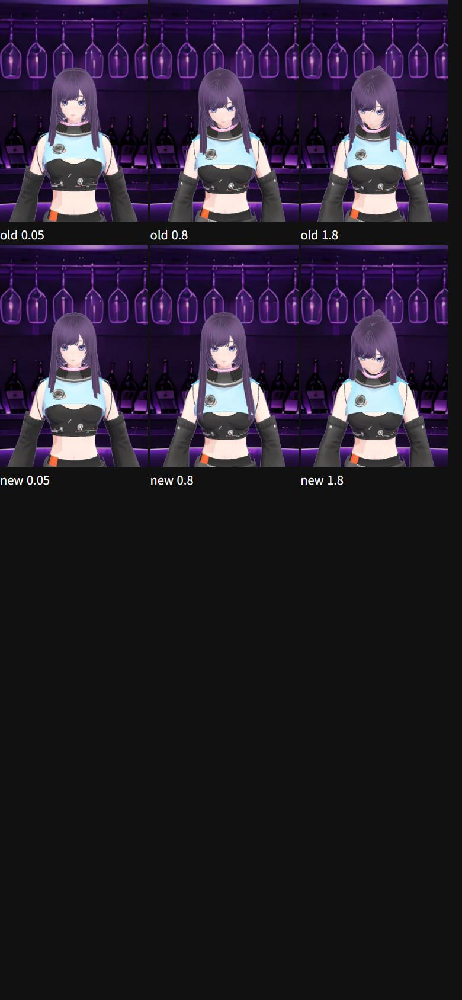 |

### 표정 흐름 (몸짓 시각)

| 시각 | 표정 | 몸짓 |
| --- | --- | --- |
| 0 | 놀람(surprised) | 고개를 들어 쳐다봄 |
| 1.1 | 당황(flustered) | 휙 숙이며 시선을 피하기 직전 |
| 2.2 | 수줍음(shy) | 숙인 채 앞머리 사이로 — 은근한 고마움(처진 눈썹에 작은 미소) |
| 3.5 끝 | 기본 표정(기존 복귀 타이머) | |

경계 단계라 활짝 웃는 표정은 쓰지 않음. `talkDamp 0.85`.

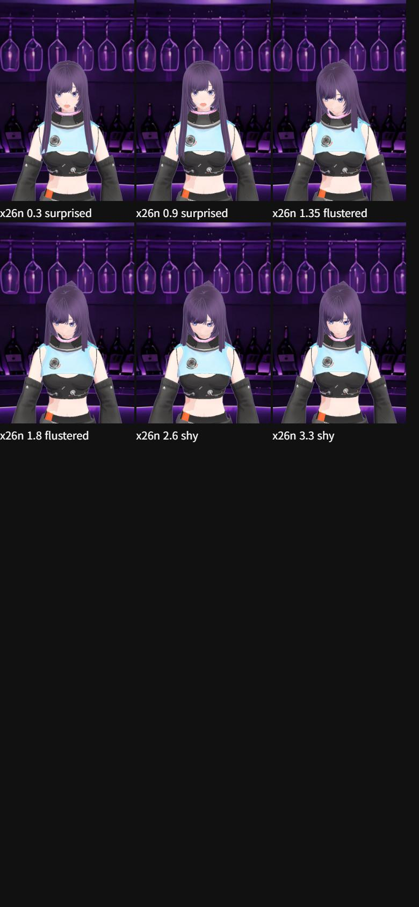

## B. 우산 x30

### 기존 문제

50-3 판은 골반을 옮기지 않고(제자리 반 걸음) 카메라가 다가가 「가까워진 느낌」을 냈다. 그런데 **컬렉션 카드 그림·크게 보기는 카메라가 서아 몸 위치를 따라가므로**(`Stage.center`) 카드에서는 카메라 연출도 없이 제자리 반 걸음만 보였다 → 「걸어오는 느낌이 없다」. 표정도 1초부터 fun 하나라 변화가 작았다.

### 수정 — `tools/make_umbrella.mjs` 다시 만듦 (6.6초)

| 시각 | 몸짓 | 표정 |
| --- | --- | --- |
| 0~1.0 | 우산을 받고 고개를 13° 숙인 채 망설임 | 슬픔(sorrow) |
| 1.0~1.6 | 고개를 들어 바라봄 | 1.0 놀람(surprised) |
| 1.6~3.4 | **실제로 작은 두 걸음** 다가옴(왼발 → 오른발 → 왼발을 옆에 모음) | 1.9 안도(shy = 처진 눈썹 + 작은 미소) |
| 3.4~4.8 | 가까이 서서 고개를 살짝 들어 눈을 맞춤 | 3.3 따뜻한 웃음(fun, 눈 뜬 웃음. joy 는 눈을 감아 안 씀) |
| 4.8~6.2 | 같은 발 디딤을 거꾸로 밟아(작은 뒷걸음 두 번) 제자리로 | 5.0 살짝 미소(soft) |
| 6.2~6.6 | 제자리에 섬 → 끝 섞기 0.4초 | 끝 뒤 기본 표정 |

- 재료: 서기 = x27 원본(「Shake Head」) 2.0~5.2초 왕복, 걷기 = x22(「Walk」) 0.8~1.967초 한 주기. 새 모션 구매 없음.
- **이동과 발 디딤:** 다리 회전·골반 이동이 같은 「걷기 시각」을 따름(처음·끝은 천천히). 다리는 걷기 쪽으로 0.26 만큼(무릎·발목은 들린 다리일 때만 더 굽혀 발이 끌리지 않게), 골반 이동은 걷기 골반 × 0.26 × 1.22(다리 각도를 줄이면 발이 덜 나가서 디딘 발이 뒤로 끌리던 것을 앱에서 재서 맞춤). 팔만 걷기 쪽으로 조금 흔듦(골반·등·머리는 서기 그대로 — 걷기 배우의 몸 비틀림을 따르면 다가오는 동안 몸이 옆으로 돌아 눈을 못 맞춤).
- **처음·끝 골반 위치가 정확히 0** → inPlace 를 끄고(골반 이동 그대로 씀) 끝 섞기 때 미끄러지지 않음. 반복 재생해도 무대가 매 프레임 기본 위치에서 다시 더하므로 누적되지 않음.
- 걸음 크기 비교: 0.42(약 0.46m)는 대화 구도에서 머리 위가 잘려 줄임 → 최종 **약 0.35m**(골반 높이 × 0.428).
- 복귀 방식 비교: (1) 끝 섞기로 미끄러져 돌아감 — 0.4초에 35cm 미끄러짐, (2) 걸어 돌아서 나감 — 6초 넘게 길어지고 등을 보임, (3) **같은 발 디딤 거꾸로(작은 뒷걸음)** — 발 디딤이 맞고 「살짝 물러서며 미소」로 읽혀 (3) 선택.
- 도중에 다른 몸짓으로 끊기면: 기본 0.35초 섞기면 35cm 를 휙 미끄러져 돌아가서, x30 만 `cutBlendMs 0.9` (0.9초 동안 섞으며 제자리로).
- motionVer 2 → 3. xstage `face`·`faceAt` 은 지우고 motionFace 표정 흐름 하나로(둘이 부딪치지 않게).

### 실제 이동 거리·발 디딤 검수 (실제 서아 모델, 1/30초마다 `Stage.still` 로 자세를 잡아 뼈 위치를 잼)

| 항목 | 값 |
| --- | --- |
| 골반 앞뒤 | 9.1cm → 최대 44.0cm → **9.1cm**(처음 자리) |
| 골반 총 이동 | 70cm(다가오기 35 + 돌아가기 35) |
| 디딘 발 미끄러짐(디딘 발 = 다른 발보다 1.5cm 이상 낮은 동안 수평 이동) | 왼발 6.2cm · 오른발 6.9cm(디딤 8번 합, 한 번에 약 1.5~3cm, 한 프레임 최대 1.36cm). 발목 뼈로 재서 뒤꿈치 → 앞꿈치로 구르는 움직임도 포함 |
| 마지막 디딤(가까이 섰을 때) | 오른발 0.4cm 안에서 고정, 왼발이 옆에 모임 |
| 발 높이 | 바닥 8.1cm(서기와 같음) ~ 든 발 12.7cm(바닥 아래로 안 내려감) |
| 대화 구도·카드 구도에서 발 | 둘 다 허벅지 위까지만 보여서 발은 화면에 안 나옴 |

조정 과정: 처음(걸음 0.42, 무릎 보정 없음)은 든 발이 3.5cm 만 들려 바닥에 끌림 → 무릎·발목 더 굽힘 → 디딘 다리까지 굽혀 미끄러짐 → 들린 다리만 굽힘 → 걷기 시작점을 디딘 발이 골반 바로 아래인 0.8초로 → 골반 × 1.22.

### 카메라

- 대화 무대: 50-3 `umbrellaIn`(카메라가 다가감)은 실제 접근과 겹치면 너무 커져서 뺌. 새 `umbrellaNear` = 평소 구도에서 **위만 조금 넓힘**(1.05 → 1.085, 카메라가 약간 뒤로·위로).

| 구도 | 멀리(0.8초) 머리 꼭대기 · 얼굴 크기 | 가까이(4.0초) 머리 꼭대기 · 얼굴 크기 |
| --- | --- | --- |
| 평소 normal | 17.6% · 37.5% | **8.8%**(머리 위가 거의 닿음) · 50.1% |
| umbrellaNear | 23.7% · 34.7% | **17.5%** · 45.2% (멀 때보다 약 30% 커짐) |

(머리 꼭대기 = 3D 칸 위에서부터의 자리, 얼굴 크기 = 칸 높이 대비. 머리 뼈 위 13cm·아래 12cm 를 화면에 투영해 계산)

- 「동작 줄이기」: 기존 코드 그대로 카메라를 움직이지 않음 → 평소 구도에서 다가옴(가까이 섰을 때 머리 꼭대기 8.8%, 잘리지는 않음). 서아의 걸음 자체는 그대로. **(코드로만 확인, 이 환경에서 동작 줄이기를 켤 수 없었음)**
- 카드 구도: `frameById.x30` 에 `fixed: true`(카메라가 서아를 따라가지 않고 처음 자리) · 위 1.13. 카드 그림과 크게 보기 모두.

| 수정 전후(카드 구도) — 위: 전 0.4·1.6·2.6초 / 가운데·아래: 후 |
| --- |
| 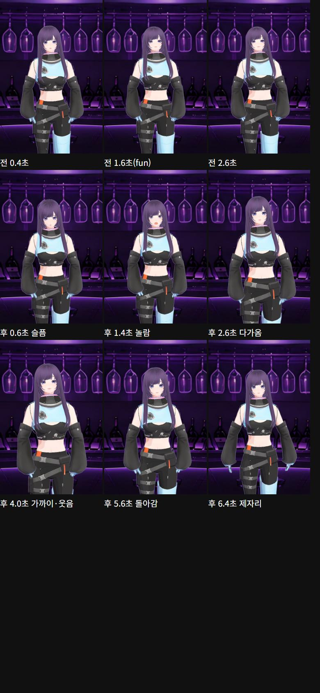 |

| 카메라가 따라갈 때(새 모션, fixed 전) | fixed 후(위 1.08 / 1.13) |
| --- | --- |
| 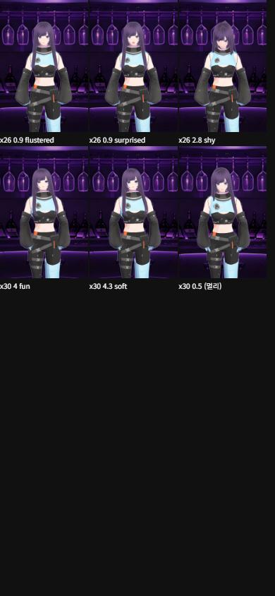 | 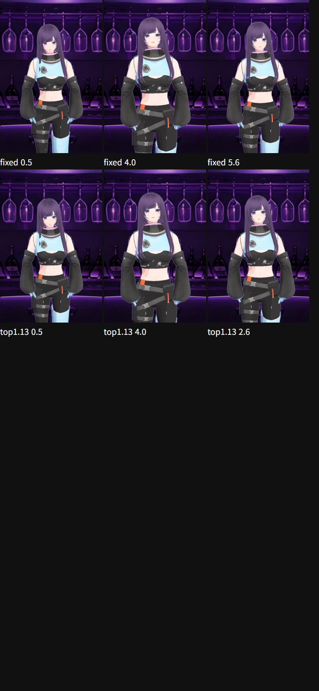 |

대화 구도(390px): 0.6초 슬픔 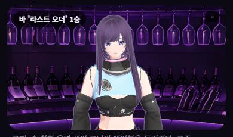 · 1.4초 놀람 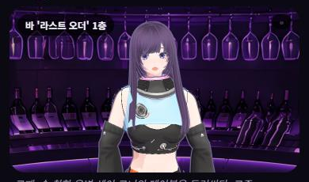 · 4.0초 가까이·웃음(시연 「대화 구도」 = 몸짓 구도 없이 평소 구도라 머리 위가 닿음. 실제 선물·「선물 흐름」은 umbrellaNear) 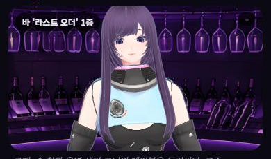

## C. 무빙 카드 gm01·gm05

- id·번호(46·50)·등급(rare)·조건·획득 기록은 그대로.
- 카드 재생 코드에 선택 설정 하나: `collection play.faceSeq: true` 면 크게 보기에서 그 몸짓의 `motionFace.seq` 를 반복마다 처음부터(`Stage.camLoop` 의 `fs`, 카드 보기는 표정 잠금 중이라 이 흐름만 잠금을 넘어 바꿈). **gm01·gm05 만** 켬 — 다른 카드는 `fs` 가 없음(전체 카드 검사: faceSeq 가 붙는 카드 0장).
- 크게 보기를 닫으면(표정 흐름 카드였을 때) 대화 기본 표정으로. 이전·다음 이동은 기존처럼 `camLoop(null)` 로 몸짓·표정 흐름·위치를 비우고 새 카드로.
- 대표 장면·그림 표정:
  - **gm01 = 26%(0.9초), flustered** — 고개를 들어 쳐다보는 순간이라 얼굴이 정면으로 보이고 당황한 눈·입이 드러남(숙인 뒤는 앞머리에 눈이 가려 덜 보임).
  - **gm05 = 61%(4.0초), fun** — 가장 가까이 와서 눈을 맞추고 웃는 순간(카드 구도 고정 카메라라 가까워진 게 크기로 보임).
- motionVer 3 으로 기존 보유자 카드 그림만 다시 만듦.

| gm01 카드 그림 | gm05 카드 그림 | gm05 크게 보기(3D, 웃는 순간) |
| --- | --- | --- |
| 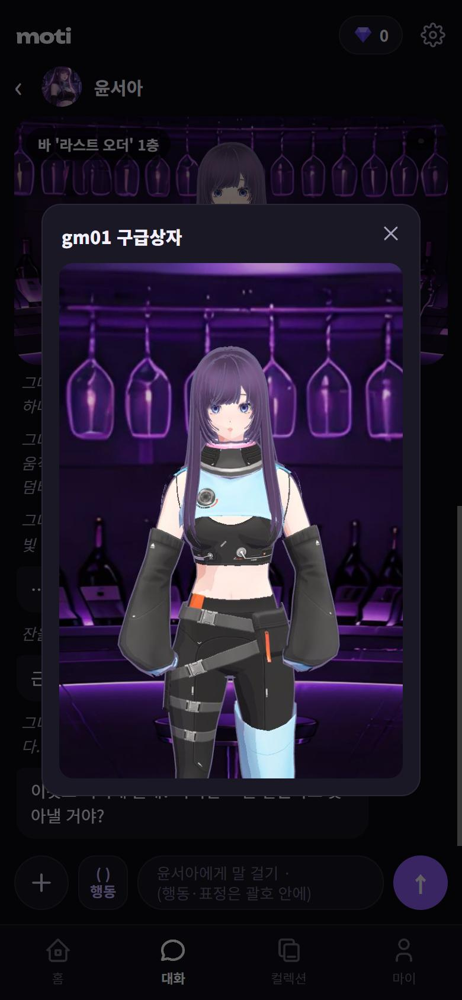 | 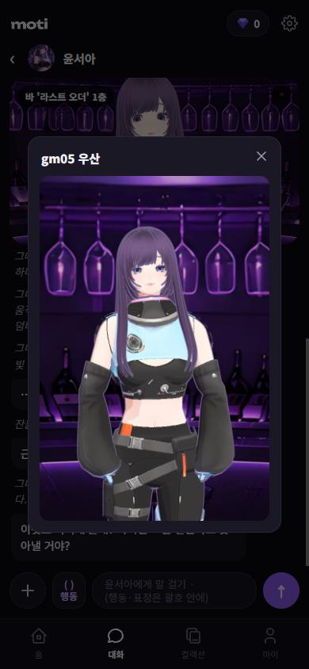 | 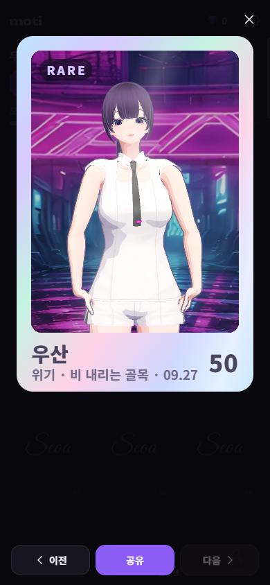 |

### 카드 반복 재생 검수(측정)

- gm05 크게 보기 17초 관찰: sorrow → surprised → shy → fun → soft → **다시 sorrow**(반복마다 처음부터) 3번째 반복까지 확인.
- 골반 앞뒤: 9 → 44 → 9cm 가 반복마다 같음(누적 없음).
- 이전(gm01)으로: x26 표정 흐름(surprised → flustered → shy)이 반복, 골반 9cm(제자리).
- 닫기: 재생 없음 · 표정 흐름 없음 · 골반 9.1cm · 표정 neutral(대화 기본).
- 기존 기록 유지: 옛 기록(날짜·장소·의상 다름, mv 2)과 옛 그림을 넣고 `Cards.refresh()` → 그림만 다시, mv 3, 날짜·장소·의상 그대로.

## D. 시연 검수

`?debug=1` 「신규 모션 검수」에 x26·x30 을 추가(86-1 x31 과 같은 줄 구성): 추천 표정 / 표정 후보 / 표정 없이(몸짓만) · 대화 구도 · 함께하기 구도 · **선물 흐름** · **카드 그림**. 「선물 흐름」은 quiet 재생이라 몸짓 카메라 구도가 빠지던 것을 실제 선물처럼 x30 umbrellaNear 로 움직였다 돌아오게(동작 줄이기면 안 움직임). 세 버튼 모두 다이아·카드·선물 기록·선물 로그·단계·호감·해금·최근 몸짓을 바꾸지 않음(측정).

## 바뀐 파일

| 파일 | 커밋 | 내용 |
| --- | --- | --- |
| `tools/xs_tilt_scale.mjs` (새 파일) | A | 뼈마다 세로 기울기 비율 축소 |
| `motions/xstage_glancing_x26.json` (새 파일) | A | x26 보정 파일 |
| `tools/make_umbrella.mjs` | B | 두 걸음 다가왔다 돌아가는 x30 |
| `motions/xstage_gift_umbrella.json` | B | 다시 만든 x30 |
| `data/motions.json` | A·B·D | x26·x30 xstage 값, motionFace x26·x30(gift·always·seq), preview x26·x30, x30 cutBlendMs |
| `data/config.json` | B | camera umbrellaIn → umbrellaNear |
| `index.html` | C·D | camLoop `fs`(반복마다 표정 흐름), 시연 선물 흐름 카메라 구도, `cutBlendMs` |
| `cards.js` | C | `play.faceSeq`, 고정 카메라(`fixed`), 닫을 때 기본 표정 |
| `seoaphoto.js` | C | 카드 그림 고정 카메라(`fixed`) |
| `data/collection.json` | C | gm01·gm05 표정·faceSeq, momentById, frameById.x30 |
| `tools/check_gacha.mjs` | A·B | x26 구간, x30 다가오기·복귀·표정 흐름 검사, gift 표정 흐름 허용(x31·x26·x30) |
| `docs/reports/img/86-2/` | | 캡처 |

## 테스트 결과

확인 방식: **정지** = 실제 서아 모델로 한 시각에 멈춘 화면(카드 그림 만들기·`Stage.seek`) · **측정** = 브라우저에서 상태·뼈 위치를 잼 · **코드** = 코드·스크립트.
이 환경은 브라우저 창 그리기가 초당 1프레임 남짓이라 **연속 재생(걸음 흐름·섞기·0.9초 끊김 복귀)을 눈으로 보지 못했다.** 발·골반은 1/30초마다 자세를 직접 잡아 잰 수치로, 표정은 0.5초마다 상태 기록으로 확인.

| # | 항목 | 결과 | 확인 |
| --- | --- | --- | --- |
| 1 | x26 움직임 가시성 | ✓ 머리 25° → 7° → 30°(전: 26 → 19 → 26) | 측정 + 정지 |
| 2 | x26 목·머리 과도한 숙임 | ✓ 머리 최대 30°, 숙인 동안 앞머리 사이로 눈이 보임 | 측정 + 정지 |
| 3 | x26 얼굴·상체 화면 안 | ✓ | 정지 |
| 4 | x26 표정 당황 → 고마움 | ✓ 놀람 → 당황 → 수줍음, 끝 뒤 기본 | 측정 |
| 5 | x26 기본 자세 복귀 | ✓ fadeOut 0.5 | 코드 · 연속은 못 봄 |
| 6 | x30 실제 전진 | ✓ 35cm 다가옴 | 측정 |
| 7 | x30 발 디딤·이동 거리 | ✓ 위 표(디딤 한 번 약 1.5~3cm) | 측정 |
| 8 | x30 발 미끄러짐·관통 | △ 디딤마다 1.5~3cm 미끄러짐(발은 두 구도 모두 화면 밖). 바닥 관통 없음. 팔·몸 관통은 정지 화면에서 없음 | 측정 + 정지 |
| 9 | x30 접근 카메라 구도 | ✓ umbrellaNear 로 머리 위 17.5% | 측정 |
| 10 | x30 표정 슬픔 → 미소 | ✓ 슬픔 → 놀람 → 안도 → 웃음 → 미소 | 측정 + 정지 |
| 11 | x30 끝·중단 위치 복귀 | ✓ 끝 9.1cm(처음 자리), 중단 뒤 9.1cm. 중단 섞기 0.9초는 코드(1fps 라 중간을 못 잼) | 측정 + 코드 |
| 12 | x30 반복 재생 누적 없음 | ✓ 카드 3번 반복 9 → 44 → 9 | 측정 |
| 13 | 동작 줄이기 | △ 카메라 안 움직이는 기존 조건 그대로(켜서 확인 못 함) | 코드 |
| 14 | gm01·gm05 대표 그림·재생 | ✓ | 정지 + 측정 |
| 15 | 카드 표정 흐름 반복 | ✓ | 측정 |
| 16 | 카드 이전·다음·닫기 뒤 상태 | ✓ | 측정 |
| 17 | 카드 기록 유지 | ✓ | 측정 |
| 18 | 선물별 전용 모션 우선 | ✓ 가짜 서버가 m03 을 줘도 구급상자 x26·우산 x30(카드 첫 획득, 다이아 60·100 한 번) | 측정 |
| 19 | x26·x30 일반 대화·함께하기 제외 | ✓ 강제로 해금 목록에 넣어도 unlockedIds·motionList·pickMotion·freeList·playCard 모두 제외, motion_list 에 없음 | 측정 |
| 20 | 나머지 선물·카드 | ✓ 초콜릿 x19 서버 표정 그대로(표정 흐름 없음), x31 반지 흐름 그대로, x19·x27~x29·x31·m09 값·파일 diff 없음, faceSeq 카드는 gm01·gm05 뿐 | 측정 + 코드 |
| 21 | 반지 gm06 SECRET·x31 | ✗/✓ x31 연출 그대로. **gm06 은 main 부터 rare — SECRET 아님**(위) | 측정 |
| 22 | check_gacha · test_motion_keywords · test_away_selfie | ✓ 모두 통과 · 26개 통과 · 53/0 | 코드 |
| 23 | JS·JSON | ✓ `node --check` 루트 js·tools, index.html 스크립트, data/*.json, xstage 파일·구간. 없는 몸짓 참조는 예전부터의 x04·x07·x08·x12(xstageReserve) 뿐 | 코드 |
| 24 | 콘솔 오류 | ✓ 앱 오류 없음(404 는 테스트 가짜 API 주소 `/__fake/openapi.json`) | 측정 |

테스트로 바뀐 브라우저 저장값·카드 그림은 테스트 전으로 되돌림.

## 제가 정한 것

- gm06 SECRET 미반영을 고치지 않음(범위 밖). 보고만 함.
- x26: 구간은 거의 그대로(끝만 4.5초로), 보정 방식을 「자르기」에서 「같은 비율로 줄이기」로. 새 도구를 만듦. 머리 30°.
- x26·x30 도 x31 처럼 선물 반응 중 서버 표정과 상관없이(`always`) 표정 흐름.
- x30 복귀 = 같은 발 디딤 거꾸로(뒷걸음). 걸음 약 0.35m, 6.6초.
- x30 카메라 = 다가가지 않고 위만 넓히는 umbrellaNear(접근은 서아가, 카메라는 머리가 안 잘리게만).
- 카드에서 다가오는 게 보이도록 x30 카드 구도만 카메라 고정(`fixed`). 이게 없으면 카드에서는 다가와도 크기가 같음(이번 「걸어오는 느낌이 없다」의 실제 원인).
- 중단 시 x30 만 0.9초 섞기(`cutBlendMs`).
- 카드 대표: gm01 26% flustered, gm05 61% fun.
- 크게 보기를 닫으면 표정 흐름 카드만 대화 기본 표정으로 되돌림(다른 카드는 예전 그대로).
- 「대화 구도」 시연 버튼은 몸짓 카메라 구도 없이 재생(기존 quiet). 「선물 흐름」은 구도까지.

## 사용자 직접 검수가 필요한 항목 (아이폰 사파리 포함)

- **x30 걸음의 자연스러움**: 다가오는 두 걸음·뒷걸음 두 번이 미끄러지거나 종종걸음처럼 보이지 않는지(디딤마다 1.5~3cm 미끄러짐, 발은 화면 밖)
- x30 가까이 섰을 때 얼굴 크기·머리 위 여백(대화·카드 크게 보기), 카메라가 0.8초에 움직였다 1.2초에 돌아오는 느낌
- x30 을 재생 도중 다음 답장으로 끊었을 때 0.9초 복귀
- x26 고개를 들었다 휙 숙이는 흐름(정지 화면으로만 봄), 숙였을 때 앞머리 사이 눈
- 표정 흐름과 대사 입 움직임이 같이 나올 때
- gm01·gm05 크게 보기 반복 재생, 이전·다음, 닫은 뒤 대화 표정
- 동작 줄이기를 켠 기기에서 우산(카메라 고정)
- 시각 효과(블러·그림자·애니메이션) 변경 없음

## 디버그 재현 방법

1. `?debug=1` → 톱니 → 「신규 모션 검수」 아래 **x26 구급상자**, **x30 우산**.
2. 「표정 없이(몸짓만)」 + 「대화 구도」 = 몸짓만(평소 구도).
3. 「추천 표정」 + 「대화 구도」 = 표정 흐름.
4. 「선물 흐름」 = 선물 그림 1초 → 반응 몸짓·표정 흐름 + x30 카메라 구도(실제 선물과 같은 화면).
5. 「카드 그림」 = gm01·gm05 대표 장면 그림.
6. 크게 보기 표정 반복은 실제 카드가 있어야 열림 — 선물을 실제로 주거나(기록이 바뀜) 콘솔에서 `S.col.gm05={...}` 로 임시 기록을 넣고 컬렉션에서 열기.
7. 2~5 는 다이아·카드·선물 기록·단계를 바꾸지 않음.

## 모션 리소스 라이선스

x26 = XSTAGE 「Shy _Glancing around nervously」, x30 = XSTAGE 「Walk」·「Shake Head Up and Down」로 만든 모션 — 기존 CREDITS 의 라이선스 **확인 필요** 그대로. CREDITS 에 새 파일·도구를 적음.

## 남은 문제

- **반지 gm06 SECRET 등급 미반영**(main 에서 rare). 별도 작업 필요.
- 연속 재생은 눈으로 끝까지 못 봄(위 직접 검수).
- x30 디딘 발 미끄러짐 1.5~3cm(화면 밖). 더 줄이려면 발 고정(IK) 처리가 필요.
