# 87-1 컬렉션 UX 및 기능 개선

기준: main `9c1603b`(86-2 병합, `20261127-0511`) · 작업 브랜치 `step/87-1-collection-ux`

이번 범위는 여섯 가지뿐이다. 86-2 구급상자·우산 모션, 무빙 카드 디자인(87-2), 가격·확률·등장 조건, 백엔드는 건드리지 않았다.

| 커밋 | 내용 |
| --- | --- |
| A | 카드 상세가 닫힐 때 터치가 뒤로 새지 않게 막음 · 확률 보기 창 본문 스크롤 |
| B | 「카드 팩」 화면 이름 → 「히든 카드」 · 무빙 카드 소개 문구 교체 |
| C | 10장 뽑기 결과를 2열 5줄 세로 스크롤로 |
| D | 반지 gm06 등급 RARE → SECRET(`special`) |

## 1. 카드 상세 화면 배경 터치 차단

### 터치가 뒤로 새던 원인

z-index 문제는 아니었다. `#cardView`(z 22)는 열려 있는 동안 앱 전체를 덮는다. 아래 탭(`nav`)과 위 머리줄은 `.app` 안에서 쌓임 순서가 없는(z auto) 요소라서 상세 화면 아래에 있다. 진짜 원인은 **닫히는 순간**에 있었다.

- 바깥을 눌러 닫거나 아래로 밀어 닫을 때 `pointerup`에서 바로 `close()`가 불린다. 이 안에서 `.cv.on`이 빠지면서 `pointer-events:none`이 **즉시** 적용된다.
- 브라우저는 같은 손가락의 `click`을 `pointerup` **뒤에** 보낸다. 이 click이 이미 투명해진 상세 화면을 지나 그 자리의 뒤 요소에 떨어졌다. 컬렉션 카드라면 **다른 카드가 다시 열리고**, 아래 탭이면 탭이 바뀐다.
- 닫히는 애니메이션(240ms) 동안에도 상세 화면은 터치를 받지 않았다. 그래서 그 사이의 터치와 스크롤도 뒤로 갔다.

수정 전 재현(390×844, 터치 에뮬레이션): m02를 연 채 카드 아래 빈 곳(195, 575)을 탭하면 닫히자마자 그 자리 뒤에 있던 **m11이 열렸다**.

### 고친 것 (`cards.js`, `cards.css`, `data/collection.json`)

- 닫을 때 `.cv.out`을 붙여 `closeMs`(최소 `card.view.closeGuardMs` 400ms) 동안 상세 화면이 터치를 계속 받게 했다. 남은 click은 상세 화면이 삼킨다.
- 상세 화면의 click 처리는 열려 있을 때만 동작한다. 닫히는 중에 이전·다음·공유 버튼 자리가 눌려도 아무 일도 없다.
- 다시 열 때는 `.out` 타이머를 지우고 시작한다. 여러 번 열고 닫아도 차단이 남지 않는다.
- 배경 스크롤은 원래대로 막혀 있다(`touch-action:none` + `touchmove` preventDefault). 컬렉션 목록은 `#album` 안에서 스크롤되는데, 상세 화면은 그 밖의 형제 요소라 스크롤이 이어지지 않는다.

**같이 고친 것 (86-2 회귀):** 86-2 C 커밋에서 `close()`의 `Outfit.sync()`가 앞 줄 주석 끝에 붙어 꺼져 있었다. 그래서 다른 의상의 카드를 보고 닫으면 대화 무대의 서아가 **카드 의상 그대로** 남았다. main에서 재현했다(m03을 bar 의상으로 열고 닫으면 무대가 `bar`로 남음). 줄을 나눠 되살렸고, 수정 후에는 `ops`로 돌아온다. 표정 흐름·카메라는 바꾸지 않았다.

## 2. 확률 안내창 스크롤

### 스크롤이 안 되던 원인

`Mini` 작은 창(`.mini`)은 높이 제한도 스크롤 칸도 없이 화면 가운데에 놓인다(flex center). 확률 목록(28장 + 안내문)이 들어가면 창 높이가 1245px이 되는데, 390×844 화면에서 가운데 맞춤 때문에 **창 위쪽이 −200px**으로 올라간다. 제목과 ✕가 화면 밖에 있고, 겉 칸도 `overflow:visible`이라 끌어서 내릴 수 없었다. 바깥을 눌러 닫는 것만 가능했다.

### 고친 것 (`photos.js`, `photos.css`, `pack.js`)

- `Mini.open(title, body, bind, {scroll:true})` 옵션을 추가했다. 확률 보기(`Pack.showOdds`)만 이 옵션을 쓰고, 다른 작은 창(사진 칸 늘리기, 무빙 카드 소개, 시연 창)은 그대로다(`.mini` absolute, 변경 없음).
- 스크롤 모드에서는 창이 화면에 고정된다(`position:fixed`, 앱 폭 440px 안, safe-area 여백). 창 높이는 **보이는 화면의 85%**다(`85dvh`, 지원하지 않는 브라우저는 `85vh`).
- 제목과 ✕는 위에 고정되고 본문(`.minibd`)만 세로로 스크롤한다. 본문에는 등급별 확률, 카드 목록, 천장·환급 안내가 들어 있다. 끝에 닿아도 뒤로 넘어가지 않는다(`overscroll-behavior:contain`).
- 창 바깥에서 끄는 동작은 막았다(`touchmove` preventDefault). 컬렉션 목록이 움직이지 않는다.
- 바깥을 눌러 닫는 것은 그대로다. 단, **누르기 시작한 곳도 바깥일 때만** 닫힌다. 본문을 스크롤하다 손가락이 바깥에서 떨어져도 닫히지 않는다.
- 열 때마다 본문을 새로 그리므로 다시 열면 맨 위에서 시작한다.

| 위(390×844) | 맨 아래(390×844) | 위(375×667) | 맨 아래(375×667) |
| --- | --- | --- | --- |
| 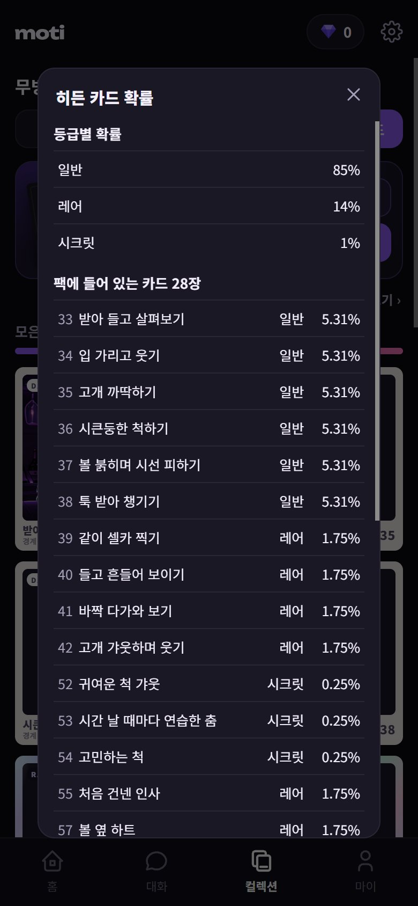 | 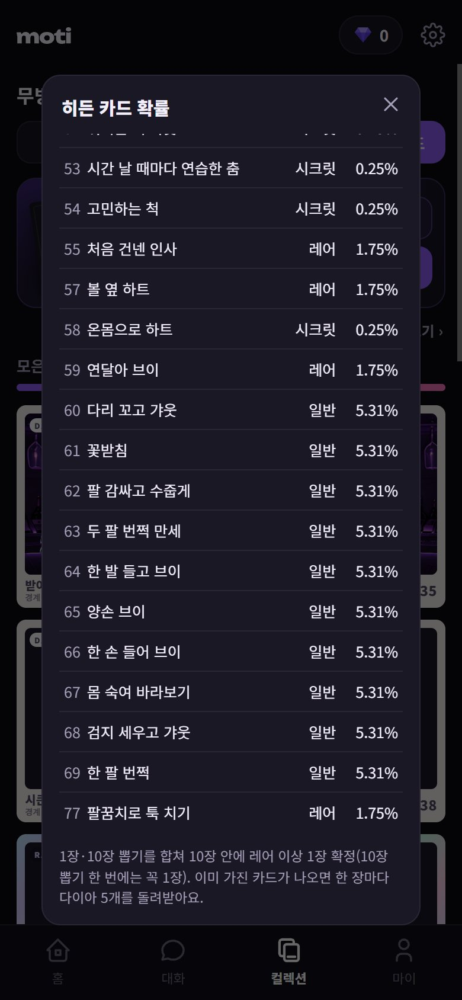 | 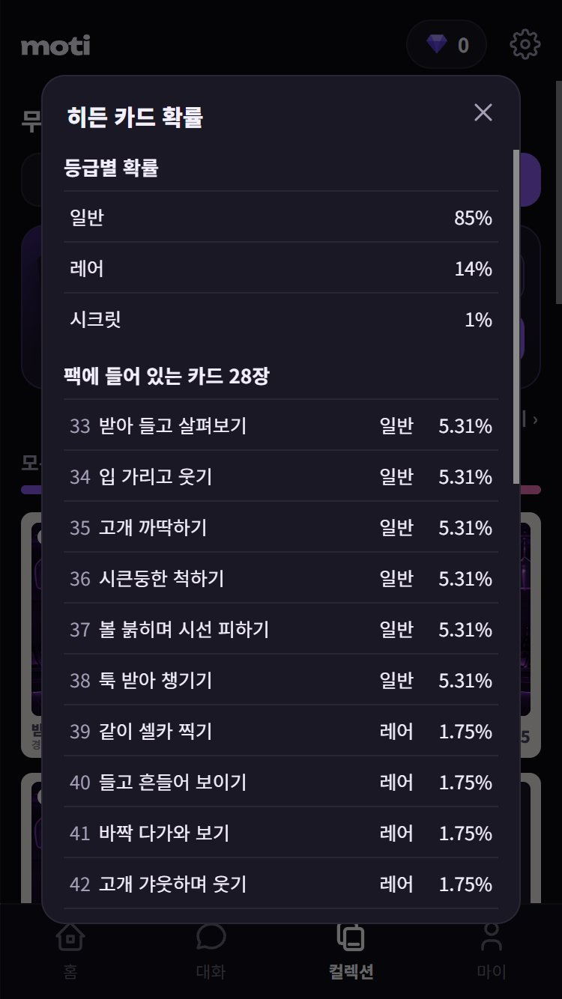 | 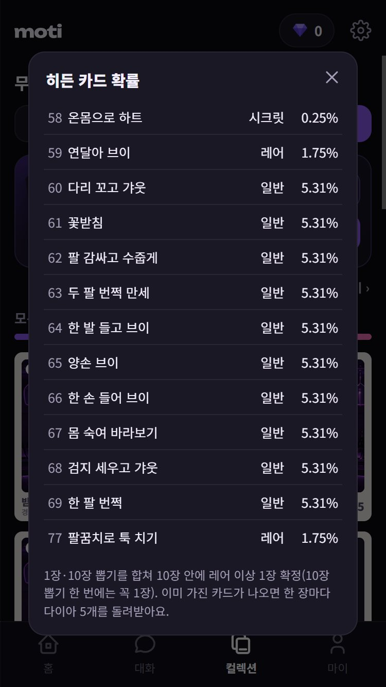 |

수정 전: 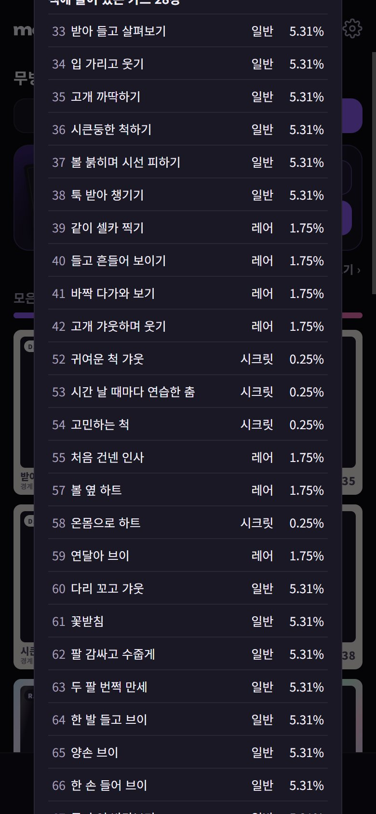

## 3. 히든 카드 명칭 (`data/ui.json`)

화면에 나오는 이름만 바꿨다.

| 자리 | 전 | 후 |
| --- | --- | --- |
| 컬렉션 분류 탭 `album.seg.pack` | 카드 팩 | 히든 카드 |
| 뽑기 배너 제목 `pack.title` | 카드 팩 | 히든 카드 |
| 확률 안내창 제목 `pack.oddsTitle` | 카드 팩 확률 | 히든 카드 확률 |
| 배너 그림 접근성 이름 `pack.artAria` | 카드 팩 | 히든 카드 |
| 포즈 목록이 비었을 때 `pose.empty` | …카드팩에서 획득할 수 있어요. | …히든 카드에서 획득할 수 있어요. |
| 못 모은 포즈를 눌렀을 때 `pose.locked` | 카드팩에서 획득할 수 있어요. | 히든 카드에서 획득할 수 있어요. |

다음은 그대로 두었다. 「확률 보기」, 「1장 뽑기」, 「10장 뽑기」, 「모두 뒤집기」, 「팩을 여는 중」, 「팩에 들어 있는 카드 {n}장」, 「한 번 더」, 「확인」. 내부의 `pack.js`·`pack.css`·`pack.json`, `source: pack`, 함수·키·카드 ID, 저장 구조(`S.packPity`·`S.packNext`)도 바꾸지 않았다.

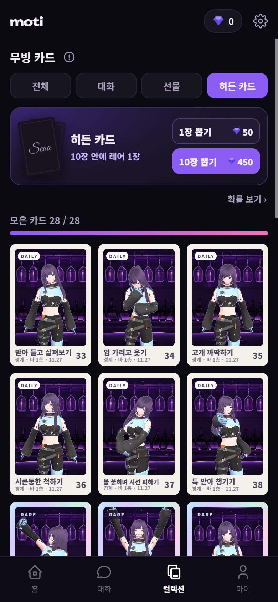

## 4. 무빙 카드 소개 문구 (`data/ui.json` `album.intro`)

확정 문구를 그대로 넣었다. 제목은 「무빙 카드」다. 본문, 분류(대화, 선물, 히든 카드), 아래 안내, 「확인」 버튼도 확정 문구 그대로다. 소개창 모양과 처음 한 번 뜨는 조건(`S.colIntro`), (!) 버튼으로 다시 열기는 그대로이고, 확인 기록도 초기화하지 않는다.

| 전 | 후 |
| --- | --- |
| 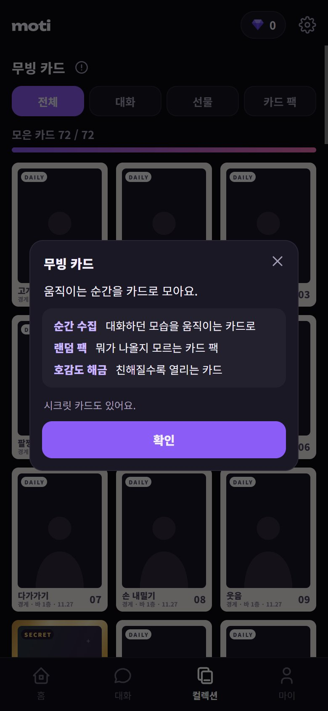 | 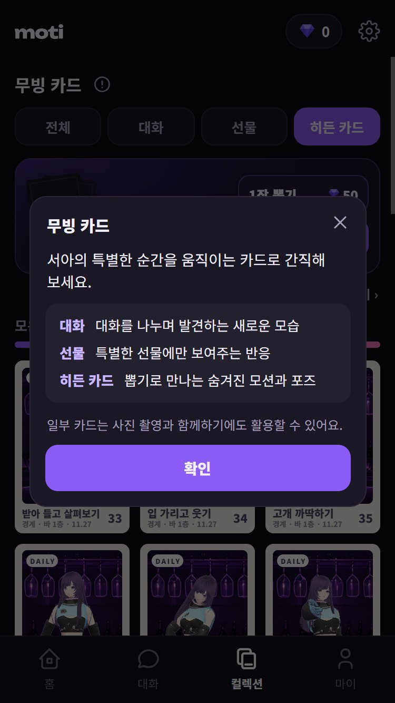 |

## 5. 10장 뽑기 결과 세로형 (`pack.js`, `pack.css`)

- **2열 5줄**로 바꿨다. 순서는 왼쪽→오른쪽, 위→아래로 나온 순서 그대로다. 카드 비율은 2:3이다. 390px 폭에서 카드는 **172×258px**(전 65×98px), 375px 폭에서는 165×247px다.
- 가운데 칸(`.pkstage`)만 세로로 스크롤한다. 가로 넘침은 없다(scrollWidth = clientWidth). 아래 요약과 「한 번 더」·「확인」 버튼은 스크롤 칸 밖에 고정되어 있어 마지막 줄 카드와 겹치지 않는다. 끝까지 내렸을 때 마지막 카드 아래 650px, 칸 끝 694px로 확인했다.
- 카드 앞면은 컬렉션 목록과 같은 포토카드다. 이름, 단계·장소·날짜, 번호, 등급 표가 나오고 이름이 넘치면 글자 크기만 줄인다. 그래서 50-3의 「5열용 9px 두 줄 이름·번호 옮기기」와 그 값(`photocard.packNamePx`·`packNameLines`)은 없앴다.
- 연출 중 손가락으로 끄는 동작은 결과 칸 안에서만 먹힌다. 뒤의 컬렉션은 움직이지 않는다. 결과를 다시 열면 맨 위에서 시작한다.
- 뒤집기 연출(`flip`·`flipAll`·`result`)은 바꾸지 않았다. 이미 뒤집은 카드는 앞면 그대로 두고(`now`) 나머지만 차례로 뒤집는다. 화면 밖 카드도 뒤집힌 상태가 되며(10장 모두 `show`), 강제 스크롤은 없다.

| 전 | 후(위) | 후(맨 아래) | 후 375×667 |
| --- | --- | --- | --- |
| 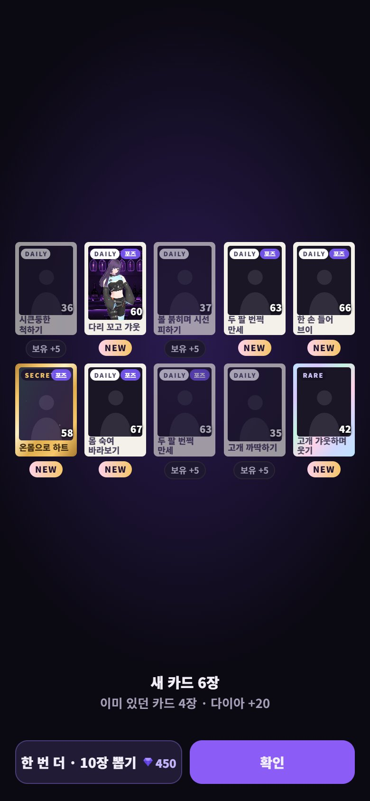 | 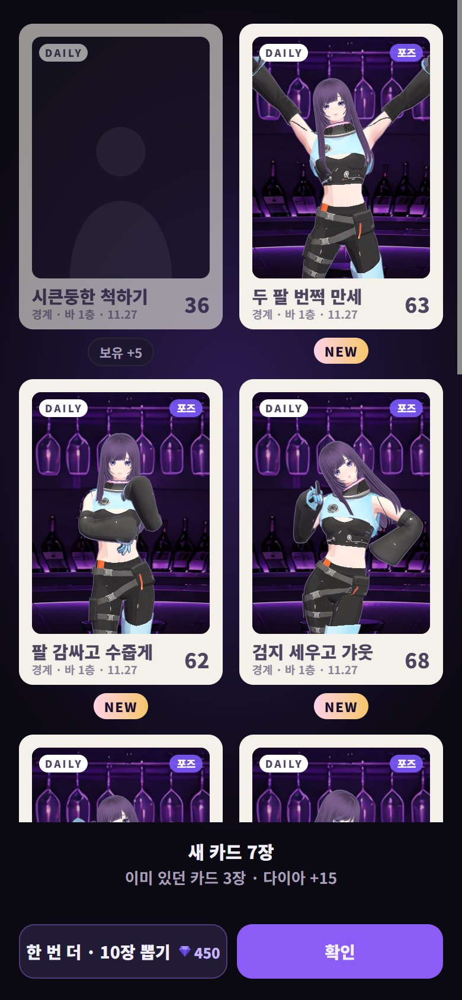 | 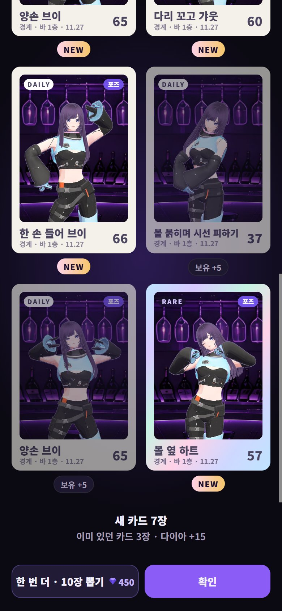 | 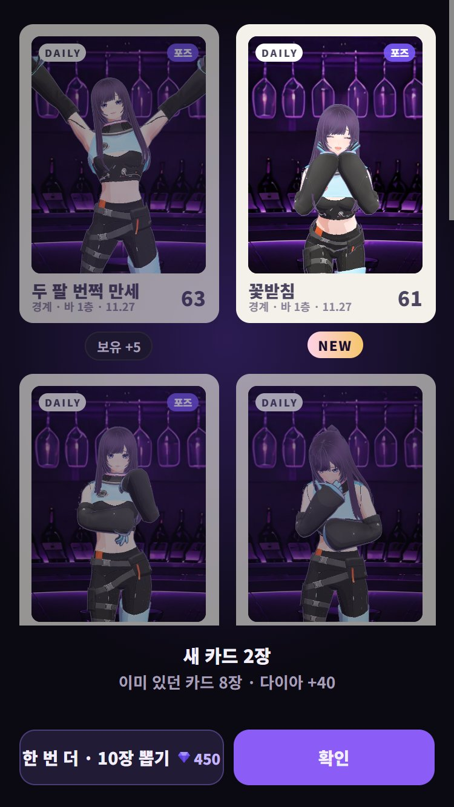 |

## 6. 반지 gm06 SECRET (`data/collection.json`)

`gm06.grade`를 `rare`에서 `special`(화면 SECRET)로 바꿨다. 번호 51, `source: moment`, 반지 300다이아, 연인 단계, x31, 표정, 대표 장면은 그대로다.

- 기존 보유자: 등급을 바꾸기 전 형식의 기록(날짜·장소·의상·mv)을 넣고 열었다. 기록은 한 글자도 바뀌지 않았고 SECRET 금박 테두리와 오로라·반짝이가 나왔다. 카드 그림의 다시 만들기는 모션 버전 기준이라 등급만 바뀌어서는 다시 만들지 않는다.
- 히든 카드 뽑기: 확률 계산은 `source: pack`만 쓴다. 변경 전후 `Gacha.odds`와 카드별 %가 **완전히 같다**(85 / 14 / 1).
- 선물로 얻을 때의 등급 알림도 이제 SECRET 알림(`notify.special`)이 된다. 「기존 SECRET 디자인과 시각 효과가 동일하게」에 따른 결과다.
- `tools/check_gacha.mjs`: 순간 카드는 gm06만 special이고 나머지는 rare인지 검사한다. gm06이 뽑기 칸에 들어가지 않는지도 검사를 더했다.

| 목록 | 크게 보기(x31 재생) |
| --- | --- |
| 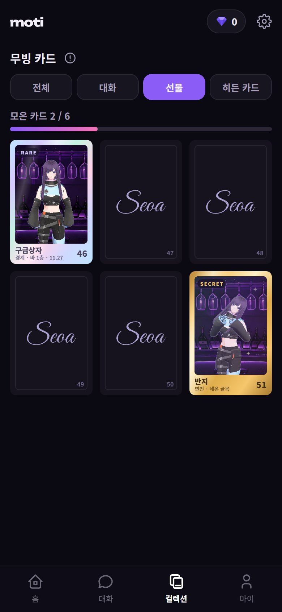 | 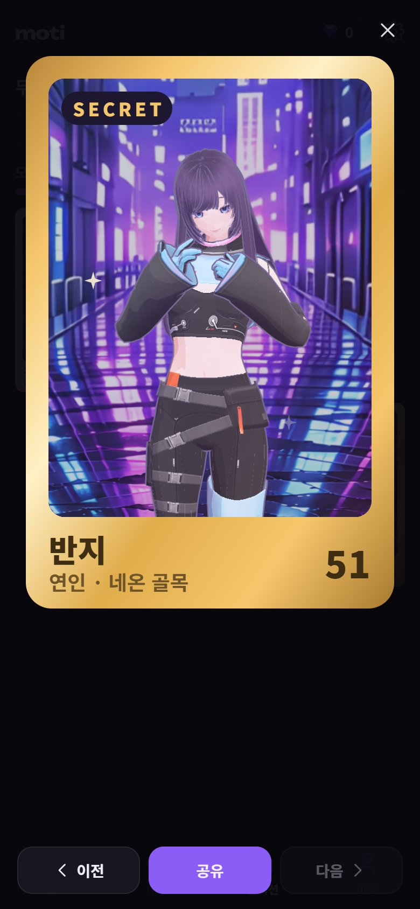 |

## 바뀐 파일

| 파일 | 커밋 | 내용 |
| --- | --- | --- |
| `cards.js` | A | 닫히는 동안 터치 받아 두기(`.out`), 닫힌 뒤 click 무시, `Outfit.sync()` 되살림 |
| `cards.css` | A | `.cv.out{pointer-events:auto}` |
| `photos.js` | A | `Mini.open` `{scroll:true}` 옵션 |
| `photos.css` | A | `.mini.scroll`·`.minibd` |
| `pack.js` | A·C | 확률 보기 스크롤 옵션, 10장 결과 2열(이름 맞추기·스크롤 처음으로·바깥 끌기 막기) |
| `pack.css` | C | 10장 결과 2열 5줄 세로 스크롤, 50-3 작은 카드 규칙 없앰 |
| `data/ui.json` | B | 히든 카드 이름, 소개 문구 |
| `data/collection.json` | A·C·D | `view.closeGuardMs`, `packNamePx`·`packNameLines` 삭제, gm06 `special` |
| `tools/check_gacha.mjs` | C·D | 50-3 이름 검사 → 87-1, gm06 SECRET·뽑기 칸 제외 검사 |
| `docs/reports/img/87-1/` | | 캡처 |

## 테스트 결과

확인 방식: 헤드리스 Chrome 390×844(일부 375×667), 모바일·터치 에뮬레이션(CDP 터치 이벤트). 테스트 전용 브라우저 프로필을 써서 사용자 브라우저 저장값은 건드리지 않았다. 서버 응답이 필요한 동작은 없었고 유료 API는 0건이다. **실제 아이폰 사파리는 확인하지 못했다.**

| # | 항목 | 결과 |
| --- | --- | --- |
| A1 | 상세 열린 채 카드 옆·아래 빈 곳 탭 → 닫히기만 하고 뒤 카드가 열리지 않음 | ✓ (수정 전 m11이 열림) |
| A2 | 아래 탭 자리 탭 → 상세만 닫히고 탭은 그대로 | ✓ |
| A3 | 위 머리줄·설정 버튼 자리 → 상세 화면(✕·배경)이 받음 | ✓ |
| A4 | 열린 채 끌기 → 컬렉션 스크롤 0 그대로 | ✓ |
| A5 | 이전·다음 버튼, 옆으로 밀기, 아래로 밀어 닫기, ✕ | ✓ |
| A6 | 공유 그림 만들기(`Cards.shareImage`) | ✓ 113KB |
| A7 | 10번 열고 닫은 뒤 목록 스크롤·카드 열기·아래 탭 | ✓ |
| A8 | gm01(x26 놀람→당황→수줍음)·gm05(x30 슬픔→…→미소, 고정 카메라) 설정이 그대로 재생됨 | ✓ 코드 변경 없음 |
| A9 | 다른 의상 카드를 닫은 뒤 대화 무대 의상 | ✓ ops로 돌아옴(main은 카드 의상 그대로) |
| B1 | 분류 탭·배너·확률 제목·접근성 이름 「히든 카드」 | ✓ |
| B2 | 바꾸지 않을 문구, 내부 이름·저장값 | ✓ |
| C1 | 2열 5줄, 172×258, 가로 넘침 없음 | ✓ |
| C2 | 처음부터 모두 뒤집기 / 3장 뒤집은 뒤 모두 뒤집기 / 10장 하나씩 | ✓ 셋 다 2열 결과, 10장 모두 앞면 |
| C3 | 마지막 줄과 버튼 겹침 없음, 터치로 끝까지 스크롤 | ✓ |
| C4 | NEW·보유 +5 표, 요약(새 카드 7장, 이미 있던 카드 3장 · 다이아 +15) | ✓ |
| C5 | 다이아 5000 → 4565(−450 +15), 천장(10번째 레어 확정 `forced`), 새 카드 7장 기록 | ✓ |
| C6 | 한 번 더 → 새 연출이 맨 위에서 시작, 확인 → 닫힘 | ✓ |
| C7 | 1장 뽑기는 큰 카드 한 장 그대로(2열 아님) | ✓ |
| D1 | gm06 SECRET 표·금박·오로라, 기존 기록 그대로, x31 재생 | ✓ |
| D2 | 히든 카드 확률·구성 변화 없음 | ✓ 전후 동일 |
| E1 | 소개 문구, 한 줄씩 겹침 없음, (!) 다시 열기 | ✓ |
| F1 | 본문 끝 안내문까지 스크롤(844: 529px, 667: 680px) | ✓ |
| F2 | 스크롤 중 ✕ 위치 그대로, ✕로 닫기 | ✓ |
| F3 | 본문에서 시작해 바깥에서 뗀 끌기 → 안 닫힘 / 바깥 탭 → 닫힘 | ✓ |
| F4 | 바깥 끌기 → 컬렉션 스크롤 0 | ✓ |
| F5 | 다시 열면 본문 맨 위 | ✓ |
| G1 | 다른 작은 창(소개·칸 늘리기) 기존 모양(`.mini` absolute) | ✓ |
| G2 | 포즈 목록(가진 포즈 13 + 무료 1), 함께하기 API | ✓ 변경 없음 |
| G3 | `node tools/check_gacha.mjs` | ✓ 모두 통과 |
| G4 | `node tools/test_motion_keywords.mjs` | ✓ 26개 |
| G5 | `node tools/test_away_selfie.mjs .` | ✓ 53 / 0 |
| G6 | `data/*.json` 파싱, `*.js` 문법 | ✓ |
| G7 | 앱 콘솔 오류 | 없음(three.js `morphNormals` 경고와 favicon 404만, 원래 있던 것) |

## 제가 정한 것

- **터치 통과 수정 방식:** 투명한 막을 새로 깔지 않고 기존 `#cardView`가 닫히는 동안에도 터치를 받게 했다(`.cv.out`). 시간은 `closeMs`와 새 값 `closeGuardMs: 400` 중 긴 쪽이다. 400ms는 손가락을 뗀 뒤 click이 늦게 오는 경우까지 넉넉히 잡은 값이다.
- **`Outfit.sync()` 되살림:** 86-2에서 실수로 꺼진 것이 분명했고(주석 끝에 붙음), main에서 의상이 남는 것을 재현했기 때문에 되살렸다. 86-2 모션 자체는 건드리지 않았다.
- **확률 창은 Mini 옵션으로:** 공통 `.mini`를 바꾸지 않고 `{scroll:true}`를 줄 때만 켜지게 했다. 「바깥에서 시작한 탭만 닫기」도 이 옵션에서만 적용된다.
- **85% 높이:** 보이는 화면 기준 `dvh`를 쓰고, 화면에서 safe-area와 16px 여백을 뺀 높이보다 커지지 않게 했다.
- **10장 결과 카드 앞면:** 2열에서는 카드가 목록(3열)보다 커서, 5열 전용으로 줄여 두었던 이름·번호 규칙을 없애고 목록과 같은 포토카드로 보이게 했다. 단계·장소·날짜 줄도 다시 보인다. 짧은 보유 표(「보유 +5」)는 그대로 두고 글자만 9 → 11px로 키웠다.
- **카드 사이 간격:** 가로 14px, 세로 42px(NEW 표 자리 포함). 결과 칸 위 여백은 56 → 20px. 1장 연출 여백은 그대로다.
- **포즈 안내 문구 두 개**(「카드팩에서 획득할 수 있어요」)도 사용자에게 보이는 같은 명칭이라 「히든 카드에서 획득할 수 있어요」로 바꿨다.
- **시연 패널 문구**(`data/demo.json` 「다음 카드 팩 결과」 등)는 개발용 화면이라 그대로 두었다.
- **소개창 항목 정렬:** 이름 칸 너비를 맞춰 보니 「대화를 나누며 발견하는 새로운 모습」이 두 줄로 꺾였다. 그래서 60단계 그대로 줄마다 이름 뒤에 설명이 오는 배치를 유지했다. 390px에서 세 줄 모두 한 줄이다.
- **gm06을 선물로 받을 때의 알림**도 SECRET 알림이 된다(등급에 따라 자동).

## 아이폰 사파리에서 직접 확인할 것

이번에 블러·그림자·애니메이션·3D 효과는 바꾸지 않았다. 아래는 터치와 스크롤 동작에 관한 항목이다.

- 카드 상세를 바깥 탭이나 아래로 밀어 닫을 때 뒤 카드·아래 탭이 반응하지 않는지(사파리의 click 지연)
- 확률 창: 본문 손가락 스크롤(관성), 끝에서 뒤 화면 고무줄 효과가 없는지, 주소창이 줄고 늘 때 창 높이(`dvh`), 노치·홈 바 여백
- 10장 결과: 세로 스크롤 관성, 끝에서 뒤 화면이 움직이지 않는지, 홈 바 위 버튼 자리, 화면 밖에서 뒤집힌 카드의 3D 앞면(`backface-visibility`)이 바르게 보이는지
- gm06 SECRET 테두리 빛·오로라(기존 SECRET과 같은 CSS)

## 남은 문제

- 헤드리스 Chrome은 그리기가 느려서 뒤집기·스크롤의 **연속 움직임**을 눈으로 보지 못했다. 상태와 위치를 재서 확인했다.
- 테스트 화면의 일부 카드는 그림을 만드는 중이라 실루엣으로 찍혔다(앱 동작과 무관).
