# 87-2 서브컬처 스타일 무빙 카드 리디자인

기준: main `8003677`(87-1 병합, `20261127-0546`) · 작업 브랜치 `step/87-2-moving-card-redesign`

첨부한 C안 SECRET 카드를 기준으로 무빙 카드 앞면을 다시 디자인했다. DAILY·RARE·SECRET은 같은 구조와 글꼴을 쓰고, 색·질감·빛의 세기만 다르다. 레퍼런스 그림은 카드 배경으로 쓰지 않았다. 모든 요소를 HTML·CSS·SVG·웹폰트로 그렸고, 공유 그림은 Canvas로 같은 모양을 그린다.

## 커밋

| 커밋 | 내용 |
| --- | --- |
| A `5ffa545` | 카드 글꼴 서브셋 2개 + 만드는 도구 + 글자 검사 |
| B `23b6afa` | C안 앞면 타이포그래피·장식·등급별 색(`cards.css`, `data/collection.json`) |
| C·D `e91b7b2` | 목록·크게 보기·뽑기가 같이 쓰는 띠 마크업, 공유 그림(Canvas) |

커밋 범위는 지시의 A·B·C·D를 조금 조정했다. 같은 `cards.js` 안에 마크업과 공유 그림이 함께 있어 C·D를 한 커밋으로 묶었다.

## 구현 방식

카드 한 장의 모양은 `cards.js`의 `tag()`·`band()` 두 함수가 만든다. 컬렉션 목록, 카드 상세(`#cardView`), 포즈 시트, 함께하기, 히든 카드 1장·10장 뽑기가 모두 같은 함수를 쓴다(화면별 중복 코드 없음). 크기는 전부 카드 너비 비율(`cqw`)이고, 값은 `data/collection.json`의 `card.photocard`와 `grades.*.card` 한 곳에 있다. CSS 변수(`vars()`)와 공유 그림 Canvas(`shareImage()`)가 같은 값을 읽는다.

```
.pc g-<등급>
 ├ .pcph  사진(목록 = 카드 그림, 상세 = 실시간 3D) + 기존 레어 빛·시크릿 오로라·반짝이
 ├ .pctag ✦ SECRET ✦  (기울어진 각진 영문 + 테두리 + 빛 + 궤도 고리)
 └ .pcbd
    ├ .pctx  [궤도 곡선 SVG + 별]  기울어진 굵은 이름
    │        ───────────────── ////   (가는 줄 + 끝 사선)
    │        /// 관계 단계 · 장소 · MM.DD
    └ .pcnoa ╱ ✦ 54                   (기울어진 구분선 + 별 + 큰 번호)
               /// ────                (번호 아래 사선 줄)
```

**카드 크기별 장식 밀도**(컨테이너 쿼리)

| 카드 너비 | 화면 | 보이는 장식 |
| --- | --- | --- |
| 150px 미만 | 컬렉션 3열(113~129px) | 이름·번호 글꼴, 가는 줄, 구분선, 등급 표 |
| 150px 이상 | 뽑기 2열(165~172px), 1장 뽑기 | + 사선, 별, 이름 궤도, 등급 표 별 |
| 250px 이상 | 카드 상세(약 330~360px) | + 등급 표 궤도 고리, 별 반짝임(레어·시크릿) |

## 레퍼런스에서 반영한 요소

- 굵고 기울어진 한글 이름: Pretendard Black, 9° 기울임, 아래 가장자리 빛(1단 엠보스)
- 기울어진 각진 영문 등급명: Chakra Petch Bold Italic, 양옆 ✦, 어두운 알약 배지, 금색 테두리·빛, 궤도 고리
- 독립된 큰 번호: Chakra Petch Bold Italic, 이름과 기울어진 구분선으로 나뉨, 왼쪽 위 별, 아래 사선 줄
- 이름을 감싸는 궤도 곡선 + 양 끝 별(SVG, 선 굵기는 카드 크기와 상관없이 가늘게)
- 이름 아래 가는 줄 + 끝 사선 `////`, 부가 정보 앞 `///`
- 테두리 안쪽의 어두운 줄 + 밝은 줄, 사진 둘레 가는 줄(블러 없는 inset)
- SECRET 금속 프레임: 밝은·어두운 금색 단계를 6 → 8개로 늘림

## 레퍼런스와 다른 점과 이유

| 레퍼런스 | 구현 | 이유 |
| --- | --- | --- |
| 이름이 띠 높이를 크게 채우고 아래 띠가 더 두꺼움 | 띠 높이 0.25(그대로), 이름 0.108·번호 0.148 | 「캐릭터 이미지의 기본 영역 유지」에 따라 사진 칸을 줄이지 않음 |
| 이름에 밝은 외곽선 | 아래쪽 한 단 빛(text-shadow 0 블러) | 외곽선(`-webkit-text-stroke`)은 한글 획 안쪽을 먹어 작은 카드에서 뭉개짐 |
| 손으로 다듬은 듯한 궤도 곡선 | 모든 이름에 같은 곡선, 이름 폭에 맞춰 늘어남 | 카드 이름 길이가 2~12자로 달라 특정 이름에 맞춘 고정 모양은 쓸 수 없음 |
| 번호 금빛 그라데이션 | 이름과 같은 어두운 색 + 아래 빛 | 금 바탕 위에서 금빛 숫자가 묻힘. 테두리의 금속감은 프레임이 담당 |
| 강한 렌즈 플레어·광택 | 기존 테두리 반짝임 한 줄 + 기존 시크릿 오로라·반짝이 유지 | 효과를 겹치지 않고 기존 효과를 그대로 활용(지시 6절) |

## 글꼴

| 쓰는 곳 | 글꼴 | 굵기·자간·기울기 | 파일 |
| --- | --- | --- | --- |
| 카드 이름 | Pretendard Black (v1.3.9) | 900 · −0.015em · skewX −9° | `assets/fonts/card-title.woff2` **23,324 B** (카드 이름 글자 + ASCII 서브셋) |
| 등급 표·번호 | Chakra Petch Bold Italic | 700 italic · 등급 표 0.08em, 번호 −0.02em | `assets/fonts/card-latin.woff2` **5,352 B** (ASCII 서브셋) |
| 관계 단계·장소·날짜 | 앱 기존 글꼴(Pretendard → Apple SD Gothic Neo → Noto Sans KR) | 600 · 0.01em · 기울임 없음 | 새 파일 없음 |

- 라이선스: 두 글꼴 모두 SIL Open Font License 1.1(상업 사용·웹폰트 배포 가능). 라이선스 전문은 `assets/fonts/OFL-*.txt`, 출처는 `docs/CREDITS.md`에 적었다.
- 비교한 후보: Black Han Sans, Do Hyeon, Pretendard Black·ExtraBold를 실제 금색 띠에 같은 크기·기울기로 놓고 비교했다. 캡처는 `img/87-2/font-candidates.jpg`.
  - Black Han Sans는 너무 좁고 장식적이어서 긴 이름이 뭉친다.
  - Do Hyeon은 레퍼런스보다 가볍다.
  - Pretendard Black은 각지고 무게감이 레퍼런스와 가장 비슷하다. 앱이 이미 Pretendard 계열을 쓰는 것도 고려했다.
- 레퍼런스 그림의 글꼴을 특정 실존 글꼴로 단정하지는 않았다.
- 서브셋: `python tools/card_fonts.py`로 만든다(fonttools 필요, 원본은 `_src/fonts_87-2/`, 저장소에 없음). 카드 이름이 바뀌면 다시 실행한다. `tools/check_gacha.mjs`가 서브셋에 없는 글자를 알려 준다.
- 로딩: `font-display: swap`. 받기 전·실패 시에는 앱 글꼴의 굵은 글자 + 기울임으로 보인다(아래 캡처). 글꼴이 도착하면 이름 맞추기를 다시 한다(`document.fonts` `loadingdone`). 공유 그림은 `document.fonts.load()`를 기다린 뒤 그린다.

## 등급별 차이

| | DAILY | RARE | SECRET |
| --- | --- | --- | --- |
| 프레임 | 아이보리 무광(그대로) | 파스텔 홀로그램(그대로) | 금속 금색 8단계 |
| 이름·번호 | 짙은 보라회색 `#3b3452` + 흰 빛 | 짙은 남보라 `#342b55` + 흰 빛 | 거의 검은 보라 `#25152f` + 밝은 금빛 |
| 장식(궤도·별·사선) | 회보라 `#a49cbb`, 궤도 옅게(.55), 별 흐리게 | 라벤더 `#8b78f0` + 민트 `#6fd9c4` | 어두운 금 `#6e4814` + 밝은 금 `#fff3cc`, 궤도 두 겹(어두운 밑줄 + 밝은 윗줄) |
| 등급 표 | 흰 알약, 빛 없음, 고리 없음 | 어두운 알약 + 라벤더 테두리·옅은 빛 + 고리 | 어두운 알약 + 금 테두리·금빛 + 금 그라데이션 글자 + 고리 |
| 반짝임 | 없음 | 상세에서 별 반짝임 | 상세에서 별 반짝임 + 기존 오로라·반짝이 |

## 캡처 (헤드리스 Chrome 실제 렌더링, 390×844 DPR 2)

**수정 전 → 후 (카드 상세)**

| DAILY | RARE | SECRET |
| --- | --- | --- |
| 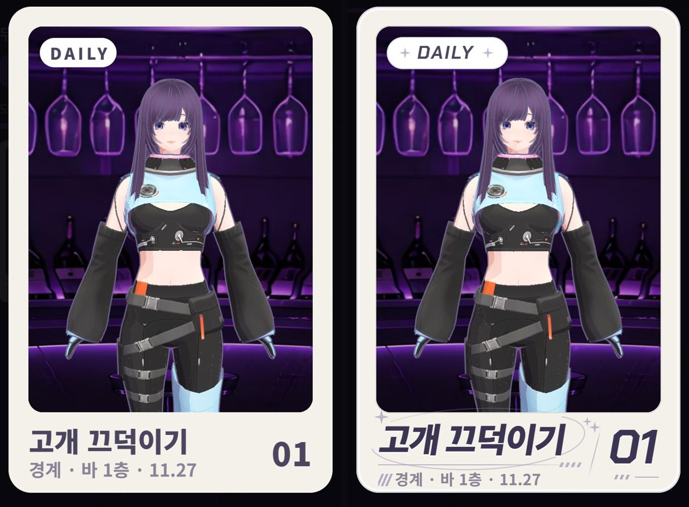 | 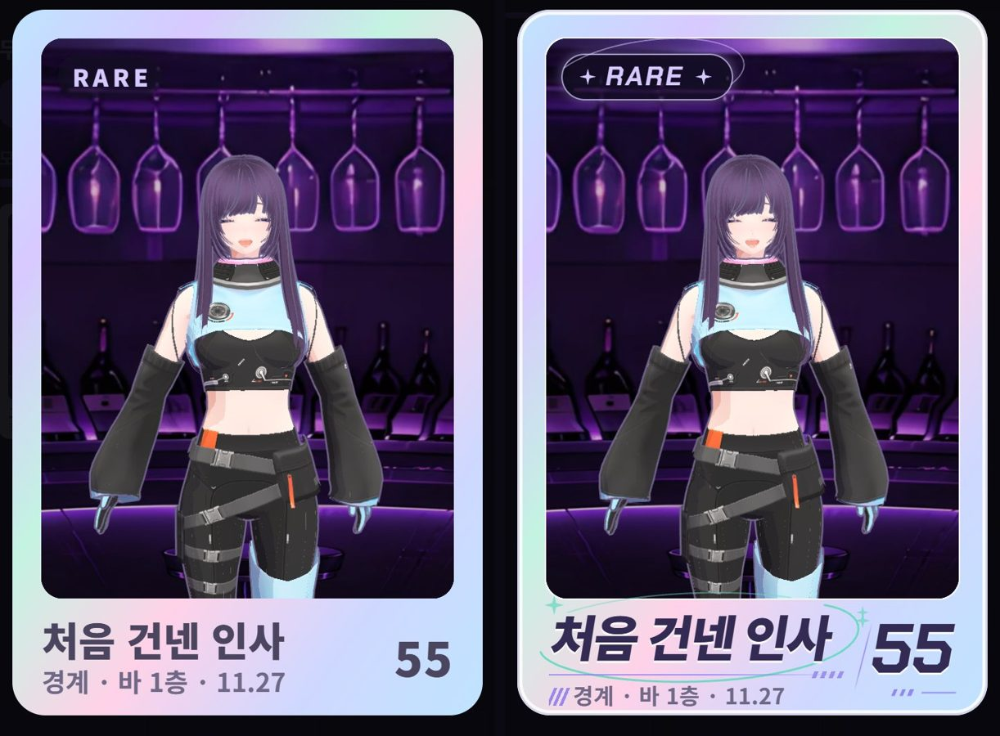 | 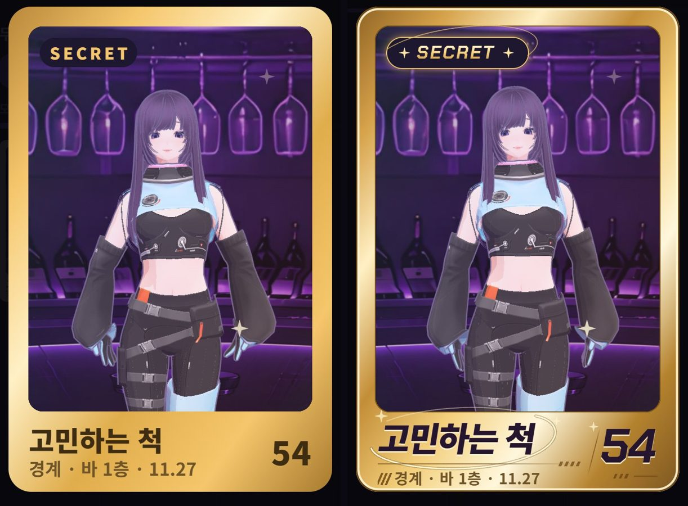 |

**세 등급 카드 상세:** 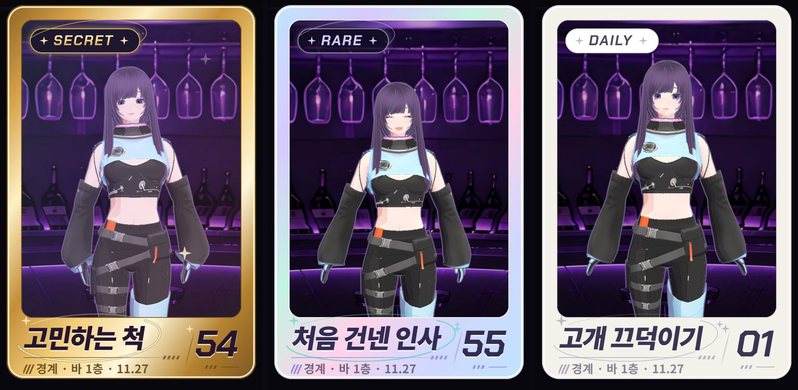

**컬렉션 목록**(히든 카드 탭, 왼쪽 390×844 · 오른쪽 375×667): 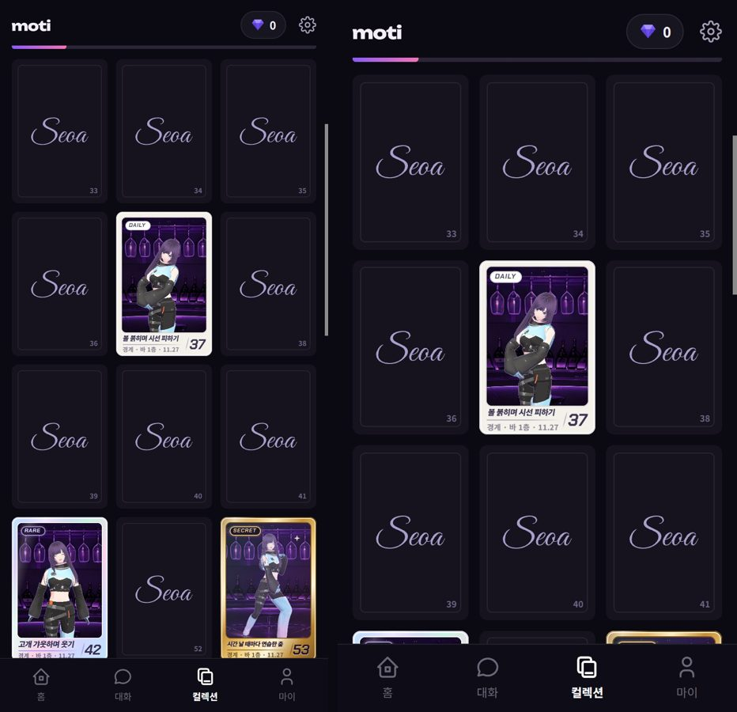
데스크톱 최대 폭(앱 440px): 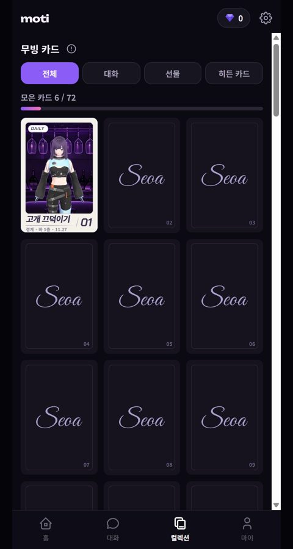

**10장 뽑기 결과**(수정 전 · 390 · 375): 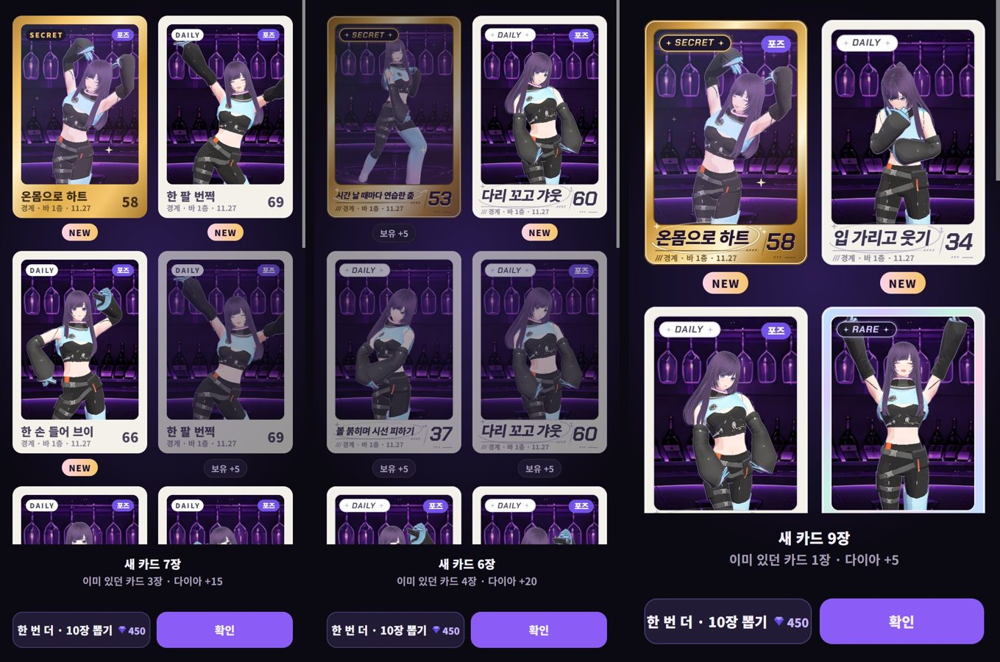 · 1장 뽑기: 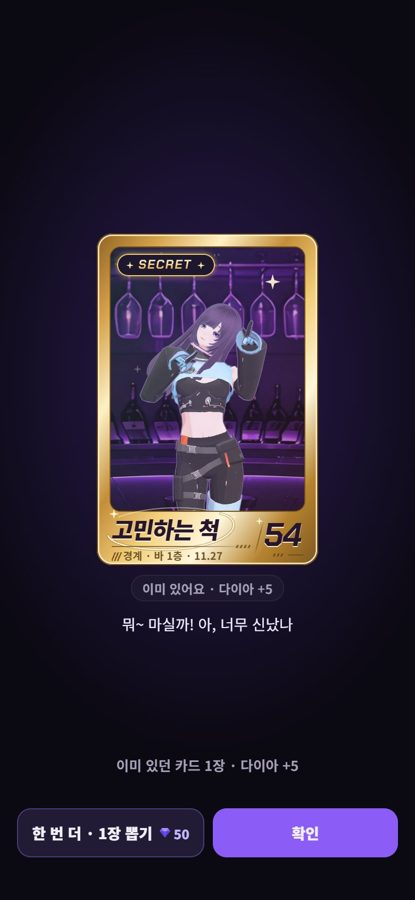

**공유 그림**(수정 전 → 후, SECRET): 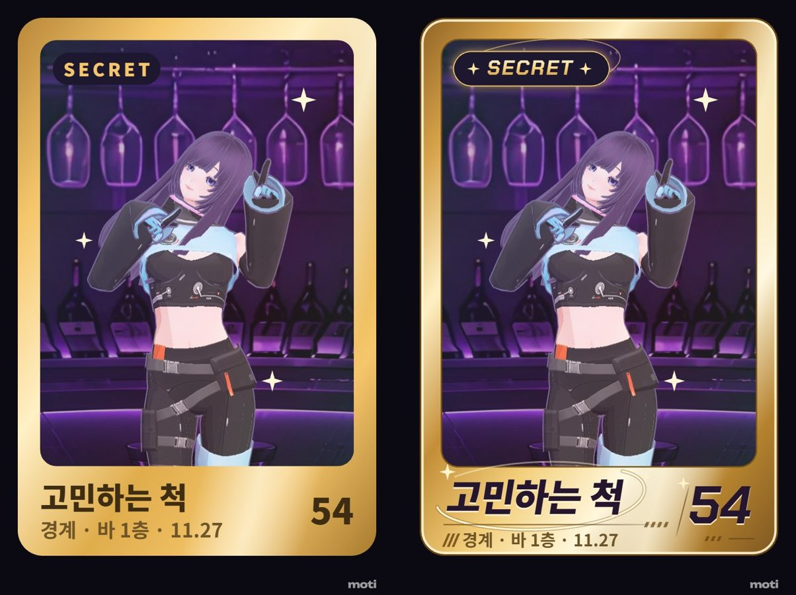 · 세 등급: 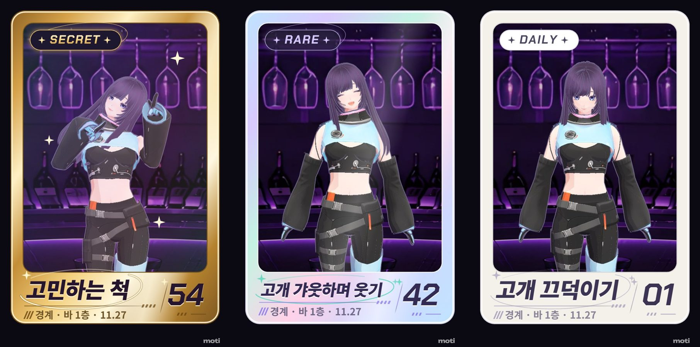

**긴 이름**(「시간 날 때마다 연습한 춤」, 상세 · 공유): 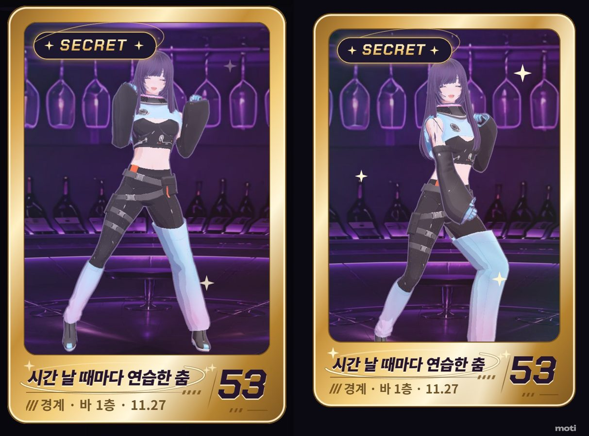

**글꼴을 못 받았을 때**(글꼴 요청 차단): 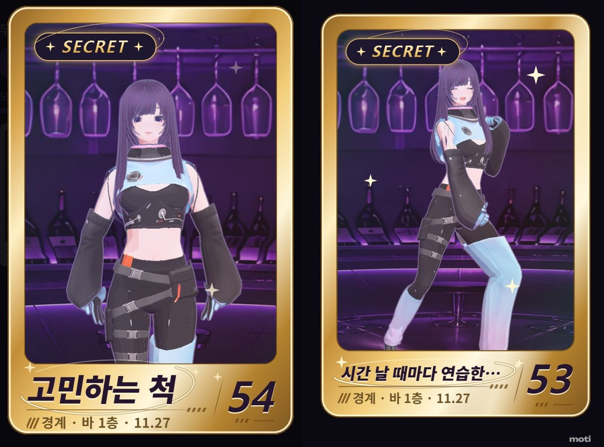

캡처 속 서아 자세는 찍은 순간의 3D 재생 장면이라 수정 전후가 서로 다를 수 있다.

## 모바일 성능

- 새 블러는 등급 표 빛 한 겹(`box-shadow` 2.4cqw, 레어·시크릿)뿐이다. 테두리 줄은 블러 없는 inset이고 `filter`는 쓰지 않았다.
- 새 애니메이션은 장식 별 3개 반짝임 하나(opacity·transform)다. 250px 이상 카드(상세)의 레어·시크릿에서만 돈다. 목록·뽑기 카드에서는 돌지 않는다.
- 상세가 열려 있으면 뒤 목록의 효과를 멈춘다(`.app.cvon`). 기존 테두리 빛·사진 효과도 그대로 멈춘다.
- 「동작 줄이기」면 모든 카드 효과를 끈다.
- 글꼴 2개를 합쳐 28.7KB이고, 처음 카드가 보일 때 한 번만 받는다.
- 궤도는 카드마다 path 3개짜리 작은 inline SVG다. 3열 목록에서는 `display:none`이라 그리지 않는다.

## 테스트 결과

확인 방식: 헤드리스 Chrome(테스트 전용 프로필) 모바일·터치 에뮬레이션. 사용자 브라우저 저장값은 건드리지 않았고, 유료 API·서버 호출은 0건이다. **실제 아이폰 사파리는 확인하지 못했다.**

| # | 항목 | 결과 |
| --- | --- | --- |
| 1 | DAILY·RARE·SECRET 목록·상세·뽑기·공유 | ✓ 캡처 |
| 2 | 짧은 이름 / 긴 이름(12자) — 번호·장식과 안 겹침, 넘치면 글자만 줄임 | ✓ 상세·2열·3열·공유 |
| 3 | 글꼴 로딩 실패 시 대체 표시 | ✓ 요청 차단 캡처 |
| 4 | 390×844 · 375×667 · 데스크톱(앱 440px) | ✓ |
| 5 | 3D 재생, 이전·다음·공유·닫기, 스와이프 | ✓ |
| 6 | 상세 주변 터치 차단·400ms 닫기 보호(87-1) | ✓ 87-1 테스트 그대로 통과 |
| 7 | 닫은 뒤 의상 복귀 | ✓ bar → ops |
| 8 | gm01·gm05 표정 흐름, x30 고정 카메라, gm06 SECRET·x31 | ✓ 설정·재생 상태 |
| 9 | 1장 / 10장 하나씩 / 3장 뒤 모두 뒤집기 / 처음부터 모두 뒤집기 | ✓ 모두 2열 결과, 10장 앞면 |
| 10 | 10장 결과 세로 스크롤, 버튼 겹침 없음, NEW·보유 표 | ✓ 172×258, 끝까지 스크롤 |
| 11 | 다이아·천장·환급·획득 기록 | ✓ 5000 → 4560(−450 +10) 등 |
| 12 | 확률 안내창 스크롤·닫기, 히든 카드 명칭 | ✓ |
| 13 | 포즈(가진 포즈 13 + 무료 1), 함께하기 | ✓ |
| 14 | 기존 보유 카드 그림·기록 | ✓ 그림 다시 만들기 없음(등급·모양은 CSS, 그림은 모션 버전 기준) |
| 15 | `check_gacha` · `test_motion_keywords` · `test_away_selfie .` | ✓ 모두 통과 · 26 · 53/0 |
| 16 | JS·JSON 유효성, 콘솔 오류, 글꼴·SVG 로딩 오류 | ✓ 없음(three.js `morphNormals` 경고·favicon 404 는 원래 있던 것) |

## 제가 정한 것

- **글꼴 받기:** 기획자 확인을 받고 후보 5개와 fonttools를 받았다. 저장소에는 서브셋 2개와 라이선스만 넣었다.
- **이름 글꼴 서브셋:** 카드 이름 글자만 남겼다(23KB, 전체는 1.5MB). 새 카드 이름에 없는 글자가 있으면 그 글자만 대체 글꼴로 보이고, 검사가 실패해 알려 준다.
- **띠 높이 그대로:** 사진 영역을 유지하려고 이름·번호를 키우는 대신 줄 간격을 줄였다.
- **크기별 장식 3단계:** 3열 목록에는 궤도·별·사선을 넣지 않았다(약 113px에서 겹치고 뭉개짐).
- **시크릿 궤도 두 겹:** 금 바탕에서 밝은 선만으로는 안 보여서, 어두운 금색 밑줄 위에 밝은 선을 얹었다.
- **SECRET 프레임 금색 단계 추가:** 색 계열은 같고, 밝은 쪽과 어두운 쪽 단계를 하나씩 더했다.
- **카드 뒷면(미획득)은 그대로:** 번호 글자 모양도 바꾸지 않았다.
- **공유 그림의 긴 이름:** 상세와 같이 글자를 줄인다(최소 원래 크기의 40%). 그래도 넘치면 「…」를 붙인다.
- 「포즈」 표(오른쪽 위)와 뽑기 연출의 홀로그램 빛은 그대로 두었다.

## 아이폰 사파리에서 직접 확인할 것

시각 효과가 바뀌었으므로 아래를 실제 기기에서 확인해야 한다.

- 웹폰트(woff2) 로딩, 대체 글꼴 → 카드 글꼴로 바뀔 때 이름이 튀는지
- 컨테이너 쿼리(iOS 16+)에 따른 장식 밀도, 그보다 낮은 iOS에서는 장식 없는 모양
- 기울인 이름의 `text-overflow`와 이름 맞추기
- `-webkit-background-clip:text` 금 글자(SECRET 등급 표)
- 궤도 SVG `vector-effect:non-scaling-stroke` 선 굵기
- 4각 별 `clip-path`, 등급 표 빛
- 3D 재생 중 카드 상세의 프레임 속도(장식 별 반짝임 3개)
- 공유 그림의 글꼴(사파리 Canvas가 웹폰트를 쓰는지)

## 해결하지 못한 문제

- 헤드리스 Chrome에서는 그리기가 느려 별 반짝임과 테두리 빛의 **연속 움직임**은 보지 못했다(정지 화면으로 확인).
- 레퍼런스의 렌즈 플레어처럼 강한 광택은 성능과 효과 중복 문제로 넣지 않았다. 필요하면 다음 단계에서 정지 하이라이트로 검토할 수 있다.
