# [9] 명장면 수집(몸짓 도감) + 선물 뽑기

- 브랜치: `step/9-collection` (main 병합 안 함)
- 시작 전 확인: `step/8-home` 은 main 에 병합돼 있음(`6d99a5a`)
- 원고: `docs/drafts/9-선물-앨범-원고.md` — 문구·대사는 그대로 넣음. 그대로 못 넣은 곳은 아래 「원고와 다른 곳」
- 커밋: `[9-A] 몸짓 도감 데이터와 선물 뽑기` → `[9-B] 명장면 수집 앨범, 등급 알림, 시연 패널`

## 바뀐 파일

| 파일 | 내용 |
| --- | --- |
| `data/collection.json` | **새 파일.** 몸짓 도감 37칸(대화 25 + 선물 12). 대화 몸짓 등급 규칙(`gradeRule`), 등급 색(`grades`), 희귀·특별 알림 크기·시간·색·어둡게(`notify`). 선물 몸짓 g01~g12 는 원고 1절 그대로(`play` = 임시 재생 몸짓·표정·속도) |
| `data/gifts.json` | **새 파일.** 예전 `GIFTS`. 아이콘·이름·가격·기분 맞춤(`rec`) 그대로 + 등급 확률(`odds`), 기분 맞춤 보너스(`moodBonus`), 천장(`pity`), 대사(원고 2절) |
| `gacha.js` | **새 파일.** 뽑기 계산(확률·기분 맞춤·천장·몸짓 고르기·대사 고르기). 앱과 시뮬레이션이 같은 코드를 씀 |
| `tools/build_collection.mjs` | **새 파일.** `seoa_story.json` unlock 에서 대화 몸짓 칸을 만들고 규칙으로 `grade` 를 계산해 `collection.json` 에 적음 |
| `tools/check_gacha.mjs` | **새 파일.** 데이터 검사 + 뽑기 시뮬레이션(아래 표). `node tools/check_gacha.mjs` |
| `data/ui.json` | `gift`(선물 창·결과), `collection`(등급 이름·알림·이미 본 모습), `album`(명장면 수집 제목·버튼·진행도·기본 힌트), `my.collection`. 예전 `album.tabFirst`·`tabGift`·`firstProgress`, `gift.note`·`special`·`albumSaved` 지움 |
| `data/demo.json` | 「다음 선물 결과」·「천장 초기화」·「선물 몸짓 모두 열기」·「선물 몸짓 비우기」 |
| `data/demo_scenes.json` | 장면 ⑥ 앨범 `album: "first"` → `"all"` |
| `index.html` | 아래 A·B |
| `docs/drafts/9-선물-앨범-원고.md` | 원고(받은 그대로 커밋) |
| `docs/reports/img/9/*.jpg` | 캡처 |

### A. 데이터와 선물 뽑기

- 선물 주기(`give`): 💎 빼기 → 등급(기분 맞춤·천장 반영, 시연 패널 「다음 선물 결과」가 있으면 그것) → 그 등급 선물 몸짓 하나 → 무대에서 재생(`play` 의 몸짓·표정·속도, 3D 아래 표시는 선물 몸짓 이름) + 대사를 3D 위 자막 → 대화 기록 「🎁 {선물} · {등급}」 줄과 대사
- 처음 얻은 몸짓이면 도감 기록(날짜·대사·장소), 이미 있으면 「이미 본 모습이에요」. 중복 보상 없음
- 천장 남은 횟수 `S.pity`(없으면 10), 희귀 이상이 나오면 10으로
- 선물 창: 기분 안내, 천장 남은 횟수, 선물마다 「기분 맞춤」 표시와 확률 줄(기분 맞춤 적용 뒤 값)
- 3D 재생 속도: `Stage.play(mid, {speed, name})` 추가(선물 몸짓 임시 재생용). 확대·복귀 시간도 속도에 맞춤

#### 지운 것 (예전 「선물로 몸짓 배우기」)

| 곳 | 지운 것 |
| --- | --- |
| 상수 | `SIGN`(선물로 배우는 몸짓 4개), `GIFTS` 안의 `sign`·`fx`·상태별 반응 `r`(16개) |
| 저장값 | `S.learned`, `S.album`(선물 리액션 16칸) — 옮기지 않고 버림. `S.firsts` 는 도감 기록 `S.col` 로 합침(아래) |
| `unlockedIds` | learned 몸짓을 대화 몸짓에 더하던 부분 |
| `send` | 「✨ 선물로 배운 모습」 표시(답장 태그·3D 표시) |
| `localReply`(예시 대사) | learned 로만 열리던 m16 「봐, 내가 된다 했지」·m24 「갑자기 그런 말 하지 마. …나도야」 갈래 → 원래 있던 다른 갈래(m01·m06)만 남김 |
| 선물 창 | 「반응 n / 4 발견」, 「✨ 새 모습을 배울 수 있어요」·「배운 모습: …」, 「지금 추천」(→ 「기분 맞춤」) |
| 선물 결과 토스트 | 「📔 앨범에 새 모습 저장! (n / 16)」, 「서아가 …을(를) 배웠어요」, 「이미 본 반응이에요…」 |
| 앨범 | 「선물 리액션」 탭(선물×기분 16칸, 「배운 모습」 표시) |
| 마이 | 「📔 서아의 모습 n/16 · ✨ 배운 모습 n개」 |
| 초기화 | 서아만·전체 초기화의 `album`·`learned`·`firsts` |

### B. 명장면 수집 앨범, 알림, 시연 패널

- 앨범 = 명장면 수집 하나: 3D 무대 → 「명장면 수집」 → 「전체 / 대화 / 선물」(화면 폭만큼) → 진행도(왼쪽 「전체 몸짓」 등, 오른쪽 n / total) → 막대 → 한 줄 3칸
- 칸 순서: 대화 → 선물, 그 안에서 일반 → 희귀 → 특별(같은 등급은 데이터 순서)
- 얻은 칸: 왼쪽 위 등급(색), 💬/🎁, 이름, 날짜, 장소. 테두리도 등급 색. 누르면 그 장소에서 그 몸짓 + 대사 자막(3D 아래 칸, 예전 다시 보기와 같은 방식)
- 잠긴 칸: 등급 + 힌트(2-1 개별 힌트 → 없으면 「대화에서 만나요」/「선물로 만나요」). 누르면 힌트 토스트
- 대화 몸짓은 대화에서 처음 나올 때 기록(1단계 기본 몸짓 포함). 해금 연출로 처음 보는 대표 몸짓도 같은 기록
- 새 몸짓 알림(대화·선물): 일반 = 예전 작은 알림 「✨ 새 명장면 · 이름」, 희귀 = 무대 위 「희귀 · 이름」 20px 1.5초, 특별 = 무대 어둡게(0.45) + 금색 「특별 · 이름」 28px 2.2초. 값 `data/collection.json notify`. 글자·색·크기·투명도만(블러·그림자·파티클 없음, CSS 전환만)
- 마이: 「명장면 수집 n / total」
- 시연 패널(항상 보임): 「다음 선물 결과」(없음·일반·희귀·특별·g01~g12, 다음 선물 한 번만) + 천장 남은 횟수, 「천장 초기화」·「선물 몸짓 모두 열기」·「선물 몸짓 비우기」. 전체 초기화는 도감·천장·다음 선물 결과도 비움

## 데이터 검사

`node tools/check_gacha.mjs` 출력

- 도감 칸: 대화 25 + 선물 12 = **37**
- 등급별 (대화): 일반 10 · 희귀 7 · 특별 8
- 등급별 (선물): 일반 6 · 희귀 4 · 특별 2
- 등급별 (전체): 일반 16 · 희귀 11 · 특별 10
- 대화 몸짓 = unlock 의 stage·flag·event 전부(ban m14·m16·m22 제외)와 같음, id 중복 없음

대화 몸짓 등급

| 등급 | 몸짓 |
| --- | --- |
| 일반 (1~2단계) | m02 m03 m04 m07 m17 m20 m12 m11 m01 (1단계), m09 (2단계) |
| 희귀 (3~4단계, flag·event) | m05 m06 (3단계), m21 m19 m08 m18 (flag), m23 (event) |
| 특별 (5~6단계, 서아 전용) | c02 c03 c01 c04 c05 (서아 전용), m10 m13 (5단계), m15 (6단계) |

| 선물 | 기분 맞춤 | 확률(일반/희귀/특별) | 합 | 기분 맞춤 적용 | 합 |
|---|---|---|---|---|---|
| ☕ 커피 | tired | 85 / 14 / 1 | 100 | 75 / 24 / 1 | 100 |
| 🍜 라멘 | normal | 80 / 18 / 2 | 100 | 70 / 28 / 2 | 100 |
| 💐 꽃다발 | sulky | 70 / 26 / 4 | 100 | 60 / 36 / 4 | 100 |
| 💍 반지 | birthday | 50 / 40 / 10 | 100 | 40 / 50 / 10 | 100 |

## 뽑기 시뮬레이션 (선물마다 10,000번, 앱과 같은 `gacha.js`)

| 선물 | 조건 | 확률(%) 일반/희귀/특별 | 결과(%) 일반/희귀/특별 | 가장 긴 연속 일반 | 천장 발동 |
|---|---|---|---|---|---|
| ☕ 커피 | 천장 끔 | 85 / 14 / 1 | 84.8 / 14.2 / 1.1 | 74 | - |
| ☕ 커피 | 천장 켬 | 85 / 14 / 1 | 80.8 / 17.9 / 1.3 | 9 | 424 |
| ☕ 커피 | 기분 맞춤 + 천장 끔 | 75 / 24 / 1 | 74.8 / 24.1 / 1.1 | 28 | - |
| ☕ 커피 | 기분 맞춤 + 천장 켬 | 75 / 24 / 1 | 73.2 / 25.8 / 1.0 | 9 | 187 |
| 🍜 라멘 | 천장 끔 | 80 / 18 / 2 | 79.9 / 18.2 / 1.9 | 31 | - |
| 🍜 라멘 | 천장 켬 | 80 / 18 / 2 | 77.7 / 20.1 / 2.2 | 9 | 316 |
| 🍜 라멘 | 기분 맞춤 + 천장 끔 | 70 / 28 / 2 | 69.7 / 28.2 / 2.0 | 21 | - |
| 🍜 라멘 | 기분 맞춤 + 천장 켬 | 70 / 28 / 2 | 69.4 / 28.5 / 2.0 | 9 | 134 |
| 💐 꽃다발 | 천장 끔 | 70 / 26 / 4 | 70.3 / 25.6 / 4.1 | 22 | - |
| 💐 꽃다발 | 천장 켬 | 70 / 26 / 4 | 68.5 / 27.1 / 4.4 | 9 | 124 |
| 💐 꽃다발 | 기분 맞춤 + 천장 끔 | 60 / 36 / 4 | 60.4 / 35.8 / 3.7 | 13 | - |
| 💐 꽃다발 | 기분 맞춤 + 천장 켬 | 60 / 36 / 4 | 60.1 / 36.0 / 4.0 | 9 | 41 |
| 💍 반지 | 천장 끔 | 50 / 40 / 10 | 48.6 / 40.4 / 11.0 | 11 | - |
| 💍 반지 | 천장 켬 | 50 / 40 / 10 | 49.9 / 39.8 / 10.3 | 9 | 7 |
| 💍 반지 | 기분 맞춤 + 천장 끔 | 40 / 50 / 10 | 39.4 / 50.7 / 9.9 | 8 | - |
| 💍 반지 | 기분 맞춤 + 천장 켬 | 40 / 50 / 10 | 39.7 / 50.5 / 9.8 | 9 | 1 |

- 4종 섞어 40,000번(천장 공유): 가장 긴 연속 일반 9
- 천장 끔: 모든 등급 비율이 확률 ± 표준오차 4배 안(검사 통과)
- 천장 켬: 연속 일반은 최대 9번(10번째는 희귀 이상). 천장이 있으면 실제 희귀 비율이 표시 확률보다 조금 높아짐 — 커피(85%)에서 가장 커서 일반 85 → 80.8%. 반지처럼 일반이 낮으면 거의 차이 없음
- 대사 규칙: 기분 맞춤 + 일반 → 기분 맞춤 대사, 기분 맞춤 + 희귀 → 희귀 대사, 그냥 일반 → 일반 대사(검사 통과)

## 캡처 (390×844, 로컬 서버, 서버 없음 모드)

| 선물 창(기분 맞춤: 지침 → 커피) | 희귀 결과 알림 | 특별 결과 알림 | 이미 본 모습 |
| --- | --- | --- | --- |
| 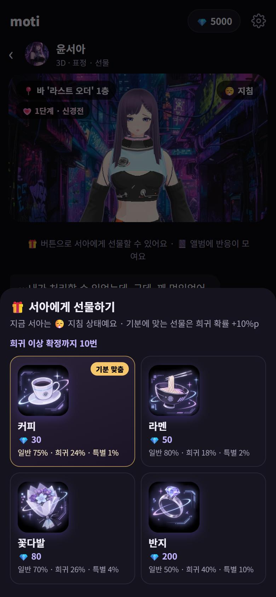 | 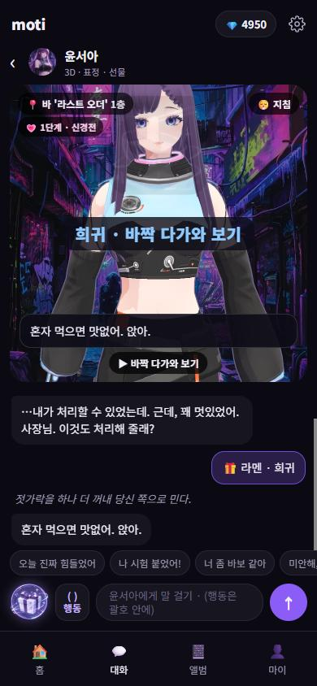 | 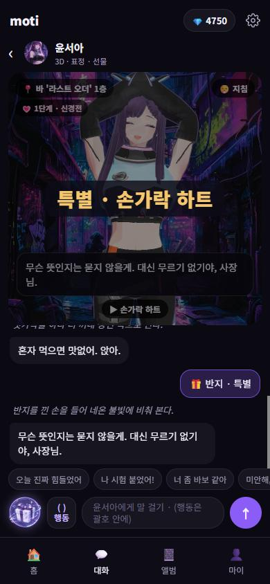 | 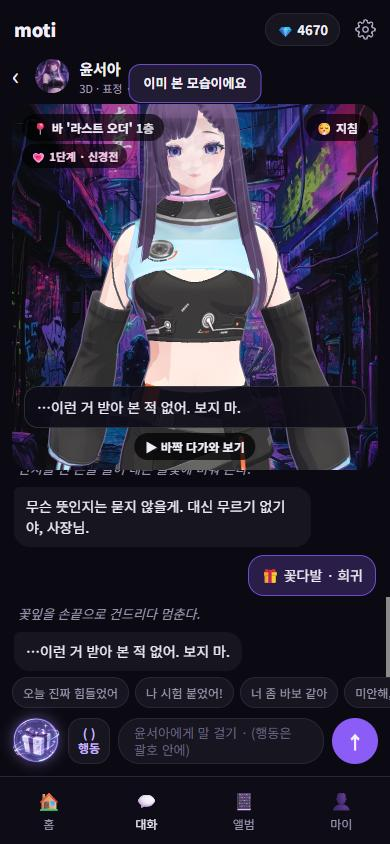 |

| 앨범 전체 | 앨범 대화 | 앨범 선물 | 잠긴 칸 힌트(m23 칸을 누름) |
| --- | --- | --- | --- |
| 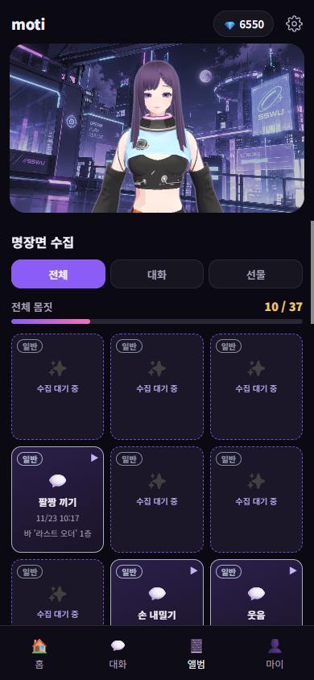 | 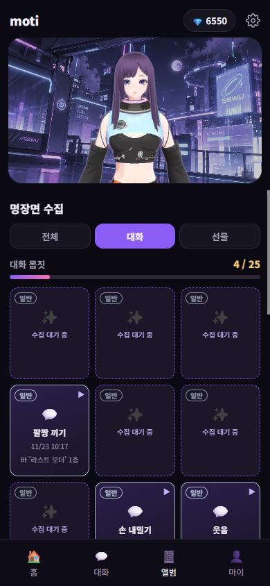 | 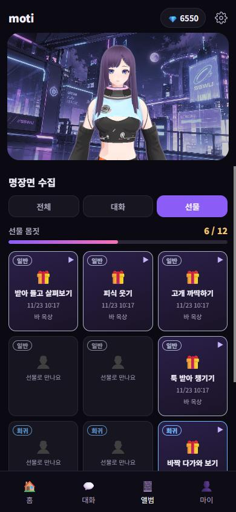 | 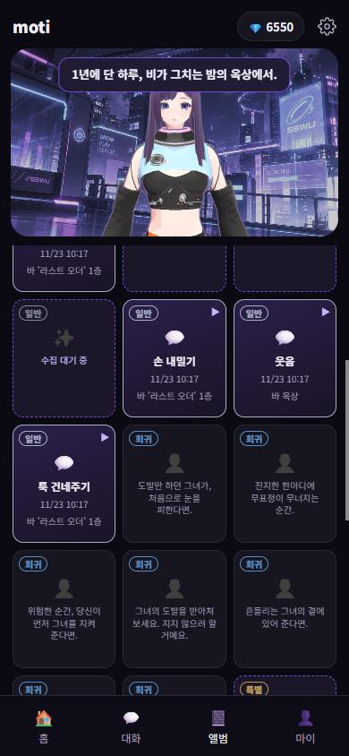 |

| 시연 패널 새 항목(특별 고른 상태) | 마이 페이지 | 375×667 앨범 전체 |
| --- | --- | --- |
| 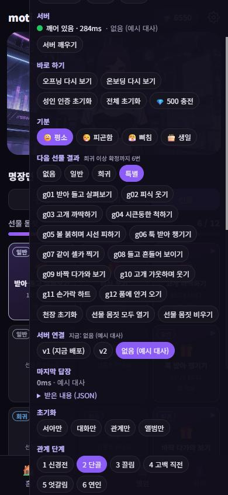 | 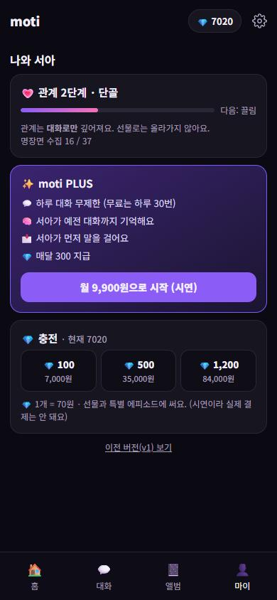 | 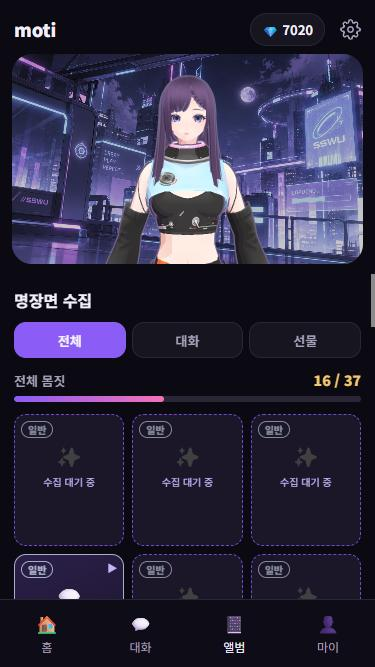 |

확인한 것

- 기분 「지침」에서 커피 → 일반 + 기분 맞춤 대사(「…딱 이게 필요했어」), 천장 10 → 9
- 다음 선물 결과 g09(희귀)·g11(특별) → 무대 위 알림, 특별은 무대가 어두워짐. 같은 g09 다시 → 「이미 본 모습이에요」, 기록 그대로
- 다음 선물 결과 「특별」 → 커피에서도 특별 + 특별 대사, 한 번 쓰면 「없음」으로 돌아감, 천장 10
- 「선물 몸짓 모두 열기」 → 선물 12/12, 「비우기」 → 0/12(대화 기록은 그대로), 「천장 초기화」 → 10
- 대화(서버 없음): 「오늘 진짜 힘들었어」 → m11 처음 → 작은 알림 「✨ 새 명장면 · 손 내밀기」 + 도감 기록. 장면 ③ 에서 「좋아해」 → 3단계 해금 연출(c01) + 「특별 · 칼라 만지작거리기」
- 얻은 칸 누르기 → 그때 장소에서 몸짓 + 3D 아래 자막
- 전체 초기화 → 도감 `{}`, 천장 10, 다음 선물 결과 없음
- 가로 넘침 없음(390, 375 모두 scrollWidth = 화면 폭), 콘솔 오류 없음

## 아이폰 사파리 확인 항목 (기획자 확인 필요)

- [ ] 희귀 알림 「희귀 · 이름」: 크기(20px)·하늘색이 무대 위 가운데에 보이고 1.5초 뒤 사라지는지
- [ ] 특별 알림 「특별 · 이름」: 금색 28px, 2.2초. 긴 이름(예: 「팔꿈치 괴고 몸 숙이기」)이 두 줄로 깨지지 않는지
- [ ] 특별 알림 때 무대가 살짝 어두워졌다가 돌아오는지(3D 가 커지는 중에도 무대 전체를 덮는지)
- [ ] 알림이 다른 화면(앨범↔대화)으로 옮겨도 다시 뜨지 않는지
- [ ] 앨범 「전체 / 대화 / 선물」 버튼 전환이 바로 되고, 진행도 숫자·막대가 바뀌는지
- [ ] 앨범 칸 한 줄 3칸, 375 폭에서도 이름·장소가 칸 밖으로 넘치지 않는지
- [ ] 선물 창 확률 줄 「일반 50% · 희귀 40% · 특별 10%」가 한 줄로 들어가는지

## 원고와 다른 곳

- **💎 부족 문구:** 원고 「`💎가 부족해요` (지금 문구 그대로)」인데 지금 선물 쪽 문구는 「💎가 부족해요. 시연 설정에서 충전할 수 있어요」였음. 원고에 적힌 「💎가 부족해요」를 씀(홈 특별 에피소드와 같은 문구)
- **기분 안내의 +10%p:** 숫자는 `data/gifts.json moodBonus.rare` 에서 채움(문구는 원고 그대로, `{bonus}` 자리)
- **표정 이름:** 원고의 neutral·fun·soft·shy·joy 는 모두 앱에 있음. 바꾼 것 없음

## 제가 정한 것

- **천장 계산:** 남은 횟수 10에서 일반이 나올 때마다 1씩 줄고, 1일 때(= 10번째) 희귀 이상 확정. 확정일 때 희귀·특별은 그 선물의 확률 비율대로(예: 커피 14:1). 화면의 「희귀 이상 확정까지 n번」은 이 남은 횟수 그대로(1번 = 다음 선물 확정)
- **시연 패널 「다음 선물 결과」도 천장에 셈:** 고른 결과가 희귀 이상이면 천장 10으로, 일반이면 하나 줄임. 💎도 그대로 빠짐
- **특정 몸짓을 고르면:** 등급은 그 몸짓의 등급. 대사는 그 등급(일반이고 기분 맞춤이면 기분 맞춤 대사)
- **대화 기록:** 예전 「☕ 커피을(를) 선물했어요」 줄 대신 결과가 나올 때 「🎁 커피 · 희귀」 줄 + 서아 대사(지문은 말풍선 밖). 선물 아이콘 연출(burst)은 그대로
- **선물 대사 자막 위치:** 대화방에서는 3D 무대 아래쪽 말풍선(쓰지 않던 `#bubble`), 앨범 다시 보기는 예전처럼 3D 아래 칸
- **삐짐 → 평소:** 예전처럼 삐짐일 때 선물을 주면 기분이 평소로(관계 단계·호감도는 그대로). 「선물은 관계에 영향 없음」 규칙과 따로인 예전 동작이라 남김
- **예전 저장값:** `album`·`learned` 는 버리고, `firsts`(대화 명장면 기록)는 새 도감 기록으로 옮김(지시의 「firsts 를 도감 기록으로 합친다」). 저장값 버전 `v: 3`
- **「수집 대기 중」 칸:** 열렸지만 아직 대화에서 못 본 대화 몸짓은 예전(3-1)처럼 점선 「수집 대기 중」으로 보임(등급 표시는 함께). 1단계 기본 몸짓도 도감에 들어와서 처음엔 1단계 9칸이 「수집 대기 중」. 누르면 개별 힌트(없으면 「대화에서 만나요」)
- **해금 연출과 등급 알림:** 단계 상승·판정·사건 해금 연출(토스트 「🔓 …」)은 그대로 두고, 그 몸짓이 희귀·특별이면 무대 위 등급 알림도 0.4초 뒤 함께. 일반이면 해금 토스트만
- **도감에 안 남기는 재생:** 오프닝(m07·m01·m11), 특별 에피소드 첫 몸짓, 시연 패널 「몸짓 재생」은 답장 몸짓이 아니라 기록하지 않음
- **선물 몸짓 모두 열기의 대사·장소:** 12칸에 선물 4종을 차례로 짝지어 그 등급 대사(g01 커피 일반, g02 라멘 일반 …), 장소는 지금 장소
- **시연 패널 선물 항목은 항상 보임**(`?debug=1` 아니어도): 발표 때 특별을 바로 보여 줄 수 있게. 「앨범만」 초기화(debug)는 도감만 비우고 천장은 그대로
- **등급 색:** 일반 회색(#a7b0c4), 희귀 하늘색(#6fb7ff, 알림 글자는 조금 밝은 #8ec9ff), 특별 금색(#f5c66b). 희귀 알림은 무대를 어둡게 하지 않음(`dim: 0`)
- **알림 글자 뒤 바탕:** 그림자·블러 없이 글자 뒤에 반투명 남색 바탕(#0d0b16cc)만 둠(무대 그림 위에서 읽히게)
- **칸 크기:** 한 줄 3칸, 높이 최소 132px(이름 두 줄 + 날짜 + 장소). 예전 「▶」 표시는 얻은 칸에 그대로
- **선물 창 확률 줄:** 한 줄로 넣으려고 10.5px·자간 조금 좁힘
- **도감 데이터 만들기:** `seoa_story.json` unlock 이 바뀌면 `node tools/build_collection.mjs` 로 대화 칸을 다시 만들고 `node tools/check_gacha.mjs` 로 검사

## 알려 둘 것

- 선물 몸짓 g07(m14)·g08(m16)·g11(m22)는 서아 대화 몸짓에서는 빠진(ban) 몸짓이지만 선물 몸짓 임시 재생으로는 씀(원고 1절 그대로)
- g01·g10 은 대기 몸짓 m25 를 씀. 선물로 나올 때는 3D 가 커지고 이름이 보이게 처리(대화 중 대기 동작은 예전 그대로)
- 로컬 확인 서버는 다른 대화가 8765 를 쓰고 있어서 8779 로 띄움(`.claude/launch.json` 은 저장소 밖)

## 9-1 1단계 몸짓 잠긴 칸 표시

커밋: `[9-1] 1단계 몸짓 잠긴 칸 표시`

### 바뀐 것

| 파일 | 내용 |
| --- | --- |
| `index.html` `renderAlbum` | 관계 1단계 몸짓(`data/collection.json` `stage: 1`, 처음부터 열린 10개)은 대화에서 아직 못 봤으면 「수집 대기 중」 점선 대신 일반 잠긴 칸(등급 + 👤 + 힌트). 힌트는 개별 힌트(`seoa_story.json hints`)가 있으면 그것, 없으면 「대화에서 만나요」(지금 1단계 몸짓에는 개별 힌트가 없어 모두 「대화에서 만나요」) |

- 2단계 이후 관계가 올라 열린 몸짓, 판정·사건으로 열린 몸짓의 「수집 대기 중」은 그대로
- 칸을 누르면 힌트 토스트(예전과 같음)

### 캡처 (390×844, 관계 2단계 · 손 내밀기·웃음·툭 건네주기·선물 1개를 모은 상태)

| 앨범 전체 첫 화면 | 대화 버튼 | 대화 버튼(아래로 내림): 1단계 c02 는 잠긴 칸, 2단계 c03 은 「수집 대기 중」 |
| --- | --- | --- |
| 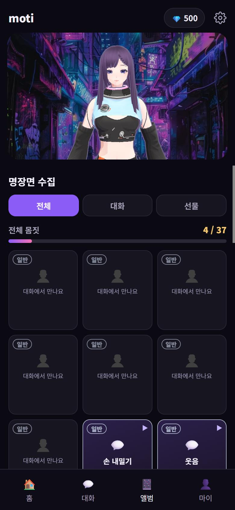 | 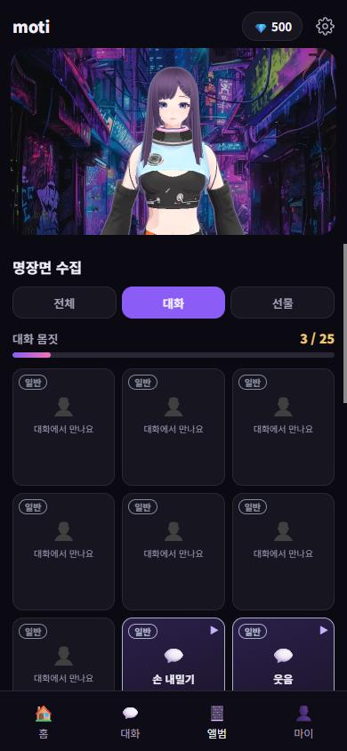 | 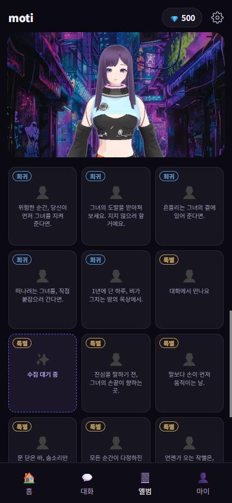 |

### 확인한 것

- 1단계 안 본 몸짓 7칸(m02·m03·m04·m07·m17·m20·m12)과 c02: 잠긴 칸 「대화에서 만나요」
- 2단계에서 열렸지만 안 본 c03: 「수집 대기 중」 점선 그대로(이 상태의 「수집 대기 중」 칸은 c03 하나)

### 제가 정한 것

- **1단계 판정:** 도감 데이터의 `stage` 값이 1인 몸짓(= `seoa_story.json` unlock stage 1). 서아 전용 c02 도 1단계라 잠긴 칸으로 보임
- **캡처 1장 더:** 「대화 버튼」 첫 화면에는 2단계 칸이 안 보여서, 아래로 내린 화면(1단계 c02 와 2단계 c03 이 나란히)을 셋째 캡처로 붙임
