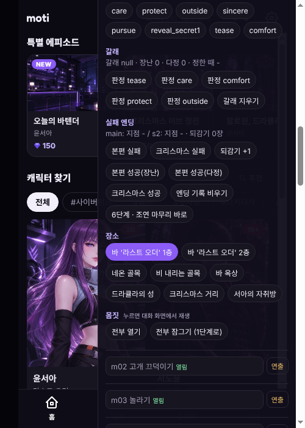

# 90 · 서버 맞추기 · 크리스마스 남은 턴 · x37 제한

브랜치 `step/90-server-sync`. 단계 번호는 팀원 단계(55·56)와 겹치지 않게 90 으로 했다.
이번 단계는 기획 대화의 Claude 가 사용자의 Claude Code 대신 직접 구현했다(사용자 요청).

기준: 서버 `ddododo-lang/seoa-backand` main(PR #6 story-routes 병합, 23:04)의 `docs/reports/story-routes.md`, `feat/side-ending`(PR #7, 병합 전)의 `docs/reports/side-ending.md` 「앱 팀에 전할 것」.

## 바뀐 파일

| 파일 | 내용 |
| --- | --- |
| `index.html` | `chatState()` 크리스마스 줄기에서 `episode_turns_left` = `End.left()`. `Moment.cooled()`(닫힌 순간 선물 cooldownTurns 동안 목록·임시 규칙에서 뺌). `oneLine()` — /chat `message`·내 쪽 `history`, 판정 `last_user` 의 메시지 안 줄바꿈을 공백으로. 시연 패널 `setStage` 가 서버 값도 맞춤(`serverStage`), 「6단계 · 조연 마무리 바로」 버튼, 본편 성공 버튼에 조연 차례 3. `epOnlyOk()` — 에피소드 전용 몸짓 |
| `data/demo.json` | `fail.finaleNow` 문구, `serverStage`(단계별 최소 메시지 수 2:15·3:20·4:15, 조연 차례 2·3, STAGE_UP_6, 기본 갈래 care) |
| `data/seoa_story.json` | `extraMotions.episodeOnly`: `{"x37": ["s2"]}` |
| `docs/server-sync.md` | 맨 위 표: 51·50 처리함(서버 PR #6), 90·54 줄 더함(서버 PR #7 점검 중). 51 절 크리스마스 자정: `episode_turns_left` 를 보냄 |
| `docs/status.md` | 90 절 |

## 서버 부탁별 결과

| 부탁 | 결과 |
| --- | --- |
| 되감기 지점 남은 날 3 | 54 에서 이미 함(`data/rewind.json main.departDays`) |
| `episode_turns_left` 보내기 | 함. 크리스마스(s2) 줄기의 `/chat`·`/judge` state 에만. 처음 40, 되감기 뒤에는 되감은 값(최소 15 남김, 51) |
| 시연 패널 `progress` 표시 | 54 에서 이미 함 |
| 새 state 값을 되감기 스냅숏에 | 할 일 없음: 판정 state 를 `Object.assign` 으로 통째로 합치고, 스냅숏이 `story` 를 통째로 복사함(`scene`·`scene_judges_left`·`last_night_told`·`stage_bonus`·`stage_user_msgs`·`mari_step`·`taeo_step`·`morning_done` 모두 보존) |
| `pending_event` 새 값 | 할 일 없음: 그대로 보내고 서버 답장 뒤 비움. 해금 지도에 없는 이름은 무시 |
| 닫힌 순간 선물 10번 빼기 | 함. 안 주고 닫힌 것·준 것 모두 내 메시지 10번(gifts.json `moment.cooldownTurns`) 동안 `gift_moments` 에서 빠짐 |
| 줄바꿈 → 공백 | 함. 화면의 내 말풍선은 그대로 |
| 「stayed」 계속 옴, 「lovers」 안 옴 | 앱은 `S.stay` 로 한 번만 띄움(54). 「lovers」에 기대는 코드 없음 |
| 시연 패널 6단계 값 | 함(아래) |

## 확인 (헤드리스 Chrome, 서버 없이 앱 함수 직접 호출)

- 단계 4 버튼 → `stage_user_msgs 15, stage_bonus 0, scene null, ending null`
- 단계 6 버튼(갈래 없음) → `route care, stage_user_msgs 0, morning_done false, pending_event STAGE_UP_6, mari_step 3, taeo_step 2`. 갈래 tease 면 `mari_step 2, taeo_step 3`
- 「6단계 · 조연 마무리 바로」 → 위 값 + `morning_done true, pending_event null`
- 「본편 성공(장난)」 → `ending stayed, mari_step 3, taeo_step 3`
- 순간 선물: 구급상자가 닫힌 뒤 5번째 메시지에는 `gift_moments` 에 없음, 15번째에는 다시 있음
- 크리스마스 줄기: `chatState().episode_turns_left = 40`, 판정 state 에도 있음. 본편 state 에는 없음
- x37: 본편 바 1층 `motionList` 에 없음, 내 말 「밖으로 나가자」 + 지문 「걸어간다」 → 몸짓 없음. 크리스마스에서는 같은 말 → x37
- `oneLine("안녕\n  (웃는다)\r\n뭐해")` → 「안녕 (웃는다) 뭐해」
- 콘솔 오류 없음(헤드리스라 WebGL 은 소프트웨어 렌더). `data/*.json` 모두 읽힘

## 제가 정한 것

- **번호 90:** 사용자가 정함. 팀원 55·56 과 겹치지 않게.
- **닫힌 순간 선물 간격:** 서버와 같은 「내 메시지 10번」. 안 주고 닫힌 것뿐 아니라 준 것도 같이 뺌(서버도 준 것은 10번 간격이라 결과가 같음).
- **줄바꿈 → 공백:** 판정 `last_user`·/chat `message` 뿐 아니라 /chat `history` 의 내 쪽 줄도 같이(서버가 기록을 볼 때도 메시지 하나로 보이게). 서아 쪽 기록은 그대로.
- **시연 패널 단계 버튼:** 서버가 보는 값(`stage_user_msgs` 등)을 그 단계 최소 수로 채움 → 다음 판정에서 바로 오를 수 있음. 6단계는 서버 보고서의 「실제 흐름」 값. 갈래가 없으면 care.
- **x37:** 지시대로 크리스마스 이브(s2)의 두 장소 모두에서만. 본편에서 「가자」·「걸어」가 나오면 원래 규칙(다른 단어에 맞는 몸짓 또는 몸짓 없음). 해금·카드와 상관없는 것은 55 그대로.
- **보고서 캡처:** 헤드리스에서 3D 가 소프트웨어 렌더라 대화 화면 캡처는 생략하고, 시연 패널만 캡처함.

## 아이폰에서 나중에 볼 것

- 시각 효과 변경 없음.
- 크리스마스에서 「걷자」 → x37, 본편에서 「나가자」 → x37 안 나옴(실서버로).
- 실서버(PR #6)에서 순간 선물이 닫힌 뒤 바로 다시 열리지 않는지, 크리스마스 남은 턴 10 이하에서 서아가 떠날 기색을 보이는지.
