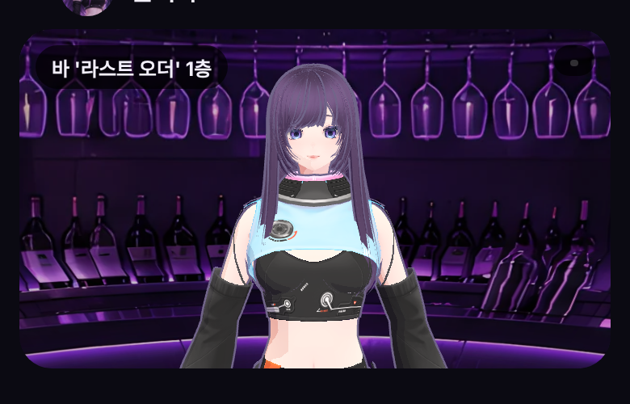
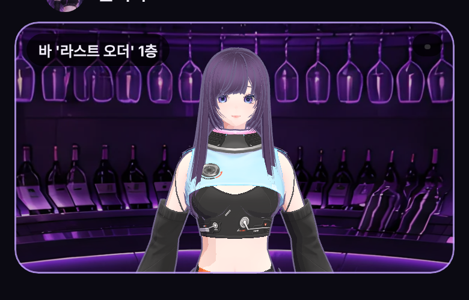
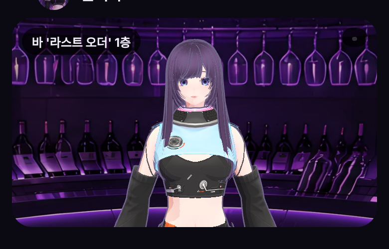

# 91 · 대화 중 모션 시인성 개선

브랜치 `step/91-motion-cue` (origin/main `64e61ec` [82] 위에서 시작). 커밋 `[91 A]` · `[91 B]` · `[91]` · `[91 C]`(검수 보완) · 최신 main 반영 · 버전 꼬리표 · main 병합(검수 지시문으로 승인).

## 바뀐 파일 · 주요 함수

| 파일 | 자리 | 한 일 |
|---|---|---|
| `index.html` | `Stage.play()` (1134줄 근처) | 새 옵션 `o.cue`: 확대(fx·big)·답장 기다림(wait)·조용히(quiet)·기본 자세(IDLE)가 아니면 이번 재생(`cur`)에 `cue` 표시 |
| `index.html` | `Stage` 그리기 루프 `frame()` (1026줄) | `cur.cue` 인 몸짓이 **파일을 다 받고 실제로 시작된 순간** 한 번만 `MotionCue.fire()`(반복 재생 중엔 다시 안 함). 매 프레임 `MotionCue.tick()` |
| `index.html` | `MotionCue` (새 모듈, `react()` 바로 위 1629줄) | `fire()` 무대 안쪽 테두리 덧칠 한 장의 투명도 애니메이션(Web Animations, opacity 만) · `clear()` · `tick()`(대화방·본편·촬영 화면 밖·밤 넘기기 아님이 아니면 바로 지움) |
| `index.html` | `react()` (1643줄) | 다섯째 인자 `cue` → `Stage.play(…,{cue})` |
| `index.html` | `send()` 답장 몸짓 (2229줄) | `cue = 서버 정상 답장(srvOk) && 본편(main) && 선물 반응 아님 && 포즈 부탁 아님`. 확대·다가가기는 `Stage.play` 가 `o.fx` 로 걸러 냄 |
| `index.html` | `setTab()`·`openRoom()` 첫 줄 | `MotionCue.clear()` 한 줄씩 |
| `index.html` | CSS `.stage .mcue` (39줄) | `inset:0; border-radius:inherit; box-shadow: inset 0 0 0 1.5px #C4A7FF`(블러 없는 선) · `opacity:0` · `pointer-events:none` |
| `data/config.json` | `stage.motionCue`(+ `_motionCue` 설명) | `{on, widthPx 1.5, color #C4A7FF, opacity 0.8, inMs 180, holdMs 350, outMs 650, reducedOpacity 0.4, reducedMs 500}` |

## 다른 작업과 겹칠 수 있는 곳

- `send()` 의 답장 몸짓 줄(`react({m:mid||IDLE,…})`, 2229줄) — 한 줄 끝에 인자 하나 더함. 이 줄을 고치는 작업(판정·밤 넘기기 답장 처리)과 겹칠 수 있음.
- `Stage.play()`·그리기 루프 — 몸짓 재생을 바꾸는 작업과 겹칠 수 있음(각 한 줄씩).
- `setTab()`·`openRoom()` 첫 줄 — 탭·대화방 작업과 겹칠 수 있음.
- `MotionCue` 는 `Night.isOn()`(80단계)을 읽기만 함 — 밤 넘기기 코드는 안 건드림.
- `data/config.json` `stage` 안 `motionCap` 바로 앞에 키 둘 추가.

## 캡처 (390px, 위 = 전 · 가운데 = 중 · 아래 = 후)

가운데는 애니메이션을 360ms(가장 진한 구간)에서 멈추고 찍음.

연출 확인 영상은 못 만듦: 이 작업 환경의 3D(소프트웨어 렌더링)는 한 프레임이 1초 가까이 걸려 1.18초 애니메이션이 한두 프레임에 끝나 버림 → 대신 위 캡처와 애니메이션 상태 값으로 확인.

## 테스트 결과 (390px, 가짜 서버 응답 · 서버 호출 없음)

| # | 항목 | 결과 |
|---|---|---|
| 1 | 일반 답장 몸짓(m02) 재생 시 강조 한 번 | ✅ 1번, 1.18초 뒤 꺼짐 |
| 2 | 같은 몸짓을 다음 답장에서 다시 | ✅ 2번째도 강조(재생마다 한 번). 반복 몸짓(x15, 3번 반복)은 처음 한 번만 |
| 3 | 모션 파일이 느릴 때(2초 늦춤) | ✅ 파일이 다 온 뒤 실제 재생이 시작될 때 강조(파일 도착 +2.4초 → 강조 +3.1초) |
| 4 | 기본 자세·답장 기다림·자동 몸짓(직접 재생)·실패 예비 지문 | ✅ 강조 없음 |
| 5 | 처음 얻는 카드(m12, 카메라 다가가기)·결정적 순간 | ✅ 기존 연출만, 강조 없음 |
| 6 | 촬영 화면·컬렉션·크리스마스 | ✅ 강조 없음(크리스마스 답장도 없음) |
| 7 | 탭 이동·대화방 다시 열기·촬영 화면 진입·밤 넘기기 중 | ✅ 남은 강조 바로 지움 |
| 8 | 무대 크기·말풍선 위치·스크롤·터치 | ✅ 강조 전·중 같음(366×210, 말풍선 위치 그대로), 무대 가운데 누르면 3D 그림판이 받음 |
| 9 | 콘솔 오류 | ✅ 없음 |
| B | 강조 중 새 몸짓 | ✅ 하던 강조를 끝내고 새로 시작 |
| B | 기기 「동작 줄이기」 | ✅ 움직임 없이 0.4 로 500ms 뒤 꺼짐 |

## 제가 정한 것

- **어느 답장에서:** 본편 서아 대화의 **서버 정상 답장**만. 예비 지문(서버 실패), 선물 반응 몸짓(선물 연출이 따로 있음), 포즈 부탁 답장(유저가 고른 포즈라 이미 보고 있음), 에피소드(크리스마스·바 등 본편이 아닌 줄기)는 뺌.
- **실제 시작 시점:** 그리기 루프에서 「모션 파일을 받았고 지금 시각이 재생 시작 시각을 지남」을 처음 만족하는 프레임.
- **촬영 화면에서 나올 때 이어 받는 답장 몸짓**(`Cam.hold`)은 강조하지 않음(일반 대화 흐름이 아니라서).
- **테두리 모양:** `box-shadow: inset 0 0 0`(번짐 없는 선)으로 무대 둥근 모서리를 그대로 따름. 무대 위 다른 표시(장소 칩·관계 칩·말풍선)보다 아래, 3D 그림 위(z-index 6).
- 애니메이션 곡선은 `ease-out` 하나.

## 아이폰에서 나중에 볼 것

- Web Animations(`element.animate`)로 투명도만 바꿈 — iOS 13.4 이상 사파리 지원. 안 되면 「동작 줄이기」처럼 0.4 로 500ms 고정 표시.
- 1.5px 선이 레티나 화면에서 너무 가늘거나 진하지 않은지(값은 `stage.motionCue`).
- 둥근 모서리(20px)에서 선이 끊기지 않는지.

## 검수 보완 [91 C] · 종료 조건

| 자리 | 바꾼 것 |
|---|---|
| `MotionCue` `ok()` | `(S.room||"seoa")==="seoa"` → `S.room==="seoa"` — 대화 목록(S.room = null)에서는 강조하지 않음 |
| `showList()` 첫 줄 | `MotionCue.clear()` — 대화방을 나가는 순간 지움 |
| `Stage.play()` | 막는 조건(포토부스 잠금·걷는 중·모르는 몸짓)을 지나 **실제로 받아들인 뒤** `MotionCue.clear()`. 막힌 호출은 강조를 건드리지 않음. 새 몸짓이 강조 대상이면 실제 시작 때 다시 켜짐, IDLE·자동·답장 기다림 몸짓에는 새로 켜지 않음(지우기만) |

- 되감기(`End.rewind`)·처음부터(`End.restart`)는 둘 다 `Stage.play(IDLE)` 를 불러 같은 줄에서 지워짐.

## 최신 main 반영

- 받은 main: `0836b14` [83-1] 병합(검수 시점과 같음, 더 새 커밋 없음).
- `git merge origin/main` → **충돌 없음**(자동 병합). `send()`·`react()`·`Stage.play()`·그리기 루프·`setTab()`·`openRoom()`·`showList()`·`data/config.json` 모두 양쪽 내용이 그대로.
- 병합 뒤 main 대비 차이 = 이번 [91] 변경만(`index.html` 34줄 · `data/config.json` 4줄 · 보고서·캡처). [83] 사진 촬영 제안(`photoask.js`·`PhotoAsk.gate`·제안 버튼)과 [83-1] 포즈 권한 검사(`Cam.open` 의 `okPose`·`Cam.setPose` 의 `Pose.info`)는 그대로 남음.

## 통합 테스트 (병합한 브랜치, 390px, 가짜 서버 · 시연 패널)

| # | 항목 | 결과 |
|---|---|---|
| 기존 | [91] 1~9 · 예외 처리 | ✅ 다시 통과 |
| 1 | 강조 중 대화 목록으로 | ✅ 바로 지움, 목록에서는 강조가 켜지지 않음 |
| 2 | 강조 중 강조 대상이 아닌 몸짓(m03 직접 재생) | ✅ 바로 지움 |
| 3 | 강조 대상 몸짓 연속(m02 → m05) | ✅ 앞 강조 취소, 새 강조 발동(2번) |
| 4 | 재생이 막힌 호출(모르는 몸짓 id) | ✅ 강조 그대로 |
| 5 | 되감기·처음부터 | ✅ 처음부터는 실제로 지워짐 확인. 되감기는 같은 `Stage.play(IDLE)` 경로라 코드로 확인(시연 패널로 되감기 지점까지 만들지 못함) |
| 6 | [83] 사진 촬영 제안 | ✅ 3단계 제안 전 카메라 잠금(「서아와 조금 더 가까워지면…」), 「썸 촬영 제안」 시연 → 「서아 사진 찍어주기」 버튼 → 카메라 열림·p01 고정, 연인 해금 뒤 자유 촬영 |
| 7 | [83-1] `Cam.setPose` 직접 사용 | ✅ 미획득 p05·일반 몸짓 m02 막힘, p01 됨 |
| 8 | 크리스마스·컬렉션·카메라 | ✅ 강조 없음 |
| 9 | `node tools/check_gacha.mjs` | ✅ 모두 통과 |
| 10 | `node tools/test_away_selfie.mjs .` | ✅ 통과 53 · 실패 0 |
| 11 | JS 문법(`node --check` 모든 .js)·data JSON·콘솔 | ✅ 오류 없음 |

- 참고: [83] 뒤로 3단계 전에는 카메라가 잠겨서, 「카메라 진입 시 지움」 확인은 연인 해금 상태로 다시 함.

## 제가 정한 것 (보완)

- 새 몸짓을 받아들일 때 지우는 자리는 `Stage.play()` 의 막는 조건 바로 뒤(그 위에서 돌아가는 호출은 「거부된 호출」로 봄).
- 되감기 확인은 실제 되감기 지점을 만드는 시연 경로가 없어 코드 경로(같은 `Stage.play(IDLE)`)와 「처음부터」 실제 확인으로 대신함.
