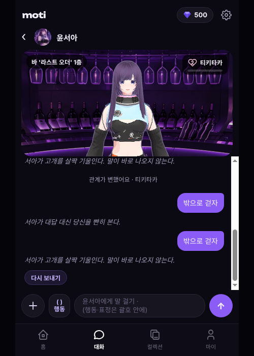
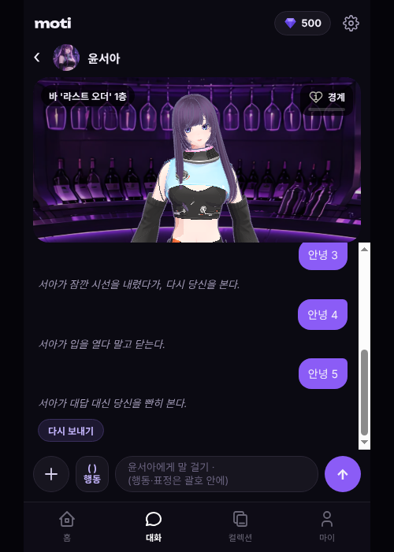

# 91 · 서버가 답하지 못할 때: 예비 지문 · 다시 보내기 · 관계 그대로

브랜치 `step/91-fallback`. 기획 대화의 Claude 가 직접 구현(사용자 요청). 번호는 팀원 단계와 겹치지 않게 90번대.

## 왜

아이폰 테스트(크리스마스 거리)에서 서버 답장이 늦자 「*서아가 잔 테두리를 손끝으로 훑는다.* …다시 말해 봐.」가 두 번 연속 나왔다. 크리스마스 거리에는 잔이 없다.
- 예비 대사가 하나뿐이고 바 전용 지문이었다.
- 연달아 실패하면 같은 줄이 반복됐다.
- 내 말에 「걷자」·「옥상」·「작전」 같은 단어가 있으면 미리 써 둔 대사를 고르며 장소까지 바꿨다(본편 설정 대사).
- 서버 v2 를 쓰는 중 실패하면 옛 「대화 횟수」 규칙으로 관계 단계가 올랐다(크리스마스는 호감이 붙었다).

## 바뀐 파일

| 파일 | 내용 |
| --- | --- |
| `data/config.json` | `fallbackReply`: 장소·소품과 상관없는 지문 4줄(`lines`, 대사 없음), `retry`, `keywordsOnlyNoServer` |
| `data/ui.json` | `chat.retry` 「다시 보내기」 |
| `index.html` | `localReply`: 단어 예시 대사는 「서버 없음」 시연에서만(특별 에피소드 제외), 예비 지문은 직전과 다른 줄. 예비 지문 아래 「다시 보내기」 칩(`retryLast`): 예비 지문과 방금 내 말을 지우고 그 턴에 센 수를 되돌린 뒤 같은 말을 다시 보냄. 서버 v2 실패(예비 지문)면 관계 단계·에피소드 호감을 움직이지 않음 |

## 예비 지문 (data, 바꿔도 됨)

- *서아가 대답 대신 당신을 빤히 본다.*
- *서아가 고개를 살짝 기울인다. 말이 바로 나오지 않는다.*
- *서아가 잠시 시선을 내렸다가, 다시 당신을 본다.*
- *서아가 입을 열다 말고 닫는다.*

## 확인 (헤드리스 Chrome 390px, 서버에 닿지 않게 해서 실패 흉내)

- 「밖으로 걷자」 → 예비 지문, 장소 그대로(예전엔 네온 골목으로 이동), 칩 보임
- 칩 → 내 말·예비 지문 한 쌍이 지워지고 같은 말이 다시 감. 대화 수(bond)는 그대로, 다음 예비 지문은 다른 줄
- 새 저장값에서 6번 연속 실패 → 관계 1단계 그대로(예전엔 대화 횟수로 2단계)
- 콘솔 오류 없음

 

## 제가 정한 것

- 예비 지문 문구 4줄은 설계 대화에서 서아 말투(짧은 지문, 대사 없음)로 씀.
- 칩은 예비 지문이 맨 마지막 줄일 때만. 선물·포즈로 보낸 메시지는 다시 보내지 않음(다이아·선물이 두 번 나가지 않게).
- 다시 보낼 때 되돌리는 것: 대화 수 또는 크리스마스 내 메시지 수, 확대 연출 턴 수, 순간 선물 턴 수.
- 「서버 없음」 시연 모드는 예전처럼 단어 예시 대사와 대화 횟수 단계를 그대로 씀(시연용).
- 사진(서아가 보내는 사진)이 예비 지문 뒤에 오면 칩은 숨음.

## 아이폰에서 볼 것

- 칩 위치와 크기(말풍선 왼쪽 아래), 눌렀을 때 내 말풍선이 한 번만 남는지.
