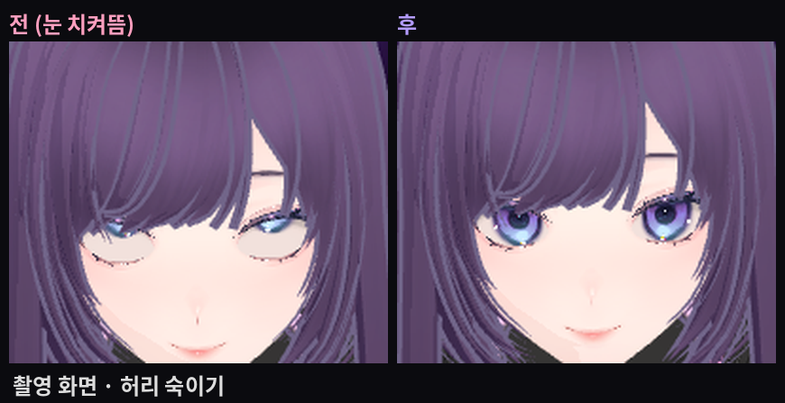
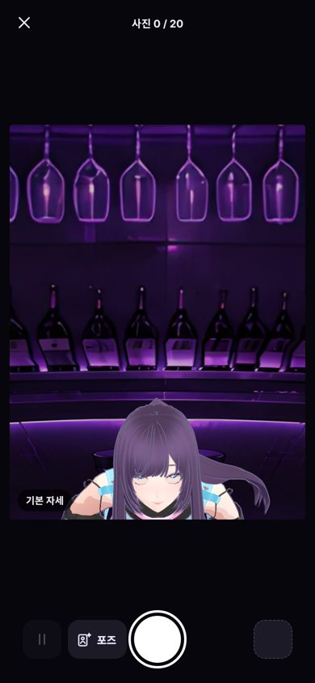
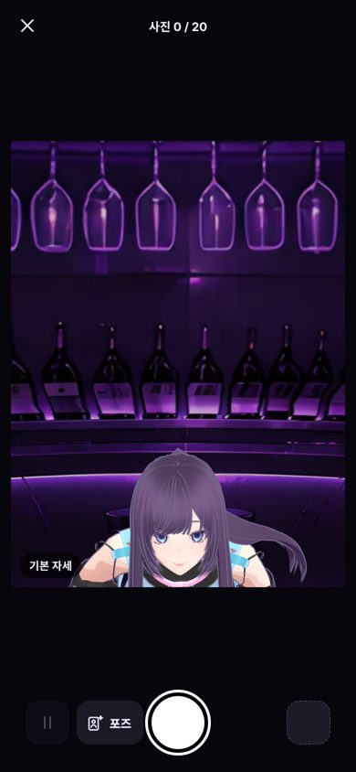

# 92단계 · 눈 치켜뜨는 얼굴 고치기

> 팀원 작업 번호 [80]은 서버 통합 [80]과 겹쳐 **[92]** 로 정리(94 지시문). 브랜치 `step/80-eyes-up` 와 커밋 이력·캡처 경로(`img/80-눈-치켜뜸.png`, `img/80/…`)는 그대로.

## 왜
79단계(고개를 돌리면 눈도 따라가기) 뒤에도 서아가 눈을 치켜뜨는 일이 남아 있었음. 재 보니 시선(카메라 쫓기)이 몸짓 중에 눈을 **위로** 굴리고 있었음:
- 대화 화면: 붙잡기 7.6°, 허리 숙이기 6.6°, 꽃받침 5.9°, 그 밖의 거의 모든 몸짓 3~5°(몸짓 시작에 고개가 숙는 순간 + 시선 흔들림)
- 촬영 화면(카메라가 더 위·가까움): 허리 숙이기 **14.8°** — 흰자가 보일 만큼 치켜뜸
애니 눈은 조금만 위로 가도 눈동자가 윗눈꺼풀에 가려 「치켜뜬」 얼굴이 됨.

## 한 일
- 눈이 위로 굴러가는 최대 각도를 **1°** 로(`data/look.json` `gaze.eyeMaxUpDeg`). 아래·옆으로는 예전 그대로
- 카메라가 위에 있어 올려다봐야 할 때는 눈 대신 고개가 조금 드는 몫(예전부터 있던 headFollow)이 맡음
- 고친 뒤 모든 몸짓에서 눈이 위로 간 최대값 0.8° 이하(대화 화면에서 재 봄)

## 바뀐 파일
- `alive.js`: 시선 위·아래 한계를 따로(위 = eyeMaxUpDeg, 아래 = eyeMaxPitchDeg)
- `data/look.json`: `gaze.eyeMaxUpDeg: 1`, `_alive` 설명
- 버전 꼬리표(`node tools/version.mjs`)

## 캡처 (390×844, 촬영 화면 허리 숙이기)
| 전 | 후 |
| --- | --- |
|  |  |

## 제가 정한 것
- 1°: 0이면 위를 전혀 안 봐서 카메라가 위에 있을 때 시선이 살짝 어긋나 보일 수 있음. 더 줄이거나 늘리려면 `eyeMaxUpDeg`
- XSTAGE(댄스트럭트) 모션 파일에는 몸 뼈 20개만 있고 얼굴(표정) 데이터는 없음 — 앱의 표정은 모두 우리 표정 값(73단계)
- 뼈 회전만 바꿈(시각 효과 없음). 아이폰 사파리 별도 확인 항목 없음

## 92 통합 검수 (94 지시문)

### 최신 main 반영
- 작업 시작 main `1acb9dd` ([91] 병합). 브랜치는 main보다 33커밋 뒤였음.
- `git merge origin/main` → 충돌 2곳: `index.html`·`data/version.json`. 둘 다 **버전 꼬리표(`?v=`, `moti-version`)만** 다름. 지시대로 main 값을 그대로 씀(그 덩어리에 main 이 새로 넣은 `photoask.js` 스크립트 줄도 main 쪽에 있어 그대로 남음).
- 병합 뒤 main 대비 차이 = `alive.js` 4줄 · `data/look.json` 2줄 · 이 보고서·캡처뿐. [79]·[80]·[80-1]·[81]·[82]·[83]·[83-1]·[91] 코드는 main 그대로.

### 핵심 값 (코드 확인)
- `alive.js`: 눈 위아래 목표 = `max(−eyeMaxUpDeg, min(eyeMaxPitchDeg, …))` × [79] `eyeW`. 좌우는 `eyeMaxYawDeg` 그대로.
- `data/look.json` `gaze`: `eyeMaxUpDeg 1`, `eyeMaxPitchDeg 8`(아래), `eyeMaxYawDeg 12`(좌우), `headFollow 0.3`, `eyeReduceDeg [6, 18]`(79) 모두 있음.

### 측정 (브라우저, `Alive.state()` 의 눈 각도를 40ms마다 읽어 최대값)

| 몸짓 | main 위로 | **92 위로** | 92 아래로 | 92 좌우 |
|---|---|---|---|---|
| 기본 자세(5초) | 0 | 0 | 3.4° | 3.0° |
| x09 붙잡기 | 0.1° | 0.1° | 2.7° | 5.6° |
| x02 허리 숙이기 | **6.9°** | **1.0°** | 4.2° | 4.0° |
| m01 웃음 | 0 | 0 | 5.5° | 3.3° |
| m03 놀라기 | 0 | 0 | 7.6° | 2.6° |
| 촬영 화면 p06 꽃받침 | 2.1° | **1.0°** | 0 | 4.4° |
| 촬영 화면 p12 몸 숙여 바라보기 | 2.8° | 0.3° | 1.5° | 1.2° |

→ 위로는 최대 1.0°, 아래(≤8°)·좌우(≤12°) 움직임은 남음.

### 통합 테스트

| # | 항목 | 결과 | 확인 방식 |
|---|---|---|---|
| 1 | 기본 자세 시선 | ✅ 위 0°, 아래·좌우 움직임 있음 | 측정 |
| 2 | 일반 대화 몸짓 치켜뜸 감소 | ✅ 허리 숙이기 6.9° → 1.0° | 측정 |
| 3 | 붙잡기·허리 숙이기·꽃받침 | ✅ 위 표 | 측정 |
| 4 | 촬영 화면 | ✅ 꽃받침 2.1° → 1.0°, 몸 숙여 바라보기 2.8° → 0.3° | 측정 |
| 5 | 위로 목표값 최대 1° | ✅ 측정 최대 1.00° | 측정 + 코드 |
| 6 | 아래·좌우 유지 | ✅ 아래 최대 7.6°, 좌우 최대 5.6° | 측정 |
| 7 | [79] 고개 따라 눈 | ✅ `eyeReduceDeg`·`eyeW` 그대로 | 코드 확인(각도 표의 몸짓별 차이로 간접 확인) |
| 8 | 표정(수줍음·놀람·기쁨) | ✅ 표정 값 그대로(이번 변경은 눈 뼈 회전만) | 코드 확인 |
| 9 | [91] 모션 강조 | ✅ 발동·종료(목록·새 몸짓·처음부터·탭·카메라·밤) | 브라우저 |
| 10 | [83] 사진 촬영 제안·카메라 잠금 | ✅ 3단계 제안 전 잠금, 제안 버튼 → p01 고정 | 브라우저(시연 패널) |
| 11 | [83-1] 직접 포즈 차단 | ✅ p05·m02 막힘, p01 됨 | 브라우저 |
| 12 | JS·JSON·콘솔 | ✅ 오류 없음 | `node --check`·JSON 읽기·브라우저 |
| 13 | `check_gacha` | ✅ 모두 통과 | 스크립트 |
| 14 | `test_away_selfie .` | ✅ 통과 53 · 실패 0 | 스크립트 |

### 테스트 한계
- 예전 보고서의 「촬영 화면 허리 숙이기 14.8°」는 다시 잴 수 없음 — [78]·[83-1] 뒤로 촬영 화면은 촬영 전용 포즈만 재생해서 x02 를 넣을 수 없음. 대신 촬영 포즈(p06·p12)로 잼.
- 눈 각도는 소프트웨어 3D(프레임이 느림)에서 잰 값이라, 실제 폰에서는 한 번에 덜 튀어서 더 작을 수 있음(최대값은 코드 상한 1°를 넘지 않음).
- [91] 되감기 지움은 이번에도 되감기 지점을 만들 수 없어 코드 경로로만 확인(91 보고서와 같음).
