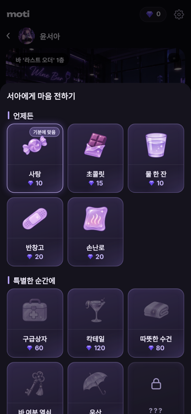
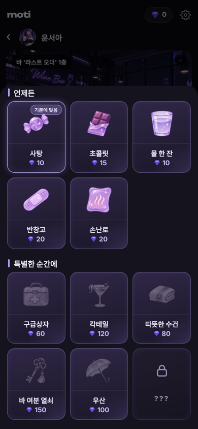
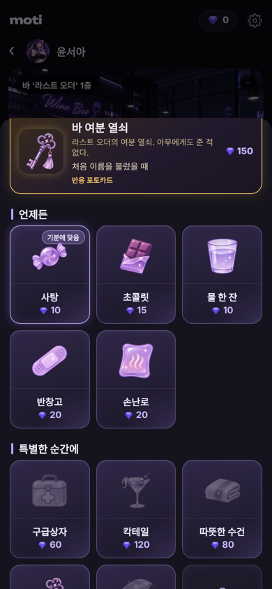
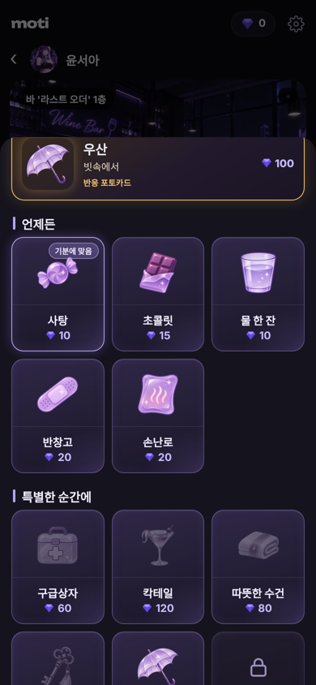
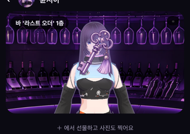

# 93 · 선물 이미지 리소스 전체 교체

브랜치 `step/93-gift-icons` (origin/main `1acb9dd` [91] 위). 커밋 `[93 A]` · `[93 B]` · `[93]` 보고서. 94 지시문으로 병합 승인 → 최신 main 통합 · 버전 꼬리표 · main 병합.

## 바뀐 파일

| 파일 | 한 일 |
|---|---|
| `icons/gift2_candy.png` · `choco` · `water` · `bandage` · `warmer` · `firstaid` · `cocktail` · `towel` | 덮어씀(8개) |
| `icons/gift2_key.png` · `gift2_umbrella.png` · `gift2_ring.png` | 새로(3개) |
| `data/gifts.json` | `flower`·`umbrella`·`ring` 의 `icon` 만, 주석 두 곳 |
| `docs/CREDITS.md` | 새 선물 이미지 11종 출처 한 줄 |

- 11개 모두 받은 그대로 복사(512×512 RGBA, 투명 배경). 크기·색·배경은 손대지 않음.
- ZIP·README 는 저장소에 넣지 않음.
- 예전 `icons/gift2_flower.png`·`icons/gift_ring.png` 는 지우지 않음.

## 이미지 경로 전후 (`data/gifts.json`)

| id | 이름 | 전 | 후 |
|---|---|---|---|
| flower | 바 여분 열쇠 | `icons/gift2_flower.png` (꽃다발 임시) | `icons/gift2_key.png` |
| umbrella | 우산 | 없음 → 이모지 ☂️ | `icons/gift2_umbrella.png` |
| ring | 반지 | `icons/gift_ring.png` | `icons/gift2_ring.png` |
| 나머지 8개 | — | 경로 그대로(파일만 바뀜) | 그대로 |

`flower` 의 `_icon` 주석에서 「꽃다발 그림 임시」를 지우고 새 열쇠 그림이라고 적음. 맨 위 `_설명` 의 「우산·반지는 새 그림이 아직 없어 예전 그대로」도 고침.

## 기존 선물 로직

**바뀐 것 없음.**
- `id`·이름·가격·관계 단계·`when`·`e`(이모지)·반응 몸짓(`x26`~`x31`)이 모두 그대로예요.
- `index.html`·JS·`data/collection.json`·`data/pack.json` 도 손대지 않았어요.
- 반지는 반응 몸짓 `x31` 이 아직 없어 예전처럼 잠긴 칸(???)이에요. 몸짓이 생기면 그때 새 그림으로 보여요.

## 화면 (390px)

| 일반 선물 | 순간 선물 | 바 여분 열쇠 강조 | 우산 강조 | 건넬 때 그림 |
|---|---|---|---|---|
|  |  |  |  |  |

강조 영역은 시연용으로 순간 선물을 직접 열어 찍었어요(`Moment.start`). 건넬 때 그림은 떠오르는 애니메이션 가운데 자리에서 멈춰 찍었어요.

## 테스트 결과 (가짜 서버, 서버 호출 없음)

| # | 항목 | 결과 |
|---|---|---|
| 1 | 일반 선물 5종 | ✅ 새 그림, 모두 읽힘 |
| 2 | 순간 선물 6종 연결 | ✅ 구급상자·칵테일·따뜻한 수건·바 여분 열쇠·우산 새 그림. 반지는 잠긴 칸(경로만 연결) |
| 3 | 바 여분 열쇠에 꽃다발 안 나옴 | ✅ 열쇠 그림 |
| 4 | 우산 이모지 대신 그림 | ✅ 선물 창에 이모지 칸이 하나도 없음 |
| 5 | 반지 경로·잠금 | ✅ `icons/gift2_ring.png` 있음, 칸은 예전처럼 잠김(`x31` 없음) |
| 6 | 선물 창 크기·여백 | ✅ 10칸 모두 같은 크기(82×62) |
| 7 | 순간 선물 강조 영역 | ✅ 열쇠·우산 그림 정상(64×64) |
| 8 | 건넬 때 그림 | ✅ 새 그림으로 떠오름 |
| 9 | 잘림·검은 배경·흰 배경·깨진 그림 | ✅ 없음(가장자리 투명, 404 없음) |
| 10 | 390px 가로 넘침 | ✅ 없음(390/390) |
| 11 | 가격·단계·반응·카드 ID·획득 조건 | ✅ 그대로 |
| 12 | 저장값·선물 기록 | ✅ 그대로 |
| 13 | `node tools/check_gacha.mjs` | ✅ 모두 통과 |
| 14 | JS·JSON 문법, 콘솔 | ✅ 오류 없음 |

## 다른 작업과 겹칠 수 있는 파일

- `data/gifts.json` — 세 선물의 `icon` 줄과 주석 두 곳. [86] 반지 작업이 `ring` 항목을 고치면 같은 블록이에요(`icon` 한 줄).
- `docs/CREDITS.md` — 한 줄 추가.
- `icons/gift2_*.png` — 그림만.

## 제가 정한 것

- **ZIP 대신 낱장:** ZIP 대신 PNG 11장을 낱장으로 받아서, 이름을 보고 각 칸에 맞춰 넣었어요. 순서는 사탕, 초콜릿, 물 한 잔, 반창고, 손난로, 구급상자, 칵테일, 따뜻한 수건, 열쇠, 우산, 반지예요. 11장 모두 512×512에 투명 배경인지 확인했어요.
- **선물 창 그림 크기:** 예전 그림 크기(82×62 칸)에 맞춘 CSS를 그대로 썼어요. 새 그림이 정사각형이라 칸 안에서 위아래 여백이 조금 남지만, 레이아웃은 바꾸지 않았어요.
- **그림 무게:** 그림 한 장이 136~200KB예요(예전 그림은 몇 KB였어요). 선물 창을 처음 열 때 한 번 받아요. 받은 그대로 넣으라는 지시라 줄이지 않았어요. 가볍게 하려면 나중에 크기를 줄인 사본을 따로 만들 수 있어요.

## 아이폰에서 나중에 볼 것

- 큰 PNG(512px) 11장을 처음 받을 때 선물 창이 늦게 그려지는지.
- 반투명 보라 그림이 어두운 카드 위에서 너무 흐려 보이지 않는지(특히 잠긴 순간 선물 칸의 흐린 그림).
- 건넬 때 그림(150px)의 빛 그림자(drop-shadow)가 사파리에서 깨지지 않는지.

## 최신 main 통합 (94 지시문)

- 받은 main: `a36bf6f` ([92] 눈 치켜뜸 개선 병합).
- `git merge origin/main` → **충돌 없음**. 병합 뒤 main 대비 차이는 [93] 파일만(그림 11개 · `data/gifts.json` · `docs/CREDITS.md` · 이 보고서·캡처).
- 그림 11개를 받은 원본과 다시 비교: **SHA-256 모두 같음**(손대지 않음). 11개 합계 1.9MB.
- `data/gifts.json`: `flower → icons/gift2_key.png`, `umbrella → icons/gift2_umbrella.png`, `ring → icons/gift2_ring.png`, id `flower` 그대로. CREDITS 출처 줄 그대로.

### 통합 테스트

| # | 항목 | 결과 | 확인 방식 |
|---|---|---|---|
| 기존 1~14 | [93] 테스트 | ✅ 다시 통과 | 브라우저·스크립트 |
| 1 | 일반 선물 5종 | ✅ | 브라우저 |
| 2 | 순간 선물 그림·잠금 | ✅ 반지 잠금(???) 그대로 | 브라우저 |
| 3 | 열쇠·우산 강조 영역 | ✅ | 브라우저 |
| 4 | 건넬 때 그림 | ✅ | 브라우저 |
| 5 | 저장값·선물 기록 | ✅ | 브라우저 |
| 6 | 브라우저 캐시 | ⚠️ 아래 「캐시」 | 코드 확인 · 직접 확인 못 함 |
| 7 | 390px 잘림·넘침·깨짐 | ✅ | 브라우저 |
| 8 | [92] 눈 | ✅ 위로 최대 1.0°, 아래 최대 7.0° | 측정 |
| 9 | [91] 모션 강조 | ✅ | 브라우저 |
| 10 | [83]·[83-1] | ✅ | 브라우저 |
| 11 | 크리스마스 선물 제한 | ✅ main 과 같은 목록(일반 5종 + 구급상자, 나머지 잠금) | 브라우저(main·브랜치 비교) |
| 12 | 카드팩·부재중 셀카 | ✅ `check_gacha` 통과 · `test_away_selfie` 53/53 | 스크립트 |
| 13 | JS·JSON·콘솔 | ✅ | `node --check`·브라우저 |

### 캐시
- 선물 그림 주소에는 버전 꼬리표(`?v=`)가 붙지 않아요. 앱 js·css·data 에만 붙어요(`tools/version.mjs`). 그래서 같은 이름으로 덮어쓴 8개는, 예전 그림을 최근에 받아 둔 브라우저에서 잠깐 예전 그림이 보일 수 있어요.
- GitHub Pages 는 보통 짧은 캐시 시간(약 10분)과 ETag 로 보내서, 그 시간이 지나면 새 그림을 받아요. 이 작업 환경에서는 배포 사이트에 접속이 막혀 실제 응답 머리글은 확인하지 못했어요.
- 새로 연 브라우저(캐시 없음)에서는 새 그림이 나오는 걸 확인했어요. 바로 바뀌게 하려면 그림 경로에도 꼬리표를 붙여야 하는데, 이번 범위(코드 변경 없음)를 넘어서 하지 않았어요.

### 로딩
- 소프트웨어 3D 환경이라 로딩 속도는 재지 않았어요. 1.9MB 압축은 지시대로 하지 않았어요.
